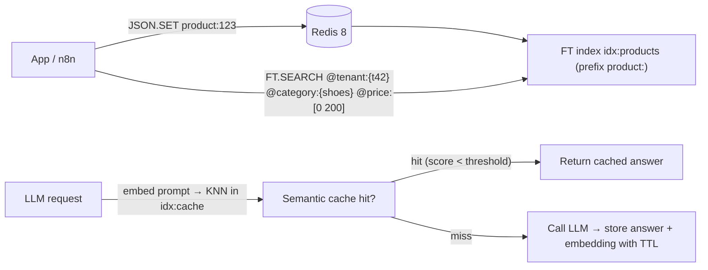

# Redis - Search, JSON & Vector Sets in Redis 8

> [!info] Deep dive of [[Redis]]

> [!abstract] TL;DR
> Since **Redis 8**, the former Redis Stack modules ship in Redis Open Source:
> - the **Query Engine** (`FT.*`: full-text, numeric, tag, geo and **vector** indexes over Hashes/JSON);
> - **JSON** (`JSON.*`);
> - time series and probabilistic structures.
>
> Redis 8 also adds **vector sets** (`VADD`/`VSIM`), a native data type for similarity search.
> **Good fits**: low-latency **semantic caching** for LLM responses, session/product lookups with filters, real-time leaderboards + search, and small-to-medium vector sets that must live in memory.
> **Poor fits**: primary document store (RAM cost, persistence trade-offs), large RAG corpora (pgvector/Qdrant are cheaper per GB), complex relational queries.
> **Licensing/fork**: Redis 8 is RSALv2/SSPL/AGPLv3. **Valkey** offers search/JSON via separate modules with different compatibility, so check before switching.

## Concept
| Feature | Commands | Use for |
|---|---|---|
| JSON documents | `JSON.SET`, `JSON.GET`, `JSON.NUMINCRBY` | Nested objects with partial updates |
| Query Engine index | `FT.CREATE … ON HASH/JSON SCHEMA …` | Search/filter/sort over keys by prefix |
| Full-text | `TEXT` fields, stemming, phonetic | Product/FAQ search (simple) |
| Tags/numeric/geo | `TAG`, `NUMERIC`, `GEO` | Filters (tenant, category, price, distance) |
| Vector fields | `VECTOR HNSW/FLAT` in `FT.CREATE`, KNN queries | Semantic search with filters |
| Vector sets | `VADD`, `VSIM`, `VREM` | Simple native similarity sets |
| Aggregations | `FT.AGGREGATE` | Facets, group-by counts |

**Where it sits vs alternatives**:

| Need | Redis 8 | pgvector / Postgres FTS | Qdrant |
|---|---|---|---|
| Latency | Sub-ms in memory | ms | ms |
| Cost per GB | High (RAM) | Low (disk) | Medium (quantization) |
| Source of truth | No (cache/derived) | Yes | No (derived) |
| Best use | Semantic cache, hot search | Default RAG + app search | Large filtered vector search |

## How It Works


## Practical Usage
**JSON documents + index**:
```bash
redis-cli JSON.SET product:123 '$' '{"tenant":"t42","name":"Kasut Sukan Lari","category":"shoes","price":189.0,"tags":["running","men"]}'
redis-cli FT.CREATE idx:products ON JSON PREFIX 1 product: SCHEMA \
  '$.tenant' AS tenant TAG '$.name' AS name TEXT '$.category' AS category TAG \
  '$.price' AS price NUMERIC SORTABLE '$.tags[*]' AS tags TAG
redis-cli FT.SEARCH idx:products '@tenant:{t42} @category:{shoes} @price:[0 200] lari' \
  SORTBY price ASC LIMIT 0 20 RETURN 3 name price category
```
**Semantic cache for LLM answers** (vector field + TTL):
```bash
redis-cli FT.CREATE idx:llmcache ON HASH PREFIX 1 llmcache: SCHEMA \
  tenant TAG prompt_hash TAG embedding VECTOR HNSW 6 TYPE FLOAT32 DIM 1024 DISTANCE_METRIC COSINE
```
```ts
// lookup (node-redis): KNN 1 within tenant, accept if distance < 0.08
const res = await redis.ft.search("idx:llmcache",
  `(@tenant:{${tenant}})=>[KNN 1 @embedding $vec AS dist]`,
  { PARAMS: { vec: Buffer.from(new Float32Array(embedding).buffer) }, DIALECT: 2, RETURN: ["answer", "dist"] });
const hit = res.documents[0];
if (hit && Number(hit.value.dist) < 0.08) return hit.value.answer;
// on miss: call LLM, then
await redis.hSet(`llmcache:${id}`, { tenant, answer, embedding: Buffer.from(new Float32Array(embedding).buffer) });
await redis.expire(`llmcache:${id}`, 60 * 60 * 24);
```
**Vector sets** (native type, simpler API):
```bash
redis-cli VADD faq:t42 VALUES 3 0.12 0.88 0.31 "faq:opening-hours"
redis-cli VSIM faq:t42 VALUES 3 0.10 0.90 0.30 COUNT 3 WITHSCORES
```
**Wrong way**:
```text
❌ Redis as the only store of product data            → restart/eviction = data loss; keep Postgres as truth
❌ Semantic cache without tenant filter               → one client's answer served to another
❌ Indexing a cache Redis with allkeys-lru eviction    → silent index gaps as keys evict
❌ 1M × 1536-dim float32 vectors in a 4 GB VPS Redis   → ~6 GB+ RAM needed; OOM
```

## Patterns & Anti-patterns
| Pattern | When | Anti-pattern to avoid |
|---|---|---|
| Postgres = truth, Redis = derived search/cache | Always | Redis-only data |
| Semantic cache scoped by tenant + TTL + threshold | LLM FAQ bots | Global cache, no expiry |
| Separate Redis for cache/search vs queues | BullMQ + search | One instance with conflicting eviction needs |
| Index only needed fields | Memory budget | Indexing whole documents |
| Rebuild index from Postgres via job | Recovery | No rebuild path |
| Measure RAM per 100k docs before scaling | Planning | Guessing memory |

## Performance & Trade-offs
- **Memory**: vectors cost `dim × 4 bytes` (FLOAT32) plus HNSW graph overhead. Use FLOAT16/quantized types where supported, or keep large corpora in pgvector/Qdrant ([[Vector Databases - pgvector Tuning & Hybrid Search]]).
- **Query Engine** adds CPU and memory for indexes. Writes update indexes synchronously, which matters for high write rates.
- **Semantic caching** can cut LLM costs for repetitive FAQs significantly, but thresholds that are too loose return wrong answers. Evaluate on real queries and include prompt version in the key ([[AI Evals & Observability - Cost Tracking & Budgets per Tenant]]).
- **Persistence**: AOF/RDB protect data, but restart reloads everything into RAM (slow for large datasets) ([[Redis - Memory Management & Eviction Tuning]]).

## Tips & Reminders
> [!tip] In ZP's stack
> - **Default stays Postgres** (FTS + pgvector) for SME search and RAG. Use Redis 8 search for **semantic caching** of WhatsApp FAQ answers and hot product filters when latency matters.
> - **Separate instances**: n8n queue mode/BullMQ Redis (`noeviction`) must not share with cache/search Redis using eviction ([[Redis - Caching Patterns & Invalidation]]).
> - **Valkey users**: search/JSON come from separate Valkey modules with differing feature sets. Check before relying on `FT.*` syntax ([[Valkey]]).

- Prefix keys per tenant, and include tenant TAG in every query.
- Use `DIALECT 2` for vector queries with parameters.
- Monitor index memory with `FT.INFO`.
- Version cached answers by prompt/model so prompt changes invalidate stale responses.

## Version Notes
| Version | Change relevant here |
|---|---|
| Redis Stack 6.2–7.4 | RediSearch/RedisJSON as separate modules (Stack distribution) |
| Redis 8.0 (2025) | Query Engine, JSON, TS, probabilistic built in. Vector sets introduced. AGPLv3 added as license option |
| 8.2–8.10 (2025–26) | Performance and vector improvements. 8.10.2 current stable |
| 8.12-RC1 (2026-10) | Next release in RC. Not for production ([[Redis]]) |

> [!warning] Unverified — check before relying on this
> Vector set command options (quantization flags, `VSIM` syntax details), supported vector types (FLOAT16/BFLOAT16) and Valkey module compatibility weren't verified this run. Check https://redis.io/docs/latest/develop/ for your exact version.

## Critical Issues & Gotchas
> [!danger] Cross-tenant leakage through shared indexes
> A single index across tenants without a mandatory tenant filter, or a semantic cache keyed only on prompt similarity, returns one client's products, prices or answers to another client's customers. Enforce tenant TAG filters in a data-access layer, never in ad-hoc queries, and test with two tenants.

> [!danger] RAM exhaustion takes down queues and caches together
> Vector indexes grow quickly. If search shares an instance with BullMQ/n8n queues, an OOM or eviction event corrupts job processing too. Isolate workloads per instance, set `maxmemory`, and alert on memory usage ([[Redis - Observability, Slow Log & Latency Troubleshooting]]).

- **Index definition changes** require dropping and recreating indexes (`FT.DROPINDEX`). Plan rebuild time.
- **Full-text for Malay/Chinese**: stemming support differs. Chinese needs specific tokenization (`LANGUAGE chinese`), and results vary.
- **Licensing**: offering Redis as a managed service to third parties triggers RSAL/SSPL/AGPL considerations.
- **Persistence of vectors**: large RDB snapshots and fork costs grow with index size.

## Related
- [[Redis]]
- [[Redis - Data Structures & Patterns]] — core types and modelling
- [[Redis - Caching Patterns & Invalidation]] — cache design
- [[Vector Databases - pgvector Tuning & Hybrid Search]] — default vector store
- [[Vector Databases - Qdrant & Dedicated Vector DB Operations]] — dedicated engine
- [[Valkey]] — fork compatibility

## References
- https://redis.io/docs/latest/develop/interact/search-and-query/
- https://redis.io/docs/latest/develop/data-types/json/
- https://redis.io/docs/latest/develop/data-types/vector-sets/
- https://redis.io/docs/latest/develop/interact/search-and-query/advanced-concepts/vectors/
- https://redis.io/blog/redis-8-ga/
