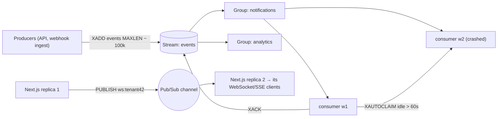

# Redis - Streams & Pub-Sub in Practice

> [!info] Deep dive of [[Redis]]

> [!abstract] TL;DR
> - **Pub/Sub** is fire-and-forget fan-out to *currently connected* subscribers: perfect for cross-instance WebSocket/SSE broadcasts and cache invalidation, useless for anything that must not be lost.
> - **Streams** are an append-only log with **consumer groups**, acknowledgements (`XACK`), a pending list and reclaiming (`XAUTOCLAIM`). That gives at-least-once delivery, short-term replay and per-consumer progress: a "mini Kafka" inside the Redis you already run.
> - Cap streams (`MAXLEN ~` / `MINID`), make consumers idempotent, and enable persistence if losing entries matters.
> - For job queues with retries/delays, use **BullMQ** instead of hand-rolling on Streams.

## Concept
| Feature | Pub/Sub | Streams |
|---|---|---|
| Delivery | At-most-once, to subscribers connected *now* | At-least-once with consumer groups |
| Persistence | None | In memory + RDB/AOF |
| Replay | No | Yes, by ID range |
| Consumer progress | — | Per group (`last-delivered-id`) + per consumer pending list |
| Fan-out | Every subscriber gets every message | Each group gets every entry. Within a group, entries are split among consumers |
| Backpressure | Slow subscribers get disconnected (output buffer limits) | Entries wait in the stream/PEL |
| Typical use | WebSocket fan-out, invalidation signals | Event log, inter-service events, activity feeds |

**Stream commands you'll use**:

| Command | Purpose |
|---|---|
| `XADD key MAXLEN ~ 100000 * field value …` | Append, approximately capped |
| `XGROUP CREATE key group $ MKSTREAM` | Create a consumer group (from new entries) |
| `XREADGROUP GROUP g c COUNT 50 BLOCK 5000 STREAMS key >` | Read new entries for consumer `c` |
| `XACK key g id …` | Mark processed (removes from the PEL) |
| `XAUTOCLAIM key g c 60000 0-0 COUNT 50` | Take over entries idle > 60 s from dead consumers |
| `XPENDING key g` / `XINFO GROUPS key` | Lag and stuck-entry monitoring |
| `XTRIM key MINID ~ <id>` | Time-based retention (IDs are ms timestamps) |

## How It Works


## Practical Usage
**Producer** (cap length; IDs are server-generated timestamps):
```ts
await redis.xadd('events', 'MAXLEN', '~', '100000', '*',
  'type', 'order.paid', 'tenant', tenantId, 'id', eventId, 'payload', JSON.stringify(payload));
```
**Consumer group worker with reclaim and idempotency**:
```ts
const STREAM = 'events', GROUP = 'notifications', ME = `w-${process.pid}`;
await redis.xgroup('CREATE', STREAM, GROUP, '$', 'MKSTREAM').catch(() => {});   // BUSYGROUP if exists

async function handle(id: string, f: Record<string, string>) {
  const fresh = await redis.set(`done:${GROUP}:${f.id}`, '1', 'EX', 86_400, 'NX');  // idempotency on event id
  if (fresh) await sendNotification(f);                                            // side effect once
  await redis.xack(STREAM, GROUP, id);
}

for (;;) {
  // 1) take over stuck entries from crashed consumers
  const [, claimed] = (await redis.xautoclaim(STREAM, GROUP, ME, 60_000, '0-0', 'COUNT', 20)) as [string, [string, string[]][]];
  // 2) read new entries
  const res = (await redis.xreadgroup('GROUP', GROUP, ME, 'COUNT', 50, 'BLOCK', 5000, 'STREAMS', STREAM, '>')) as
    [string, [string, string[]][]][] | null;
  const entries = [...claimed, ...(res?.[0]?.[1] ?? [])];
  for (const [id, kv] of entries) {
    const f = Object.fromEntries(Array.from({ length: kv.length / 2 }, (_, i) => [kv[2 * i], kv[2 * i + 1]]));
    try { await handle(id, f); } catch (e) { logger.error({ id, e }, 'stream handler failed'); }   // stays pending → retried
  }
}
```
**Dead-letter after N deliveries**:
```ts
const pending = await redis.xpending(STREAM, GROUP, '-', '+', 50) as [string, string, number, number][];
for (const [id, , , deliveries] of pending) if (deliveries > 5) {
  await redis.xadd('events:dlq', '*', 'origin', id);
  await redis.xack(STREAM, GROUP, id);
}
```
**Pub/Sub fan-out across app replicas** (WebSocket/SSE):
```ts
const sub = redis.duplicate();                       // subscriber connections can't run other commands
await sub.subscribe(`ws:tenant:${tenantId}`);
sub.on('message', (_ch, msg) => broadcastToLocalSockets(tenantId, msg));
await redis.publish(`ws:tenant:${tenantId}`, JSON.stringify({ type: 'order.updated', id }));
```
**Wrong way**:
```text
❌ Pub/Sub for "order paid → send receipt"         → subscriber restarting = receipt never sent
❌ XADD without MAXLEN/MINID                         → stream grows until Redis hits maxmemory
❌ XREADGROUP with no XACK / no XAUTOCLAIM           → PEL grows forever; crashed consumers' entries never processed
❌ One consumer group per replica for work queues    → every replica processes every entry (duplicates)
```

## Patterns & Anti-patterns
| Pattern | When | Anti-pattern to avoid |
|---|---|---|
| Pub/Sub for ephemeral fan-out, with a DB as the source of truth | Realtime UI updates | Pub/Sub as a delivery guarantee |
| One consumer group per *purpose*, N consumers per group | Event processing | One group per instance |
| `MAXLEN ~` or `MINID ~` retention | Every stream | Unbounded streams |
| `XAUTOCLAIM` loop + delivery-count DLQ | Workers that can crash | Ignoring the pending list |
| Idempotent handlers keyed by event ID | At-least-once | Assuming exactly-once |
| Outbox in Postgres → relay to the stream | Events tied to DB changes | XADD after commit from request handlers (dual write) |
| BullMQ for jobs (retries, delays, priorities) | Background jobs | Re-implementing a job queue on Streams |

## Performance & Trade-offs
- **Throughput**: `XADD`/`XREADGROUP` handle tens of thousands of entries/s on one Redis, far beyond SME needs.
- **Memory**: streams are compact (radix tree + listpacks), but 1M entries × 300 bytes ≈ 300+ MB. Size retention to your Redis memory, and keep payloads small (store IDs, not documents).
- **Durability**: with `appendfsync everysec`, up to ~1 s of acknowledged writes can be lost on crash. Async replication can lose more on failover. Fine for notifications, not for financial records ([[Redis - Persistence & High Availability]]).
- **Pub/Sub at scale**: every published message goes to every subscriber of the channel. Use per-tenant channels, and sharded pub/sub (`SPUBLISH`/`SSUBSCRIBE`) in Redis Cluster.
- **Streams vs Kafka**: Streams fit when the retention and throughput fit in RAM. Kafka is for long retention, big fan-out and multi-team replays ([[Kafka - KRaft, Redpanda & Small-Infra Trade-offs]]).

## Tips & Reminders
> [!tip] In ZP's stack
> - **Realtime dashboards across Next.js replicas**: Postgres/Supabase as truth, Redis Pub/Sub per tenant channel to fan updates out to each replica's SSE/WebSocket connections ([[WebSocket - Scaling & Reliability]]).
> - **Event streams between your services**: Postgres outbox → relay → Redis Stream → consumer groups (notifications, analytics), with handlers deduped by event ID ([[System Design - Event-Driven Architecture & Outbox Pattern]]).
> - **Jobs and WhatsApp sends**: BullMQ (built on Redis) with rate limiters, not raw streams ([[Message Queues - BullMQ in Production]]).

- Use a separate Redis (or logical DB) from caches with `allkeys-lru`. Eviction can delete streams and in-flight work.
- Monitor `XINFO GROUPS` lag and PEL size, and alert on growth.
- Keep subscriber connections dedicated (a connection in subscribe mode can't run other commands), and reconnect with resubscribe logic.
- Valkey supports the same Streams/Pub-Sub commands, so migration doesn't change this code ([[Valkey]]).

## Version Notes
| Version | Change relevant here |
|---|---|
| 2.0 | Pub/Sub |
| 5.0 (2018) | Streams, consumer groups |
| 6.2 | `XAUTOCLAIM`, `XADD … MINID`, `XTRIM MINID`, `NOMKSTREAM` |
| 7.0 | Sharded Pub/Sub (`SPUBLISH`/`SSUBSCRIBE`). Stream consumer `entries-read`/lag in `XINFO` |
| 8.x | Further stream command additions in recent minors. Valkey 8–9 keep compatibility for core commands |

> [!warning] Unverified — check before relying on this
> Stream commands added in Redis 8.x minors (e.g. combined ack/delete variants) weren't verified. Check https://redis.io/docs/latest/develop/data-types/streams/ for your version before using new commands.

## Critical Issues & Gotchas
> [!danger] Silent message loss with Pub/Sub
> A subscriber that is restarting, slow (output buffer limit exceeded, so disconnected) or partitioned simply misses messages, with no error to the publisher. If a message matters (payments, orders, notifications), use Streams, BullMQ or a database outbox, and treat Pub/Sub only as a hint to refetch.

> [!danger] Unbounded pending lists and streams fill memory
> Consumers that never `XACK` (bugs, crashes) grow the PEL, and streams without trimming grow forever. When Redis hits `maxmemory` with `noeviction`, writes fail, which can take down queues and sessions sharing that instance. Trim, reclaim, dead-letter, and alert on memory.

- **Consumer naming**: random consumer names per restart leave abandoned consumers with pending entries. Use stable names, or `XGROUP DELCONSUMER` after reclaiming.
- **`$` vs `0` on group creation**: `$` skips existing entries, and `0` processes the whole stream history. Choose deliberately.
- **Ordering**: within a group, parallel consumers process out of order. Partition by key (one stream per tenant/aggregate) if order matters.
- **Keyspace notifications** (`notify-keyspace-events`) are Pub/Sub too, and also lossy. Don't build critical expiry handling on them.

## Related
- [[Redis]]
- [[Redis - Data Structures & Patterns]] — lists, sorted sets and other primitives
- [[Redis - Persistence & High Availability]] — durability of stream data
- [[Message Queues - BullMQ in Production]] — job queues on Redis
- [[WebSocket - Scaling & Reliability]] — Pub/Sub fan-out across instances
- [[Kafka - KRaft, Redpanda & Small-Infra Trade-offs]] — when a real log is warranted

## References
- https://redis.io/docs/latest/develop/data-types/streams/
- https://redis.io/docs/latest/develop/interact/pubsub/
- https://redis.io/docs/latest/commands/xautoclaim/
- https://redis.io/docs/latest/commands/xreadgroup/
- https://valkey.io/topics/streams-intro/
