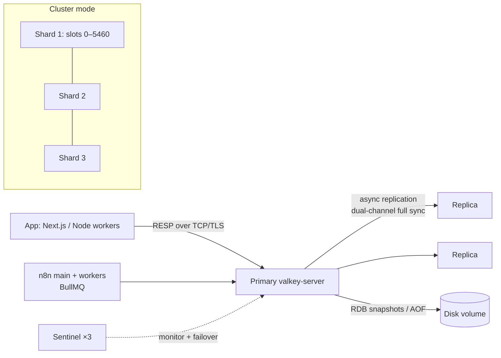

# Valkey

> [!abstract] TL;DR
> Valkey is the **BSD-3-licensed, Linux Foundation fork of Redis 7.2.4**, created in March 2024 after Redis left open source. It speaks the same RESP protocol, so most Redis clients, BullMQ and n8n queue mode work unchanged.
> - **Divergence**: it now evolves on its own: multithreaded I/O, a new hashtable, atomic slot migration, hash-field TTLs (9.0) and a new I/O threading model (9.1).
> - **Pick it** when you want a permissive license, vendor-neutral governance, or cheaper managed pricing (AWS/Google).
> - **Pick [[Redis]] 8** when you need its built-in Query Engine, JSON or vector sets.

## Introduction
- **What**: an in-memory key-value data structure server (strings, hashes, lists, sets, sorted sets, streams, bitmaps, HyperLogLog, geo) with persistence (RDB/AOF), replication, Sentinel and Cluster. Binaries: `valkey-server`, `valkey-cli` (with `redis-*` compatibility symlinks in most packages).
- **Origin**:
  - Redis Ltd. moved Redis to RSALv2/SSPLv1 on 2024-03-20.
  - Former core contributors forked 7.2.4 as **Valkey** under the **Linux Foundation** (2024-03-28), backed by AWS, Google Cloud, Oracle, Ericsson, Snap and others.
  - Redis later added **AGPLv3** as an option with Redis 8 (2025), but Valkey remains BSD-3.
- **Where it sits**: the same slot as Redis in a full-stack app. It serves as the cache, session store, rate limiter, queue backend (BullMQ, n8n queue mode, Sidekiq, Celery) and pub/sub, alongside [[PostgreSQL]].

## Core Concepts

### Compatibility with Redis
| Area | Status |
|---|---|
| Protocol (RESP2/RESP3) | Same. Existing clients (ioredis, node-redis, redis-py, Jedis, go-redis) connect unchanged |
| Commands up to Redis 7.2 | Compatible. Data files (RDB) from Redis ≤ 7.2 load in Valkey |
| Redis 7.4+/8.x features | **Not guaranteed**: Redis-only commands (e.g. Redis 8 vector sets, built-in JSON/Query Engine) aren't in core Valkey |
| Valkey-only features | Hash field TTL (9.0), atomic slot migration, `HGETDEL`, `MSETEX` (9.1), `COMMANDLOG`, numbered DBs in cluster mode |
| Modules | `valkey-json`, `valkey-bloom`, `valkey-search` (vector + full-text), shipped together in the `valkey-bundle` image |
| Config | `valkey.conf`. Most Redis directives keep their names |

### Data structures and patterns
Same as [[Redis - Data Structures & Patterns]]:
- **Cache-aside**: `SET key val EX ttl` + `GET`.
- **Rate limits**: `INCR` + `EXPIRE`, or Lua/functions.
- **Leaderboards**: sorted sets.
- **Streams**: `XADD` / `XREADGROUP` with consumer groups.
- **Locks**: `SET NX PX`, plus fencing tokens for correctness.

### Hash field expiration (9.0+)
```bash
HSET session:42 cart '{"items":3}' csrf abc123 otp 918273
HEXPIRE session:42 300 FIELDS 1 otp        # only the OTP field expires in 5 min
HTTL session:42 FIELDS 1 otp
```
- This replaces the "one key per expiring attribute" workaround, which means fewer keys and less memory.

### Threading model
- **Command execution** stays effectively single-threaded per shard: atomicity, Lua and `MULTI` semantics are unchanged.
- **Network I/O, parsing and reply writing** are offloaded to I/O threads (`io-threads N`). Valkey 8 redesigned this for async I/O, and 9.1 introduced a new I/O threading model. The result is much higher throughput per node on multi-core VMs, without application changes.

## Architecture / How It Works

- **Persistence**: RDB snapshots (fork + copy-on-write) and/or AOF (`appendfsync everysec`), the same as Redis ([[Redis - Persistence & High Availability]]).
- **Replication**: async primary → replicas. **Dual-channel replication** (8.0) streams the RDB and the replication buffer in parallel, which cuts full-sync memory spikes on the primary.
- **Cluster**: 16,384 hash slots. **Atomic slot migration** (9.0) moves whole slots in one operation instead of key-by-key `MIGRATE` with `ASK` redirects. Numbered databases also work in cluster mode (9.0).
- **Memory**: a new hashtable implementation (8.1) and per-key overhead reductions (9.1) lower RAM per key compared with Redis 7.2 on the same dataset.

## Project Structure
```text
infra/valkey/
├── docker-compose.yml     # valkey/valkey:9.1 (pin minor) + volume
├── valkey.conf            # maxmemory, policy, AOF, ACL file path, io-threads
└── users.acl              # ACL users: app, worker, n8n, monitor
```
```yaml
# docker-compose.yml (Coolify custom service)
services:
  valkey:
    image: valkey/valkey:9.1-alpine
    command: ["valkey-server", "/etc/valkey/valkey.conf"]
    volumes:
      - ./valkey.conf:/etc/valkey/valkey.conf:ro
      - ./users.acl:/etc/valkey/users.acl:ro
      - valkey-data:/data
    healthcheck: { test: ["CMD", "valkey-cli", "--user", "monitor", "--pass", "${MONITOR_PASS}", "ping"], interval: 10s }
    restart: unless-stopped
    # no "ports:" — reachable only on the internal Docker network
volumes: { valkey-data: {} }
```
```conf
# valkey.conf (queue + cache instance on a 4 GB VPS)
bind 0.0.0.0
protected-mode yes
aclfile /etc/valkey/users.acl
maxmemory 1gb
maxmemory-policy noeviction        # queues: never evict. Use allkeys-lru on a SEPARATE cache-only instance
appendonly yes
appendfsync everysec
io-threads 2
```

## Use Cases
| Use case | Why it fits |
|---|---|
| BullMQ / n8n queue-mode backend | RESP-compatible, permissive license, same durability knobs ([[Message Queues - BullMQ in Production]], [[n8n - Queue Mode & Scaling]]) |
| Cache + session store for Next.js/Supabase apps | Sub-ms reads, TTLs, hash-field expiry for session attributes |
| Rate limiting WhatsApp/LLM API usage per tenant | Atomic `INCR`/Lua, per-key TTL |
| Managed cache on AWS/GCP | ElastiCache/MemoryDB for Valkey and Memorystore for Valkey are priced below their Redis-engine equivalents |
| SaaS you redistribute or host for clients | BSD-3 avoids AGPL/SSPL obligations when embedding or offering it as a service |
| Vector/semantic cache (with `valkey-search`) | In-memory KNN for LLM response caching. For large-scale vectors prefer [[Vector Databases]] |

## Pros & Cons
| Pros | Cons |
|---|---|
| BSD-3, Linux Foundation governance (no single-vendor relicensing risk) | Feature divergence from Redis 8 grows each release. Some Redis-only commands are missing |
| Drop-in for Redis ≤ 7.2 clients, tools, RDB files | Built-in JSON/search/time series need modules (`valkey-bundle`), less mature than Redis Stack equivalents |
| Strong multithreaded I/O, memory-efficiency work, atomic slot migration | Smaller commercial support ecosystem than Redis Ltd. (Percona, Aiven, cloud vendors fill the gap) |
| Cheaper managed offerings on AWS/GCP | Some SaaS tools/docs still say "Redis only", so you test compatibility yourself |
| Backed by major clouds, fast release cadence | Two ecosystems to track: client libraries may add Redis-8-only helpers |

## Alternatives & Peers
| Alternative | Strength vs Valkey | Weakness vs Valkey | Pick it when… |
|---|---|---|---|
| [[Redis]] 8.x | Built-in Query Engine, JSON, time series, probabilistic structures, vector sets. Redis Ltd. support | RSALv2/SSPL/AGPLv3 tri-license, vendor-controlled roadmap | You need Redis 8 features or Redis Cloud/Enterprise (Active-Active) |
| Dragonfly | Multi-threaded shared-nothing core, very high single-node throughput, Redis/Memcached APIs | BSL license, not 100% compatible (Lua/BullMQ flags needed) | Very large single-node caches where vertical scale beats clustering |
| KeyDB | Multithreaded Redis fork | Development largely stalled since the Snap acquisition | Legacy deployments only |
| Memcached | Simple, multithreaded pure cache | No persistence, no data structures, no queues | Pure ephemeral object caching |
| [[PostgreSQL]] (UNLOGGED tables, pgmq, advisory locks) | One less system, transactional with app data | Slower, more load on the primary DB | Small apps wanting minimal infra |

## Tips & Reminders
> [!tip]
> - **Separate instances by role**: a **queue instance** (`noeviction`, AOF) and a **cache instance** (`allkeys-lru`, no AOF). Mixing them means eviction can delete jobs, or cache bloat OOMs the queue.
> - **Use ACL users per app** (`user worker on >pass ~bull:* +@all -@dangerous`) instead of a shared `requirepass`. Disable `FLUSHALL`/`CONFIG`/`DEBUG` for app users.
> - **Never publish 6379** to the internet. Keep it on the internal Docker network or behind Tailscale ([[Linux Essentials - VPS Hardening Runbook]]).
> - **Migrating from Redis 7.x**: stop writes or use replication (`REPLICAOF` from Valkey to the Redis primary), promote, then switch DNS or env vars. Run BullMQ/n8n smoke tests first.
> - **Clients**: existing libraries work. `valkey-glide` is the official multi-language client, with cluster-aware features if you want vendor-neutral client support.
> - **In ZP's stack**:
>   - **Coolify servers**: Valkey 9.1 as the default for new client projects, with one instance for n8n queue mode and BullMQ (AOF, `noeviction`) and an optional second for caching.
>   - **Existing Redis 7.2**: swaps 1:1. Keep Redis 8 only where a project needs its JSON/search features.

## Versions & Breaking Changes
| Version | Released | Key changes | Breaking / migration notes |
|---|---|---|---|
| 7.2.5 | 2024-04 | First Valkey release (rebrand of Redis 7.2.4 + fixes) | Binary/config names change. Compatibility symlinks provided |
| 8.0 | 2024-09 | Async I/O threading (large throughput gains), dual-channel replication, per-slot metrics, memory improvements | RDB format version bump: downgrading to 7.2 needs care |
| 8.1 | 2025-03/04 | New hashtable (lower memory), `COMMANDLOG`, conditional `SET … IFEQ`, faster TLS | — |
| 9.0 | 2025-10 | Atomic slot migration, hash field expiration (`HEXPIRE`…), numbered DBs in cluster mode, Lua sandbox CVE fixes, TLS cert client auth | Check client support for multi-DB cluster before relying on it |
| **9.1** | 2026-05-19 | New I/O threading model, faster streams/sorted sets/GET, `HGETDEL`, `MSETEX`, up to ~10% lower per-key memory, database-level ACLs, Lua moved into a module | Lua-as-module: confirm `EVAL`/functions availability in your build/image |
| 9.1.1 | 2026-07-21 | Security release (CVE-2026-56684, CVE-2026-63639) | **Upgrade** |

> [!warning] Unverified — check before relying on this
> The 8.x feature attributions, the claim that Lua moved to a module in 9.1 (and its packaging impact), and the 9.1.1 CVE details come from news/packaging sources. Check the release notes at https://valkey.io/download/releases/ before upgrading production.

## Critical Issues & Gotchas
> [!danger] License-driven forks: the vendor risk that created Valkey
> - **The history**: Redis' 2024 relicensing broke distributions, cloud offerings and companies embedding Redis overnight, and Valkey exists because of it. Redis 8's AGPLv3 option re-opened the door, but the lesson stands: single-vendor open-source infrastructure can change terms.
> - **Valkey's protection**: Linux Foundation governance and BSD-3 reduce that risk, but don't eliminate ecosystem fragmentation.
> - **What to do**: track which features you depend on (Redis-only vs Valkey-only) so either engine stays an option.

> [!danger] Lua scripting CVEs (Redis lineage)
> - **The bugs**: the Lua engine inherited from Redis has had repeated memory-safety bugs, e.g. 2025 use-after-free/RCE classes patched in both Redis and Valkey (9.0 addressed several).
> - **Exposure**: any user who can run `EVAL` can try to exploit them.
> - **Mitigation**: patch quickly (9.1.1 is a security release), restrict `@scripting` via ACLs for app users that don't need it, and never expose the port.

> [!warning] Gotchas
> - `maxmemory-policy` defaults to `noeviction`, so a cache without TTLs fills up and starts rejecting writes. Set TTLs, or `allkeys-lru` on cache-only instances.
> - Docker's default images run without a password, so always mount a config/ACL file.
> - RDB files written by Valkey 8+/9 can't be loaded by Redis 7.2 (format bump). Plan rollback via replication or dumps, not file copy.
> - Some hosted tools hard-check `INFO server` for `redis_version`. Valkey reports compatibility fields, but test integrations (monitoring, GUIs).
> - Cluster mode needs hash tags (`{tenant42}:...`) for multi-key operations and BullMQ prefixes, same as Redis.

## Deep Dives
- [[Valkey - Redis to Valkey Migration Runbook]]

## Related
- [[Redis]] — upstream lineage, data structures, licensing
- [[Redis - Persistence & High Availability]] — RDB/AOF, Sentinel, Cluster (applies to Valkey)
- [[Message Queues - BullMQ in Production]] — `noeviction`, AOF for queue durability
- [[n8n - Queue Mode & Scaling]] — Valkey as n8n's queue backend
- [[Vector Databases]] — when `valkey-search` isn't enough
- [[Docker]] — running Valkey in Coolify stacks

## References
- Official site & docs: https://valkey.io/
- Releases: https://valkey.io/download/releases/
- Valkey on GitHub: https://github.com/valkey-io/valkey
- Linux Foundation, Valkey 9.1 announcement: https://www.linuxfoundation.org/press/valkey-enhances-efficiency-security-and-modular-performance-with-9.1-release-and-new-ecosystem-integrations
- Phoronix, Valkey 9.1 released: https://phoronix.com/news/Valkey-9.1-Released
- valkey-glide client: https://github.com/valkey-io/valkey-glide
