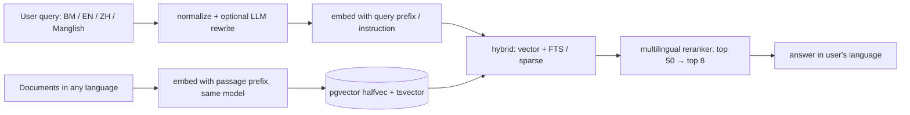

# Vector Databases - Embedding Models & Multilingual Retrieval

> [!info] Deep dive of [[Vector Databases]]

> [!abstract] TL;DR
> Pick the embedding model on **your** queries (BM/EN/ZH, Manglish, product codes), not on leaderboard rank: build a 100–300 query eval set and measure recall@10.
> - **Hosted**: OpenAI `text-embedding-3-*`, Gemini, Cohere or Voyage. Easiest, with per-token cost and data leaving your infra.
> - **Self-hosted**: **bge-m3** (MIT, 1024-d, 8k tokens, dense + sparse) or **Qwen3-Embedding** (Apache-2.0, 0.6B–8B, Matryoshka). Both are strong multilingual choices.
> - Store `embedding_model` per row and plan re-embedding as a migration.
> - Hybrid search + a multilingual reranker cover most of the gap that the model alone can't.

## Concept
**Selection criteria**:

| Criterion | Why it matters here |
|---|---|
| Language coverage + code-switching | Malaysian users mix BM, English and Chinese in one message ("brp harga for 2 kotak?") |
| Max input tokens | Chunks longer than the model limit are **silently truncated** |
| Dimensions / Matryoshka | Storage, HNSW memory and speed. Matryoshka models allow truncating dims (e.g. 1024 → 512) |
| Asymmetric prompts | Many models need query vs passage prefixes or instructions (e5: `query:` / `passage:`; Qwen3: an instruction on queries) |
| Hosting + licence | API (cost per token, data processing terms) vs self-host (GPU/CPU, MIT/Apache) |
| Stability | Hosted models get deprecated, which forces a full re-embed |

**Candidates** (2026 snapshot; scores are indicative and depend on MTEB version):

| Model | Type | Dims | Notes |
|---|---|---|---|
| OpenAI `text-embedding-3-small` / `-large` | API | 1536 / 3072 (Matryoshka) | Cheap and solid; `-large` needs `halfvec` for HNSW in pgvector |
| Google `gemini-embedding-001` | API | up to 3072 (Matryoshka) | Strong on multilingual leaderboards since 2025 |
| Cohere `embed-v4` | API | configurable | Multilingual, multimodal; pairs with Cohere Rerank |
| Voyage (MongoDB) | API | 1024–2048 | Anthropic's recommended embedding partner; domain models (code, law, finance) |
| **bge-m3** (BAAI) | Open, MIT | 1024 | 100+ languages, 8192 tokens, dense + sparse + multi-vector in one model |
| **Qwen3-Embedding** 0.6B / 4B / 8B | Open, Apache-2.0 | up to 4096 (MRL) | Top multilingual MTEB results in 2025 (8B: 70.58). 0.6B is CPU-viable |
| multilingual-e5-large(-instruct) | Open, MIT | 1024 | Proven baseline; 512-token limit |

## How It Works

- **Cross-lingual retrieval**: good multilingual models map "harga penghantaran" and "delivery fee" close together, so a BM query can retrieve an English policy chunk. Lexical search can't, which is why hybrid needs the vector side.
- **Rerankers** (cross-encoders like `bge-reranker-v2-m3`, Cohere Rerank, Voyage rerank) read query + passage together. They're far more precise than bi-encoder similarity and worth the ~50–200 ms on top-50 candidates.

## Practical Usage
**Self-hosted embeddings on Coolify** (Hugging Face Text Embeddings Inference, CPU):
```yaml
services:
  embed:
    image: ghcr.io/huggingface/text-embeddings-inference:cpu-1.8     # pin; GPU images exist too
    command: ["--model-id", "BAAI/bge-m3", "--max-batch-tokens", "16384"]
    volumes: ["hf-cache:/data"]
    deploy: { resources: { limits: { memory: 6g } } }
    networks: [internal]
volumes: { hf-cache: {} }
```
```ts
const r = await fetch('http://embed/embed', { method: 'POST', headers: { 'content-type': 'application/json' },
  body: JSON.stringify({ inputs: chunks, normalize: true, truncate: false }) });   // fail loudly on over-length
const vectors: number[][] = await r.json();
```
**Schema with model versioning** (pgvector):
```sql
alter table chunks add column embedding_v2 halfvec(1024), add column embedding_model_v2 text;
-- backfill in batches by a worker, then:
create index concurrently chunks_emb_v2_hnsw on chunks using hnsw (embedding_v2 halfvec_cosine_ops);
-- switch reads to embedding_v2 behind a flag; drop the old column after a soak period
```
**Retrieval eval harness** (Python, own data):
```python
import numpy as np

def recall_at_k(queries, gold, search, k=10):
    """queries: list[str]; gold: list[set[chunk_id]]; search: fn(query, k) -> list[chunk_id]"""
    hits = [len(set(search(q, k)) & g) > 0 for q, g in zip(queries, gold)]
    return float(np.mean(hits))

for model in ["bge-m3", "qwen3-embedding-0.6b", "text-embedding-3-small"]:
    print(model, recall_at_k(evalset.queries, evalset.gold, make_search(model)))
```
Build `evalset` from real (redacted) WhatsApp questions in BM, EN, ZH and code-switched text, each labelled with the chunk IDs that answer it ([[AI Evals & Observability - Eval Datasets & LLM-as-Judge]]).

**Query normalization** for Manglish shorthand, before embedding and FTS:
```ts
const SHORT: Record<string, string> = { brp: 'berapa', sy: 'saya', x: 'tak', tq: 'terima kasih', bole: 'boleh', camne: 'macam mana' };
const normalize = (s: string) => s.toLowerCase().split(/\s+/).map((w) => SHORT[w] ?? w).join(' ');
```
**Wrong way**:
```python
emb = model.encode(chunk)                 # ❌ no passage prefix/instruction where the model expects one
q   = other_model.encode(query)           # ❌ different model for queries: vectors not comparable
vec = full_vec[:256]                      # ❌ truncating a non-Matryoshka model, or forgetting to renormalize
```

## Patterns & Anti-patterns
| Pattern | When | Anti-pattern to avoid |
|---|---|---|
| Own-data eval (recall@k, MRR) before choosing | Any new corpus or language mix | Picking the leaderboard #1 |
| `embedding_model` column + dual-column migrations | Model changes | Mixing vectors from two models in one index |
| Hybrid (vector + FTS/sparse) + reranker | Multilingual, SKUs, names | Vector-only retrieval |
| `simple` FTS config + trigram for mixed languages | BM/EN/ZH text in Postgres | `english` stemming applied to Malay and Chinese |
| Batch embedding jobs (async queue) | Ingestion | Embedding synchronously in upload requests |
| Matryoshka truncation, measured | Large corpora, RAM limits | Truncating blindly to save space |

## Performance & Trade-offs
- **Cost**: a hosted small model costs about cents per million tokens (one-off ingestion plus per-query). Self-hosting bge-m3 on CPU handles roughly tens of chunks per second, fine for SME corpora (thousands to hundreds of thousands of chunks). Larger Qwen3 variants want a GPU.
- **Dimensions vs memory**: 1024-d `halfvec` = 2 KB per vector. 1M chunks ≈ 2 GB of vectors + index ([[Vector Databases - pgvector Tuning & Hybrid Search]]). Matryoshka truncation to 512 halves that, usually with a small recall loss. Measure it.
- **Reranker latency vs precision**: reranking top 50 adds ~50–200 ms (CPU cross-encoder or API) and typically gives a larger quality jump than switching embedding models.
- **Sparse from bge-m3** replaces or augments BM25 for multilingual text where Postgres FTS dictionaries are weak (Chinese without segmentation).

## Tips & Reminders
> [!tip] In ZP's stack
> - **Default**: Supabase pgvector `halfvec(1024)` with bge-m3 (self-hosted TEI on Coolify) or a hosted small model, plus `tsvector('simple')` hybrid and a multilingual reranker on the top 50.
> - **Re-embedding**: run it as a pgmq/BullMQ backfill job. Never inline.
> - **Chinese-heavy tenants**: rely on vectors + trigram, or add a segmentation extension (zhparser/pg_jieba) if you need exact FTS.

- Keep chunk size inside the model's token limit with margin (e.g. ≤ 1,500 tokens for 8k models, ≤ 400 for 512-token models).
- Normalize vectors (or let the server do it) when using cosine or inner product, and keep it consistent.
- Log retrieval results (chunk IDs, scores) on traces, so retrieval failures are visible separately from generation failures.
- Embed titles and section headings along with chunk text ("contextual" chunks). It's cheap, and it reliably improves recall.

## Version Notes
| Date | Change |
|---|---|
| 2024 | bge-m3 (dense + sparse + multi-vector, 8k tokens). OpenAI `text-embedding-3` with Matryoshka dims |
| 2025 | MMTEB (Massive Multilingual Text Embedding Benchmark). gemini-embedding-001 tops multilingual boards. Qwen3-Embedding (0.6B–8B, Apache-2.0). MongoDB acquires Voyage AI |
| 2026 | New entries above 70 on MTEB(Multilingual, v2) per aggregators. Leaderboard positions change monthly |

> [!warning] Unverified — check before relying on this
> Leaderboard scores come from aggregators and mix MTEB versions, and no Malay-specific benchmark was found. Check https://huggingface.co/spaces/mteb/leaderboard and, above all, evaluate on your own BM/EN/ZH queries.

## Critical Issues & Gotchas
> [!danger] Model deprecation = full re-embed
> Hosted embedding models get retired or silently versioned. Without stored `embedding_model` and a dual-column migration path, you can't switch without downtime or mixed vectors. Self-hosted open weights avoid forced migrations.

> [!danger] Embeddings are personal data
> Embedding inversion attacks can reconstruct much of the original text from vectors. Treat vectors of customer chats or IC documents like the source text under PDPA: tenant-scoped RLS, deletion on erasure requests, and no sharing of "anonymous" vectors.

- **Silent truncation** at the token limit drops the end of long chunks, often the part with the answer. Set `truncate: false` and fail, or chunk smaller.
- **Prefix mistakes** (missing `query:`/`passage:`, or swapped) can cost several recall points with no error.
- **Language-skewed corpora**: if 95% of documents are English, BM queries retrieve fine cross-lingually, but answers should still reply in the user's language. Instruct the generator explicitly.
- **Duplicate near-identical chunks** (boilerplate footers) crowd the top-k. Dedupe at ingestion ([[RAG - Document Ingestion & PDF Parsing Pipelines]]).

## Related
- [[Vector Databases]]
- [[Vector Databases - pgvector Tuning & Hybrid Search]] — storage types, HNSW, hybrid SQL
- [[RAG - Chunking & Retrieval Strategies]] — chunking, reranking, query rewriting
- [[RAG - Document Ingestion & PDF Parsing Pipelines]] — clean input for embedding
- [[AI Evals & Observability - Eval Datasets & LLM-as-Judge]] — building the retrieval eval set
- [[Supabase]] — pgvector + RLS hosting

## References
- https://arxiv.org/html/2502.13595v2 (MMTEB)
- https://huggingface.co/BAAI/bge-m3
- https://huggingface.co/Qwen/Qwen3-Embedding-8B
- https://github.com/huggingface/text-embeddings-inference
- https://www.llmreference.com/benchmark/mteb-multilingual-v2
- https://www.datallmlab.com/blog/best-embedding-models.html
