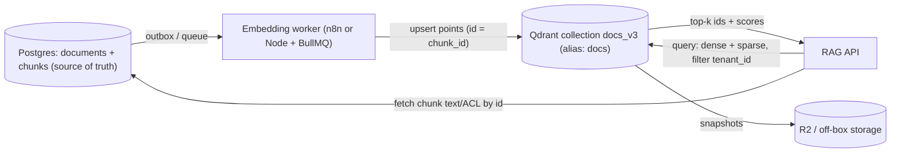

# Vector Databases - Qdrant & Dedicated Vector DB Operations

> [!info] Deep dive of [[Vector Databases]]

> [!abstract] TL;DR
> **Qdrant** is a Rust vector database. It stores **points** (id + one or more named vectors + JSON payload) in **collections**, indexes them with filterable **HNSW**, and offers payload indexes, quantization, sparse vectors, hybrid queries (Query API with RRF fusion), snapshots and distributed sharding.
> - **When to leave pgvector**: tens of millions of vectors, heavy filtered search, many tenants with very different sizes, or RAM pressure on the Postgres box.
> - **Operational must-dos**: API key + private network, payload indexes on every filter field, `is_tenant` for multitenancy, quantization + on-disk vectors to fit RAM, scheduled snapshots off-box, and a **re-index path** from Postgres (the source of truth).

## Concept
| Concept | Meaning | Ops note |
|---|---|---|
| Collection | Vectors with fixed config (size, distance) | Changing dims/model → new collection + alias swap |
| Point | `id` (uint/UUID) + vectors + payload | Use your Postgres row/chunk ID as the point ID |
| Named vectors | Several vectors per point (`dense`, `sparse`, `image`) | Hybrid search without duplicate collections |
| Payload index | Index on payload fields (keyword, integer, datetime, text, uuid) | Required for fast filtering. Create before bulk load |
| `is_tenant: true` | Tenant-aware payload index | Co-locates tenant data. Efficient per-tenant HNSW |
| Quantization | Scalar (int8, ~4×), binary (~32×), product | Rescore with originals for accuracy |
| `on_disk` | Vectors/HNSW on mmap instead of RAM | RAM ↔ latency trade-off |
| Alias | Name pointing to a collection | Zero-downtime re-index |
| Snapshot | Point-in-time collection archive | Restore = recover collection from file/URL |
| Shards/replicas | Distributed mode (Raft consensus) | Only when one node can't hold data/QPS |

**pgvector vs Qdrant** (decision):

| Factor | Stay on pgvector ([[Supabase]]) | Move to Qdrant |
|---|---|---|
| Vectors | < ~5–10M | Tens of millions+ |
| Filters | Simple tenant filter | Many selective filters, faceting |
| Joins/transactions with app data | Needed | Not needed (IDs only) |
| Ops capacity | One DB to run | Can run and back up a second system |
| Hybrid search | SQL FTS + RRF function | Native sparse vectors + fusion |

## How It Works


## Practical Usage
**Compose service** (internal network only, on [[Coolify]]):
```yaml
services:
  qdrant:
    image: qdrant/qdrant:v1.20.0           # pin; read release notes before bumping
    environment:
      QDRANT__SERVICE__API_KEY: ${QDRANT_API_KEY}
      QDRANT__SERVICE__READ_ONLY_API_KEY: ${QDRANT_RO_KEY}
      QDRANT__TELEMETRY_DISABLED: "true"
    volumes: ["qdrant_data:/qdrant/storage", "qdrant_snapshots:/qdrant/snapshots"]
    expose: ["6333", "6334"]                # REST / gRPC — no public ports
    deploy: { resources: { limits: { memory: 4g } } }
volumes: { qdrant_data: {}, qdrant_snapshots: {} }
```
**Create a multi-tenant hybrid collection**:
```bash
curl -X PUT "$Q/collections/docs_v3" -H "api-key: $KEY" -H 'content-type: application/json' -d '{
  "vectors": { "dense": { "size": 1024, "distance": "Cosine", "on_disk": true } },
  "sparse_vectors": { "bm25": { "modifier": "idf" } },
  "quantization_config": { "scalar": { "type": "int8", "quantile": 0.99, "always_ram": true } },
  "hnsw_config": { "m": 16, "ef_construct": 128, "payload_m": 16 }
}'
curl -X PUT "$Q/collections/docs_v3/index" -H "api-key: $KEY" -H 'content-type: application/json' \
  -d '{ "field_name": "tenant_id", "field_schema": { "type": "keyword", "is_tenant": true } }'
curl -X PUT "$Q/collections/docs_v3/index" -H "api-key: $KEY" -H 'content-type: application/json' \
  -d '{ "field_name": "doc_type", "field_schema": "keyword" }'
curl -X PUT "$Q/collections/aliases" -H "api-key: $KEY" -H 'content-type: application/json' \
  -d '{ "actions": [ { "create_alias": { "collection_name": "docs_v3", "alias_name": "docs" } } ] }'
```
**Hybrid query with tenant filter** (TypeScript client):
```ts
import { QdrantClient } from "@qdrant/js-client-rest";
const q = new QdrantClient({ url: process.env.QDRANT_URL, apiKey: process.env.QDRANT_RO_KEY });

const res = await q.query("docs", {
  prefetch: [
    { query: denseVec, using: "dense", limit: 40 },
    { query: { indices: sparse.indices, values: sparse.values }, using: "bm25", limit: 40 },
  ],
  query: { fusion: "rrf" },
  filter: { must: [{ key: "tenant_id", match: { value: tenantId } }] },
  limit: 8,
  with_payload: ["chunk_id", "doc_id"],
});
```
**Snapshots to off-box storage**:
```bash
curl -X POST "$Q/collections/docs_v3/snapshots" -H "api-key: $KEY"          # returns snapshot name
curl -s "$Q/collections/docs_v3/snapshots/$NAME" -H "api-key: $KEY" -o "$NAME"
rclone copy "$NAME" r2:backups/qdrant/                                      # then prune local snapshots
```
**Wrong way**:
```text
❌ Port 6333 published without API key          → anyone can read/delete the knowledge base
❌ One collection per tenant (thousands)         → overhead per collection; use is_tenant payload index
❌ Filtering on unindexed payload fields          → full scans / low recall on selective filters
❌ Qdrant as the only copy of chunk text           → no rebuild path after corruption or model change
```

## Patterns & Anti-patterns
| Pattern | When | Anti-pattern to avoid |
|---|---|---|
| Postgres = source of truth, Qdrant = derived index | Always | Business data only in payloads |
| Alias swap for re-embedding (`docs_v3` → `docs_v4`) | Model/chunking change | Re-embedding in place while serving |
| `is_tenant` index + filter on every query | Multi-tenant RAG | Collection per tenant |
| Read-only key for query services | Least privilege | Admin key in the RAG API |
| Quantization + `on_disk` + rescoring | RAM-limited VPS | All float32 vectors in RAM |
| Batch upserts (100–1000 points), `wait=false` for bulk | Ingestion | One HTTP call per point |
| Payload kept small (IDs, filter fields) | Always | Full documents in payload |

## Performance & Trade-offs
- **RAM math**: 1M × 1024-dim float32 ≈ 4 GB raw vectors (+ HNSW graph). int8 scalar quantization ≈ 1 GB in RAM with originals on disk. Binary ≈ 128 MB, but suits only high-dim models that tolerate it.
- **HNSW params**: higher `m`/`ef_construct` raise recall, memory and build time. Tune query-time `hnsw_ef` per request for latency vs recall.
- **Indexing threshold**: small segments are brute-forced until `indexing_threshold`. Bulk loads finish faster with indexing deferred, then optimized.
- **Single node** handles millions of vectors on a 4–8 GB VPS. Distributed mode adds Raft, resharding and replica consistency to operate, so avoid it unless needed.
- **gRPC (6334)** is faster for bulk upserts. REST is simpler for n8n and debugging.

## Tips & Reminders
> [!tip] In ZP's stack
> - **Default stays pgvector on Supabase** for SME RAG bots ([[Vector Databases - pgvector Tuning & Hybrid Search]]). Qdrant becomes worth it for a SaaS with many tenants' document sets, or when Postgres RAM is contended.
> - **n8n** has a Qdrant Vector Store node. Point it at the alias, not the versioned collection, and use the internal Docker hostname ([[n8n]]).
> - **Self-host on the same Coolify server** only with a memory limit. Otherwise a separate small VPS avoids starving Postgres/n8n.
> - **Multilingual (BM/EN/ZH)**: choose embeddings and sparse tokenization that handle mixed text ([[Vector Databases - Embedding Models & Multilingual Retrieval]]).

- Store `embedding_model` and `chunker_version` in payload for audits and selective re-embeds.
- Delete points on source deletion (by `doc_id` filter). Stale chunks are a PDPA and quality risk.
- Monitor `/metrics` (Prometheus), collection status (`green/yellow`), and disk usage of the snapshots directory.
- Check snapshot restore on a scratch instance quarterly.

## Version Notes
| Version / date | Change relevant here |
|---|---|
| 1.10 (2024) | Universal Query API (prefetch + fusion), multivector |
| 1.11 (2024) | Tenant-aware payload index (`is_tenant`), on-disk payload index |
| 1.13–1.15 (2025) | GPU-accelerated indexing, strict mode, server-side BM25/inference improvements |
| 1.17 (2026-02) | Relevance feedback, search latency improvements |
| 1.20 (2026-10) | Full-text search improvements (current at writing) |
| Cloud (2026-04) | GPU indexing, Multi-AZ clusters, audit logging (Cloud only) |

> [!warning] Unverified — check before relying on this
> The minor-version mapping for 1.10–1.15 features and the full 1.20 changelog weren't confirmed from release notes this run. Check https://github.com/qdrant/qdrant/releases before upgrading or relying on a feature.

## Critical Issues & Gotchas
> [!danger] Unauthenticated Qdrant exposed to the internet
> Qdrant runs **without auth by default**. Scans routinely find open instances whose collections (chunked contracts, chats, ICs) can be dumped or deleted via REST. Always set `QDRANT__SERVICE__API_KEY`, don't publish 6333/6334, and reach it only over the Docker network or a tailnet. Enable TLS if it crosses hosts.

> [!danger] Lost index with no rebuild path
> Volume loss, a failed upgrade, or an embedding-model deprecation (a vendor retiring the model) leaves vectors unusable. Keep chunk text and metadata in Postgres, version the embedding model, script a full re-embed into a new collection, and keep off-box snapshots for fast restores.

- **Dimension mismatch** after switching embedding models makes upserts fail. Create a new collection.
- **Snapshot compatibility**: restore into the same or a newer compatible version. Read upgrade notes before major jumps.
- **Deleted points** free space only after optimization/vacuum, so disk usage lags.
- **Recall drops with quantization** without rescoring. Evaluate on your own queries ([[RAG - Chunking & Retrieval Strategies]]).

## Related
- [[Vector Databases]]
- [[Vector Databases - pgvector Tuning & Hybrid Search]] — the default alternative
- [[Vector Databases - Embedding Models & Multilingual Retrieval]] — vectors that go in
- [[RAG - Chunking & Retrieval Strategies]] — what gets indexed and how it's queried
- [[n8n]] — Qdrant Vector Store node in ingestion/RAG workflows
- [[Docker - Compose Patterns for Production]] — volumes, limits, internal networks

## References
- https://qdrant.tech/documentation/
- https://qdrant.tech/documentation/guides/multiple-partitions/
- https://qdrant.tech/documentation/guides/quantization/
- https://qdrant.tech/blog/qdrant-1.17.x/
- https://qdrant.tech/blog/qdrant-1.20.x/
