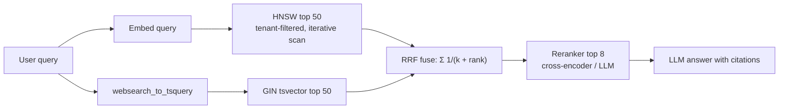

# Vector Databases - pgvector Tuning & Hybrid Search

> [!info] Deep dive of [[Vector Databases]]

> [!abstract] TL;DR
> **pgvector** handles a few million vectors well if you size RAM for HNSW, pick a sensible storage type, and **measure recall**.
> - **Storage and index**: use `halfvec` to halve memory, an HNSW index with `m=16, ef_construction=64–128`, and tune `hnsw.ef_search` per query.
> - **Filtered queries**: these are the real trap. Use `hnsw.iterative_scan` (0.8+), partial indexes or partitions.
> - **Hybrid search**: combine **full-text** (`tsvector`) and **vector** results with **RRF**, then rerank the top 20–50. It beats either retriever alone for SME RAG content with product codes, names and Malay/English mixes.

## Concept

### Storage types and limits
| Type | Bytes/dim | Max dims for HNSW index | Use |
|---|---|---|---|
| `vector(n)` | 4 (float32) | **2,000** | Default. Exact storage |
| `halfvec(n)` | 2 (float16) | **4,000** | **Default choice for new tables**: ~half the RAM, negligible recall loss for most embedding models |
| `bit(n)` | 1/8 | 64,000 | Binary quantization: first-stage candidate search + rerank |
| `sparsevec(n)` | per non-zero | 1,000 non-zero | Sparse embeddings (SPLADE-like) |

- **Large embeddings**: 3,072-dim models (e.g. OpenAI `text-embedding-3-large`) can't use an HNSW index on `vector`. Store them as `halfvec(3072)`, or request fewer dims if the model supports Matryoshka-style truncation (e.g. 1,024).

### HNSW knobs
| Knob | Default | Effect | Typical |
|---|---|---|---|
| `m` | 16 | Graph degree. ↑ recall, ↑ memory, ↑ build time | 16 (24–32 for high-dim/hard data) |
| `ef_construction` | 64 | Build-time candidate list. ↑ graph quality, ↑ build time | 64–128 |
| `hnsw.ef_search` (session/txn) | **40** | Query-time candidate list. ↑ recall, ↑ latency. **Also caps rows returned** | 40–200 |
| `hnsw.iterative_scan` (0.8+) | `off` | Keep scanning when filters remove results: `strict_order` / `relaxed_order` | `relaxed_order` for filtered RAG |
| `hnsw.max_scan_tuples` (0.8+) | 20,000 | Upper bound for iterative scans | Raise for very selective filters |

### Memory sizing (rule of thumb)
- **Index size** ≈ `n × (dims × bytes_per_dim + m × 2 × 4 bytes) × ~1.1–1.3`.
  - **Worked example**: 2M chunks × 1,536 dims `halfvec` = ~6 GB of vectors, ~6.5–8 GB of index.
  - **Rule**: keep the index in `shared_buffers` + OS cache, or latency jumps 10–100× on disk reads.
- **Build memory**: `maintenance_work_mem` must hold the graph during the build. When it doesn't fit, the build slows dramatically, and pgvector logs a notice.

## How It Works

- **Why hybrid**: vector search misses exact tokens (SKUs `A1234-B`, phone numbers, rare names, typos the embedding model never saw). Keyword search misses paraphrases and cross-language matches (BM/EN/Manglish).
- **RRF (Reciprocal Rank Fusion)**: `score = Σ 1/(k + rank_i)` with `k ≈ 60`. It needs no score normalisation between cosine distance and `ts_rank`.
- **Filtered ANN**: HNSW finds `ef_search` nearest candidates *first*, then applies `WHERE`. A selective filter (one tenant out of 500) can leave 0–3 rows. Iterative scans keep walking the graph until enough rows pass the filter or `max_scan_tuples` is hit.

## Practical Usage

### Schema (Supabase / Postgres 17)
```sql
create extension if not exists vector;

create table chunks (
  id          bigint generated always as identity primary key,
  tenant_id   uuid not null,
  doc_id      uuid not null,
  content     text not null,
  embedding   halfvec(1536) not null,
  fts         tsvector generated always as (to_tsvector('simple', unaccent_immutable(content))) stored,
  embed_model text not null default 'text-embedding-3-small@2024'   -- version your embeddings
);

-- Build fast: more memory + parallel workers (session-level), concurrently on live tables
set maintenance_work_mem = '4GB';
set max_parallel_maintenance_workers = 3;
create index concurrently chunks_embedding_hnsw on chunks using hnsw (embedding halfvec_cosine_ops) with (m = 16, ef_construction = 96);
create index chunks_fts_gin on chunks using gin (fts);
create index chunks_tenant_doc on chunks (tenant_id, doc_id);
```
- `unaccent_immutable` is an `IMMUTABLE` wrapper around `unaccent()`, which is needed for generated columns.
- Use the `simple` configuration for mixed Malay/English, since Postgres has no Malay stemmer. Add [[PostgreSQL - Indexing|`pg_trgm`]] for fuzzy names/SKUs.

### Hybrid search function (RRF)
```sql
create or replace function hybrid_search(p_tenant uuid, p_query text, p_embedding halfvec(1536), p_k int default 8)
returns table (id bigint, content text, score float8)
language sql stable
set hnsw.ef_search = 100
set hnsw.iterative_scan = 'relaxed_order'
as $$
  with vec as (
    select c.id, row_number() over (order by c.embedding <=> p_embedding) as r
    from chunks c
    where c.tenant_id = p_tenant
    order by c.embedding <=> p_embedding
    limit 50
  ),
  kw as (
    select c.id, row_number() over (order by ts_rank_cd(c.fts, q) desc) as r
    from chunks c, websearch_to_tsquery('simple', p_query) q
    where c.tenant_id = p_tenant and c.fts @@ q
    order by ts_rank_cd(c.fts, q) desc
    limit 50
  ),
  fused as (
    select coalesce(vec.id, kw.id) as id,
           coalesce(1.0 / (60 + vec.r), 0) + coalesce(1.0 / (60 + kw.r), 0) as score
    from vec full outer join kw on vec.id = kw.id
  )
  select c.id, c.content, f.score
  from fused f join chunks c using (id)
  order by f.score desc
  limit p_k * 3;   -- hand 24 candidates to the reranker, keep the best p_k
$$;
```
- With `relaxed_order`, results can come back slightly out of distance order. The `row_number()` window over the distance re-sorts them, which is why it's computed explicitly.
- Weight the retrievers if evals show one is stronger, e.g. `1.5 / (60 + vec.r)`.

### Measure recall (do this before and after every tuning change)
```sql
-- Ground truth: exact search (disable index scans in this transaction)
begin;
set local enable_indexscan = off;
create temp table truth as
  select id from chunks where tenant_id = $1 order by embedding <=> $2 limit 10;
commit;

-- Approximate result with current settings → recall@10 = |approx ∩ truth| / 10
set hnsw.ef_search = 40;   -- try 40 / 80 / 160 and plot recall vs p95 latency
```
- Run this over 100–200 real queries. Target **recall@10 ≥ 0.95** for RAG. Lower usually means raising `ef_search` before rebuilding with a higher `m`.
- Check plans with `EXPLAIN (ANALYZE, BUFFERS)`. If you see `Seq Scan` on `chunks`, the index isn't used: an operator class mismatch, a missing `ORDER BY … LIMIT`, or a casting issue ([[PostgreSQL - Query Planning & EXPLAIN]]).

### Binary quantization + rerank (memory-constrained, > ~5M vectors)
```sql
create index on chunks using hnsw ((binary_quantize(embedding)::bit(1536)) bit_hamming_ops);

select id from (
  select id, embedding from chunks
  order by binary_quantize(embedding)::bit(1536) <~> binary_quantize($1::halfvec(1536))
  limit 200                                          -- cheap candidate set
) c
order by c.embedding <=> $1::halfvec(1536)           -- exact rerank on full vectors
limit 10;
```

## Patterns & Anti-patterns
| Pattern | When | Anti-pattern to avoid |
|---|---|---|
| `halfvec` + HNSW `m=16` | New tables | `vector(3072)` with no index (seq scans) or with an index that can't be built |
| Iterative scans or partial indexes per large tenant | Multi-tenant filtered search | ANN then `WHERE tenant_id = …` with default settings → empty results |
| Partition by tenant (list/hash) for very uneven tenants | Few huge tenants + many small | One giant index where 95% of the graph is irrelevant to every query |
| Hybrid (FTS + vector) + RRF + reranker | SME docs, product catalogs, SOPs | Vector-only search for SKU/phone/name lookups |
| `embed_model` column + re-embed jobs | Model upgrades | Mixing embeddings from two models in one index (meaningless distances) |
| Recall measured against exact search | Every tuning change | Tuning `ef_search` by "looks fine" on 3 queries |
| `CREATE INDEX CONCURRENTLY` + high `maintenance_work_mem` | Production builds | Building HNSW in a migration under a 2-min statement timeout |

## Performance & Trade-offs
- **HNSW vs IVFFlat**:
  - **HNSW**: better recall and latency, and handles inserts. Builds are slower and memory is higher.
  - **IVFFlat**: builds fast and is smaller, but needs representative data at build time (`lists ≈ rows/1000` up to 1M rows, `sqrt(rows)` beyond), and recall drifts as data changes.
  - **Default**: use HNSW for RAG.
- **Write cost**: each insert updates the graph (≈ ms). Bulk loads are faster as `COPY` first, index after. Deletes leave tombstones, so `VACUUM` regularly and `REINDEX CONCURRENTLY` after big churn.
- **`ef_search` trade-off**: in typical benchmarks, doubling it roughly doubles latency while recall approaches 0.99. Choose per route: chat at 40–80, compliance search at 200.
- **When to leave pgvector**: consider Qdrant/Milvus or pgvectorscale (DiskANN) once any of these holds:
  - more than ~10–50M vectors
  - a hot index that can't fit in RAM
  - heavy filtered search across many attributes
  - write-heavy re-embedding

## Tips & Reminders
> [!tip]
> - Under ~50k vectors per tenant, exact search with a B-tree on `tenant_id` is fast enough (a few ms) and has 100% recall. Skip ANN.
> - Normalise embeddings and use cosine (`<=>`) or inner product (`<#>`, which is **negative** inner product) consistently between index opclass and query operator.
> - `set local hnsw.ef_search` inside the transaction or function. A pooled connection (Supavisor transaction mode) doesn't keep session `SET`s.
> - Chunking matters more than index tuning: 300–800 tokens with overlap, titles/breadcrumbs prepended to each chunk, and a doc-level metadata filter ([[RAG]]).
> - **In ZP's stack**:
>   - **Setup**: [[Supabase]] Postgres with `halfvec(1536)`, the `hybrid_search` RPC above called from Next.js or [[n8n]], and a cheap reranker step.
>   - **Sizing**: pick compute with RAM ≥ 2× index size.
>   - **Maintenance**: rebuild indexes off-peak.

## Version Notes
| pgvector | Change |
|---|---|
| 0.5.0 (2023-08) | HNSW index |
| 0.6.0 (2024-01) | Parallel HNSW builds (much faster), lower memory during build |
| 0.7.0 (2024-04) | `halfvec`, `sparsevec`, `bit` with Hamming/Jaccard, `binary_quantize()`, expression-index quantization |
| 0.8.0 (2024-10) | **Iterative index scans** (`hnsw.iterative_scan`, `ivfflat.iterative_scan`), better cost estimation for filtered queries |
| 0.8.x (2025–2026) | Bug fixes and compatibility (PG 18). 0.8.5 seen in PGDG packages 2026-07 |

> [!warning] Unverified — check before relying on this
> I didn't find a pgvector 0.9 release, and the 0.8.3–0.8.5 contents weren't checked against the official CHANGELOG. Also check which pgvector version your Supabase project runs (`select extversion from pg_extension where extname = 'vector'`).

## Critical Issues & Gotchas
> [!danger] `ef_search` silently caps your results
> With the default `hnsw.ef_search = 40`, `LIMIT 100` returns at most ~40 rows. Combined with a `WHERE` filter, it can return far fewer, or zero, with no error. Symptoms: "the bot can't find documents that definitely exist" for small tenants. Fix: raise `ef_search` ≥ the limit, enable iterative scans, or use partial indexes/partitions.

> [!danger] Tenant leakage in vector search
> A `match_documents` RPC declared `security definer` without a `tenant_id` predicate, or called with the service-role key from the client, returns other tenants' chunks. Those chunks then end up quoted in LLM answers. Keep RPCs `security invoker` so RLS applies ([[Supabase - Row Level Security]]), or enforce `tenant_id = auth.jwt()->>'tenant_id'` inside the function, and test cross-tenant queries in CI.

> [!warning] Gotchas
> - The operator must match the opclass: an index built with `halfvec_cosine_ops` isn't used for `<->` (L2) queries.
> - Passing `vector` to a `halfvec` column without a cast falls back to a sequential scan. Cast explicitly (`$1::halfvec(1536)`).
> - HNSW builds on a busy primary compete for I/O and memory. On Supabase, raise `statement_timeout` for the session or build via a direct (non-pooler) connection.
> - `ts_rank` isn't BM25. For better keyword ranking, consider `pg_search`/ParadeDB BM25 where it's available (not on Supabase hosted).
> - Re-embedding millions of rows rewrites the table (bloat). Do it in batches with `VACUUM` between them, or build a new table and swap.

## Related
- [[Vector Databases]]
- [[Vector Databases - Embedding Models & Multilingual Retrieval]] — choosing and migrating the embedding model behind these indexes
- [[PostgreSQL - Indexing]] — GIN, partial and expression indexes
- [[PostgreSQL - Query Planning & EXPLAIN]] — verifying index usage
- [[Supabase]] — hosted pgvector, RPCs, compute sizing
- [[Supabase - Row Level Security]] — tenant isolation for search RPCs
- [[RAG]] — chunking, reranking, evaluation

## References
- pgvector README (HNSW, iterative scans, quantization): https://github.com/pgvector/pgvector
- pgvector CHANGELOG: https://github.com/pgvector/pgvector/blob/master/CHANGELOG.md
- Supabase hybrid search guide: https://supabase.com/docs/guides/ai/hybrid-search
- RRF paper (Cormack et al., 2009): https://plg.uwaterloo.ca/~gvcormac/cormacksigir09-rrf.pdf
- PostgreSQL full-text search: https://www.postgresql.org/docs/current/textsearch.html
