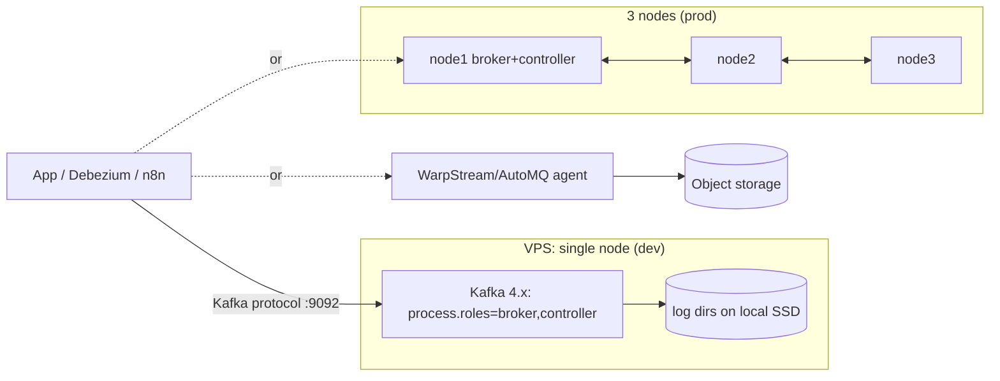

# Kafka - KRaft, Redpanda & Small-Infra Trade-offs

> [!info] Deep dive of [[Kafka]]

> [!abstract] TL;DR
> On one or two VPSs, **you probably don't need Kafka**. Postgres queues/outbox (pgmq), [[Redis]] Streams/BullMQ or NATS JetStream cover SME workloads with far less ops.
> When you do need the Kafka API (CDC with Debezium, replayable multi-consumer streams, a client/tooling requirement):
> - **dev or low-stakes**: a single-node **KRaft combined** broker (Kafka 4.x, no ZooKeeper) or **Redpanda** (one C++ binary, BSL);
> - **production**: 3 nodes minimum, or a **managed / object-storage-based** service (Aiven, Confluent, Redpanda Cloud, WarpStream, AutoMQ).
>
> A single broker with replication factor 1 is a cache, not a durable log.

## Concept
| Option | What it is | Footprint (small) | License | Pick it when… |
|---|---|---|---|---|
| Postgres outbox + pgmq | Queue tables in your DB | Zero extra service | PostgreSQL | Events tied to DB transactions, < ~1k msg/s |
| Redis Streams / BullMQ | Streams + consumer groups in Redis | Existing Redis | RSAL/SSPL/AGPL ([[Valkey]] BSD) | Jobs, fan-out, short retention |
| NATS JetStream | Lightweight streaming + KV | ~50–100 MB RAM | Apache 2.0 | Many subjects, edge/IoT, simple ops |
| **Kafka 4.x KRaft, 1 node** | Broker + controller in one JVM | 1–2 GB heap + page cache, 2 vCPU | Apache 2.0 | Dev, CI, PoCs, Kafka-only tooling |
| **Kafka 4.x KRaft, 3 nodes** | 3 combined (or 3 controller + N broker) nodes | 3 × 4–8 GB VMs | Apache 2.0 | Self-hosted production with RF=3 |
| **Redpanda** | Kafka-API broker in C++ (Seastar), no JVM, built-in schema registry + HTTP proxy | ~1 GB in dev mode | BSL (Community), enterprise features licensed | Kafka API with lower ops/latency |
| WarpStream / AutoMQ | Kafka API on object storage (S3/R2-like), stateless agents | Agents only, data in the bucket | Commercial / Apache 2.0 (AutoMQ) | High-retention, cost-sensitive streams, latency ≥ 100s of ms OK |
| Managed (Aiven, Confluent Cloud, MSK, Redpanda Cloud) | Someone else's cluster | None | Service terms | Production Kafka without a platform team |

**What "small Kafka" gives up**:

| Concern | 1-node KRaft / Redpanda | 3-node cluster |
|---|---|---|
| Disk failure | **Data loss** (RF=1) | Survives (RF=3, `min.insync.replicas=2`) |
| Broker restart | Producers/consumers stall until it returns | Leaders move, clients continue |
| Upgrades | Downtime | Rolling |
| `acks=all` meaning | "Written on one disk" | "Written on 2+ replicas" |

## How It Works


## Practical Usage
**Single-node KRaft for dev/CI** (Compose; `apache/kafka` image):
```yaml
services:
  kafka:
    image: apache/kafka:4.3.1
    environment:
      KAFKA_NODE_ID: 1
      KAFKA_PROCESS_ROLES: broker,controller
      KAFKA_LISTENERS: PLAINTEXT://:9092,CONTROLLER://:9093
      KAFKA_ADVERTISED_LISTENERS: PLAINTEXT://kafka:9092          # the name clients use to reach it
      KAFKA_CONTROLLER_LISTENER_NAMES: CONTROLLER
      KAFKA_LISTENER_SECURITY_PROTOCOL_MAP: CONTROLLER:PLAINTEXT,PLAINTEXT:PLAINTEXT
      KAFKA_CONTROLLER_QUORUM_VOTERS: 1@kafka:9093
      KAFKA_OFFSETS_TOPIC_REPLICATION_FACTOR: 1
      KAFKA_TRANSACTION_STATE_LOG_REPLICATION_FACTOR: 1
      KAFKA_TRANSACTION_STATE_LOG_MIN_ISR: 1
      KAFKA_AUTO_CREATE_TOPICS_ENABLE: "false"
      KAFKA_LOG_RETENTION_HOURS: 72
      KAFKA_HEAP_OPTS: "-Xms1g -Xmx1g"
    volumes: [kafka-data:/var/lib/kafka/data]
    deploy: { resources: { limits: { memory: 2g } } }
    # no ports: published → reachable only on the Docker network
volumes: { kafka-data: {} }
```
**Redpanda equivalent** (dev mode, small VM):
```yaml
services:
  redpanda:
    image: redpandadata/redpanda:latest   # pin a version in real deployments
    command: >-
      redpanda start --mode dev-container --smp 1 --memory 1G --overprovisioned
      --kafka-addr internal://0.0.0.0:9092 --advertise-kafka-addr internal://redpanda:9092
    volumes: [rp-data:/var/lib/redpanda/data]
volumes: { rp-data: {} }
```
**Topic with explicit retention and compression**:
```bash
kafka-topics.sh --bootstrap-server kafka:9092 --create --topic orders.v1 \
  --partitions 6 --replication-factor 1 \
  --config retention.ms=259200000 --config retention.bytes=5368709120 \
  --config compression.type=zstd --config cleanup.policy=delete
kafka-consumer-groups.sh --bootstrap-server kafka:9092 --describe --group analytics   # lag check
```
**Production minimum** (self-hosted):
```properties
# each of 3 nodes
process.roles=broker,controller
controller.quorum.bootstrap.servers=node1:9093,node2:9093,node3:9093
default.replication.factor=3
min.insync.replicas=2
unclean.leader.election.enable=false
auto.create.topics.enable=false
listeners=SASL_SSL://:9092,CONTROLLER://:9093
sasl.enabled.mechanisms=SCRAM-SHA-512
```
**Wrong way**:
```text
❌ advertised.listeners=PLAINTEXT://localhost:9092 in Docker   → clients in other containers connect to themselves and hang
❌ Port 9092 published on a public VPS IP with PLAINTEXT       → anyone can read/write topics
❌ RF=1 "production" broker holding the only copy of orders     → one disk failure = lost events
❌ Kafka as a job queue for 50 msgs/min of emails               → JVM, disks and ops for what pgmq/BullMQ does better
```

## Patterns & Anti-patterns
| Pattern | When | Anti-pattern to avoid |
|---|---|---|
| Postgres outbox → Kafka only when consumers need it | Event-driven SaaS | Dual writes (DB + Kafka) in request handlers |
| Single node for dev/CI, managed or 3-node for prod | Kafka is required | One VPS broker serving production |
| Explicit topics (no auto-create), retention by time and bytes | Always | Default 7-day retention filling a 50 GB disk |
| Private network only (Docker network/Tailscale), SASL/TLS when crossing hosts | Self-hosted | Public 9092 |
| Kafbat UI / Redpanda Console behind Access | Debugging | No visibility into lag and topics |
| Object-storage Kafka (WarpStream/AutoMQ) for long retention | Logs/analytics, latency-tolerant | Large local disks for months of data |

## Performance & Trade-offs
- **Throughput is rarely the issue**: a single small broker handles 10–50k msg/s of 1 KB messages. Small deployments fail on disk, memory and ops, not speed.
- **Memory**: the Kafka JVM needs 1–2 GB heap, and the rest of RAM should be page cache. Redpanda pre-allocates the memory you give it (`--memory`). Both fight Postgres for RAM on a shared VPS, so don't co-locate them on 4–8 GB boxes.
- **Disk**: retention × throughput. At 200 msg/s × 1 KB × 3 days ≈ 52 GB before compression. Set `retention.bytes` per topic and alert on disk.
- **Latency**: local-disk Kafka/Redpanda gives single-digit ms. Object-storage designs trade 100 ms–1 s+ latency for cheap, durable, stateless storage.
- **Ops time**: upgrades, rebalancing partitions, certs, ACLs and monitoring (under-replicated partitions, consumer lag) are ongoing. Managed Kafka often costs less than your hours.

## Tips & Reminders
> [!tip] In ZP's stack
> - **Default to Postgres + pgmq/outbox** (Supabase Queues) or BullMQ on Redis for SME automation and WhatsApp pipelines ([[Message Queues - Choosing BullMQ, pgmq, RabbitMQ or NATS]]).
> - **Use Kafka only when** a client's data platform requires it, for CDC into analytics (Debezium → Kafka → ClickHouse/BigQuery), or where several teams consume the same event history.
> - **Then**: quote managed Kafka (Aiven/Confluent/Redpanda Cloud) in the proposal, or a 3-node cluster with a maintenance retainer. Don't self-host a single broker for production on a Hostinger KVM.
> - **Your 6-year CEX background**: exchange-grade order/event streams are where Kafka shines. SME webhooks aren't.

- Keep Kafka on a dedicated VM, separate from Postgres, if self-hosting.
- Use `zstd` compression and batching (`linger.ms=5–20`) to save disk and network.
- Check `advertised.listeners` first when clients "connect then hang".
- For local dev on laptops, Redpanda starts in seconds and uses less RAM. Run CI against the same engine you run in production.

## Version Notes
| Version / date | Change relevant here |
|---|---|
| 3.3 (2022-10) | KRaft production-ready for new clusters |
| 3.9 (2024-11) | Last ZooKeeper line, the bridge for ZK → KRaft migration |
| 4.0 (2025-03) | ZooKeeper removed. KRaft only. New consumer protocol (KIP-848) GA |
| 4.2 (2026-02-17) | Share groups (queue semantics) production-ready |
| 4.3.0 (2026-05-22) | Deprecations ahead of 5.0 (e.g. `group.coordinator.rebalance.protocols`) |
| 4.3.1 (2026-06-25) | Bugfix: Kafka Streams RocksDB native memory leak |

> [!warning] Unverified — check before relying on this
> Redpanda's current license terms (BSL change dates, which features are enterprise-only) and the status of "diskless topics" in upstream Kafka weren't verified this run. Check https://github.com/redpanda-data/redpanda/blob/dev/licenses and the Kafka KIP index.

## Critical Issues & Gotchas
> [!danger] Single-broker "production" loses data
> With RF=1, `acks=all` only means one disk has the write. Disk corruption, a full disk or a botched volume migration loses the log permanently, including consumer offsets. If the data matters, use 3 replicas or managed Kafka, and keep the system of record in Postgres.

> [!danger] Unauthenticated listeners on public IPs
> PLAINTEXT Kafka has no auth. Scanners find open 9092 ports quickly and can read every topic or delete it. Bind to private networks, use SASL/SCRAM + TLS between hosts, and firewall per [[Linux Essentials - VPS Hardening Runbook]].

- **Docker networking**: Docker's iptables rules bypass UFW for published ports, so a "firewalled" broker may still be reachable ([[Docker]]).
- **Redpanda licensing**: the Community edition is BSL (no offering as a competing hosted service), and features such as tiered storage are enterprise-licensed. Read the terms before building a hosted product on it.
- **Upgrades from 3.x with ZooKeeper** must go through 3.9 and the KRaft migration. You can't jump straight to 4.x.
- **Disk-full**: brokers stop accepting writes and may need manual segment cleanup. Alert at 70–80%.

## Related
- [[Kafka]]
- [[Kafka - Partitions, Consumer Groups & Delivery Semantics]] — partitions, offsets, delivery guarantees
- [[Message Queues - Choosing BullMQ, pgmq, RabbitMQ or NATS]] — lighter alternatives first
- [[Supabase - Edge Functions, Cron & Queues]] — pgmq and outbox in Postgres
- [[Docker - Logging, Metrics & Resource Limits on a VPS]] — memory limits and disk alerts for brokers
- [[Kubernetes - k3s vs Coolify for Small Teams]] — same "platform vs ops time" trade-off

## References
- https://kafka.apache.org/documentation/#kraft
- https://kafka.apache.org/blog/2026/06/25/apache-kafka-4.3.1-release-announcement/
- https://hub.docker.com/r/apache/kafka
- https://docs.redpanda.com/current/get-started/quick-start/
- https://releasebot.io/updates/apache/kafka
