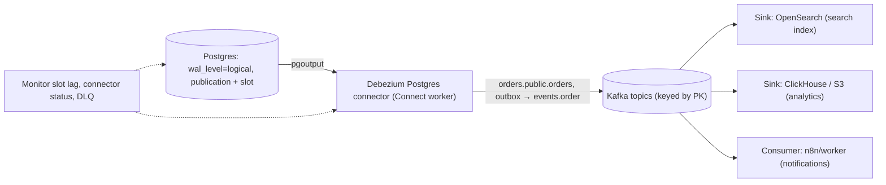

# Kafka - Kafka Connect & Debezium Pipelines

> [!info] Deep dive of [[Kafka]]

> [!abstract] TL;DR
> **Kafka Connect** runs **source** and **sink** connectors that move data between systems and Kafka, with offsets, retries and scaling handled by the framework. **Debezium** is the standard **CDC source**: it reads Postgres's WAL via a **logical replication slot** (`pgoutput`) and emits one event per row change (`before`/`after`/`op`) to topics per table. The **outbox event router** SMT turns an outbox table into clean domain events.
> - Typical pipelines: Postgres → Debezium → Kafka → sink (OpenSearch/Elasticsearch, ClickHouse, S3/R2, another DB, vector index).
> - **Debezium Server** streams CDC to Redis/Pub-Sub/Kinesis/HTTP **without** running Kafka. Often the right size for small teams.
> - **Operational truth**: the replication slot must be monitored (WAL retention), schema changes need a plan, and connectors need idempotent sinks.
> - **For most SME workloads**, an outbox + pgmq/BullMQ or Supabase webhooks is simpler. Use Connect/Debezium when several downstream systems need the same reliable change stream.

## Concept
| Component | Role | Notes |
|---|---|---|
| Connect worker (distributed mode) | Runs connectors/tasks, stores configs/offsets/status in Kafka topics | REST API on :8083 |
| Source connector | External system → Kafka | Debezium Postgres/MySQL, JDBC source |
| Sink connector | Kafka → external system | JDBC sink, S3, Elasticsearch/OpenSearch, ClickHouse |
| SMT (Single Message Transform) | Per-message reshaping | `ExtractNewRecordState` (unwrap), `EventRouter` (outbox), routing |
| Converter | Serialization | JSON (simple), Avro/Protobuf + Schema Registry (evolution) |
| Dead letter queue | Failed sink records | `errors.tolerance=all` + DLQ topic |
| Debezium Server | Standalone CDC → non-Kafka sinks | Redis Streams, Pub/Sub, Kinesis, HTTP |

**Debezium event** (simplified):

| Field | Meaning |
|---|---|
| `op` | `c` create, `u` update, `d` delete, `r` snapshot read |
| `before` / `after` | Row images (before needs `REPLICA IDENTITY FULL` for all columns) |
| `source` | LSN, txId, table, timestamp |
| `ts_ms` | Processing time |

## How It Works


## Practical Usage
**Postgres prerequisites**:
```sql
alter system set wal_level = 'logical';                  -- restart required (Supabase: already logical)
alter system set max_slot_wal_keep_size = '10GB';        -- cap WAL retained by a stuck connector
create role debezium with login replication password '…';
grant select on public.orders, public.order_items, public.outbox to debezium;
create publication dbz_pub for table public.orders, public.order_items, public.outbox;
```
**Debezium Postgres connector** (POST to Connect REST API):
```json
{
  "name": "pg-orders",
  "config": {
    "connector.class": "io.debezium.connector.postgresql.PostgresConnector",
    "plugin.name": "pgoutput",
    "database.hostname": "postgres", "database.port": "5432",
    "database.user": "debezium", "database.password": "${file:/secrets/pg.properties:password}",
    "database.dbname": "app",
    "topic.prefix": "app",
    "publication.name": "dbz_pub", "publication.autocreate.mode": "disabled",
    "slot.name": "dbz_orders",
    "table.include.list": "public.orders,public.order_items",
    "column.exclude.list": "public.orders.customer_ic",
    "snapshot.mode": "initial",
    "heartbeat.interval.ms": "60000",
    "transforms": "unwrap",
    "transforms.unwrap.type": "io.debezium.transforms.ExtractNewRecordState",
    "transforms.unwrap.delete.handling.mode": "rewrite"
  }
}
```
**Outbox event router** (clean domain events instead of table rows):
```json
{
  "transforms": "outbox",
  "transforms.outbox.type": "io.debezium.transforms.outbox.EventRouter",
  "transforms.outbox.table.field.event.key": "aggregate_id",
  "transforms.outbox.route.by.field": "aggregate_type",
  "transforms.outbox.route.topic.replacement": "events.${routedByValue}",
  "table.include.list": "public.outbox"
}
```
**JDBC/OpenSearch sink with DLQ** (idempotent upserts by key):
```json
{
  "name": "orders-to-search",
  "config": {
    "connector.class": "io.debezium.connector.jdbc.JdbcSinkConnector",
    "topics": "app.public.orders",
    "insert.mode": "upsert", "primary.key.mode": "record_key", "delete.enabled": "true",
    "errors.tolerance": "all",
    "errors.deadletterqueue.topic.name": "dlq.orders-to-search",
    "errors.deadletterqueue.context.headers.enable": "true"
  }
}
```
**Operate**:
```bash
curl -s localhost:8083/connectors?expand=status | jq          # RUNNING/FAILED per task
curl -X POST localhost:8083/connectors/pg-orders/restart?includeTasks=true
```
```sql
select slot_name, active, pg_size_pretty(pg_wal_lsn_diff(pg_current_wal_lsn(), confirmed_flush_lsn)) as lag
from pg_replication_slots where slot_name = 'dbz_orders';
```
**Wrong way**:
```text
❌ Deleting a connector but not its replication slot     → WAL accumulates until the disk fills
❌ CDC of every internal table as the public event contract → consumers break on every schema change
❌ Non-idempotent sinks (insert-only)                     → duplicates after connector restarts (at-least-once)
❌ Streaming IC numbers/addresses to analytics sinks       → PDPA exposure; exclude columns at the source
```

## Patterns & Anti-patterns
| Pattern | When | Anti-pattern to avoid |
|---|---|---|
| Outbox table + EventRouter for domain events | Event-driven integration | Raw table CDC as an API |
| Column/table include lists, exclude PII | Every connector | Capturing whole databases |
| Idempotent upsert sinks keyed by PK | All sinks | Append-only targets without dedupe |
| `max_slot_wal_keep_size` + slot lag alerts | Postgres sources | Unbounded WAL retention |
| Schema Registry (Avro/Protobuf) for many consumers | Evolving schemas | Ad-hoc JSON with breaking changes |
| Debezium Server for Kafka-less setups | Small teams, Redis/Pub-Sub sinks | Running a Kafka cluster for one pipeline |
| DLQ + alerting on sink failures | Production | `errors.tolerance=all` with no DLQ (silent drops) |

## Performance & Trade-offs
- **Initial snapshot** reads whole tables (heavy I/O, long-running transaction). Run it off-peak, or use incremental snapshots (signal table) for large tables.
- **Throughput**: one Postgres connector reads one slot sequentially, which is plenty for SME volumes (thousands of changes/s). Large transactions create bursts.
- **Infra cost**: Kafka (KRaft) + Connect + optional Schema Registry is ~2–4 GB RAM minimum. Redpanda reduces footprint. Debezium Server + Redis Streams is far lighter ([[Kafka - KRaft, Redpanda & Small-Infra Trade-offs]]).
- **Delivery semantics**: Connect is at-least-once by default (exactly-once source support exists for some connectors). Design idempotent consumers ([[Kafka - Partitions, Consumer Groups & Delivery Semantics]]).

## Tips & Reminders
> [!tip] In ZP's stack
> - **Default answer for SME clients**: outbox table + pgmq/BullMQ relay or Supabase webhooks ([[System Design - Event-Driven Architecture & Outbox Pattern]]). Reach for Debezium when a client needs Postgres changes in search, analytics and other services reliably and replayably.
> - **Supabase**: logical replication is available. Check slot limits per plan and connection requirements (direct connection, not the transaction pooler) ([[PostgreSQL - Logical Replication & Change Data Capture]]).
> - **Search/vector indexes**: CDC of `products`/`documents` into OpenSearch or a vector DB keeps indexes fresh without dual writes ([[Vector Databases - Qdrant & Dedicated Vector DB Operations]]).

- Use Connect's config providers (file/env) for secrets. Never put passwords in connector JSON stored in git.
- Version connector configs in git, and apply them via the REST API in CI.
- Set `heartbeat.interval.ms` so slots advance on low-traffic databases.
- Test schema changes (add column, rename) against the pipeline in staging.

## Version Notes
| Version | Change relevant here |
|---|---|
| Debezium 2.x (2022–24) | Incremental snapshots, JDBC sink connector, Debezium Server sinks |
| Debezium 3.0 (2024) | Java 17 baseline, Kafka 3.x+, new UI/platform efforts |
| Debezium 3.6 (2026-07) / 3.6.2 (2026-09-01) | Latest final found. Fixes across connectors, Debezium Server log password masking |
| Debezium 3.7 (beta, 2026-08) | Next minor in progress |
| Kafka 4.x | ZooKeeper removed (KRaft only) ([[Kafka]]) |

> [!warning] Unverified — check before relying on this
> Whether Debezium 3.7 final has shipped, Kafka 4.3 compatibility of specific connectors, and Supabase's replication slot limits weren't verified. Check https://debezium.io/releases/ before deploying.

## Critical Issues & Gotchas
> [!danger] Abandoned replication slots fill the primary's disk
> When a Debezium connector stops (crash, paused, deleted) its slot keeps retaining WAL. On a small VPS this fills the disk in days, and Postgres stops accepting writes, taking every app down. Set `max_slot_wal_keep_size`, alert on slot lag and `active = false`, and drop slots when decommissioning connectors.

> [!danger] Schema changes break pipelines silently
> Renaming or dropping columns, changing types, or adding NOT NULL without defaults can make sinks fail (records go to the DLQ) or downstream consumers misinterpret data. Coordinate DDL: add columns first, deploy consumers, then remove old fields. Use a schema registry with compatibility rules when many consumers exist.

- **TOAST/unchanged large columns** may appear as placeholders in update events unless `REPLICA IDENTITY FULL`. Handle them in sinks.
- **Deletes** produce tombstones. Compacted topics and sinks must handle them (`delete.enabled`).
- **Time zones and numeric types** (decimal handling mode) differ between connectors. Configure `decimal.handling.mode` explicitly.
- **Credentials** for the replication role grant read access to included tables. Treat them as sensitive.

## Related
- [[Kafka]]
- [[PostgreSQL - Logical Replication & Change Data Capture]] — slots, publications, WAL
- [[System Design - Event-Driven Architecture & Outbox Pattern]] — outbox design
- [[Kafka - KRaft, Redpanda & Small-Infra Trade-offs]] — sizing the cluster
- [[Kafka - Partitions, Consumer Groups & Delivery Semantics]] — ordering and delivery
- [[Message Queues - Choosing BullMQ, pgmq, RabbitMQ or NATS]] — simpler alternatives

## References
- https://debezium.io/documentation/reference/stable/connectors/postgresql.html
- https://debezium.io/documentation/reference/stable/transformations/outbox-event-router.html
- https://debezium.io/documentation/reference/stable/operations/debezium-server.html
- https://kafka.apache.org/documentation/#connect
- https://debezium.io/releases/
