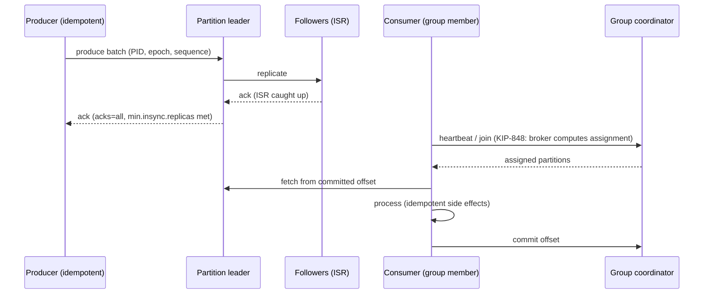

# Kafka - Partitions, Consumer Groups & Delivery Semantics

> [!info] Deep dive of [[Kafka]]

> [!abstract] TL;DR
> - **Partitions** are Kafka's unit of ordering, parallelism and replication. Records with the same **key** land in the same partition and stay ordered.
> - **Consumer groups** split partitions among members, so max parallelism = partition count. Progress is tracked by committed **offsets**.
> - **Delivery** is at-least-once by default. Idempotent producers stop duplicates from retries, and **transactions** give exactly-once *within Kafka* (read → process → write).
> - **Side effects outside Kafka** (DB writes, WhatsApp sends) need idempotency keys.
> - **Kafka 4.x**: the new broker-side rebalance protocol (KIP-848) is GA, and **share groups** (4.2) add queue-style per-record acks.

## Concept

### Partitions and keys
- A topic with N partitions = N independent append-only logs. Each record gets an increasing **offset** within its partition.
- **Partitioner**: `murmur2(key) % numPartitions` for keyed records. Null keys use the **sticky partitioner**, which batches to one partition until the batch is full, then switches.
- **Ordering guarantee**: only per partition. Choose the key as the entity whose events must stay ordered (`order_id`, `conversation_id`, `tenant_id`).
- **Changing the partition count** re-maps keys (hash mod N changes), which breaks per-key ordering for in-flight data. Size up front, or create a new topic and migrate.

### Consumer groups
- Each partition is assigned to **exactly one** consumer in a group. Extra consumers beyond the partition count sit idle.
- Different groups are independent: each gets the full stream (fan-out by group).
- **Committed offset** = next offset to read. Lag = log end offset − committed offset.

### Share groups (Kafka 4.2, production-ready)
- Multiple consumers can read the **same partition**, and each record is acquired, then **acknowledged / released / rejected** individually, with delivery counts and a lock timeout.
- That gives queue semantics (competing consumers beyond the partition count, per-message retry), but **no per-key ordering** guarantee.

### Delivery semantics matrix
| Goal | Producer | Consumer | Caveat |
|---|---|---|---|
| At-most-once | `acks=0/1`, no retries | Commit **before** processing | Loses data on failure |
| **At-least-once** (default) | `acks=all`, idempotence on, retries | Commit **after** processing | Duplicates on crash/rebalance, so downstream must be idempotent |
| Exactly-once within Kafka | Transactions (`transactional.id`) | `isolation.level=read_committed`, offsets committed in the transaction (`sendOffsetsToTransaction`) | Only covers Kafka→Kafka. External DB writes aren't included |
| Effectively-once end to end | At-least-once | Idempotent sink: upsert by key / dedup table / transactional outbox | The practical target for most systems |

## How It Works

- **Idempotent producer**: each producer has a producer ID + epoch, and each batch has sequence numbers per partition. The broker drops duplicates from retries, and ordering is preserved with up to 5 in-flight requests.
- **Transactions**: a transaction coordinator writes markers. Consumers with `read_committed` skip aborted records and wait at the **LSO** (last stable offset).
- **High watermark**: consumers only see records replicated to all ISR members. With `acks=all` + `min.insync.replicas=2` + RF=3, an acknowledged write survives one broker loss.
- **Rebalancing**:
  - **Classic eager**: stop-the-world.
  - **Cooperative sticky**: incremental.
  - **KIP-848** (`group.protocol=consumer`, GA in 4.0): the broker computes assignments, members reconcile incrementally, and no global sync barrier is needed. That means far fewer pauses at scale.
- **Static membership** (`group.instance.id`): restarts within `session.timeout.ms` don't trigger rebalances, which suits rolling deploys on Kubernetes.

## Practical Usage

### Producer (Node.js, Confluent's librdkafka-based client)
```ts
import { KafkaJS } from "@confluentinc/kafka-javascript";   // KafkaJS-compatible API; KafkaJS itself is unmaintained
const kafka = new KafkaJS.Kafka({ kafkaJS: { brokers: ["kafka:9092"], clientId: "orders-api" } });

const producer = kafka.producer({ kafkaJS: { idempotent: true, acks: -1 } });   // acks=all
await producer.connect();
await producer.send({
  topic: "orders.events.v1",
  messages: [{ key: order.id, value: JSON.stringify({ type: "OrderPaid", orderId: order.id, v: 1 }),
               headers: { "event-id": eventId } }],          // event-id = idempotency key for consumers
});
```

### Consumer with manual commits + idempotent sink
```ts
const consumer = kafka.consumer({ kafkaJS: { groupId: "billing-service", fromBeginning: false, autoCommit: false } });
await consumer.connect();
await consumer.subscribe({ topics: ["orders.events.v1"] });

await consumer.run({
  eachMessage: async ({ topic, partition, message }) => {
    const eventId = message.headers?.["event-id"]?.toString()!;
    await db.tx(async (t) => {
      const inserted = await t.oneOrNone(
        "insert into processed_events(event_id) values ($1) on conflict do nothing returning event_id", [eventId]);
      if (inserted) await applyBilling(t, JSON.parse(message.value!.toString()));   // side effect once per event
    });
    await consumer.commitOffsets([{ topic, partition, offset: (BigInt(message.offset) + 1n).toString() }]);
  },
});
```
**Wrong way**: auto-commit every 5 s, then call an external API. A crash after the commit but before the call loses the event. A crash after the call but before the commit duplicates it.

### Key configs
```properties
# producer
acks=all
enable.idempotence=true
max.in.flight.requests.per.connection=5
delivery.timeout.ms=120000
linger.ms=5
compression.type=zstd
# topic / broker
replication.factor=3
min.insync.replicas=2
unclean.leader.election.enable=false
# consumer
group.protocol=consumer            # KIP-848 (4.0+)
enable.auto.commit=false
isolation.level=read_committed     # if producers use transactions
max.poll.interval.ms=300000        # processing time per poll must stay below this
group.instance.id=${POD_NAME}      # static membership
```

## Patterns & Anti-patterns
| Pattern | When | Anti-pattern to avoid |
|---|---|---|
| Key by the entity needing order (`order_id`, `conversation_id`) | Per-entity ordering | Random/null keys when order matters. One giant key creating a hot partition |
| Over-provision partitions moderately (e.g. 2–3× expected consumers) | New topics | Increasing partitions later on keyed topics |
| Commit after processing + idempotent sink (dedup table/upsert) | Side effects outside Kafka | Auto-commit with external side effects |
| Transactional outbox (Debezium CDC from Postgres) | Publishing events from DB writes | Dual writes (DB + Kafka) without coordination |
| Retry topics + DLQ (`orders.retry.1m`, `orders.dlq`) | Transient vs permanent failures | Blocking a partition forever on a poison message |
| Share groups for job-like workloads | Per-message ack, many workers | Using share groups when per-key ordering is required |

## Performance & Trade-offs
- **Partition count**: more partitions = more parallelism, but more open files, replication traffic, longer failovers and more memory. Typical clusters run thousands to tens of thousands of partitions. KRaft raises the ceiling.
- **Throughput levers**: batching (`linger.ms`, `batch.size`), compression (zstd/lz4), `fetch.min.bytes`, consumer concurrency per partition (process in order but pipeline I/O).
- **Durability vs latency**: `acks=all` adds a replication round trip (low ms in-region). Cross-AZ replication costs money on cloud providers.
- **Exactly-once cost**: transactions add coordinator round trips and LSO waiting, so `read_committed` consumers can lag behind open transactions.
- **Lag** is the key SLI. Alert on lag growth and the age of the oldest unconsumed record, not raw counts.

## Tips & Reminders
> [!tip]
> - Version topics (`orders.events.v1`) and payloads. Use a schema registry (Avro/Protobuf/JSON Schema) for multi-team topics.
> - Keep processing per record well under `max.poll.interval.ms`, or the consumer is kicked out (rebalance storm).
> - Use the cooperative/KIP-848 protocol and static membership to avoid rebalance pauses on deploys.
> - Test failure paths: kill consumers mid-processing, restart brokers, verify no loss and no double side effects.
> - **In ZP's stack**: most SME workloads don't need this. BullMQ/pgmq ([[Message Queues]]) covers webhooks and jobs. Use Kafka (managed, or a single-node KRaft broker for dev) only for CDC/event streaming between several services or analytics pipelines, and always with idempotent sinks into [[PostgreSQL]].

## Version Notes
| Version | Change |
|---|---|
| 0.11 (2017) | Idempotent producer, transactions (EOS) |
| 2.4 | Cooperative incremental rebalancing, follower fetching (KIP-392) |
| 3.0 | `acks=all` + idempotence enabled by default for producers |
| **4.0** (2025-03) | ZooKeeper removed. **KIP-848 consumer protocol GA**. Share groups early access |
| 4.1 (2025-09) | Share groups preview. Streams rebalance protocol (KIP-1071) |
| **4.2** (2026-02-17) | **Share groups production-ready** (lock renewal, lag metrics, fetch limits) |

## Critical Issues & Gotchas
> [!danger] "Exactly-once" ends at Kafka's boundary
> Kafka transactions guarantee atomic read-process-write **between Kafka topics** only. Calling an HTTP API, sending a WhatsApp message or writing to Postgres inside a consumer is still at-least-once. Teams that assume EOS covers side effects end up double-charging or double-messaging customers. Use dedup keys and idempotent writes for every external effect.

> [!danger] Data loss from weak durability settings
> `acks=1`, `min.insync.replicas=1` or `unclean.leader.election.enable=true` can silently drop acknowledged writes when a leader fails. RF=3 + `min.insync.replicas=2` + `acks=all` + unclean election disabled is the baseline for anything important.

> [!warning] Gotchas
> - Hot partitions from skewed keys (one big tenant) cap throughput at one consumer. Add a salt/sub-key, or split the tenant topic.
> - Long GC pauses or slow processing → missed heartbeats/poll intervals → rebalances → duplicates.
> - Offsets of a consumer group expire after `offsets.retention.minutes` (7 days default) when the group is inactive. On restart it falls back to `auto.offset.reset` (earliest = reprocess everything, latest = skip).
> - Log compaction doesn't remove duplicates immediately. Consumers still see multiple values per key until compaction runs.
> - Rolling back a deploy that changed message formats requires consumers to tolerate both versions.

## Related
- [[Kafka]]
- [[Message Queues]] — job queues vs logs, DLQ and idempotency patterns
- [[System Design]] — outbox, sagas, idempotency
- [[PostgreSQL]] — CDC source and idempotent sink
- [[Redis]] — Redis Streams as a lighter alternative

## References
- Kafka documentation (design: delivery semantics): https://kafka.apache.org/documentation/#semantics
- KIP-848 next-gen consumer rebalance protocol: https://cwiki.apache.org/confluence/display/KAFKA/KIP-848%3A+The+Next+Generation+of+the+Consumer+Rebalance+Protocol
- KIP-932 queues for Kafka (share groups): https://cwiki.apache.org/confluence/display/KAFKA/KIP-932%3A+Queues+for+Kafka
- Kafka 4.2 upgrade notes: https://kafka.apache.org/42/getting-started/upgrade/
- Confluent JavaScript client: https://github.com/confluentinc/confluent-kafka-javascript
