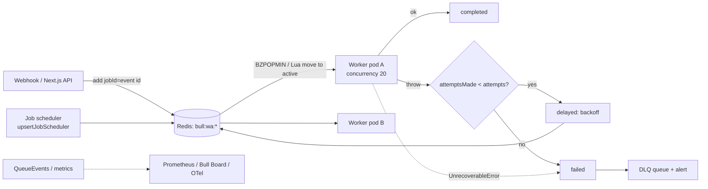

# Message Queues - BullMQ in Production

> [!info] Deep dive of [[Message Queues]]

> [!abstract] TL;DR
> BullMQ gives Node.js durable-enough background jobs on [[Redis]]: retries with backoff, delays, priorities, rate limits, schedulers and parent/child flows. Production means:
> - **Redis**: `noeviction` + AOF.
> - **Jobs**: **idempotent** handlers with `jobId`/deduplication, bounded `removeOnComplete/Fail`, a real **DLQ** process, and **graceful shutdown**.
> - **Workers**: CPU work in sandboxed processors.
> - **Alerting**: on queue depth, oldest-waiting age and failure rate, not just on errors.

## Concept

### Job lifecycle
| State | Meaning | Ops concern |
|---|---|---|
| `wait` / `prioritized` | Ready, waiting for a worker | Depth + age of oldest = backlog signal |
| `delayed` | Scheduled for later (delay or backoff) | Retry storms show up here |
| `active` | Locked by a worker (lock renewed every `lockDuration / 2`) | Long jobs must keep the event loop free or the lock expires |
| `waiting-children` | Parent in a flow waiting for children | Stuck parents = a failed child without `failParentOnFailure` |
| `completed` / `failed` | Terminal (kept per `removeOn*`) | Unbounded retention = Redis memory leak |
| **stalled** (event, not a state) | Lock expired while active → moved back to wait (or failed after `maxStalledCount`) | Blocked event loop, OOM-killed worker, or deploy without `close()` |

### Key settings
| Setting | Default | Production value | Why |
|---|---|---|---|
| `attempts` / `backoff` | 1 / none | 5–8, `exponential` 2–5 s (+ jitter via custom strategy) | Transient failures (Meta 5xx, LLM 529/overloaded) |
| `removeOnComplete` | keep all | `{ age: 86400, count: 10000 }` | Memory |
| `removeOnFail` | keep all | `{ age: 14 * 86400 }` | Keep failures long enough to triage |
| `concurrency` (worker) | 1 | I/O jobs 20–100. CPU jobs = cores (sandboxed) | Throughput without starving the loop |
| `lockDuration` | 30 s | ≥ 2× worst-case blocking section | Avoid false stalls |
| `maxStalledCount` | 1 | 1–2 | Poison jobs that crash workers end in `failed` |
| `limiter` | none | `{ max, duration }` per queue (global across workers) | Respect provider rate limits |
| ioredis `maxRetriesPerRequest` | 20 | **`null`** for Worker connections (required) | Blocking commands must not error out |

## How It Works

- **Data layout**: all state lives in Redis keys under the prefix `bull:<queue>:`, as hashes per job plus lists/sorted sets per state. Transitions happen in **Lua scripts**, so they're atomic per operation.
- **Connections**: each `Worker` uses **2 connections** (one blocking), and `QueueEvents` uses another (a stream reader). 20 worker processes × 3 queues ≈ 120 connections, so size Redis `maxclients` and connection limits accordingly.
- **Delivery semantics**: **at-least-once**. A job can run twice after a stall, crash or redeploy, so handlers must be idempotent.

## Practical Usage

### Shared connection + queue factory
```ts
import { Queue, Worker, QueueEvents, UnrecoverableError, MetricsTime } from "bullmq";
import IORedis from "ioredis";

export const connection = new IORedis(process.env.REDIS_URL!, { maxRetriesPerRequest: null, enableReadyCheck: true });

export const waInbound = new Queue("wa-inbound", {
  connection,
  defaultJobOptions: {
    attempts: 6,
    backoff: { type: "custom" },                            // see backoffStrategy below
    removeOnComplete: { age: 86_400, count: 10_000 },
    removeOnFail: { age: 14 * 86_400 },
  },
});
```

### Producer: dedupe at the edge
```ts
// Webhook handler: verify signature, then enqueue and return 200 immediately
await waInbound.add("message", payload, { jobId: `meta:${payload.messageId}` });          // same id = no duplicate job

// Debounce/throttle bursts (e.g. "recompute customer summary" at most once per 30 s)
await summaries.add("recompute", { customerId }, { deduplication: { id: `cust:${customerId}`, ttl: 30_000 } });
```

### Worker: retries, non-retryable errors, rate limits, shutdown
```ts
const worker = new Worker("wa-inbound", async (job) => {
  const msg = job.data;
  if (!isValid(msg)) throw new UnrecoverableError("schema invalid");   // straight to failed, no retries

  try {
    await handleMessage(msg);                                        // idempotent: unique(message_id) in Postgres
  } catch (e: any) {
    if (e.status === 429) {                                          // provider rate limit: pause the whole queue
      await worker.rateLimit(Number(e.retryAfterMs ?? 60_000));
      throw Worker.RateLimitError();                                 // job returns to wait without consuming an attempt
    }
    throw e;                                                         // normal retry with backoff
  }
}, {
  connection,
  concurrency: 20,
  limiter: { max: 80, duration: 1000 },                              // Meta/LLM throughput cap across all workers
  metrics: { maxDataPoints: MetricsTime.ONE_WEEK * 2 },
  settings: {
    backoffStrategy: (attemptsMade) => Math.min(2 ** attemptsMade * 2000, 10 * 60_000) * (0.75 + Math.random() * 0.5),
  },
});

worker.on("failed", async (job, err) => {
  if (job && job.attemptsMade >= (job.opts.attempts ?? 1)) {
    await deadLetter.add("dead", { queue: job.queueName, id: job.id, data: job.data, error: err.message });
    alert(`wa-inbound job ${job.id} dead-lettered: ${err.message}`);
  }
});

for (const sig of ["SIGTERM", "SIGINT"]) process.on(sig, async () => { await worker.close(); process.exit(0); });
```

### Schedules (replaces old repeatable jobs)
```ts
await reports.upsertJobScheduler("daily-sales-report", { pattern: "0 30 23 * * *", tz: "Asia/Kuching" },
  { name: "daily-report", data: { tenant: "all" }, opts: { attempts: 3 } });
// Idempotent: calling it on every boot updates instead of duplicating schedules
```

### CPU-heavy work in sandboxed processors
```ts
// Runs in a separate process/worker thread → doesn't block lock renewal of the main worker
new Worker("pdf-render", new URL("./processors/pdf.js", import.meta.url), { connection, concurrency: 4, useWorkerThreads: true });
```

### Flows (fan-out, then aggregate)
```ts
import { FlowProducer } from "bullmq";
await new FlowProducer({ connection }).add({
  name: "monthly-invoice-batch", queueName: "billing", data: { month: "2026-09" },
  children: tenants.map((t) => ({ name: "invoice", queueName: "invoices", data: { tenant: t.id }, opts: { failParentOnFailure: true } })),
});
```

## Patterns & Anti-patterns
| Pattern | When | Anti-pattern to avoid |
|---|---|---|
| `jobId` = provider event ID + DB unique constraint | Webhooks, payments | Relying on "BullMQ runs each job once" |
| `UnrecoverableError` for validation/4xx | Bad input, permanent errors | Retrying 6× on a 400 → noise + delayed alerting |
| `worker.rateLimit()` on 429 | Meta, LLM, Shopify APIs | Retrying 429s with exponential backoff per job (thundering herd when the window resets) |
| Separate queues by workload (inbound, outbound, LLM, reports) | Mixed latency needs | One queue where a 10-min report blocks real-time WhatsApp replies |
| Sandboxed processors for CPU work | PDF, image, parsing | CPU loops in the main worker → stalled jobs → duplicates |
| Bounded `removeOn*` + metrics | Always | Millions of completed jobs eating Redis RAM |
| Job schedulers created idempotently at boot | Cron-like tasks | `setInterval` in the API process, or duplicate repeatables after each deploy |

## Performance & Trade-offs
- **Throughput**: a single Redis handles thousands of jobs/s for small payloads. The bottleneck is usually your handlers or downstream APIs.
- **Payload size**: keep job data small (IDs, not 2 MB blobs). Large payloads bloat Redis memory and AOF. Store blobs in Postgres/R2 and pass references.
- **Redis vs Postgres queue**:
  - **BullMQ**: features and throughput, but a separate durability domain.
  - **pgmq/pg-boss**: transactional enqueue with business writes (an outbox for free), simpler ops on [[Supabase]], lower throughput.
  - **Rule**: choose Postgres when "job must exist if the order committed" matters more than throughput.
- **Ordering**: per-group FIFO needs BullMQ Pro groups or a per-key queue. Usually version checks in handlers are simpler.
- **Multi-region/HA**: BullMQ needs a single primary. Redis Sentinel or managed HA, and use `{hashtag}` prefixes on Redis Cluster ([[Redis - Persistence & High Availability]]).

## Tips & Reminders
> [!tip]
> - **Redis config**: `maxmemory-policy noeviction` (eviction silently deletes jobs), `appendonly yes` + `appendfsync everysec`, and memory alerts at 70%.
> - **Dashboard**: Bull Board (or Taskforce.sh) behind auth (Cloudflare Access or Traefik basic auth). Never public, since it can retry/delete jobs.
> - **Metrics to alert on**: `getJobCounts()` (waiting, delayed, failed), oldest waiting job age, failure rate per queue, and stalled events.
> - **Version the payload** with a schema (`v: 2`) so old jobs still process after a deploy changes handler expectations.
> - **In ZP's stack**:
>   - **Topology**: API and worker containers in [[Coolify]] share one Redis with AOF on a persistent volume. Use separate queues for `wa-inbound`, `wa-outbound` (Meta rate limit), `llm` (limiter tuned to provider TPM) and `reports`.
>   - **[[n8n]]**: queue mode uses its own Bull queue. Don't share the Redis DB index or prefix with your app queues ([[n8n - Queue Mode & Scaling]]).

## Version Notes
| Version | Change |
|---|---|
| Bull → BullMQ (2019) | TypeScript rewrite, streams-based events, flows |
| 5.0 (2023-12 → 2024) | New job markers and internal key changes (check the migration guide and the minimum Redis version before upgrading from v4) |
| 5.x (2024–2025) | Job schedulers (`upsertJobScheduler`) replace repeatable jobs, `deduplication` option (replaces `debounce`), OpenTelemetry telemetry hooks |
| 2026 | Official ports: Python, PHP, Elixir, .NET, Rust (1.0 2026-07) using the same Redis protocol/Lua scripts |

> [!warning] Unverified — check before relying on this
> A Node.js BullMQ v6 line may have shipped in 2026 (only an indirect signal was found). Check the GitHub releases and migration guide before upgrading, and pin the major version in `package.json`.

## Critical Issues & Gotchas
> [!danger] Eviction or non-persistent Redis = silent job loss
> With `allkeys-lru` (a common default on managed or shared Redis) or no AOF, jobs vanish under memory pressure or restart. Nothing errors: orders aren't processed and messages aren't sent. Use a dedicated Redis for queues with `noeviction` and AOF, and alert on `evicted_keys > 0`.

> [!danger] Duplicate side effects after stalls and deploys
> A worker killed mid-job (OOM, `docker stop` timeout, Coolify redeploy without `worker.close()`) leaves the job active. It stalls and runs again, sending the WhatsApp message or charging twice. Make every external side effect idempotent (provider idempotency keys, DB state guards), handle `SIGTERM`, and give containers a stop grace period ≥ the longest job.

> [!warning] Gotchas
> - `maxRetriesPerRequest` must be `null` on Worker connections, or workers throw on Redis hiccups.
> - Changing `defaultJobOptions` doesn't affect already-enqueued jobs.
> - `queue.obliterate()` / `drain()` in a script pointed at the wrong env wipes production. Guard with an env check.
> - Large `concurrency` with sync code doesn't add parallelism. It just increases stall risk ([[Node.js - Performance & Diagnostics]]).
> - Timezone-less cron patterns run in UTC. Pass `tz` for Malaysian business hours.
> - Valkey/Dragonfly compatibility: Valkey generally works, while Dragonfly needs specific flags. Test the Lua scripts before switching ([[Valkey]]).

## Related
- [[Message Queues]]
- [[Redis]] — data structures, memory, `noeviction`
- [[Redis - Persistence & High Availability]] — AOF, Sentinel, failover behaviour
- [[REST API - Webhooks & Idempotency]] — enqueue-and-ack receivers, dedupe keys
- [[n8n - Queue Mode & Scaling]] — n8n's own Bull-based queue
- [[Supabase - Edge Functions, Cron & Queues]] — Postgres-native pgmq alternative for Supabase apps
- [[Node.js]] — event loop, graceful shutdown

## References
- BullMQ docs: https://docs.bullmq.io/
- Going to production: https://docs.bullmq.io/guide/going-to-production
- Job schedulers: https://docs.bullmq.io/guide/job-schedulers
- Rate limiting: https://docs.bullmq.io/guide/rate-limiting
- BullMQ releases: https://github.com/taskforcesh/bullmq/releases
