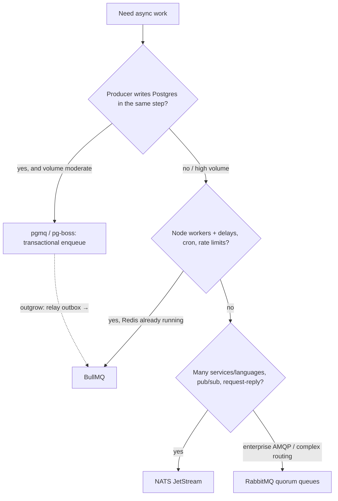

# Message Queues - Choosing BullMQ, pgmq, RabbitMQ or NATS

> [!info] Deep dive of [[Message Queues]]

> [!abstract] TL;DR
> Default to the queue that lives **in infrastructure you already run**:
> - **pgmq** (Supabase Queues) when Postgres is the source of truth and you want transactional enqueue;
> - **BullMQ** when you already run Redis and need delays, repeatable jobs, rate limits, flows and a dashboard;
> - **NATS JetStream** for lightweight cross-service messaging and pub/sub across languages;
> - **RabbitMQ** for rich routing, AMQP interop with enterprise systems, or many heterogeneous consumers.
>
> Add a broker only when a concrete requirement forces it. Every new stateful service is another thing to back up, patch and monitor solo.

## Concept
| | **pgmq** (Postgres) | **BullMQ** (Redis) | **NATS JetStream** | **RabbitMQ 4.x** |
|---|---|---|---|---|
| Model | SQS-like queue tables | Job queue (Node-first) | Subjects + persistent streams/consumers | Exchanges → queues (AMQP 0.9.1 / 1.0) |
| Transactional enqueue with your data | **Yes** (same DB transaction) | No (outbox needed) | No (outbox needed) | No (outbox needed) |
| Delays / scheduling | Visibility timeout, `send` with delay | Delays, repeatable (cron), priorities | Message scheduling (2.12+) | Delayed via plugin / TTL+DLX |
| Rate limiting | DIY | Built in (queue-level). Per-group in Pro | DIY | Prefetch + DIY |
| Fan-out / pub/sub | DIY | Limited (events) | **Native** (subjects, wildcards) | **Native** (fanout/topic exchanges) |
| Multi-language consumers | Any SQL client | Node (Python/Elixir ports exist) | Excellent (many official clients) | Excellent |
| Ops footprint | **None extra** | Redis (AOF, `noeviction`) | Single Go binary; cluster for HA | Erlang cluster, quorum queues, more tuning |
| Throughput sweet spot | ≲ 1–5k msg/s | ~10k+ jobs/s | 100k+ msg/s | 10k–50k+ msg/s |
| UI | SQL + Supabase dashboard | Bull Board / Taskforce | `nats` CLI, Surveyor | Management UI |

- **Managed alternatives**: Cloudflare Queues (if work runs in Workers), Amazon SQS/SNS, Upstash QStash (HTTP push). Zero ops, but per-message pricing and vendor coupling.
- **Not a queue**: [[Kafka]] (and Redpanda) is a replayable log for event streaming and analytics. It's overkill for background jobs at SME scale.

## How It Works


## Practical Usage
**pgmq**: enqueue in the business transaction (see [[Supabase - Edge Functions, Cron & Queues]]):
```sql
begin;
update orders set status = 'paid' where id = $1;
select pgmq.send('wa_outbound', jsonb_build_object('order_id', $1, 'template', 'payment_received'));
commit;
```
**BullMQ**: delays, retries and a global rate limit (e.g. stay under the Meta Cloud API throughput):
```ts
import { Queue, Worker } from 'bullmq';
const q = new Queue('wa-send', { connection });
await q.add('reminder', { orderId }, { delay: 24 * 3600_000, attempts: 5, backoff: { type: 'exponential', delay: 10_000 },
                                      jobId: `reminder:${orderId}` });            // dedupe by jobId
new Worker('wa-send', sendTemplate, { connection, concurrency: 10, limiter: { max: 60, duration: 1_000 } });
```
**NATS JetStream**: a durable consumer, across services and languages:
```ts
import { connect } from '@nats-io/transport-node';
import { jetstream, jetstreamManager, AckPolicy } from '@nats-io/jetstream';

const nc = await connect({ servers: 'nats://nats:4222' });
const jsm = await jetstreamManager(nc);
await jsm.streams.add({ name: 'ORDERS', subjects: ['orders.*'] });
await jsm.consumers.add('ORDERS', { durable_name: 'invoicer', ack_policy: AckPolicy.Explicit, max_deliver: 5 });
const js = jetstream(nc);
await js.publish('orders.paid', JSON.stringify({ orderId }), { msgID: `paid:${orderId}` });   // server-side dedupe window
const c = await js.consumers.get('ORDERS', 'invoicer');
for await (const m of await c.consume()) { await createInvoice(m.json()); m.ack(); }
```
**RabbitMQ**: quorum queue with a dead-letter exchange:
```ts
await ch.assertExchange('dlx', 'fanout', { durable: true });
await ch.assertQueue('invoices', { durable: true, arguments: { 'x-queue-type': 'quorum', 'x-dead-letter-exchange': 'dlx', 'x-delivery-limit': 5 } });
await ch.prefetch(20);                                      // backpressure per consumer
```
**Wrong way**:
```text
❌ Add RabbitMQ + NATS + Redis "for flexibility" on a 4 GB KVM running one Next.js app
❌ Redis with maxmemory-policy allkeys-lru under BullMQ   → jobs silently evicted
❌ Enqueue to BullMQ before the DB commit                 → worker runs on data that rolled back
```

## Patterns & Anti-patterns
| Pattern | When | Anti-pattern to avoid |
|---|---|---|
| Start with pgmq, relay via an outbox to BullMQ/NATS when outgrown | Supabase-first products | Introducing a broker on day one |
| One queue tech per product | Solo/small team | Different queue per feature |
| Idempotent consumers + dedupe keys (`jobId`, `msgID`, idempotency table) | Every option (all are at-least-once) | Trusting "exactly once" marketing |
| DLQ + alert on depth and age | Every option | Poison messages retried forever |
| Separate queues per workload class (fast vs slow, per tenant tier) | Mixed workloads | One queue where a slow PDF job blocks WhatsApp replies |
| Managed queue when the compute is managed (Workers → Cloudflare Queues) | Edge-native apps | Self-hosting a broker for Workers |

## Performance & Trade-offs
- **pgmq** adds write load and MVCC churn to your primary DB. Fine for thousands of messages per minute; plan archive rotation and vacuum beyond that.
- **BullMQ** is fast and feature-rich, but Redis durability depends on AOF (`appendfsync everysec` loses ≤1 s on crash) and `noeviction`. Redis memory must hold queue backlogs during outages.
- **NATS** is operationally light (a single binary, a JetStream file store), but its job-queue ergonomics (delays, cron, per-job retries with backoff) need more code than BullMQ.
- **RabbitMQ 4.x**: quorum queues (Raft) are the durable default, Khepri is the metadata store, and AMQP 1.0 is core. It's the most features for routing, and the most operational surface.
- **Cost of a broker** for a solo founder: 1 extra container, backups/HA decisions, monitoring, upgrades and CVE patching. That's roughly 1–2 hours a month of ops forever.

## Tips & Reminders
> [!tip] In ZP's stack
> - **Supabase-backed SaaS**: pgmq for app jobs (notifications, AI tasks, sync).
> - **BullMQ** when you need per-number WhatsApp throttling, repeatable reminders or Bull Board for support staff. Redis is already present for n8n queue mode ([[n8n - Queue Mode & Scaling]]), but use a **separate Redis DB or instance** from n8n's.
> - **NATS** only if the product splits into several services in different languages (e.g. Python AI workers + Node APIs).
> - **RabbitMQ** only for client integrations that require AMQP.

- Model the outbox once ([[System Design - Reliability Patterns]]). Then any queue can be swapped behind a relay.
- Measure queue age (oldest message), not just depth. Age is what customers feel.
- Keep payloads small (IDs, not documents). Large payloads belong in Postgres or R2.

## Version Notes
| Product | Version / date | Change relevant here |
|---|---|---|
| RabbitMQ | 4.0–4.2 (2024–25) | AMQP 1.0 core, Khepri default metadata store, quorum queue priorities. Classic mirrored queues removed (use quorum) |
| NATS | 2.12 (2025-09) | JetStream batch publishing, message scheduling |
| NATS | 2.14 (2026-04) | High-throughput JetStream publishing, extended scheduling. 2.15 reported later in 2026 |
| BullMQ | 5.x | Job schedulers (replacing repeatable API), flows, OpenTelemetry |
| pgmq / Supabase Queues | 2024-12 → | Postgres-native queues with `pgmq_public` API |

> [!warning] Unverified — check before relying on this
> NATS 2.15's date and BullMQ 5.x feature specifics weren't confirmed this run, and throughput figures are order-of-magnitude guidance. See https://docs.nats.io/release-notes/whats_new and https://docs.bullmq.io.

## Critical Issues & Gotchas
> [!danger] Dual-write between DB and broker
> Writing to Postgres and then publishing to BullMQ/NATS/RabbitMQ is two writes, and one can fail. You get lost notifications, or jobs for rolled-back data. Use pgmq (same transaction) or a transactional outbox with a relay.

> [!danger] Shared Redis between n8n and app queues
> n8n queue mode and BullMQ app queues on the same Redis share memory and eviction policy. A backlog in one can OOM or evict the other. Separate instances, or at least separate DBs plus monitoring and `noeviction`.

- **At-least-once everywhere**: every option redelivers on timeouts and crashes. Design idempotent handlers.
- **Visibility/lock timeouts shorter than processing** produce duplicate side effects (double WhatsApp sends). Size them to p99 runtime × 2, and extend locks for long jobs.
- **Licence and vendor shifts**: Redis changed licences (2024, AGPL option from 8.0). If that matters, Valkey is a drop-in for BullMQ ([[Redis]]).

## Related
- [[Message Queues]]
- [[Message Queues - BullMQ in Production]] — BullMQ operations in depth
- [[Supabase - Edge Functions, Cron & Queues]] — pgmq workers and cron
- [[Kafka]] — when you need a log, not a queue
- [[System Design - Reliability Patterns]] — outbox, idempotency, DLQs
- [[n8n - Queue Mode & Scaling]] — n8n's own Redis queue

## References
- https://docs.bullmq.io/
- https://github.com/pgmq/pgmq
- https://docs.nats.io/release-notes/whats_new
- https://www.rabbitmq.com/docs/quorum-queues
- https://aws.amazon.com/ru/about-aws/whats-new/2025/11/amazon-mq-rabbitmq-42/
- https://blogs.apievangelist.com/blogs/nats-2026-04-30-nats-server-214-release/
