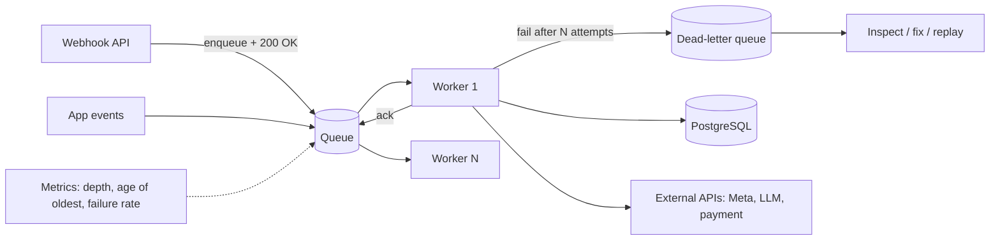

# Message Queues

> [!abstract] TL;DR
> A message queue decouples **producers** from **consumers**: work is enqueued and processed asynchronously by workers that acknowledge each message. That gives you buffering for spikes, retries, scheduling, fan-out, and isolation from slow or failing dependencies.
> - **Choosing a family**:
>   - **Job queues**: BullMQ on [[Redis]], pg-boss/pgmq on [[PostgreSQL]]. Background work in apps.
>   - **Message brokers**: RabbitMQ, SQS, NATS. Routing between services.
>   - **Logs**: [[Kafka]], Redis Streams. Replayable event streams.
> - **The rules**: delivery is **at-least-once**, so make consumers **idempotent**, bound retries with backoff, route poison messages to a **dead-letter queue**, and monitor queue depth and age.

## Introduction
- **Origin**: enterprise messaging (IBM MQ 1993, JMS 1998), AMQP (2006) and RabbitMQ (2007), cloud queues (Amazon SQS 2004/2006, one of the first AWS services), then Redis-based job queues (Resque, Sidekiq, Bull/BullMQ) and logs (Kafka 2011).
- **Problem**: synchronous request chains fail and slow down together. Queues absorb bursts, smooth load, and let work happen later or elsewhere.
- **Where it sits**:
  - **Webhook ingestion**: Meta WhatsApp, payment gateways. Ack fast, process async.
  - **Background jobs**: emails, PDFs, AI calls, imports.
  - **Scheduled and delayed jobs**: reminders, retries.
  - **Integration**: inter-service events.
  - **Automation runtime**: [[n8n]] queue mode (Bull on Redis).

## Core Concepts

### Queue vs pub/sub vs log
| Model | Semantics | Consumers | Retention | Examples |
|---|---|---|---|---|
| **Work queue** (point-to-point) | Each message processed by one worker | Competing consumers | Until acked | BullMQ, SQS, RabbitMQ queues, pgmq |
| **Pub/sub** | Each subscriber gets a copy | Fan-out | Usually transient | RabbitMQ fanout/topic exchanges, SNS, Redis Pub/Sub, NATS core |
| **Log / stream** | Ordered, replayable, consumer offsets | Consumer groups | Time/size-based | [[Kafka]], Redis Streams, RabbitMQ Streams, NATS JetStream |

### Delivery guarantees
| Guarantee | How | Trade-off |
|---|---|---|
| At-most-once | Ack before processing | Loses messages on crash |
| **At-least-once** (default) | Ack after processing. Redeliver on timeout | Duplicates, so consumers must be idempotent |
| Effectively-once | At-least-once + idempotent processing / dedup keys / transactional outbox | Engineering effort, but the practical target |

### Key mechanisms
- **Acknowledgement + visibility timeout / lock**: an unacked message reappears after a timeout (SQS visibility timeout, BullMQ lock duration, RabbitMQ consumer ack).
- **Retries with exponential backoff + jitter**, a max attempts limit, then a **DLQ** (dead-letter queue) for inspection and replay.
- **Ordering**: FIFO only within a partition/group (SQS FIFO message groups, Kafka partitions, BullMQ groups (Pro)). Global ordering kills throughput.
- **Delayed/scheduled jobs**, **priorities**, **rate limiting** (per queue, per tenant), **concurrency** per worker.
- **Backpressure**: bounded queues, consumer prefetch limits (RabbitMQ `prefetch`), and producers that slow down or shed load.

### BullMQ (Node.js + Redis)
```ts
import { Queue, Worker, QueueEvents } from "bullmq";
const connection = { host: "redis", port: 6379, maxRetriesPerRequest: null };

export const waQueue = new Queue("whatsapp-inbound", { connection, defaultJobOptions: {
  attempts: 5, backoff: { type: "exponential", delay: 2000 },
  removeOnComplete: { age: 86_400, count: 10_000 }, removeOnFail: { age: 7 * 86_400 },
}});

// Producer (webhook handler): enqueue + return 200 fast; jobId = provider message id → dedup
await waQueue.add("message", payload, { jobId: payload.messageId });

// Consumer
new Worker("whatsapp-inbound", async (job) => {
  await handleMessage(job.data);          // idempotent: unique constraint on message_id in Postgres
}, { connection, concurrency: 20, limiter: { max: 50, duration: 1000 } });   // respect downstream rate limits
```

### Postgres as a queue
```sql
-- SKIP LOCKED pattern (what pg-boss, graphile-worker, Oban and pgmq build on)
with next as (
  select id from jobs
  where status = 'queued' and run_at <= now()
  order by priority desc, run_at
  for update skip locked
  limit 10
)
update jobs set status = 'running', locked_at = now(), attempts = attempts + 1
from next where jobs.id = next.id
returning jobs.*;
```
Supabase **Queues** wrap `pgmq` (SQS-like API: `pgmq.send`, `pgmq.read` with visibility timeout, `pgmq.archive`) inside your existing database. That means transactional enqueue with your business writes, which is effectively a built-in outbox.

## Architecture / How It Works

- **RabbitMQ**: producers publish to **exchanges** (direct, topic, fanout, headers), and bindings route to **queues**. **Quorum queues** (Raft-replicated) are the durable default. **Streams** add log semantics. 4.x speaks AMQP 0-9-1, AMQP 1.0 (native since 4.0), MQTT and STOMP. Metadata moves to **Khepri** (Raft), the default for new clusters in 4.2.
- **Redis-based queues** (BullMQ) use Redis lists/sorted sets/streams with Lua scripts for atomic state transitions. Durability depends on Redis persistence (AOF) and **`maxmemory-policy noeviction`**.
- **SQS**: fully managed, standard (at-least-once, best-effort order) or FIFO (ordered per message group, dedup window 5 min). Long polling, visibility timeout, redrive to DLQ.
- **NATS**: lightweight, very fast subjects-based pub/sub. **JetStream** adds persistence, consumers, acks and key-value/object stores.

## Project Structure
```text
src/jobs/
├── queues.ts            # queue definitions + default job options (attempts, backoff, retention)
├── producers/           # typed enqueue helpers: enqueueWhatsAppMessage(), enqueueInvoicePdf()
├── workers/
│   ├── whatsapp.worker.ts
│   └── invoices.worker.ts
├── schemas.ts           # Zod schemas for job payloads (versioned)
└── dlq.ts               # replay tooling, alerting
docker-compose.yml       # redis (appendonly yes, maxmemory-policy noeviction), workers as a separate service
```

## Use Cases
| Use case | Good fit |
|---|---|
| Webhook ingestion (WhatsApp, Stripe/Billplz) with retries | BullMQ / pgmq / SQS |
| Background jobs in a Node/Next.js app | BullMQ (Redis), pg-boss / Supabase Queues (Postgres) |
| Service-to-service routing, RPC-over-queue, IoT/MQTT | RabbitMQ, NATS |
| Fan-out notifications (email, push, WhatsApp) | Pub/sub exchange/topic → per-channel queues |
| Event sourcing, analytics pipelines, replay | [[Kafka]] / Redis Streams |
| Workflow automation at scale | [[n8n]] queue mode (Redis + workers), or [[Windmill]] (Postgres queue) |
| Long multi-step business processes with state | Workflow engines (Temporal, n8n) rather than raw queues |

## Pros & Cons
| Pros | Cons |
|---|---|
| Absorbs spikes, smooths load, isolates failures | Eventual consistency. Harder debugging across async boundaries |
| Retries, delays, scheduling built in | Duplicates (at-least-once) require idempotency everywhere |
| Horizontal scaling of workers | Another stateful component to operate and monitor |
| Decouples teams/services | Ordering guarantees are limited and costly |
| Enables fast webhook acknowledgements | Poison messages and silent backlog growth if unmonitored |

## Alternatives & Peers
| Option | Strength | Weakness | Pick it when… |
|---|---|---|---|
| **BullMQ** (Redis) | Rich job features (delays, priorities, rate limits, flows), great Node DX, dashboards (Bull Board) | Redis durability/memory limits. Node-centric | Node apps already running Redis (ZP default) |
| **pg-boss / pgmq / Supabase Queues** | No extra infra, transactional enqueue | Lower throughput than dedicated brokers, DB load | Small-medium volume, Supabase stacks |
| RabbitMQ | Flexible routing, protocols, mature, quorum queues | Ops complexity, Erlang tooling | Multi-service routing, polyglot consumers |
| Amazon SQS (+ SNS) | Zero ops, infinite scale | AWS lock-in, 256 KB messages, polling cost | AWS-hosted systems |
| NATS / JetStream | Very low latency, simple ops, edge-friendly | Smaller ecosystem than Kafka/RabbitMQ | Microservices/IoT messaging |
| [[Kafka]] | Massive throughput, replay, stream processing | Heavy to operate, not a job queue (share groups help) | Event streaming, analytics |
| Cloudflare Queues | Serverless with Workers | Cloudflare-only | Edge/Workers apps |

## Tips & Reminders
> [!tip]
> - Use the provider's event/message ID as the **job ID or dedup key** (BullMQ `jobId`, SQS FIFO dedup ID) and a unique DB constraint as the last line of defense.
> - Keep payloads small (IDs + minimal data). Store big blobs in R2/S3 and reference them.
> - Version payload schemas (`v: 2`) and validate with Zod in workers. Old jobs survive deploys.
> - Alert on **age of oldest message** and DLQ size, not just throughput.
> - Graceful shutdown: workers must finish or release in-flight jobs on `SIGTERM` (BullMQ `worker.close()`), or rolling deploys cause duplicate/stalled jobs.
> - **In ZP's stack**:
>   - **Redis**: one Redis (AOF on, `noeviction`) for BullMQ + n8n queue mode, separate from the cache Redis if you use eviction there.
>   - **Workers**: run as their own [[Coolify]] service, scaled independently from the API.
>   - **Supabase-heavy apps**: consider Supabase Queues (pgmq) for transactional enqueue.

## Versions & Breaking Changes
| Product / version | Released | Key changes | Breaking / migration notes |
|---|---|---|---|
| RabbitMQ 3.8–3.13 | 2019–2024 | Quorum queues, streams, Khepri (experimental) | — |
| **RabbitMQ 4.0** | 2024-09 | Native AMQP 1.0, **classic mirrored queues removed**, Khepri option | Migrate mirrored queues to quorum queues before upgrading |
| RabbitMQ 4.1 / **4.2** | 2025 | Performance work. 4.2: **Khepri default metadata store** for new clusters, message interceptors, quorum queue priorities | Khepri likely required from 4.3 |
| BullMQ 5.x | 2024–2026 | Job schedulers (replacing repeatable jobs API), flows, telemetry | Repeatable-job APIs deprecated in favour of job schedulers |
| Supabase Queues (pgmq) | 2024-12 | Postgres-native queues with RLS and Dashboard | — |
| NATS governance | 2025 | Synadia/CNCF dispute over NATS ownership and licensing resolved with NATS remaining in CNCF (Apache-2.0) | Watch governance for long-term bets |

> [!warning] Unverified — check before relying on this
> RabbitMQ 4.2 GA date, BullMQ current minor and the NATS governance outcome weren't confirmed from primary sources this run. Check https://www.rabbitmq.com/release-information, https://docs.bullmq.io/changelog and https://nats.io/.

## Critical Issues & Gotchas
> [!danger] Redis eviction silently deletes jobs
> With `maxmemory` set and an eviction policy like `allkeys-lru` (common for caches), Redis evicts BullMQ/n8n queue keys under memory pressure: jobs vanish, workflows stall, and there's no error. Queue Redis must use **`maxmemory-policy noeviction`** with AOF persistence, adequate memory, and job retention limits (`removeOnComplete`/`removeOnFail`).

> [!danger] Poison messages and retry storms
> A message that always fails (bad payload, deleted entity) retried forever blocks FIFO queues and burns API quotas (WhatsApp/LLM rate limits, payment gateways), sometimes triggering provider bans. Cap attempts, use exponential backoff with jitter, route to a DLQ, and alert. Distinguish permanent errors (4xx: don't retry) from transient ones (5xx/timeouts: retry).

> [!warning] Gotchas
> - Visibility timeout shorter than processing time → the same message is processed twice concurrently. Extend leases for long jobs, or split work.
> - Enqueuing outside the DB transaction ("save order, then enqueue") loses or orphans jobs on crashes. Use a transactional outbox or a Postgres queue.
> - RabbitMQ unbounded queues + no consumer → memory/disk alarms block **all** publishers on the node.
> - Large backlogs after an outage hit downstream APIs at full speed. Add rate limiters to workers.
> - Time zones in scheduled jobs: store UTC and compute local times (`Asia/Kuala_Lumpur`) explicitly.

## Deep Dives
- [[Message Queues - BullMQ in Production]]

## Related
- [[Kafka]] — log-based streaming peer
- [[Redis]] — BullMQ backend, Redis Streams
- [[PostgreSQL]] — SKIP LOCKED queues, pgmq, outbox
- [[n8n]] — queue mode on Redis
- [[System Design]] — async patterns, idempotency, backpressure
- [[Node.js]] — worker runtime in ZP's stack

## References
- RabbitMQ docs: https://www.rabbitmq.com/docs
- Khepri default roadmap: https://www.rabbitmq.com/blog/2025/09/01/6-khepri-default
- RabbitMQ 4.2 on CloudAMQP: https://cloudamqp.com/blog/cloudamqp-announcing-rabbitmq-version-4-2.html
- BullMQ docs: https://docs.bullmq.io/
- Supabase Queues: https://supabase.com/docs/guides/queues
- Amazon SQS developer guide: https://docs.aws.amazon.com/AWSSimpleQueueService/latest/SQSDeveloperGuide/
- NATS JetStream: https://docs.nats.io/nats-concepts/jetstream
