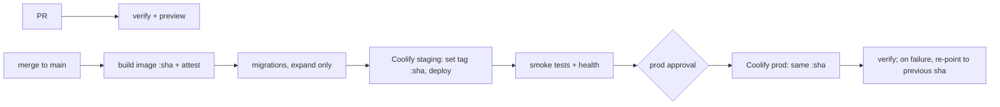

# CI-CD - Deploy Pipelines for Coolify & Flutter Releases

> [!info] Deep dive of [[CI-CD]]

> [!abstract] TL;DR
> **Web/API**:
> - PR: lint + test + preview.
> - `main`: build the image once in GitHub Actions and push it as `ghcr.io/…:<sha>`, run migrations, point Coolify at that exact tag and deploy, then gate on health + smoke tests.
> - Roll back by re-pointing to the previous SHA.
>
> **Mobile**: a git tag `v1.4.0` gets build number = CI run number. Android goes to the Play **internal** track, iOS to **TestFlight** via fastlane with an App Store Connect API key. Promote to production manually.
> One artifact, built once, promoted through environments. Never rebuild for prod.

## Concept
| Stage | Trigger | Web/API (Next.js, Node) | Mobile (Flutter) |
|---|---|---|---|
| Verify | PR | lint, typecheck, unit + integration, E2E on ephemeral stack | `flutter analyze`, `flutter test`, golden tests |
| Preview | PR | Coolify preview deployment (`pr=<n>`) | Firebase App Distribution / internal track build (optional) |
| Build | push to `main` / tag | Docker image → GHCR, tag `:<sha>` + provenance | AAB + IPA, symbols uploaded |
| Staging | auto | Deploy `:<sha>` to staging, run smoke tests | Play internal / TestFlight internal testers |
| Production | manual approval (environment) | Same `:<sha>` to prod | Promote internal → production (staged rollout 10% → 100%) |

- **Coolify deploy API**: `GET|POST /api/v1/deploy` with `uuid` (one or more resource UUIDs), `tag` (**Coolify resource tags**, not image tags), `force` (rebuild without cache) and `pr` (deploy a PR preview). Auth uses a bearer token. A **deploy-only token** can trigger deploys without general API access.
- **Expand → migrate → contract**: rolling or near-zero-downtime deploys run old and new code at the same time. Schema changes must be backward-compatible for one release ([[Git - Branching, Releases & Recovery]]).
- **Mobile can't roll back.** An installed binary stays installed. Use feature flags, remote config and a server-side minimum version ("force update") as your rollback levers.

## How It Works


## Practical Usage
**Web: build once, deploy by SHA** (`.github/workflows/deploy.yml`, abbreviated):
```yaml
on: { push: { branches: [main] } }
permissions: { contents: read, packages: write, id-token: write, attestations: write }

jobs:
  build:
    runs-on: ubuntu-latest
    outputs: { image: "${{ steps.meta.outputs.image }}" }
    steps:
      - uses: actions/checkout@v4
      - uses: docker/setup-buildx-action@v3
      - uses: docker/login-action@v3
        with: { registry: ghcr.io, username: "${{ github.actor }}", password: "${{ secrets.GITHUB_TOKEN }}" }
      - id: meta
        run: echo "image=ghcr.io/${{ github.repository }}:${{ github.sha }}" >> "$GITHUB_OUTPUT"
      - uses: docker/build-push-action@v6
        with:
          push: true
          tags: ${{ steps.meta.outputs.image }}
          cache-from: type=gha
          cache-to: type=gha,mode=max
          build-args: NEXT_PUBLIC_APP_ENV=production   # public build-time vars only; secrets at runtime

  deploy-staging:
    needs: build
    environment: staging
    runs-on: ubuntu-latest
    steps:
      - uses: actions/checkout@v4
      - run: npx supabase db push --db-url "$DB_URL"               # expand-only migrations
        env: { DB_URL: "${{ secrets.STAGING_DB_URL }}" }
      - run: ./scripts/coolify-deploy.sh "${{ vars.COOLIFY_APP_UUID }}" "${{ github.sha }}"
        env: { COOLIFY_URL: "${{ vars.COOLIFY_URL }}", COOLIFY_TOKEN: "${{ secrets.COOLIFY_TOKEN }}" }
      - run: BASE_URL=${{ vars.STAGING_URL }} npx playwright test --grep @smoke

  deploy-prod:
    needs: deploy-staging
    environment: production                                    # required reviewer = you
    runs-on: ubuntu-latest
    steps:
      - uses: actions/checkout@v4
      - run: ./scripts/coolify-deploy.sh "${{ vars.COOLIFY_APP_UUID }}" "${{ github.sha }}"
        env: { COOLIFY_URL: "${{ vars.COOLIFY_URL }}", COOLIFY_TOKEN: "${{ secrets.COOLIFY_TOKEN }}" }
```
**`scripts/coolify-deploy.sh`**: pin the image tag, deploy, wait for health.
```bash
#!/usr/bin/env bash
set -euo pipefail
APP="$1"; SHA="$2"; H="Authorization: Bearer ${COOLIFY_TOKEN}"

# 1. point the Docker-image application at this exact tag (field name: verify for your Coolify version)
curl -fsS -X PATCH -H "$H" -H 'Content-Type: application/json' \
  "${COOLIFY_URL}/api/v1/applications/${APP}" -d "{\"docker_registry_image_tag\":\"${SHA}\"}"

# 2. trigger the deployment
curl -fsS -H "$H" "${COOLIFY_URL}/api/v1/deploy?uuid=${APP}&force=false"

# 3. wait until the new version answers
for i in $(seq 1 30); do
  v=$(curl -fsS "${APP_URL:-https://app.example.my}/api/health" | jq -r .version || true)
  [ "$v" = "$SHA" ] && echo "live: $SHA" && exit 0
  sleep 10
done
echo "deploy did not become healthy" >&2; exit 1
```
`/api/health` returns `{ "version": process.env.GIT_SHA }`. Bake `GIT_SHA` into the image as an `ARG`/`ENV`.

**Rollback**: re-run the deploy job or script with the previous good SHA (`gh run rerun`, or `workflow_dispatch` with a `sha` input). The image still exists in GHCR, so no rebuild is needed.

**Flutter release on tag** (Android + iOS):
```yaml
on: { push: { tags: ["v*"] } }
jobs:
  android:
    runs-on: ubuntu-latest
    environment: mobile-release
    steps:
      - uses: actions/checkout@v4
      - uses: subosito/flutter-action@v2
        with: { flutter-version-file: pubspec.yaml, cache: true }
      - run: echo "${{ secrets.UPLOAD_KEYSTORE_B64 }}" | base64 -d > android/app/upload.jks
      - run: flutter build appbundle --release --build-name=${GITHUB_REF_NAME#v} --build-number=${{ github.run_number }} --obfuscate --split-debug-info=build/symbols
      - run: bundle exec fastlane supply --aab build/app/outputs/bundle/release/app-release.aab --track internal --json_key_data "$PLAY_JSON"
        working-directory: android
        env: { PLAY_JSON: "${{ secrets.PLAY_SERVICE_ACCOUNT_JSON }}" }
  ios:
    runs-on: macos-latest
    environment: mobile-release
    steps:
      - uses: actions/checkout@v4
      - uses: subosito/flutter-action@v2
        with: { flutter-version-file: pubspec.yaml, cache: true }
      - run: bundle exec fastlane ios beta build_number:${{ github.run_number }}   # match (readonly) → build_app → pilot
        working-directory: ios
        env:
          MATCH_PASSWORD: ${{ secrets.MATCH_PASSWORD }}
          ASC_KEY_JSON: ${{ secrets.APP_STORE_CONNECT_API_KEY_JSON }}
```
**Wrong way**:
```yaml
# ❌ rebuild per environment: prod runs an image that was never tested on staging
- run: docker build -t app:prod . && docker push app:prod
# ❌ Coolify "tag" used as an image tag: it selects Coolify resources by tag and deploys nothing (or the wrong set)
- run: curl "$COOLIFY_URL/api/v1/deploy?uuid=$APP&tag=${{ github.sha }}"
# ❌ hand-typed build numbers → store rejects duplicate uploads
- run: flutter build appbundle --build-number=12
```

## Patterns & Anti-patterns
| Pattern | When | Anti-pattern to avoid |
|---|---|---|
| Build once, promote the same `:sha` | Every deploy | `latest` / per-env rebuilds |
| Health endpoint reports the running SHA | Deploy verification | "curl returned 200", which might be the old container |
| Migrations as a pipeline step before deploy, expand-only | DB-backed apps | Migrations in the container entrypoint racing with replicas |
| Deploy-only Coolify token per environment, in GitHub environment secrets | Coolify API | Root API token in repo-level secrets |
| Mobile: internal track → staged rollout + remote kill switch | Store releases | Straight to 100% production |
| Path filters in monorepos (`paths: [apps/web/**]`) | Web + mobile in one repo | Every commit building iOS on a 10× priced macOS runner |
| `workflow_dispatch` rollback with a `sha` input | Incidents | Manual SSH + `docker run` at 2am |

## Performance & Trade-offs
- **Build location**: building Next.js in Actions (2-core runner, ~3–6 min with the `gha` cache) keeps the Hostinger KVM free for serving. Coolify's on-server builds are simpler but compete with production for RAM and CPU.
- **macOS minutes** cost ~10× Linux on GitHub Actions. Build iOS only on release tags, and cache CocoaPods and Flutter. Codemagic's free tier or a self-hosted Mac mini are the alternatives ([[Flutter - Build, Release & Store Compliance]]).
- **Approval gates**: a production environment reviewer adds minutes of latency but prevents Friday-night accidents. For a solo founder, gate prod only and let staging auto-deploy.
- **Rollback speed**: re-pointing to an existing image takes ~30–90 s (pull + health check). Rebuilding from source takes 5+ min. Keep at least the last 10 images in GHCR (retention policy).

## Tips & Reminders
> [!tip] In ZP's stack
> - **One reusable workflow per stack**:
>   - `web-deploy.yml`: Actions → GHCR → Coolify on Hostinger;
>   - `flutter-release.yml`: tag → Play internal + TestFlight.
>
>   Each client repo calls it via `uses: org/.github/.github/workflows/web-deploy.yml@v1`.
> - **Supabase migrations** go through `supabase db push` in the pipeline, never through the dashboard SQL editor on prod.
> - **n8n workflows**: export JSON to git and import via the n8n API in a deploy job. That gives you version history for automation changes too.

- Put the deploy summary (SHA, image digest, migration list, deployer) in `$GITHUB_STEP_SUMMARY`. It's your audit trail when a client asks "what changed Tuesday?".
- Notify on deploy result to a Telegram/Slack channel from the final step (`if: always()`).
- Tag releases (`v2026.10.23-1` or semver) from the deployed SHA, so Sentry/Crashlytics releases and git history line up.
- Use Coolify's `pr=<number>` deploy parameter (or its GitHub App previews) for PR environments. Clean them up on PR close.

## Version Notes
| Version / date | Change relevant here |
|---|---|
| Coolify 4.x | `/api/v1/deploy` with `uuid`, `tag` (resource tags), `force`, `pr`. Deploy webhooks and deploy-only tokens |
| Coolify 4.2.0 (2026-07-21) | Expanded API, audit logging. **Breaking changes to API endpoints and team permissions**: re-test deploy scripts after upgrading |
| GitHub Actions 2024–26 | Artifact attestations (`actions/attest-build-provenance`), `gha` cache v2 backend, environment protection rules |
| Play Console | New personal developer accounts must run closed testing (12 testers / 14 days) before production access |

> [!warning] Unverified — check before relying on this
> The Coolify application field for the image tag (`docker_registry_image_tag`) and the PATCH semantics weren't verified against the 4.2 API reference in this run. Check https://coolify.io/docs/api-reference before scripting it.

## Critical Issues & Gotchas
> [!danger] Deploy token = production access
> Anyone with the Coolify token (or write access to a workflow that can read it) can deploy arbitrary images. Keep it in a GitHub **environment** secret restricted to `main`, use a deploy-only token, and harden workflows ([[CI-CD - GitHub Actions Security Hardening]]).

> [!danger] Destructive migrations in the same deploy
> Dropping or renaming a column while old containers still serve traffic causes 500s for the whole rolling window, and blocks rollback, because the old code needs the old column. Contract only in a later release, after the new code has been stable.

- **`NEXT_PUBLIC_*` vars are baked at build time**: the same image can't switch them per environment. Use runtime config (server-rendered env, or `/api/config`) if staging and prod need different public values, or accept per-env builds for those apps only.
- **Store signing keys are irreplaceable**: losing the Android upload key needs a Play support reset, and leaking it lets attackers publish updates. Store backups offline, and use Play App Signing.
- **TestFlight processing** takes 5–30 min after upload. Don't fail the job waiting for it (`skip_waiting_for_build_processing: true` in pilot).
- **Silent Coolify failures**: a successful API call means the deploy was **queued**, not that it succeeded. Always verify the running SHA.

## Related
- [[CI-CD]]
- [[CI-CD - GitHub Actions Security Hardening]] — permissions, OIDC, pinned actions, environment secrets
- [[Coolify]] — deploy API, previews, rolling updates
- [[Flutter - Build, Release & Store Compliance]] — signing, store policies, build numbers
- [[Docker - Compose Patterns for Production]] — healthchecks and migrations as services
- [[Testing Strategy - E2E Testing with Playwright]] — smoke tests as the deploy gate

## References
- https://coolify.io/docs/api-reference/api/operations/deploy-by-tag-or-uuid
- https://coolify.io/docs/core/automation/deploy-webhooks
- https://docs.github.com/en/actions/deployment/targeting-different-environments/using-environments-for-deployment
- https://docs.fastlane.tools/actions/supply/
- https://docs.fastlane.tools/actions/match/
