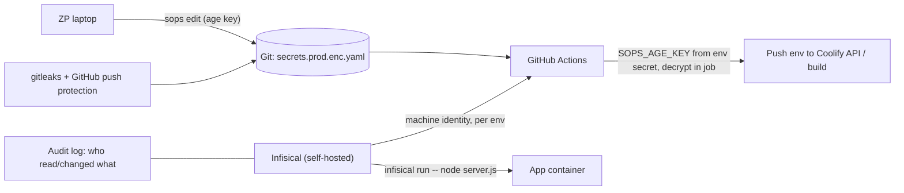

# CI-CD - Secrets Management with SOPS & Infisical

> [!info] Deep dive of [[CI-CD]]

> [!abstract] TL;DR
> Secrets need **one source of truth per environment**, **least-privilege distribution** and a **rotation path**.
> - **Solo/small**: a password manager for humans, and **Coolify env** as the runtime store. Add **SOPS + age** when you want encrypted, reviewable config in git (values encrypted, keys visible).
> - **Many clients/projects**: a secrets manager such as **Infisical** (open source, self-hostable) with machine identities, per-environment access, audit logs and CLI injection (`infisical run --`).
> - **Everywhere**: block leaks with push protection + `gitleaks`, prefer **short-lived credentials (OIDC)** over static keys in CI, and keep a per-client secret inventory with owners and rotation dates.

## Concept
| Option | Model | Strengths | Weaknesses | Pick it when… |
|---|---|---|---|---|
| Coolify env/shared variables | Runtime store per resource/env | Already there, encrypted with `APP_KEY` | No audit/rotation workflow, tied to Coolify | Default for apps on Coolify |
| GitHub Actions secrets/environments | CI-only store | Environment protection rules, OIDC | Not for runtime, per-repo sprawl | CI deploy tokens |
| **SOPS + age** | Encrypted files in git | Reviewable diffs, offline, no server | Key distribution, no audit, manual rotation | Config-as-code, infra repos, k8s manifests |
| **Infisical** (self-hosted or cloud) | Central secrets service | Projects/envs, machine identities, audit, CLI/SDKs/k8s operator | Another critical service to run (Postgres + Redis) | Multiple clients/projects, team access |
| Doppler / 1Password Secrets Automation | SaaS managers | Polished UX | Vendor lock-in, recurring cost | You prefer SaaS over self-hosting |
| Vault / OpenBao | Full secrets platform | Dynamic secrets, PKI, leases | Heavy to operate. Vault is BSL, OpenBao the MPL fork | Larger teams, dynamic DB creds |

**Secret lifecycle**:

| Stage | Practice |
|---|---|
| Create | Generate (≥ 32 random bytes), never reuse across environments/clients |
| Store | One source of truth per env. Encrypted at rest |
| Distribute | Inject at runtime (env, files). Least privilege per service |
| Use | Never log, never ship in client bundles/APKs |
| Rotate | Scheduled (90–365 days) + on staff/vendor change + on suspected leak |
| Revoke | Know where each secret is used, so revocation doesn't cause an outage |

## How It Works


## Practical Usage
**SOPS + age setup**:
```bash
age-keygen -o ~/.config/sops/age/keys.txt          # private key: password manager + offline backup
# public key → .sops.yaml recipients
```
```yaml
# .sops.yaml
creation_rules:
  - path_regex: secrets/prod\.enc\.yaml$
    age: age1prodrecipient...,age1breakglass...      # ZP + offline break-glass key
    encrypted_regex: '^(.*_KEY|.*_SECRET|.*_TOKEN|DATABASE_URL|.*PASSWORD)$'
  - path_regex: secrets/staging\.enc\.yaml$
    age: age1stagingrecipient...,age1ci...
```
```bash
sops secrets/prod.enc.yaml                         # opens decrypted in $EDITOR, re-encrypts on save
sops -d secrets/prod.enc.yaml | yq '.STRIPE_SECRET'  # read one value
sops updatekeys secrets/prod.enc.yaml              # after changing recipients (rotate access)
```
**Decrypt in GitHub Actions and push to Coolify**:
```yaml
jobs:
  sync-secrets:
    runs-on: ubuntu-latest
    environment: production                        # requires approval, holds SOPS_AGE_KEY
    steps:
      - uses: actions/checkout@v4
      - run: |
          curl -fsSL -o sops https://github.com/getsops/sops/releases/download/v3.13.1/sops-v3.13.1.linux.amd64
          echo "<sha256>  sops" | sha256sum -c - && chmod +x sops
      - env: { SOPS_AGE_KEY: "${{ secrets.SOPS_AGE_KEY }}", COOLIFY_TOKEN: "${{ secrets.COOLIFY_TOKEN }}" }
        run: ./sops -d --output-type dotenv secrets/prod.enc.yaml > .env.prod && ./scripts/push-env-to-coolify.sh .env.prod && rm .env.prod
```
**Infisical injection** (machine identity, no secrets in compose files):
```bash
export INFISICAL_TOKEN=$(infisical login --method=universal-auth \
  --client-id="$INFISICAL_CLIENT_ID" --client-secret="$INFISICAL_CLIENT_SECRET" --plain --silent)
infisical run --env=prod --projectId="$PROJECT_ID" -- node server.js
```
**Leak prevention**:
```bash
gitleaks detect --source . --redact                 # pre-commit / CI
git log -p | gitleaks detect --pipe                 # scan history when onboarding a client repo
```
**Wrong way**:
```text
❌ .env.production committed "temporarily"            → in git history forever; forks and clones keep it
❌ One Supabase service key reused across 6 client apps → one leak = six breaches, and rotation breaks all at once
❌ Secrets pasted in WhatsApp/Slack to "share quickly"  → copies in chat backups you don't control
❌ age private key only on one laptop                   → laptop dies, encrypted secrets are unrecoverable
```

## Patterns & Anti-patterns
| Pattern | When | Anti-pattern to avoid |
|---|---|---|
| Separate secrets per client and per environment | Agency work | Shared keys across clients |
| Break-glass recipient (offline age key / sealed envelope) | SOPS | Single key holder |
| Short-lived CI credentials (OIDC to cloud, deploy-only tokens) | CI-CD | Long-lived admin tokens in repo secrets |
| Secret inventory: name, purpose, owner, location, rotation date | Every client | "We'll figure it out when it leaks" |
| Push protection + gitleaks in pre-commit and CI | All repos | Detecting leaks only after a bill arrives |
| Client-owned third-party accounts, ZP as a member | Meta, payment gateways, Cloudflare | Client secrets created under ZP's personal accounts |
| Rotation runbook tested (dual-key overlap where supported) | Signing keys, API keys | Rotation that requires downtime |

## Performance & Trade-offs
- **SOPS** has zero runtime dependencies (decrypt at deploy), but rotation and access changes are manual git operations, and there's no audit of who decrypted what.
- **Infisical** adds a critical-path service. If it's down, new deployments or restarts that fetch secrets at boot fail. Cache secrets in the runtime environment (Coolify env) or use the agent with local caching for resilience.
- **Self-hosting a secrets manager** means you must back it up, patch it and secure it like the crown jewels it is. For a solo founder, the cloud tier may be safer than an unpatched self-hosted instance.
- **Granularity vs effort**: per-service secrets limit blast radius but multiply rotation work. Automate rotation where providers support multiple active keys.

## Tips & Reminders
> [!tip] In ZP's stack
> - **Now (solo)**: Bitwarden/1Password for humans, Coolify environments as runtime store, GitHub environment secrets for deploy tokens, and SOPS for infra repos (Coolify/Traefik configs, Compose files).
> - **When managing 5+ client projects**: self-host Infisical on a separate small VPS behind Tailscale, with one project per client and machine identities per app. The audit log becomes part of your client security story ([[Linux Essentials - Networking, Firewalls & Tailscale]]).
> - **Contracts**: the SOW states that clients own their provider accounts and secrets, and that ZP returns/rotates access at offboarding.

- Rotate immediately when a contractor leaves, a laptop is lost, or a secret appears in logs, screenshots or n8n exports ([[n8n - Security, Credentials & Self-Hosting Hardening]]).
- Back up Coolify's `APP_KEY` and n8n's `N8N_ENCRYPTION_KEY` in the secrets store. Without them, stored credentials are unrecoverable.
- Use deploy-only Coolify tokens and environment protection rules in GitHub ([[CI-CD - GitHub Actions Security Hardening]]).
- Never put secrets in Flutter apps or `NEXT_PUBLIC_*`. They're public by definition ([[Flutter - App Security, Obfuscation & Secure Storage]]).

## Version Notes
| Date | Change |
|---|---|
| 2023-08 | HashiCorp moves Vault/Terraform to BSL. OpenBao fork (Linux Foundation, MPL-2.0) follows |
| 2023–24 | SOPS moves from Mozilla to the getsops org (CNCF sandbox). age is the recommended backend |
| 2026 | SOPS 3.12.x (Feb–Mar) and 3.13.1 (May) releases |

> [!warning] Unverified — check before relying on this
> Infisical's current self-hosted licensing split (MIT core vs enterprise features), OIDC auth support for GitHub Actions, and CLI flags weren't checked. See https://infisical.com/docs and https://github.com/getsops/sops/releases.

## Critical Issues & Gotchas
> [!danger] Leaked secrets are found by bots within minutes
> Public commits, npm packages, Docker images and APKs are scanned continuously for keys (cloud, LLM, payment, Supabase service keys). Abuse (crypto mining, LLM bill fraud, data exfiltration) starts quickly. On a leak: **revoke/rotate first**, then clean history, then investigate usage logs. Cleaning git history alone doesn't help, because the secret is already copied.

> [!danger] Secrets manager compromise = every client compromised
> Centralizing secrets concentrates risk: a phished admin account or unpatched self-hosted instance exposes all clients. Enforce SSO/2FA, network-restrict the UI (Tailscale/Access), separate projects per client with least-privilege identities, and monitor the audit log.

- **SOPS `encrypted_regex` mistakes** can leave values in plaintext. Verify encrypted files before committing (`grep -v ENC[` checks or pre-commit hooks).
- **Env vars leak** via crash reports, `printenv` in debug endpoints and child processes. Scrub error-tracker payloads.
- **Docker build args** persist in image history. Use BuildKit secrets for build-time tokens ([[Coolify - Preview Deployments, Environments & Secrets]]).
- **PDPA**: credentials to systems holding personal data are part of your security safeguards obligation. Document access control and rotation.

## Related
- [[CI-CD]]
- [[CI-CD - GitHub Actions Security Hardening]] — environments, OIDC, token scoping
- [[Coolify - Preview Deployments, Environments & Secrets]] — runtime env and build secrets
- [[n8n - Security, Credentials & Self-Hosting Hardening]] — encryption key custody
- [[Node.js - Supply Chain Security & Dependency Hygiene]] — secrets in packages and CI
- [[JWT - Signing Algorithms, Keys & Rotation]] — key rotation patterns

## References
- https://github.com/getsops/sops
- https://github.com/FiloSottile/age
- https://infisical.com/docs/documentation/getting-started/introduction
- https://github.com/gitleaks/gitleaks
- https://docs.github.com/en/code-security/secret-scanning/push-protection-for-repositories-and-organizations
