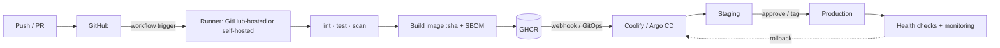

# CI-CD

> [!abstract] TL;DR
> **Continuous Integration** merges small changes to `main` frequently, with every push automatically built, linted and tested. **Continuous Delivery** keeps `main` always releasable (deploy is one click). **Continuous Deployment** ships every green commit to production automatically.
> - **For a solo founder**: CI-CD is a quality and liability safeguard. Nothing reaches a client's production without passing checks, and every deploy is reproducible and traceable to a commit.
> - **Default stack**: **GitHub Actions** for CI + image builds → registry → [[Coolify]] (or GitOps) for deploys.
> - **The pipeline is a high-value attack target**: it holds secrets and deploy rights. Pin actions, use least-privilege tokens, and prefer OIDC over long-lived keys.

## Introduction
- **Origin**: Continuous Integration (Grady Booch 1991, XP/Kent Beck late 1990s; CruiseControl, Jenkins/Hudson 2004–2011), then Continuous Delivery (Humble & Farley, 2010) and DevOps / DORA research (Accelerate, 2018).
- **Problem**: big-bang merges and manual deployments are slow, error-prone and unauditable. Automation shortens feedback loops and reduces change-failure rates.
- **Where it sits**: between [[Git]] (trigger) and runtime ([[Docker]] images on [[Coolify]]/[[Kubernetes]], app stores via [[Flutter - Build, Release & Store Compliance]], static sites on [[Cloudflare]]).

## Core Concepts

### Pipeline stages
| Stage | Typical jobs | Fail fast? |
|---|---|---|
| Validate | Format, lint, typecheck, commit message rules | Yes (seconds) |
| Test | Unit, integration (Testcontainers/[[PostgreSQL]] service), contract tests | Yes |
| Security | Secret scan (gitleaks), dependency audit (`npm audit`, Dependabot/Renovate), SAST (CodeQL/Semgrep), image scan (Trivy/Grype) | Gate on high/critical |
| Build | Docker image (multi-stage, cached), mobile bundles, static assets | — |
| Publish | Push image to GHCR/registry with immutable tag (commit SHA) + SBOM/provenance | — |
| Deploy | Staging auto, production on tag/approval. Migrations | Manual gate optional |
| Verify | Smoke tests, health checks, error-rate monitors, auto-rollback | Rollback on failure |

### Deployment strategies
| Strategy | How | Pros | Cons |
|---|---|---|---|
| Recreate | Stop old, start new | Simple | Downtime |
| **Rolling** | Replace instances gradually (Coolify/K8s default) | No downtime | Two versions live at once (schema compatibility needed) |
| Blue-green | Switch traffic between two full environments | Instant rollback | Double resources |
| Canary | Small % of traffic to the new version, then ramp | Limits blast radius | Needs traffic splitting + metrics |
| Feature flags | Deploy dark, release by flag | Decouples deploy from release | Flag debt |

### DORA metrics (measure delivery performance)
Deployment frequency · Lead time for changes · Change failure rate · Time to restore service.

## Architecture / How It Works

- **Runners** execute jobs in fresh VMs (GitHub-hosted) or on your machines (self-hosted). Self-hosted runners on public repos let any fork PR run code on your server. **Never** use them for public repos.
- **Secrets** are injected as env vars and masked in logs, but any step (including third-party actions) can read and exfiltrate them.
- **OIDC federation**: the workflow gets a short-lived signed JWT and exchanges it for cloud credentials (AWS/GCP/Azure/Cloudflare/Vault), so no stored long-lived keys are needed.
- **Caching** (dependency caches, Docker layer cache via `cache-from: type=gha`) and **concurrency groups** (cancel outdated runs) keep pipelines fast and cheap.

## Project Structure
```yaml
# .github/workflows/ci-cd.yml
name: ci-cd
on:
  pull_request:
  push: { branches: [main] }
permissions: { contents: read }                     # least privilege by default
concurrency: { group: ${{ github.workflow }}-${{ github.ref }}, cancel-in-progress: true }

jobs:
  test:
    runs-on: ubuntu-latest
    services:
      postgres: { image: "postgres:17", env: { POSTGRES_PASSWORD: test }, ports: ["5432:5432"] }
    steps:
      - uses: actions/checkout@08eba0b27e820071cde6df949e0beb9ba4906955          # pin by full commit SHA
      - uses: actions/setup-node@49933ea5288caeca8642d1e84afbd3f7d6820020
        with: { node-version: 24, cache: npm }
      - run: npm ci --ignore-scripts && npm run lint && npm run typecheck && npm test
      - uses: gitleaks/gitleaks-action@ff98106e4c7b2bc287b24eaf42907196329070c7

  build-deploy:
    if: github.ref == 'refs/heads/main'
    needs: test
    runs-on: ubuntu-latest
    permissions: { contents: read, packages: write, id-token: write }
    environment: production                          # required reviewers / protection rules
    steps:
      - uses: actions/checkout@08eba0b27e820071cde6df949e0beb9ba4906955
      - uses: docker/login-action@74a5d142397b4f367a81961eba4e8cd7edddf772
        with: { registry: ghcr.io, username: ${{ github.actor }}, password: ${{ secrets.GITHUB_TOKEN }} }
      - uses: docker/build-push-action@263435318d21b8e681c14492fe198d362a7d2c83
        with: { push: true, tags: "ghcr.io/rarticle/api:${{ github.sha }}", cache-from: type=gha, cache-to: "type=gha,mode=max", provenance: true, sbom: true }
      - run: curl -fsS -X GET "$COOLIFY_DEPLOY_WEBHOOK" -H "Authorization: Bearer $COOLIFY_TOKEN"
        env: { COOLIFY_DEPLOY_WEBHOOK: ${{ secrets.COOLIFY_DEPLOY_WEBHOOK }}, COOLIFY_TOKEN: ${{ secrets.COOLIFY_TOKEN }} }
```
(The SHAs above are illustrative. Let Dependabot/Renovate maintain real pinned SHAs.)

## Use Cases
| Use case | Why it fits |
|---|---|
| Every client project (web, API, mobile) | Consistent quality gate and deploy audit trail |
| Multi-environment SaaS (staging/prod) | Promotion via tags/approvals, environment secrets |
| Mobile releases | Build + sign + upload to TestFlight/Play internal track |
| Infra-as-code (Compose, Terraform, K8s) | Plan/apply with review |
| Scheduled jobs (backups verification, dependency updates) | `schedule:` triggers, Renovate |
| Tiny one-off scripts or prototypes | Overkill. A lint/test workflow at most |

## Pros & Cons
| Pros | Cons |
|---|---|
| Fewer production bugs, faster feedback | Initial setup and maintenance time |
| Reproducible, auditable deployments (who/what/when) | Pipelines become a privileged attack surface |
| Enables small, frequent, low-risk releases | Flaky tests erode trust and slow everything |
| Documentation-as-code for the delivery process | CI minutes cost money (macOS runners especially) |
| Protects you contractually: evidence of tested deliveries | Vendor lock-in to CI-specific YAML/actions |

## Alternatives & Peers
| Tool | Strength | Weakness | Pick it when… |
|---|---|---|---|
| **GitHub Actions** | Native to GitHub, huge marketplace, OIDC, free minutes for public repos | Third-party action supply-chain risk, YAML sprawl | Code on GitHub (ZP's default) |
| GitLab CI | Integrated DevSecOps, self-hostable | Heavier self-hosting | GitLab users, on-prem clients |
| Forgejo/Gitea Actions, Woodpecker | Self-hosted, GitHub Actions–compatible (Forgejo) | Smaller ecosystem | Data-sovereignty or cost-sensitive setups |
| Jenkins | Infinitely pluggable, on-prem standard | Plugin rot, maintenance, security | Legacy enterprise |
| Codemagic / Bitrise | Mobile-focused, managed macOS | Paid | Flutter/iOS builds without a Mac |
| Argo CD / Flux (GitOps CD) | Pull-based deploys, drift correction | Kubernetes only | K8s clusters |
| Coolify built-in (git push → build on server) | Zero CI config | Builds consume prod server resources, fewer checks | Small apps. Pair with Actions for tests |

## Tips & Reminders
> [!tip]
> - Set `permissions:` explicitly at the workflow level (`contents: read`) and elevate per job. The default `GITHUB_TOKEN` should not be write-all (org setting).
> - **Pin third-party actions to full commit SHAs**, and let Renovate/Dependabot bump them. Prefer official/verified actions, and fewer of them.
> - Avoid `pull_request_target` + checking out PR code (classic "pwn request"). Never echo secrets. Use environments with required reviewers for production.
> - Build once, deploy the same artifact everywhere (tag by commit SHA). Never rebuild for production.
> - Run DB migrations as a separate, backward-compatible step (expand → deploy → contract) so rolling deploys don't break.
> - Track build time: aim for < 10 min PR feedback. Cache dependencies and parallelize jobs.
> - **In ZP's stack**:
>   - GitHub Actions runs lint/test/scan on PRs, builds the image to GHCR on `main`, then triggers the [[Coolify]] deploy webhook. Builds don't run on the production VPS.
>   - Mobile goes through Codemagic or a macOS runner to TestFlight/Play internal.
>   - Notify the client or yourself via [[n8n]] (Telegram/WhatsApp) on deploy success/failure.

## Versions & Breaking Changes
| Change | Date | Key changes | Breaking / migration notes |
|---|---|---|---|
| GitHub Actions GA | 2019-11 | YAML workflows, marketplace | — |
| OIDC for Actions | 2021-10 | Keyless cloud auth | Replace stored cloud keys |
| Default `GITHUB_TOKEN` read-only for new orgs/repos | 2023-02 | Least privilege by default | Workflows need explicit `permissions:` |
| Artifact/cache actions v4 | 2024–2025 | v3 artifact actions deprecated and blocked | Upgrade `actions/upload-artifact@v4` etc. |
| GitHub-hosted runner price cut | 2026-01-01 | Up to ~39% cheaper hosted minutes | — |
| Self-hosted runner per-minute fee (USD 0.002/min) | Announced for 2026-03-01, then **postponed** by GitHub (2025-12-15) | Public repos stay free. GHES exempt | Check current GitHub billing docs |

> [!warning] Unverified — check before relying on this
> Whether GitHub's self-hosted runner fee was reinstated in 2026 is unclear across sources. Check https://resources.github.com/actions/2026-pricing-changes-for-github-actions/ and GitHub's changelog.

## Critical Issues & Gotchas
> [!danger] Compromised third-party actions (tj-actions/changed-files, 2025-03)
> Attackers compromised the popular `tj-actions/changed-files` action (used in 20k+ repos) and **retargeted its version tags** to malicious code that dumped CI secrets into public workflow logs (CVE-2025-30066). A chained compromise of `reviewdog/action-setup` enabled it. Repos pinned by tag (`@v45`) ran the malicious code. Only full-SHA pins were safe. Mitigation: SHA pinning, minimal third-party actions, an allow-list policy in org settings, short-lived OIDC credentials, and rotating any secret exposed in logs.

> [!danger] npm worms targeting CI tokens (Shai-Hulud, 2025)
> Self-propagating npm malware stole GitHub/npm/cloud tokens from CI environments during `npm install` (postinstall scripts) and republished infected packages, sometimes creating malicious workflows in victims' repos. Use `npm ci --ignore-scripts` where possible, scope tokens tightly, and don't expose publish tokens to install steps. See [[Node.js]].

> [!warning] Gotchas
> - Secrets aren't available to workflows from forks (by design). Don't "fix" that with `pull_request_target`.
> - Masking fails for transformed secrets (base64, JSON fragments). Never print them.
> - `latest` image tags make rollbacks ambiguous. Deploy immutable SHA tags.
> - Self-hosted runners persist state between jobs unless ephemeral, so secrets and artifacts can leak across jobs. Use ephemeral/containerized runners.
> - Scheduled workflows in inactive repos get disabled after 60 days without activity.
> - Database migrations inside app startup + rolling deploys → two versions racing migrations. Run migrations once as a job.

## Deep Dives
- [[CI-CD - GitHub Actions Security Hardening]]
- [[CI-CD - Deploy Pipelines for Coolify & Flutter Releases]] — build once by SHA, Coolify API deploy + health verify, rollback, Flutter tag → Play internal/TestFlight

## Related
- [[Git]] — triggers, branching strategy, tags
- [[Docker]] — image builds, registries
- [[Coolify]] — deploy target via webhook
- [[Kubernetes]] — GitOps with Argo CD/Flux
- [[Network Security]] — secrets, least privilege, supply chain
- [[Flutter - Build, Release & Store Compliance]] — mobile pipelines
- [[Node.js]] — npm supply-chain risk in CI

## References
- GitHub Actions docs: https://docs.github.com/actions
- Security hardening for Actions: https://docs.github.com/actions/security-for-github-actions/security-guides/security-hardening-for-github-actions
- GitHub Actions 2026 pricing changes: https://resources.github.com/actions/2026-pricing-changes-for-github-actions/
- DevClass on self-hosted runner fees: https://devclass.com/2025/12/17/github-to-charge-for-self-hosted-runners-from-march-2026/
- tj-actions incident (CVE-2025-30066): https://nvd.nist.gov/vuln/detail/CVE-2025-30066
- DORA metrics: https://dora.dev/guides/dora-metrics-four-keys/
- SLSA framework: https://slsa.dev/
