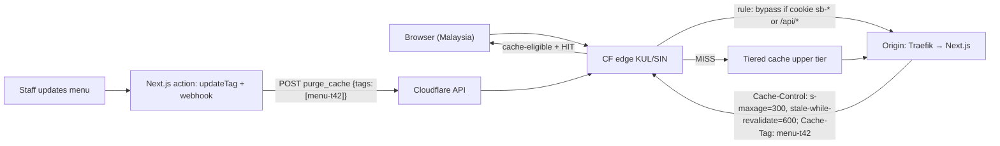

# Cloudflare - Caching Rules, CDN & Cache Purging

> [!info] Deep dive of [[Cloudflare]]

> [!abstract] TL;DR
> By default Cloudflare caches **static file extensions only**, never HTML or JSON. **Cache Rules** decide what else is cache-eligible, the Edge/Browser TTLs and the cache key.
> - Cache **hashed assets forever**, cache **public HTML/API responses briefly** with `s-maxage` + `stale-while-revalidate`, and **bypass** anything personalized (cookies, `Authorization`, `/api/*` writes).
> - Invalidate with **purge by tag** (`Cache-Tag` header), now on all plans including Free, instead of purge-everything.
> - Check every rule with the `cf-cache-status` header and a logged-in vs logged-out test. One wrong "cache everything" leaks customers' pages.

## Concept
| `cf-cache-status` | Meaning |
|---|---|
| `HIT` | Served from edge cache |
| `MISS` | Not in cache, fetched from origin (now cached if eligible) |
| `EXPIRED` / `REVALIDATED` | TTL passed, refetched / origin confirmed with 304 |
| `STALE` / `UPDATING` | Served stale while refreshing (origin down or revalidating) |
| `BYPASS` | Rule or origin headers (`Cache-Control: private/no-store`, `Set-Cookie`) prevented caching |
| `DYNAMIC` | Not eligible (default for HTML/JSON without a Cache Rule) |

**Cache Rule settings**:

| Setting | Effect | Typical value |
|---|---|---|
| Eligible for cache | Makes HTML/JSON cacheable | Public marketing pages, public API GETs |
| Edge TTL | How long the edge keeps it | Respect origin, or override (e.g. 1 h) |
| Browser TTL | `Cache-Control` sent to browsers | Short for HTML (0–60 s), long for hashed assets |
| Cache key | Which parts of the request vary the cache | Ignore marketing query params (`utm_*`, `fbclid`) |
| Serve stale | Serve expired content when origin errors | On for public pages |
| Bypass | Never cache | Cookies present, `/api/`, `/admin`, previews |

**Purge options**:

| Method | Scope | Use |
|---|---|---|
| URL (files) | Exact URLs | Single page/asset fixes |
| **Tag** | All responses with a `Cache-Tag` value | Content changes (`menu:tenant42`) |
| Prefix / Hostname | Path prefix, whole host | Section or tenant subdomain |
| Purge Everything | Zone | Emergencies only (origin load spike after) |

## How It Works


## Practical Usage
**Origin headers drive caching** (Next.js route or middleware):
```ts
// public, tenant-specific menu page
return new Response(html, {
  headers: {
    'Content-Type': 'text/html; charset=utf-8',
    'Cache-Control': 'public, s-maxage=300, stale-while-revalidate=600, max-age=0',
    'Cache-Tag': `menu-${tenantId},tenant-${tenantId}`,
  },
});
// personalized: never cache
headers.set('Cache-Control', 'private, no-store');
```
**Cache Rules (expressions, in order)**:
```text
1. Bypass:   (http.request.uri.path wildcard "/api/*") or (http.request.uri.path wildcard "/admin*")
             or (http.cookie contains "sb-") or (any(http.request.headers["authorization"][*] ne ""))
2. Assets:   starts_with(http.request.uri.path, "/_next/static/")  → eligible, Edge TTL 1 year, Browser TTL 1 year
3. Public HTML: http.host eq "menu.client.my" and http.request.method eq "GET" → eligible, Edge TTL: respect origin,
             cache key: ignore query string params utm_*, fbclid, gclid; serve stale on error
```
**Purge by tag from the app** (after content changes):
```ts
await fetch(`https://api.cloudflare.com/client/v4/zones/${ZONE_ID}/purge_cache`, {
  method: 'POST',
  headers: { Authorization: `Bearer ${CF_PURGE_TOKEN}`, 'Content-Type': 'application/json' },   // token scoped: Zone.Cache Purge only
  body: JSON.stringify({ tags: [`menu-${tenantId}`] }),
});
```
**Verify**:
```bash
curl -sI https://menu.client.my/ | grep -iE 'cf-cache-status|cache-control|age'
curl -sI -H 'Cookie: sb-access-token=x' https://menu.client.my/ | grep -i cf-cache-status   # must be BYPASS/DYNAMIC
curl -sI "https://menu.client.my/?utm_source=x" | grep -i cf-cache-status                     # should HIT after first request
```
**Wrong way**:
```text
❌ "Cache Everything" on the whole zone        → dashboard HTML with customer data served to other users
❌ Purge Everything on every CMS save          → cold cache, origin spike on a 2-vCPU VPS
❌ Cache key includes all query params         → cache-busting via ?random=… floods the origin
❌ Long Browser TTL on HTML                    → users stuck on old pages; you can't purge browsers
```

## Patterns & Anti-patterns
| Pattern | When | Anti-pattern to avoid |
|---|---|---|
| Hashed filenames + 1-year TTL | JS/CSS/fonts/images | Short TTLs on immutable assets |
| `s-maxage` + `stale-while-revalidate` from origin | Public HTML/API | Edge TTL overrides that ignore app intent |
| Bypass on auth cookies/headers first in rule order | Any app with logins | Relying on origin `private` alone |
| Purge by tag per tenant/content type | Multi-tenant SME sites | Purge everything |
| Strip tracking params from the cache key | Marketing traffic | Each ad click a cache miss |
| Separate hostnames for app vs marketing/assets | Mixed sites | One hostname with complex exceptions |
| Tiered cache on | Origins in one region | Every edge PoP hitting the origin |

## Performance & Trade-offs
- **Hit ratio vs freshness**: 5-minute HTML TTL + SWR gives near-instant pages and at most 5 minutes of staleness. Tag purges make it effectively fresh.
- **Origin protection**: a high hit ratio is the cheapest scaling for a Hostinger KVM. Traffic spikes from Facebook ads or a viral post land on the edge, not Next.js.
- **Tiered Cache** (Smart Tiered on all plans) reduces origin requests by routing misses through an upper tier. **Cache Reserve** (paid, R2-backed) keeps long-tail content longer.
- **Purge propagation** is fast (seconds), but Free-plan purge rate limits (≈5 requests/min, bucket 25) mean batching tags per request.
- **Image-heavy sites**: caching Supabase Storage/R2 public URLs behind a custom domain removes egress costs at the origin ([[Supabase - Storage, Uploads & Image Transformations]]).

## Tips & Reminders
> [!tip] In ZP's stack
> - **Next.js sites**: Cloudflare caches `/_next/static` forever. Public tenant pages are cached with `s-maxage` + `Cache-Tag`, and Server Actions trigger `updateTag` and a Cloudflare tag purge ([[Next.js - Self-Hosting, Standalone Builds & ISR on Coolify]]).
> - **Bypass by default** for app hostnames (`app.client.my`), and cache only marketing/menu hostnames. That's simpler and safer.
> - **API tokens**: one token per zone with only "Cache Purge" permission, stored as a Coolify secret.

- Add `Cache-Tag` values with tenant and entity IDs, since tags are cheap. Keep each header under the size limit by using coarse tags.
- For WordPress clients, use APO or a cache plugin that sends tags, and bypass `wp-admin` and logged-in cookies ([[PHP - WordPress Hardening & Maintenance SOP]]).
- Debug with `cf-cache-status`, `age` and `cf-ray` headers, and check Cache Analytics for the top uncached paths.
- Document cache rules per client in the handover doc. They're invisible infrastructure.

## Version Notes
| Date | Change |
|---|---|
| 2023–24 | Cache Rules replace Page Rules for cache settings (Page Rules deprecated over time) |
| 2024 | Smart Tiered Cache available on all plans |
| 2025-04 | Purge by tag/prefix/hostname available on all plans (Free: 5 req/min, bucket 25) |

> [!warning] Unverified — check before relying on this
> Cookie/header conditions available per plan in Cache Rules, Cloudflare's current handling of `stale-while-revalidate` from origin, and 2026 Cache Rules changes weren't verified. Check https://developers.cloudflare.com/cache/ and the changelog.

## Critical Issues & Gotchas
> [!danger] Caching personalized responses
> Caching HTML or JSON that depends on a session (dashboards, order history, "Hi Aisyah") serves one user's data to others, which is a PDPA breach that's hard to detect. Put bypass rules for auth cookies and `Authorization` first, send `Cache-Control: private, no-store` from the origin for personalized routes, and test logged-in vs logged-out after every rule change.

> [!danger] Web cache poisoning and deception
> If the cache key ignores a header the origin uses (e.g. `X-Forwarded-Host`, language headers), an attacker can store a poisoned response for everyone. Cache-deception tricks (`/account/profile.css`) can make private pages cacheable by extension. Keep cache keys aligned with what the origin varies on, and avoid extension-based caching on app paths ([[Network Security - Common Web Attacks]]).

- **`Set-Cookie` responses** aren't cached by default. A framework that sets cookies on every response silently kills the hit ratio.
- **`Vary`**: Cloudflare largely ignores `Vary` (beyond encoding/images on some plans), so don't rely on it to separate variants. Use distinct URLs or cache-key settings.
- **Custom cache keys break single-URL purge** from the dashboard. Use tag purges instead.
- **Preview/staging hostnames** must bypass the cache entirely, or testers see stale builds ([[Coolify - Preview Deployments, Environments & Secrets]]).

## Related
- [[Cloudflare]]
- [[Next.js - Self-Hosting, Standalone Builds & ISR on Coolify]] — origin headers and purge on revalidate
- [[Next.js - Caching]] — app-level cache vs CDN cache
- [[Nginx - Caching & Performance Tuning]] — origin-side caching alternative
- [[Redis - Caching Patterns & Invalidation]] — data caching behind the CDN
- [[Network Security - Cloudflare WAF & Rate Limiting Rules]] — the other half of zone configuration

## References
- https://developers.cloudflare.com/cache/how-to/cache-rules/
- https://developers.cloudflare.com/cache/how-to/purge-cache/
- https://developers.cloudflare.com/cache/concepts/cache-responses/
- https://developers.cloudflare.com/cache/how-to/tiered-cache/
- https://www.drupal.org/project/cloudflare_purge/issues/3567714
