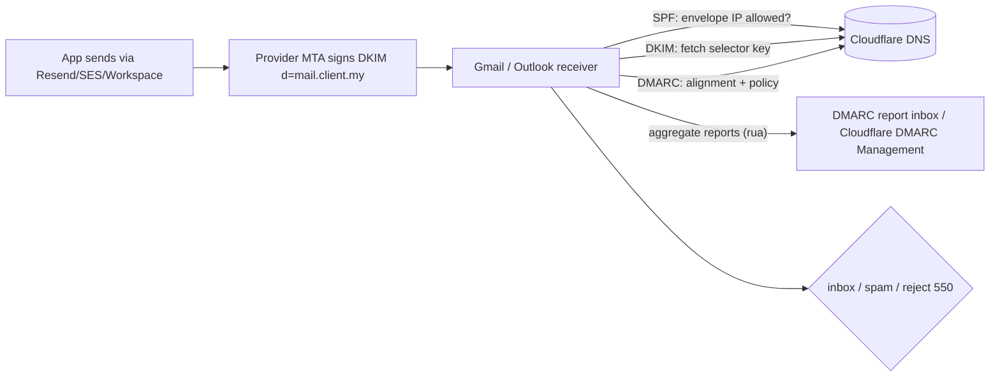

# Cloudflare - DNS, Email Authentication & Domain Ops

> [!info] Deep dive of [[Cloudflare]]

> [!abstract] TL;DR
> - **DNS**: proxy (orange) only HTTP(S) hostnames. MX, mail and SSH records stay **DNS-only**.
> - **Email authentication** is now mandatory for deliverability (Gmail, Yahoo and Outlook enforce SPF, DKIM, DMARC and one-click unsubscribe for bulk senders):
>   - **one** SPF record (≤ 10 DNS lookups);
>   - DKIM for every sender (Workspace, Resend, Supabase SMTP provider);
>   - DMARC rolled out `p=none` → `quarantine` → `reject` while reading reports.
> - **Ownership**: domain and Cloudflare account in the **client's name**, you invited as a member, registrar lock + auto-renew on.
> - **Hygiene**: delete dangling CNAMEs to prevent subdomain takeover.

## Concept
| Record | Purpose | Proxied? | Notes |
|---|---|---|---|
| A / AAAA | Point a hostname to an IP | ✅ for web (hides origin) | Grey-cloud for non-HTTP services |
| CNAME | Alias to another hostname | ✅ for web | Apex CNAME works via Cloudflare flattening |
| MX | Mail servers for the domain | ❌ never | Points at mail-provider hosts |
| TXT | SPF, DKIM (sometimes), DMARC, verification | — | One SPF record only |
| CAA | Which CAs may issue certs | — | Allow Let's Encrypt + Cloudflare's CAs, or issuance fails |
| DS (DNSSEC) | Chain of trust at the registry | — | Enable in Cloudflare, add DS at the registrar (MYNIC supports it for .my) |

**Email authentication**:

| Mechanism | What it proves | Record |
|---|---|---|
| **SPF** | The sending IP is allowed for the envelope domain | `v=spf1 include:_spf.google.com include:amazonses.com ~all` |
| **DKIM** | The message was signed by a key published for the domain | `selector._domainkey` TXT/CNAME from each provider |
| **DMARC** | Policy + reporting when SPF/DKIM **align** with the From domain | `_dmarc` TXT: `v=DMARC1; p=none; rua=mailto:…` |
| One-click unsubscribe | Bulk mail compliance | `List-Unsubscribe` + `List-Unsubscribe-Post` headers (RFC 8058) |

## How It Works


## Practical Usage
**Baseline zone for an SME client** (web on Coolify, Google Workspace mail, transactional mail via a subdomain):
```text
client.my.            A      203.0.113.10        ; proxied (orange)
www                   CNAME  client.my.           ; proxied
app                   CNAME  client.my.           ; proxied
hooks                 CNAME  hooks-gateway.workers.dev. ; Worker route or proxied CNAME
client.my.            MX 1   smtp.google.com.     ; DNS-only
client.my.            TXT    "v=spf1 include:_spf.google.com ~all"
google._domainkey     TXT    "v=DKIM1; k=rsa; p=MIIB…"
mail                  TXT    "v=spf1 include:amazonses.com ~all"      ; transactional subdomain
resend._domainkey.mail TXT   "p=MIGf…"                                ; provider DKIM for mail.client.my
_dmarc                TXT    "v=DMARC1; p=none; rua=mailto:dmarc@client.my; adkim=s; aspf=r; pct=100"
client.my.            CAA    0 issue "letsencrypt.org"
client.my.            CAA    0 issue "pki.goog"
```
**Verify from the command line**:
```bash
dig +short TXT client.my | grep spf1
dig +short TXT google._domainkey.client.my
dig +short TXT _dmarc.client.my
dig +short CAA client.my
# count SPF lookups (include/a/mx/ptr/exists/redirect) — must stay ≤ 10
```
**DMARC rollout plan**:

| Week | Policy | Action |
|---|---|---|
| 0 | `p=none; rua=…` | Collect reports. List every legitimate sender (CRM, invoicing tool, website forms) |
| 2–4 | Fix SPF/DKIM for each sender | Unknown sources = misconfigurations or spoofing |
| 4+ | `p=quarantine; pct=25` → `100` | Watch reports and support tickets |
| 8+ | `p=reject` | Spoofed mail of the client's domain gets blocked |

**Records via API** (repeatable per client):
```bash
curl -sS -X POST "https://api.cloudflare.com/client/v4/zones/$ZONE/dns_records" \
  -H "Authorization: Bearer $CF_DNS_TOKEN" -H "Content-Type: application/json" \
  --data '{"type":"TXT","name":"_dmarc","content":"v=DMARC1; p=none; rua=mailto:dmarc@client.my","ttl":3600}'
```
**Wrong way**:
```text
❌ Two SPF TXT records (one per provider)          → SPF permerror → DMARC fails for everyone
❌ MX host proxied (orange cloud)                  → mail delivery breaks
❌ Domain registered under your personal account   → client can't move providers; you hold their business hostage (and liability)
❌ CNAME shop → old-store.myshopify.com after cancelling Shopify → subdomain takeover
```

## Patterns & Anti-patterns
| Pattern | When | Anti-pattern to avoid |
|---|---|---|
| Separate sending subdomain for app/transactional mail (`mail.client.my`) | Apps sending notifications | Sending bulk/app mail from the root domain used by staff |
| DKIM for every sender service | Every provider | Relying on SPF only (breaks on forwarding) |
| DMARC with `rua` reports, gradual enforcement | Every domain | Jumping to `p=reject` without inventory |
| CAA records listing exactly your CAs | Traefik ACME + Cloudflare edge certs | No CAA (any CA can issue) or wrong CAA (renewals fail) |
| Client-owned registrar + Cloudflare accounts; you as a member | Agency/consulting | Your accounts owning client domains |
| Quarterly DNS review: remove records for retired services | Always | Accumulated dangling CNAMEs |

## Performance & Trade-offs
- **Proxied vs DNS-only**: proxied hides the origin and adds WAF/CDN, but only for HTTP(S) on supported ports. DNS-only exposes the IP, so keep non-HTTP services on separate IPs or behind Tunnel.
- **TTL**: proxied records ignore TTL at the edge. For DNS-only records, use a low TTL (300) before migrations and higher (3600+) for stability.
- **Email Routing** (Cloudflare) forwards inbound mail for free (`info@client.my` → Gmail), but **doesn't send**. Replies come from Gmail unless you configure "send as" via an SMTP provider. That's good for micro-SMEs without Workspace.
- **DNSSEC** protects against spoofed DNS answers, but a botched registrar DS change takes the domain offline. Enable it only when you control both sides.

## Tips & Reminders
> [!tip] In ZP's stack
> - **Onboarding checklist** per client domain:
>   - transfer DNS to Cloudflare (client account, ZP as Administrator member);
>   - set registrar lock + auto-renew;
>   - add SPF/DKIM/DMARC for Workspace or Zoho + transactional provider (Supabase Auth custom SMTP, Resend/SES) ([[Supabase - Auth Flows, MFA & Custom Claims]]);
>   - add CAA for Let's Encrypt (Traefik) + Google Trust Services (Cloudflare edge);
>   - apply the WAF baseline ([[Network Security - Cloudflare WAF & Rate Limiting Rules]]).
> - **Handover document**: list every DNS record's purpose and owner.

- Use Cloudflare's DMARC Management (or a free report parser) to read aggregate reports. Raw XML in an inbox goes unread.
- For `.my` domains, MYNIC-accredited registrars handle the DS record and nameserver changes. Note the registrar and login owner in the client file.
- Bulk-sender thresholds (5,000/day to Gmail) apply per domain. Newsletters through Mailchimp/Brevo need their DKIM records too.
- Keep complaint rates under ~0.1% (hard ceiling 0.3% at Gmail): only mail people who opted in, and honour unsubscribes within 2 days.

## Version Notes
| Date | Change |
|---|---|
| 2024-02 | Gmail + Yahoo bulk-sender requirements: SPF, DKIM, DMARC (≥ `p=none`), one-click unsubscribe, spam-rate limits |
| 2025-05-05 | Microsoft Outlook/Hotmail enforces similar requirements for 5,000+/day senders |
| 2025-11 | Gmail escalates non-compliant bulk traffic to permanent 550 rejections (reported) |
| 2024–26 | Cloudflare DMARC Management, Email Routing, apex CNAME flattening as standard |

> [!warning] Unverified — check before relying on this
> Exact enforcement thresholds and whether any provider requires `p=quarantine` were reported inconsistently by vendor blogs. See Google's Email sender guidelines, Yahoo Sender Hub and Microsoft's announcements.

## Critical Issues & Gotchas
> [!danger] Subdomain takeover via dangling records
> A CNAME pointing at a deprovisioned service (old Vercel/Netlify site, deleted R2 custom domain, cancelled SaaS) can be claimed by an attacker, who then serves content on the client's trusted subdomain (phishing, cookie theft if cookies are domain-wide). Remove DNS records when services are retired, and audit regularly.

> [!danger] Client domains owned by you
> Registering client domains or Cloudflare zones under your personal accounts creates legal and operational risk: disputes, expired cards, your account compromise affecting all clients. Put ownership in the client's name, and document access in the SOW.

- **SPF 10-lookup limit**: each `include:` can nest more lookups. Exceeding 10 makes SPF `permerror`. Flatten carefully, or move senders to subdomains.
- **DMARC alignment**: providers sending as `bounce.provider.com` pass SPF for *their* domain, not yours. Configure custom return-path/DKIM domains so alignment passes.
- **CAA blocks renewals** if you forget a CA in use (e.g. Cloudflare edge certs from Google Trust Services). Certificate errors appear on renewal day.
- **Proxy breaks some services**: FTP, SSH, mail and raw TCP don't work through orange-cloud records. Use DNS-only records or Spectrum/Tunnel.

## Related
- [[Cloudflare]]
- [[Cloudflare - Zero Trust Tunnel & Access]] — admin hostnames without public DNS exposure
- [[Network Security - Cloudflare WAF & Rate Limiting Rules]] — zone security baseline
- [[HTTP & HTTPS - TLS Handshake & Certificates]] — CAA, ACME, certificate issuance
- [[Supabase - Auth Flows, MFA & Custom Claims]] — custom SMTP for auth emails
- [[Traefik]] — ACME DNS-01 with Cloudflare tokens

## References
- https://developers.cloudflare.com/dns/
- https://developers.cloudflare.com/email-routing/
- https://developers.cloudflare.com/dmarc-management/
- https://support.google.com/a/answer/81126 (Email sender guidelines)
- https://redsift.com/guides/bulk-email-sender-requirements
- https://www.rfc-editor.org/rfc/rfc8058
