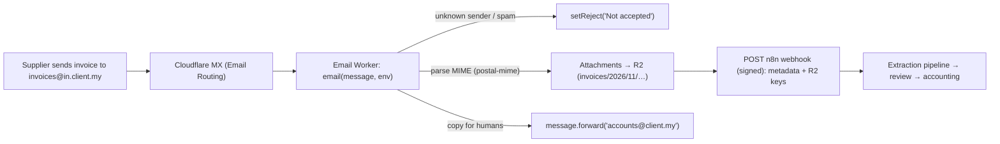

# Cloudflare - Email Routing & Email Workers

> [!info] Deep dive of [[Cloudflare]]

> [!abstract] TL;DR
> **Email Routing** (free) receives mail for a domain on Cloudflare and **forwards** custom addresses (`support@`, `invoices@`, catch-all) to verified inboxes. Good for small businesses without full mailboxes, and for receive-only automation addresses.
> **Email Workers** run code on each inbound message: parse (e.g. `postal-mime`), extract attachments, store in R2, call an n8n webhook, forward, or reject spam/unknown senders.
>
> Typical uses: `invoices@client.my` → Worker → R2 + n8n extraction pipeline, `orders@` → create ticket, catch-all → filtered forward.
> **Limits**: it's not a mailbox (no IMAP/storage, no sending from arbitrary addresses), MX records conflict with existing mail providers on the same domain, and forwarding interacts with SPF/DMARC. Use a **subdomain** (`in.client.my`) when the root domain uses Google Workspace/Microsoft 365.

## Concept
| Feature | What it does | Notes |
|---|---|---|
| Custom address | `sales@client.my` → `owner@gmail.com` | Destination must be verified |
| Catch-all | Unmatched addresses → action | Forward, drop, or Worker |
| Email Worker | `email()` handler per message | Forward, reject, reply (limited), process |
| `send_email` binding | Send from Workers to **verified** destination addresses | Notifications to yourself, not marketing/customers |
| DNS | Cloudflare MX + SPF/DKIM records added automatically | Replaces other MX on that (sub)domain |

**Where it fits**:

| Need | Use | Not |
|---|---|---|
| Receive-only automation inbox | Email Routing + Worker | A paid mailbox |
| Small business alias forwarding | Email Routing | — |
| Full mailboxes for staff | Google Workspace / Microsoft 365 / Zoho | Email Routing |
| Transactional sending | Resend/Postmark/SES ([[Supabase - Transactional Email, Auth SMTP & Deliverability]]) | send_email binding |

## How It Works


## Practical Usage
**Enable**: Dashboard → Email → Email Routing → enable for zone/subdomain (adds MX/TXT records) → verify destination addresses → create rules or bind a Worker to an address or catch-all.

**Email Worker** (parse, store attachments, notify n8n, forward copy):
```ts
import PostalMime from "postal-mime";

export default {
  async email(message: ForwardableEmailMessage, env: Env, ctx: ExecutionContext) {
    const allowed = await env.CONFIG.get("allowed_senders", { type: "json" }) as string[] | null;
    if (allowed && !allowed.some((d) => message.from.toLowerCase().endsWith(d))) {
      message.setReject("Sender not accepted");
      return;
    }
    const raw = await new Response(message.raw).arrayBuffer();
    const mail = await PostalMime.parse(raw);
    const id = crypto.randomUUID();
    const keys: string[] = [];
    for (const a of mail.attachments ?? []) {
      if (!/pdf|image\//.test(a.mimeType) || a.content.byteLength > 15_000_000) continue;
      const key = `invoices/${new Date().toISOString().slice(0, 7)}/${id}/${a.filename ?? "file"}`;
      await env.BUCKET.put(key, a.content, { httpMetadata: { contentType: a.mimeType } });
      keys.push(key);
    }
    const body = JSON.stringify({ id, from: message.from, subject: mail.subject, date: mail.date, keys });
    const sig = await hmac(env.N8N_SECRET, body);
    ctx.waitUntil(fetch(env.N8N_WEBHOOK, { method: "POST", body, headers: { "content-type": "application/json", "x-signature": sig } }));
    await message.forward("accounts@client.my");        // verified destination: humans keep a copy
  },
};
```
**wrangler config**:
```jsonc
{
  "name": "invoice-inbox",
  "main": "src/index.ts",
  "compatibility_date": "2026-10-01",
  "r2_buckets": [{ "binding": "BUCKET", "bucket_name": "client-invoices" }],
  "kv_namespaces": [{ "binding": "CONFIG", "id": "<kv-id>" }],
  "vars": { "N8N_WEBHOOK": "https://n8n.client.my/webhook/inbound-invoice" }
}
```
**DNS when the root domain uses Google Workspace**:
```text
client.my          MX  → Google (unchanged)
in.client.my       MX  → Cloudflare Email Routing (route.mx.cloudflare.net, added by Cloudflare)
invoices@in.client.my → Email Worker
```
**Wrong way**:
```text
❌ Enabling Email Routing on a root domain that already uses Workspace MX → company email stops arriving
❌ Forwarding everything from a catch-all                                → spam flood into the owner's Gmail
❌ Passing raw attachments in the webhook body                           → large payloads, timeouts; store in R2 instead
❌ Using send_email binding for customer emails                          → only verified destinations; wrong tool
```

## Patterns & Anti-patterns
| Pattern | When | Anti-pattern to avoid |
|---|---|---|
| Dedicated inbound subdomain for automation | Domains with existing mail | Touching root MX |
| Worker: filter → store → notify → forward copy | Invoice/order inboxes | Forward-only, losing structured processing |
| Sender allow-lists for automation inboxes | Supplier invoices | Processing any sender (prompt injection, spam) |
| Attachments to R2, references to n8n | Large files | Base64 in webhooks |
| Signed webhook to n8n | Always | Unauthenticated webhook URLs |
| Keep a human copy (forward) | Accounting inboxes | Black-box automation with no fallback |

## Performance & Trade-offs
- **Free and serverless**: no mail server to run. Workers CPU limits apply to parsing large emails, so skip huge attachments or stream to R2.
- **Forwarding and DMARC**: forwarded mail may fail SPF at the destination. Cloudflare rewrites envelope senders (SRS) to help, but strict DMARC senders can still land in spam at the destination.
- **No mailbox**: nothing is stored unless your Worker stores it. Missed processing means lost mail, unless you forward a copy.
- **Alternatives**: Postmark/SendGrid/Mailgun inbound parse webhooks offer similar inbound processing with their own limits and costs. Gmail API polling via n8n works when the client already uses Workspace ([[n8n - Google Workspace & Sheets Integrations]]).

## Tips & Reminders
> [!tip] In ZP's stack
> - **Invoice inbox product**: give each client `invoices@in.clientdomain.my`. Suppliers email PDFs, the Worker stores them in R2 and triggers the n8n extraction pipeline, and staff review in a Next.js page ([[AI Agents - Document Processing & Invoice Extraction]]).
> - **Micro-SMEs without Workspace**: Email Routing aliases (`hello@`, `sales@`) forwarding to the owner's Gmail are free and look professional. Pair with a transactional provider for sending.
> - **Logging**: record message ID, sender and processing result in Postgres, so "did you receive my invoice?" questions are answerable.

- Verify destination addresses before rules work, and keep the destination list minimal.
- Use `message.headers.get("message-id")` for dedupe (suppliers resend).
- Add Workers observability to debug parse failures ([[Cloudflare - Logs, Analytics & Security Events]]).
- Put DMARC/SPF on the subdomain consistent with the root domain policy ([[Cloudflare - DNS, Email Authentication & Domain Ops]]).

## Version Notes
| Date | Change relevant here |
|---|---|
| 2021–22 | Cloudflare Email Routing launched (free forwarding) |
| 2023 | Email Workers GA (`email()` handler, forward/reject) |
| 2024 | `send_email` binding to verified destinations. Reply support expanded |
| 2025–26 | Ongoing Email Routing/Workers improvements. Check for Cloudflare's newer email sending products before building outbound features |

> [!warning] Unverified — check before relying on this
> Current limits (message size, number of rules/destinations), reply capabilities from Email Workers, and the status of any Cloudflare outbound email service weren't verified this run. Check https://developers.cloudflare.com/email-routing/.

## Critical Issues & Gotchas
> [!danger] Breaking a client's existing email
> Turning on Email Routing for a domain replaces its MX records. If the client uses Google Workspace, Microsoft 365 or cPanel mail on that domain, all incoming mail silently goes to Cloudflare instead. Always check existing MX first, and use a dedicated subdomain for automation inboxes.

> [!danger] Inbound email is untrusted input
> Anyone can email an automation address: spoofed suppliers, malware attachments, phishing, and text designed to manipulate downstream AI extraction. Allow-list senders, check SPF/DKIM results where available, restrict attachment types and sizes, and never auto-pay or auto-approve based on emailed documents.

- **Large attachments** may exceed Worker memory/CPU. Reject or forward without processing above a threshold.
- **Character encodings** (ZH/BM subjects) need a proper MIME parser. Don't hand-roll parsing.
- **Duplicate deliveries** happen. Dedupe by Message-ID.
- **Catch-all spam** consumes Worker invocations. Prefer explicit addresses for automation.

## Related
- [[Cloudflare]]
- [[Cloudflare - DNS, Email Authentication & Domain Ops]] — MX, SPF, DKIM, DMARC
- [[Supabase - Transactional Email, Auth SMTP & Deliverability]] — outbound email
- [[Cloudflare - Workers for Webhooks & Edge APIs]] — Worker patterns
- [[AI Agents - Document Processing & Invoice Extraction]] — downstream processing
- [[Cloudflare - R2 Storage & Presigned Uploads]] — attachment storage

## References
- https://developers.cloudflare.com/email-routing/
- https://developers.cloudflare.com/email-routing/email-workers/
- https://developers.cloudflare.com/email-routing/email-workers/send-email-workers/
- https://github.com/postalsys/postal-mime
- https://developers.cloudflare.com/email-routing/setup/email-routing-dns-records/
