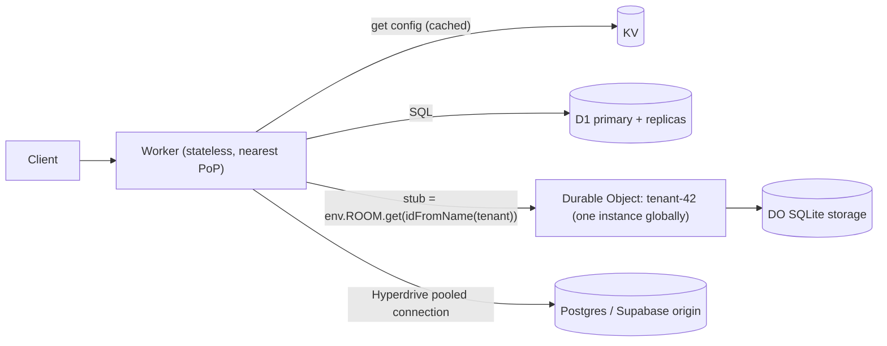

# Cloudflare - KV, D1 & Durable Objects for Edge State

> [!info] Deep dive of [[Cloudflare]]

> [!abstract] TL;DR
> Workers are stateless. Cloudflare offers three state primitives (plus R2 for blobs):
> - **KV**: global, **eventually consistent** key-value (~60 s propagation, ~1 write/s per key). For config, feature flags, cached lookups, read-heavy data.
> - **D1**: managed **SQLite** databases (≤ 10 GB each) with SQL, migrations and read replicas. For small relational apps living fully on Workers.
> - **Durable Objects**: single-threaded, **strongly consistent** actors with their own SQLite storage, alarms and WebSockets. For counters, rate limiters, locks, chat rooms, per-tenant coordination.
>
> For ZP's typical client systems, **Postgres/Supabase stays the system of record**. Use these for edge-side caching, coordination and webhook buffering, not to move core data onto Cloudflare.

## Concept
| | KV | D1 | Durable Objects (SQLite) |
|---|---|---|---|
| Model | Key → value (≤ 25 MiB) | SQLite DB (SQL) | Actor instance + private SQLite/KV storage |
| Consistency | Eventual (cached at edge, ~60 s) | Strong on primary. Replicas via Sessions API (sequential per session) | Strong, single-threaded per object |
| Write throughput | ~1 write/s per key | Single writer per DB | One object ≈ one thread. Shard by key |
| Size limit | Large namespaces | 10 GB per database | 10 GB per object (paid) |
| Location | Global reads | Primary region + read replicas | Created near first request, then fixed |
| Extras | TTL, list by prefix, metadata | Migrations, Time Travel restore | Alarms, WebSocket hibernation, RPC |
| Pick it when… | Read-heavy config/cache | Small relational app on Workers | Coordination, counters, realtime rooms |

**Versus ZP's existing stack**:

| Need | Cloudflare primitive | Self-hosted equivalent |
|---|---|---|
| Rate limit per API key at edge | Durable Object (or Workers Rate Limiting binding) | [[Redis]] GCRA script |
| Feature flags/tenant config | KV | Redis/Postgres table |
| Webhook buffer before n8n | Queues + DO/D1 | Redis/BullMQ, n8n queue mode |
| Chat/presence room | DO with WebSocket hibernation | [[Supabase]] Realtime |
| Core business data | D1 (small) / Hyperdrive → Postgres | [[PostgreSQL]] |

## How It Works


## Practical Usage
**Bindings** (`wrangler.jsonc`):
```jsonc
{
  "name": "edge-api",
  "main": "src/index.ts",
  "compatibility_date": "2026-10-01",
  "kv_namespaces": [{ "binding": "CONFIG", "id": "<kv-id>" }],
  "d1_databases": [{ "binding": "DB", "database_name": "app", "database_id": "<d1-id>" }],
  "durable_objects": { "bindings": [{ "name": "LIMITER", "class_name": "RateLimiter" }] },
  "migrations": [{ "tag": "v1", "new_sqlite_classes": ["RateLimiter"] }]
}
```
**KV: cached tenant config**:
```ts
const cfg = await env.CONFIG.get<TenantConfig>(`tenant:${tenantId}`, { type: "json", cacheTtl: 300 });
await env.CONFIG.put(`tenant:${tenantId}`, JSON.stringify(next), { expirationTtl: 86400 });
```
**D1: parameterized queries and migrations**:
```bash
npx wrangler d1 migrations create app add_leads
npx wrangler d1 migrations apply app --remote
```
```ts
const { results } = await env.DB
  .prepare("SELECT id, name, phone FROM leads WHERE tenant_id = ? AND created_at > ? ORDER BY created_at DESC LIMIT 50")
  .bind(tenantId, since).all<Lead>();
```
**Durable Object: strongly consistent per-key rate limiter**:
```ts
import { DurableObject } from "cloudflare:workers";

export class RateLimiter extends DurableObject {
  async hit(limit: number, windowMs: number): Promise<boolean> {
    const now = Date.now();
    const sql = this.ctx.storage.sql;
    sql.exec("CREATE TABLE IF NOT EXISTS hits (ts INTEGER)");
    sql.exec("DELETE FROM hits WHERE ts < ?", now - windowMs);
    const count = sql.exec<{ c: number }>("SELECT count(*) AS c FROM hits").one().c;
    if (count >= limit) return false;
    sql.exec("INSERT INTO hits (ts) VALUES (?)", now);
    return true;
  }
}

// in the Worker
const stub = env.LIMITER.get(env.LIMITER.idFromName(`key:${apiKey}`));
if (!(await stub.hit(60, 60_000))) return new Response("Too Many Requests", { status: 429 });
```
**Alarms for delayed work** (retry/flush buffered webhooks):
```ts
await this.ctx.storage.setAlarm(Date.now() + 30_000);
async alarm() { /* flush buffered events to n8n; reschedule on failure */ }
```
**Wrong way**:
```text
❌ KV as a counter or session store with frequent writes  → lost updates, stale reads for up to ~60 s
❌ One global Durable Object for all traffic               → single-threaded bottleneck; shard by tenant/key
❌ D1 as the main DB of a growing multi-tenant SaaS         → 10 GB/db cap, single writer, migration pain later
❌ String-concatenated SQL in D1                            → SQL injection, same as anywhere else
```

## Patterns & Anti-patterns
| Pattern | When | Anti-pattern to avoid |
|---|---|---|
| KV for read-mostly config with `cacheTtl` | Flags, tenant settings, redirects | Writing per request |
| DO per tenant/room/key (`idFromName`) | Coordination, limits, realtime | Global singleton DO |
| D1 per tenant (database-per-tenant) | Many small isolated tenants | One huge D1 approaching 10 GB |
| Hyperdrive to existing Postgres | Workers needing core data | Replicating core data into D1 |
| Edge buffer → origin worker queue | Webhook bursts | Workers calling n8n synchronously with no retry |
| WebSocket hibernation API | Realtime rooms | Holding DO awake per socket (billed duration) |
| Postgres remains source of truth | ZP's client systems | Splitting data of record across D1 and Postgres |

## Performance & Trade-offs
- **KV reads** are fast at hot PoPs. Cold keys fall back to central storage (tens to hundreds of ms). Writes are slow to propagate by design.
- **D1** queries go to the primary region unless read replication is enabled and you use the **Sessions API** (bookmarks ensure read-your-writes). Latency from Malaysia to a distant primary is noticeable, so pick a location hint near APAC (`apac`) at creation.
- **Durable Objects** live where first created, so a Malaysian tenant's DO created from Singapore stays near users. Global users of one object pay a round trip to it.
- **Cost model**: requests + duration (DO) + rows read/written (D1) + reads/writes/storage (KV). Free-tier daily limits **fail hard** (errors) when exceeded rather than billing.
- **Lock-in**: DO/D1 APIs are Cloudflare-specific. D1 data is SQLite (exportable), but DO logic needs a rewrite elsewhere.

## Tips & Reminders
> [!tip] In ZP's stack
> - **Best fits**: edge rate limiting for public webhook/API endpoints, KV-cached tenant configs for Workers fronting n8n, DO-based dedupe/idempotency of Meta/WhatsApp webhook bursts before forwarding to n8n ([[Cloudflare - Workers for Webhooks & Edge APIs]]).
> - **Avoid** migrating Supabase/Postgres data of record to D1. Keep one source of truth, and use Hyperdrive if Workers need it.
> - **PDPA**: data in KV/D1/DO is stored on Cloudflare infrastructure outside Malaysia. Note it in DPAs and minimize personal data at the edge.

- `wrangler d1 export app --remote --output backup.sql` on a schedule. Time Travel is not a substitute for off-platform backups.
- Use `idFromName` for deterministic DO routing, and `newUniqueId` only for ephemeral objects.
- Always set `new_sqlite_classes` (not legacy KV-backed classes) for new DOs.
- Test locally with `wrangler dev` (Miniflare emulates KV/D1/DO).

## Version Notes
| Date | Change relevant here |
|---|---|
| 2024-04 | D1 GA (10 GB per database) |
| 2024-09 | SQLite-backed Durable Objects (beta), 10 GB per object |
| 2025-04 | SQLite DOs GA. Durable Objects on the Workers Free plan (SQLite only), D1 read replication beta (Sessions API) |
| 2025–2026 | KV namespace limit raised (200 → 1000 per account). Workers Rate Limiting binding |

> [!warning] Unverified — check before relying on this
> Sources conflict on whether Durable Objects are available on the **Workers Free** plan, and current free-tier quotas (D1 5M rows read/day, 100K writes/day, 5 GB; KV 100K reads/day) came mainly from third-party trackers. Confirm at developers.cloudflare.com pricing pages before quoting clients.

## Critical Issues & Gotchas
> [!danger] KV eventual consistency causes stale or lost data
> Two writes to the same key within a second, or a read right after a write from another PoP, can return old data for up to ~60 s. Using KV for sessions, balances, stock or counters causes double-spends and wrong states. Use a Durable Object (strong consistency) or the origin database.

> [!danger] Platform outages and hard free-tier limits
> Cloudflare's 2025 global outages took Workers and KV-dependent services down. On the free plan, exceeding daily D1/KV/DO limits makes operations **fail** until reset. Don't put the only copy of business-critical state on the edge, keep an origin fallback, and use the paid plan for client production.

- **DO single-threading**: a slow `await fetch` inside an object blocks its other requests (input gates help consistency but not throughput). Keep DO work short and shard.
- **D1 migrations** are forward-only via wrangler. Test on a preview DB first.
- **DO location is sticky**: an object first touched from Europe stays there. Use `locationHint` when creating tenant objects.
- **Large KV values/lists**: `list()` is paginated and eventually consistent. Don't use it as an index.

## Related
- [[Cloudflare]]
- [[Cloudflare - Workers for Webhooks & Edge APIs]] — the Workers these bind to
- [[Cloudflare - R2 Storage & Presigned Uploads]] — blob storage counterpart
- [[Redis]] — self-hosted equivalent for counters/limits
- [[PostgreSQL]] — source of truth, via Hyperdrive
- [[WebSocket]] — DO hibernatable WebSocket rooms

## References
- https://developers.cloudflare.com/kv/concepts/how-kv-works/
- https://developers.cloudflare.com/d1/reference/faq
- https://developers.cloudflare.com/durable-objects/platform/pricing
- https://developers.cloudflare.com/durable-objects/release-notes/
- https://jwatte.com/blog/cloudflare-developer-platform/
