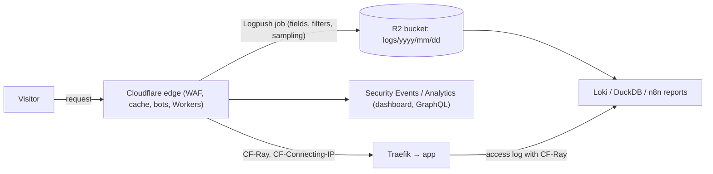

# Cloudflare - Logs, Analytics & Security Events

> [!info] Deep dive of [[Cloudflare]]

> [!abstract] TL;DR
> Cloudflare sees every request before your VPS does, which makes it the best place to answer "was it blocked, slow, cached or attacked?":
> - **Security Events / Security Analytics**: which WAF, rate-limit, bot or Turnstile rule acted on which request (by Ray ID). Sampled and short retention on lower plans.
> - **Analytics (dashboard + GraphQL API)**: traffic, cache ratio, status codes, top paths/countries. Aggregated, not raw.
> - **Logpush**: raw HTTP request/firewall/Workers logs to R2/S3/HTTP/Datadog. Now self-service on all plans with **usage-based pricing (from 2026-12-01)**.
> - **Log Explorer**: query logs stored in Cloudflare (US$1/GB ingested, first 10 GB/month free).
> - **Workers Logs/Traces**: `console.log` and invocation logs for Workers.
> - **Web Analytics**: free, cookieless RUM beacon for sites.
>
> Always correlate by the **`CF-Ray`** header from browser → Cloudflare → Traefik access logs.

## Concept
| Tool | Data | Plan / cost (verify) | Use it for |
|---|---|---|---|
| Security Events | WAF/rate-limit/bot actions, sampled | All plans. Retention/sampling vary | "Why was this customer blocked?" |
| Security Analytics | Aggregated threat view, rule simulation | Paid tiers richer | Tuning WAF rules before enforcing |
| Traffic/Cache Analytics | Requests, bandwidth, cache hit ratio, status codes | All plans (aggregated) | Cache tuning, outage triage |
| GraphQL Analytics API | Same datasets, programmable | All plans, dataset/retention limits | Client reports, alerts from n8n |
| Logpush | Raw HTTP requests, firewall events, Workers trace events, DNS, etc. | All plans, usage-based from 2026-12-01 | Long retention, SIEM/Loki, forensics |
| Log Explorer | Logs stored and queried in Cloudflare | US$1/GB ingested, 10 GB/month free | Investigations without a SIEM |
| Instant Logs | Live tail of requests | Paid tiers | Debugging right now |
| Workers observability | Workers logs + traces | Free 0.5 GB/day, 7 days | Webhook/edge API debugging |
| Web Analytics | Page views, Core Web Vitals (RUM) | Free | Privacy-friendly site analytics |

## How It Works


## Practical Usage
**Correlate a blocked request** (customer sends a screenshot with Ray ID `8f3a…-SIN`):
```text
Dashboard → Security → Events → filter "Ray ID = 8f3a…" → see rule (e.g. managed rule 100xxx, rate limit "login-burst")
→ check action (block/managed challenge), country, ASN, path → add a skip rule or adjust threshold, scoped narrowly
```
**Log `CF-Ray` and the real client IP in Traefik access logs**:
```yaml
accessLog:
  format: json
  fields:
    headers:
      defaultMode: drop
      names:
        CF-Ray: keep
        CF-Connecting-IP: keep
        User-Agent: keep
```
**Logpush HTTP requests to R2** (API, minimal fields, filtered to errors and security actions):
```bash
curl -s -X POST "https://api.cloudflare.com/client/v4/zones/$ZONE_ID/logpush/jobs" \
  -H "Authorization: Bearer $CF_API_TOKEN" -H "Content-Type: application/json" -d '{
  "name": "acme-http-errors",
  "dataset": "http_requests",
  "destination_conf": "r2://acme-logs/http/{DATE}?account-id='"$ACCOUNT_ID"'&access-key-id='"$R2_KEY"'&secret-access-key='"$R2_SECRET"'",
  "output_options": { "field_names": ["EdgeStartTimestamp","RayID","ClientIP","ClientCountry","ClientRequestHost","ClientRequestPath","EdgeResponseStatus","OriginResponseStatus","SecurityAction","CacheCacheStatus","EdgeTimeToFirstByteMs"], "output_type": "ndjson" },
  "filter": "{\"where\":{\"or\":[{\"key\":\"EdgeResponseStatus\",\"operator\":\"geq\",\"value\":400},{\"key\":\"SecurityAction\",\"operator\":\"neq\",\"value\":\"unknown\"}]}}",
  "enabled": true }'
```
**GraphQL Analytics for a weekly client report** (n8n HTTP node):
```graphql
query ($zone: String!, $since: Time!, $until: Time!) {
  viewer { zones(filter: { zoneTag: $zone }) {
    httpRequestsAdaptiveGroups(limit: 10, filter: { datetime_geq: $since, datetime_leq: $until },
                               orderBy: [count_DESC]) {
      count
      dimensions { edgeResponseStatus clientRequestPath }
    }
  } }
}
```
**Workers logs**:
```jsonc
// wrangler.jsonc
{ "observability": { "enabled": true, "head_sampling_rate": 1 } }
```
```bash
npx wrangler tail edge-api --status error     # live tail errors from a deployed Worker
```
**Wrong way**:
```text
❌ Logpush of every field for every request to a SIEM   → large bills under usage-based pricing, PII everywhere
❌ Disabling WAF rules globally after one false positive → whole site exposed; use narrow skip rules instead
❌ Origin logs without CF-Connecting-IP                 → every request appears to come from Cloudflare IPs
❌ Relying on dashboard history for an incident 3 weeks ago → sampled/expired; export what you need to keep
```

## Patterns & Anti-patterns
| Pattern | When | Anti-pattern to avoid |
|---|---|---|
| Ray ID on error pages + in origin logs | Support and debugging | Guessing which rule blocked a user |
| Logpush only errors + security actions | Small budgets | Full request logs "just in case" |
| R2 as log sink, query with DuckDB/Loki | Self-hosted stack | Paid SIEM for an SME |
| Weekly GraphQL report (traffic, threats blocked, cache %) | Retainer value | No visibility for clients |
| Log-mode/simulate WAF rules before block | New rules | Enforcing untested rules on checkout |
| Field minimization + retention policy | PDPA | Storing IPs/URLs with tokens forever |

## Performance & Trade-offs
- **Sampling**: dashboard security events and adaptive analytics are sampled. Good for trends, incomplete for forensics. Logpush or Log Explorer gives full fidelity at a cost.
- **Usage-based Logpush** (from 2026-12-01): cost scales with volume. Filter and select fields at the job level, and push to R2 (no egress) rather than external SaaS.
- **Log Explorer vs self-hosted**: Explorer is zero-ops and SQL-like, at US$1/GB. R2 + DuckDB is cheaper but DIY. For SME traffic either is small. Choose based on how often you investigate.
- **Workers observability** head sampling reduces volume on high-traffic Workers. Keep 100% for low-volume webhooks.

## Tips & Reminders
> [!tip] In ZP's stack
> - **Client retainer report**: requests served, cache hit %, threats blocked, top blocked countries/paths, and uptime. Pull it monthly via GraphQL in n8n. It makes "invisible" security work visible.
> - **Webhook debugging** (Meta/Stripe → Worker/n8n): check Security Events first when webhooks "stop arriving". Bot Fight Mode or WAF rules often challenge provider IPs, so add skip rules for webhook paths ([[Network Security - Cloudflare WAF & Rate Limiting Rules]]).
> - **Tie it together**: CF-Ray in Traefik access logs → Loki, so one query spans edge and origin ([[Traefik - Observability & Troubleshooting]]).

- Add a custom error page that shows the Ray ID, so customers can report it.
- Create API tokens scoped to `Logs:Edit` / `Analytics:Read` per zone for automation.
- Review Security Events weekly for false positives on login, checkout and webhook paths.
- Restrict who can view logs. They include IPs and URLs (personal data under PDPA).

## Version Notes
| Date | Change relevant here |
|---|---|
| 2024 | Workers Logs (observability) launched. Workers Logpush GA earlier |
| 2025-06 | Log Explorer launched (self-serve log storage and querying) |
| 2025-08 | Extended retention options for observability data |
| 2026-09-30 (changelog) | Logpush usage-based pricing, self-service on Free/Pro/Business. Takes effect 2026-12-01 |

> [!warning] Unverified — check before relying on this
> Security Events retention/sampling per plan, Workers Logs quotas (Free 0.5 GB/day vs a third-party "6M events, 3 days" figure), exact Logpush allowances, and Instant Logs plan availability weren't confirmed in primary docs. Check https://developers.cloudflare.com/logs/logpush/pricing/ before relying on them.

## Critical Issues & Gotchas
> [!danger] Logs contain secrets and personal data
> Raw request logs capture full URLs (query-string tokens, password-reset links, signed URLs), IPs and user agents. Pushing them to third-party tools or keeping them indefinitely creates PDPA exposure and a credential-leak path. Select only needed fields, avoid secrets in query strings, encrypt and restrict the log bucket, and set lifecycle deletion (e.g. 30–90 days).

> [!danger] Blind spot when the origin is reachable directly
> If attackers hit the VPS IP directly (bypassing Cloudflare), none of this shows up and WAF rules don't apply. Lock the origin to Cloudflare IPs or use Tunnel, and alert on origin requests lacking `CF-Ray` ([[Cloudflare - Zero Trust Tunnel & Access]]).

- **Usage-based pricing change** may turn existing "free" log jobs into billable volume from 2026-12-01. Audit Logpush jobs now.
- **Time zones**: Cloudflare timestamps are UTC. Convert when matching to MYT client reports.
- **GraphQL limits**: query cost and time-range limits vary by plan and dataset. Paginate and keep ranges short.
- **Ray ID suffix** shows the colo (e.g. `-SIN`, `-KUL`), which helps spot routing issues for Malaysian users.

## Related
- [[Cloudflare]]
- [[Network Security - Cloudflare WAF & Rate Limiting Rules]] — the rules that generate security events
- [[Cloudflare - Workers for Webhooks & Edge APIs]] — Workers logs and traces
- [[Traefik - Observability & Troubleshooting]] — origin-side access logs
- [[Docker - Logging, Metrics & Resource Limits on a VPS]] — Loki/Grafana stack for pushed logs
- [[Cloudflare - R2 Storage & Presigned Uploads]] — log bucket destination

## References
- https://developers.cloudflare.com/logs/
- https://developers.cloudflare.com/changelog/post/2026-09-30-logpush-usage-based-pricing/
- https://developers.cloudflare.com/observability/pricing/
- https://blog.cloudflare.com/one-observability-platform/
- https://developers.cloudflare.com/analytics/graphql-api/
