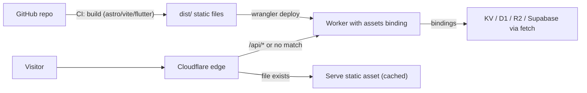

# Cloudflare - Pages & Workers Static Assets for Frontends

> [!info] Deep dive of [[Cloudflare]]

> [!abstract] TL;DR
> Static frontends (Astro sites, SPAs, Flutter web, docs, landing pages) deploy to Cloudflare's edge with free bandwidth and global caching.
> - **Cloudflare Pages**: git-connected builds, preview URLs per branch, Pages Functions. Still supported, but Cloudflare now steers new projects to Workers.
> - **Workers with static assets**: the `assets` binding serves files from the edge, with optional Worker code for APIs, middleware and SSR. Cloudflare's docs recommend it for new projects and provide a Pages → Workers migration guide.
> - **Next.js on Cloudflare**: the OpenNext adapter (`@opennextjs/cloudflare`) runs existing apps on Workers. Cloudflare docs now point new Next.js apps to **vinext**. Expect Node-API and ISR caveats.
>
> **Rule for ZP's stack**: static/content sites go on Cloudflare (cheap, fast, zero ops). Full Next.js apps with Supabase, server actions and long-running work usually stay on Coolify, unless edge hosting has a clear benefit.

## Concept
| Option | Best for | Server code | Notes |
|---|---|---|---|
| Pages (static) | Astro/Vite/SPA builds, docs | Pages Functions (`/functions`) | Git integration, previews, simple |
| Workers + static assets | New projects, static + API in one deploy | Full Worker (`fetch`, bindings: KV/D1/R2/DO, cron) | Recommended path, more control |
| Workers + OpenNext | Existing Next.js apps on Cloudflare | Next.js server on Workers runtime | Node compat flags, caching via R2/KV, limits |
| Coolify (self-hosted) | Full Next.js + Supabase apps, long jobs | Node server, workers | Ops on you, no edge, unlimited runtime |

**Free-tier-relevant limits** (verify current values):

| Item | Typical limit |
|---|---|
| Static asset bandwidth | Free (no egress fees for static assets) |
| Files per deployment | ~20,000 (Pages) / large on Workers assets |
| Max file size | ~25 MiB per asset |
| Builds | Limited concurrent/monthly builds on free plans (Pages) |
| Worker CPU time | Limited per request (free vs paid). SSR-heavy pages may hit it |

## How It Works


## Practical Usage
**Workers static assets config** (`wrangler.jsonc`):
```jsonc
{
  "name": "client-site",
  "compatibility_date": "2026-10-01",
  "main": "src/worker.ts",                     // optional: omit for pure static
  "assets": {
    "directory": "./dist",
    "binding": "ASSETS",
    "not_found_handling": "single-page-application",   // SPA fallback to index.html ("404-page" for static sites)
    "run_worker_first": ["/api/*"]
  }
}
```
**Worker handling API routes, assets for everything else**:
```ts
export default {
  async fetch(req: Request, env: Env): Promise<Response> {
    const url = new URL(req.url);
    if (url.pathname === "/api/contact" && req.method === "POST") {
      const form = await req.formData();
      // verify Turnstile, then forward to n8n webhook with a shared secret
      await fetch(env.N8N_WEBHOOK, { method: "POST", body: form, headers: { "x-secret": env.N8N_SECRET } });
      return Response.json({ ok: true });
    }
    return env.ASSETS.fetch(req);
  },
};
```
**Deploy from CI** (GitHub Actions):
```yaml
- run: npm ci && npm run build
- run: npx wrangler deploy                       # production
- run: npx wrangler versions upload              # preview version for PRs (gradual deploy / preview URL)
  env: { CLOUDFLARE_API_TOKEN: ${{ secrets.CF_API_TOKEN }}, CLOUDFLARE_ACCOUNT_ID: ${{ secrets.CF_ACCOUNT_ID }} }
```
**Headers and redirects** (`_headers` / `_redirects` in the output dir, supported by assets):
```text
# _headers
/assets/*
  Cache-Control: public, max-age=31536000, immutable
/*
  X-Content-Type-Options: nosniff
  Referrer-Policy: strict-origin-when-cross-origin

# _redirects
/old-promo  /promo-2026  301
```
**Next.js on Workers via OpenNext** (existing apps):
```bash
npm i -D @opennextjs/cloudflare wrangler
npx opennextjs-cloudflare build && npx opennextjs-cloudflare deploy
# wrangler: "compatibility_flags": ["nodejs_compat"]; configure incremental cache (R2/KV) for ISR
```
**Wrong way**:
```text
❌ Secrets embedded in the static bundle (VITE_*/PUBLIC_* vars)   → visible to everyone
❌ SPA without not_found_handling                                 → deep links 404 on refresh
❌ Moving a Supabase-heavy Next.js app to Workers without testing  → Node APIs/connections/ISR surprises in prod
❌ index.html cached for a year                                    → users stuck on old releases
```

## Patterns & Anti-patterns
| Pattern | When | Anti-pattern to avoid |
|---|---|---|
| Static marketing site on Workers assets / Pages | Client landing pages, Astro sites | Paying for a VPS to serve static HTML |
| Hashed assets immutable, HTML no-cache | Every deploy | Long cache on HTML |
| Small Worker for forms/APIs + Turnstile → n8n | Contact/lead forms | Exposing n8n webhook URLs directly in frontend |
| Preview deployments per PR shared with client | Reviews | Testing on production |
| Keep stateful Next.js apps on Coolify | Supabase + server actions + jobs | Forcing edge runtime for everything |
| Client-owned Cloudflare account, you as member | Handover | Hosting client sites in your personal account |

## Performance & Trade-offs
- **Static assets** are served from the edge cache worldwide with excellent TTFB for Malaysian visitors (KUL/SIN PoPs) and no egress cost.
- **Workers SSR** runs close to users, but your data (Supabase in Singapore) may be far from the executing PoP. Use Smart Placement or keep SSR near the database. Edge SSR + distant DB can be slower than a Coolify server next to the DB.
- **CPU time limits** on Workers constrain heavy SSR or image processing. Paid plans raise limits.
- **Lock-in**: plain static output is portable. Workers bindings (KV/D1/DO) and adapter-specific behaviours are Cloudflare-specific.

## Tips & Reminders
> [!tip] In ZP's stack
> - **Landing pages and company sites** for SME clients: Astro → Workers static assets, forms via a tiny Worker → n8n. Near-zero hosting cost, which makes it an easy upsell with maintenance retainers ([[Astro - Content Sites, SEO & Cloudflare Deployment]]).
> - **Flutter web builds** deploy the same way (static), with SPA fallback and no-cache on `index.html` ([[Flutter - Web Support, PWA & Desktop Trade-offs]]).
> - **Existing Pages projects** keep working. Migrate to Workers when you need cron, Durable Objects or better observability, following Cloudflare's migration guide.

- Use scoped API tokens per client account for CI deploys.
- Add custom domains in the client's Cloudflare zone and enable "Always Use HTTPS".
- Check analytics/Logs for 404 spikes after migrations ([[Cloudflare - Logs, Analytics & Security Events]]).
- Keep `compatibility_date` pinned, and bump it deliberately.

## Version Notes
| Date | Change relevant here |
|---|---|
| 2020–21 | Cloudflare Pages launched (static + Functions) |
| 2024-09 | Workers static assets (beta), Workers Sites deprecated |
| 2025 | Workers static assets GA. OpenNext Cloudflare adapter becomes the recommended Next.js path (replacing next-on-pages) |
| 2025–26 | Cloudflare recommends Workers for new projects, with a Pages → Workers migration guide. Docs recommend vinext for new Next.js apps |

> [!warning] Unverified — check before relying on this
> Current Pages/Workers free-tier limits, any Pages deprecation timeline (a third-party guide mentions a future forced migration, which Cloudflare hasn't confirmed), and vinext's maturity weren't verified. Check https://developers.cloudflare.com/workers/static-assets/migrate-from-pages/.

## Critical Issues & Gotchas
> [!danger] Public build-time variables leak secrets
> Anything injected at build time into frontend code (`PUBLIC_`, `VITE_`, `NEXT_PUBLIC_`) ships to every visitor. API keys for n8n webhooks, payment gateways or LLMs placed there get abused within hours. Keep secrets in Worker environment variables/secrets, and call third parties only from Worker code.

> [!danger] Edge SSR far from the database
> Running Next.js SSR on Workers while the database sits in one region adds a round trip per query from distant PoPs, and connection handling to Postgres from Workers needs Hyperdrive or HTTP APIs. A "faster edge" migration can make pages slower and break connection limits. Measure before migrating ([[Cloudflare - KV, D1 & Durable Objects for Edge State]]).

- **SPA routing** needs `not_found_handling: "single-page-application"`, or server-side redirects for each route.
- **Large files** (videos, big PDFs) belong in R2, not in assets ([[Cloudflare - R2 Storage & Presigned Uploads]]).
- **Preview URLs** are public by default. Protect them with Cloudflare Access for unreleased client work.
- **Build output size/file count** limits can break big Flutter web or docs builds. Check before committing to the platform.

## Related
- [[Cloudflare]]
- [[Cloudflare - Workers for Webhooks & Edge APIs]] — Worker code alongside assets
- [[Astro - Content Sites, SEO & Cloudflare Deployment]] — content sites on Cloudflare
- [[Next.js - Self-Hosting, Standalone Builds & ISR on Coolify]] — the self-hosted alternative
- [[Cloudflare - Caching Rules, CDN & Cache Purging]] — cache headers and purges
- [[Flutter - Web Support, PWA & Desktop Trade-offs]] — static Flutter web hosting

## References
- https://developers.cloudflare.com/workers/static-assets/
- https://developers.cloudflare.com/workers/static-assets/migrate-from-pages/
- https://developers.cloudflare.com/workers/framework-guides/web-apps/nextjs
- https://developers.cloudflare.com/pages/
- https://blog.cloudflare.com/full-stack-development-on-cloudflare-workers
