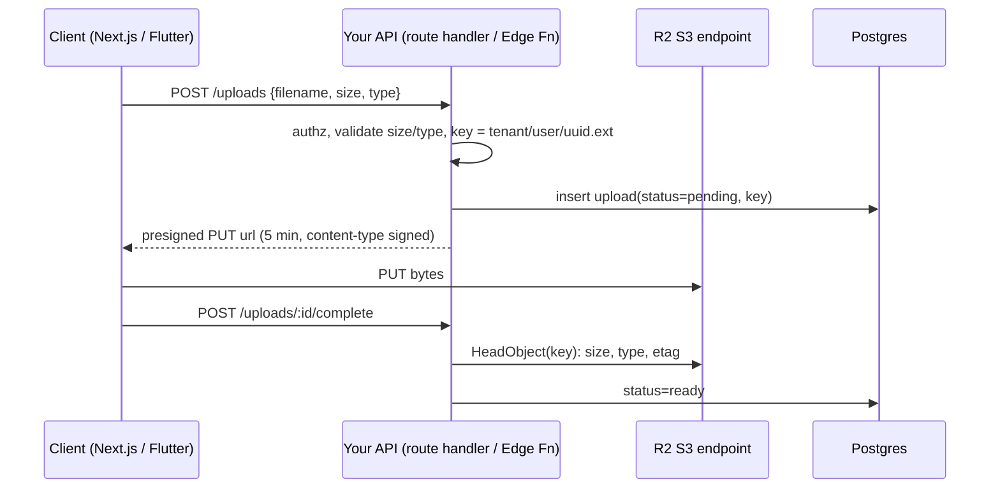

# Cloudflare - R2 Storage & Presigned Uploads

> [!info] Deep dive of [[Cloudflare]]

> [!abstract] TL;DR
> R2 is S3-compatible object storage with **zero egress fees**. The standard upload flow is direct-to-bucket:
> 1. Your server authorises the upload and returns a short-lived **presigned PUT URL**, scoped to one key and content type.
> 2. The client uploads straight to R2.
> 3. The server verifies with `HeadObject`, or via an event notification, before marking it done.
>
> Remember these: presigned URLs **only work on the S3 endpoint**, not custom domains; there is **no POST-policy upload**; and recent AWS SDK checksum defaults must be turned off.

## Concept
- **Endpoint**: `https://<account_id>.r2.cloudflarestorage.com`, `region: 'auto'`. Credentials are an Access Key ID/Secret derived from an R2 API token. Scope tokens to **one bucket** with Object Read/Write only.
- **Three ways to serve objects**:

| Access | How | Use for |
|---|---|---|
| Private + presigned GET | `GetObject` URL with expiry (≤ 7 days) | Invoices, IC/KYC scans, per-user files |
| Custom domain (public bucket) | `cdn.example.com` connected to the bucket; Cloudflare cache + WAF apply | Public assets, product images |
| Worker in front | R2 binding (`env.BUCKET.get()`); your own auth logic | Auth-checked downloads, image transforms, range logic |
| `r2.dev` subdomain | One click public | Dev only: rate-limited, no cache controls |

- **Storage classes**: Standard ($0.015/GB-month) and Infrequent Access ($0.01/GB-month, a $0.01/GB retrieval fee, higher op prices, 30-day minimum).
- **Operations**: Class A (writes/lists) costs $4.50 per million; Class B (reads) costs $0.36 per million; deletes are free. The free tier is 10 GB-month, 1M Class A and 10M Class B per month.
- **Not S3**: no ACLs (`x-amz-acl` is ignored or rejected), no POST Object (browser form policy uploads), and multipart parts must be **equal size except the last**.

## How It Works


## Practical Usage
**S3 client for R2** (Node / Next.js server, AWS SDK v3):
```ts
import { S3Client, PutObjectCommand, HeadObjectCommand, DeleteObjectCommand } from '@aws-sdk/client-s3';
import { getSignedUrl } from '@aws-sdk/s3-request-presigner';

export const r2 = new S3Client({
  region: 'auto',
  endpoint: `https://${process.env.R2_ACCOUNT_ID}.r2.cloudflarestorage.com`,
  credentials: { accessKeyId: process.env.R2_ACCESS_KEY_ID!, secretAccessKey: process.env.R2_SECRET_ACCESS_KEY! },
  requestChecksumCalculation: 'WHEN_REQUIRED',     // SDK ≥ 3.729 adds CRC32 headers by default → breaks presigned browser PUTs
  responseChecksumValidation: 'WHEN_REQUIRED',
});
```
**Issue a presigned upload** (route handler):
```ts
const MAX = 20 * 1024 * 1024;
const ALLOWED = new Set(['image/jpeg', 'image/png', 'application/pdf']);

export async function POST(req: Request) {
  const user = await requireUser(req);
  const { size, type } = await req.json();
  if (!ALLOWED.has(type) || size > MAX) return Response.json({ error: 'invalid file' }, { status: 400 });

  const key = `${user.tenantId}/${user.id}/${crypto.randomUUID()}`;          // never the client's filename
  const url = await getSignedUrl(r2, new PutObjectCommand({ Bucket: 'uploads', Key: key, ContentType: type, ContentLength: size }),
                                 { expiresIn: 300, signableHeaders: new Set(['content-type', 'content-length']) });
  await db.from('uploads').insert({ key, owner: user.id, tenant_id: user.tenantId, status: 'pending', declared_size: size });
  return Response.json({ url, key });
}
```
**Verify on completion**. Never trust the client's "done":
```ts
const head = await r2.send(new HeadObjectCommand({ Bucket: 'uploads', Key: key }));
if ((head.ContentLength ?? 0) > MAX || !ALLOWED.has(head.ContentType ?? '')) {
  await r2.send(new DeleteObjectCommand({ Bucket: 'uploads', Key: key }));
  throw new Error('rejected');
}
```
**Flutter upload** with progress:
```dart
final res = await dio.put(url,
  data: file.openRead(),
  options: Options(headers: {
    Headers.contentTypeHeader: 'image/jpeg',          // must equal the signed Content-Type
    Headers.contentLengthHeader: await file.length(),
  }),
  onSendProgress: (sent, total) => progress.value = sent / total,
);
```
**CORS** (browser uploads need it; Flutter mobile doesn't):
```bash
cat > cors.json <<'EOF'
{ "rules": [ { "allowed": { "origins": ["https://app.example.com"], "methods": ["PUT", "GET"], "headers": ["content-type"] },
               "exposeHeaders": ["ETag"], "maxAgeSeconds": 3600 } ] }
EOF
npx wrangler r2 bucket cors set uploads --file cors.json
```
**Lifecycle**: clean up abandoned uploads and old backups.
```bash
npx wrangler r2 bucket lifecycle add uploads abort-mpu --abort-multipart-days 1
npx wrangler r2 bucket lifecycle add backups expire-90d --expire-days 90 --prefix pg/
```
**Wrong way**:
```ts
// ❌ proxying the file through your server: 100 MB body cap on CF Free/Pro, VPS bandwidth + memory, slow
// ❌ client-chosen key: overwrites other users' files, path tricks
const key = `uploads/${body.filename}`;
// ❌ presigned URL on the custom domain: signature host mismatch → 403
new S3Client({ endpoint: 'https://cdn.example.com', ... });
```

## Patterns & Anti-patterns
| Pattern | When | Anti-pattern to avoid |
|---|---|---|
| Server-generated key `tenant/user/uuid` + DB row | Every user upload | Client filename as key, or "list bucket to find user files" (Class A ops, no authz) |
| Short expiry (60–300 s) for PUT, scoped to one key | Uploads | 7-day upload URLs shared in logs |
| `HeadObject` verification or event notification → queue | Before marking ready | Trusting declared size/type |
| Multipart for files > ~100 MB (fixed 10–100 MB parts) | Video, backups | Single PUT for multi-GB files on flaky mobile networks |
| Custom domain + cache for public assets | Images, downloads | Serving public files via presigned GETs (no CDN cache, signature churn) |
| Bucket-scoped API token per app/env | Always | One account-wide R2 token in every `.env` |

## Performance & Trade-offs
- **Egress is free**, but operations aren't. 10M thumbnail reads per month cost about $3.60 in Class B ops. Put a custom domain with cache in front so hits never reach R2.
- **Limits**: a single PUT is up to ~5 GiB; multipart objects up to ~5 TiB with ≤ 10,000 parts. Writes to the **same key** are rate-limited (roughly 1 per second). Don't use one object as a counter or log.
- **Latency**: R2 is not a CDN. Uncached reads from APAC to a bucket hinted elsewhere add 100+ ms. Set the **location hint** (`apac`) at bucket creation; it can't be changed later.
- **Compared with**:

| Option | Egress | Pick it when… |
|---|---|---|
| R2 | Free | Download-heavy, public assets, backups, multi-cloud |
| [[Supabase]] Storage | Billed beyond plan quota | Want RLS-based storage policies and one SDK, with modest traffic |
| AWS S3 | ~$0.09/GB internet egress | Deep AWS integration (Lambda triggers, Glacier tiers, Object Lock) |
| Self-hosted MinIO/Garage on VPS | VPS bandwidth | Data must stay on your server; you accept the ops burden |

## Tips & Reminders
> [!tip] In ZP's stack
> - **Uploads**: Next.js route handlers or Supabase Edge Functions issue the presigned URLs, and Postgres holds the `uploads` table with RLS by `tenant_id`.
> - **Backups**: Coolify's S3 backup target points to R2 for Postgres dumps and n8n binaries (see [[Coolify - Operations, Backups & Hardening]]). Use a separate bucket and token with write-only scope where possible, plus a lifecycle expiry.
> - **n8n**: the S3 node works with R2 via a custom endpoint and `region: auto`.

- Use event notifications (object-create → Cloudflare Queue → Worker) for post-processing: virus scan, thumbnails, OCR. This is more reliable than a client-side "complete" call.
- Set `Content-Disposition: attachment` on presigned GETs for user-uploaded HTML/SVG, so they never render inline from a domain users trust.
- Migrating from S3: **Sippy** copies objects lazily on first read; **Super Slurper** does bulk copy. Both avoid a big-bang migration.
- PDPA: R2 location hints aren't a residency guarantee. For personal data (IC scans), document where data is stored and the cross-border transfer basis.

## Version Notes
| Date | Change |
|---|---|
| 2022-09 | R2 GA (S3-compatible, zero egress) |
| 2023–24 | Event notifications → Queues, Sippy and Super Slurper migration, location hints, jurisdictions (EU) |
| 2024–25 | Infrequent Access storage class, bucket lifecycle rules in Wrangler |
| 2025-01 | AWS SDK v3 (≈3.729+) enables default CRC32 integrity headers. Many S3-compatible stores, R2 included, needed `WHEN_REQUIRED` config |
| 2026-10 | Pricing re-checked: Standard $0.015/GB-mo; Class A $4.50/M; Class B $0.36/M; egress free |

> [!warning] Unverified — check before relying on this
> Exact per-key write rate, multipart limits and current checksum support were not re-verified in this run. Check https://developers.cloudflare.com/r2/platform/limits/ and the S3 compatibility page.

## Critical Issues & Gotchas
> [!danger] Presigned URLs don't enforce size unless you sign it
> Without `content-length` in the signed headers, a client can upload 5 GB to a "20 MB avatar" URL, and you pay for the storage. Sign `content-length`, keep expiry short, and verify with `HeadObject` afterwards. R2 has no POST-policy `content-length-range`.

> [!danger] Leaked R2 credentials = full bucket access
> An account-wide R2 token in a Flutter build, `NEXT_PUBLIC_*` env or n8n export grants list/read/delete on every bucket. Use bucket-scoped tokens, keep them server-side only, and rotate on staff or contractor changes.

- **Presigned URLs on custom domains fail**: signatures are bound to the S3 endpoint host. Serve private files via the S3 endpoint or a Worker.
- **Checksum headers break browser uploads**: the SDK adds `x-amz-checksum-crc32` / `x-amz-sdk-checksum-algorithm` to signed URLs, and browsers can't compute them, so you get a 403 or `SignatureDoesNotMatch`. Use `WHEN_REQUIRED`.
- **Content-Type mismatch** between the signed URL and the actual request causes `SignatureDoesNotMatch`. Flutter's `http` package may append `; charset=utf-8`. Set the header explicitly.
- **Platform concentration**: R2, DNS, Tunnel and WAF on one vendor means one outage takes down everything (see the 2025 incidents in [[Cloudflare]]). Keep an off-Cloudflare copy of backups, e.g. Hostinger snapshots or a second provider.

## Related
- [[Cloudflare]]
- [[Cloudflare - Zero Trust Tunnel & Access]] — protecting admin tools that manage uploads
- [[Supabase]] — Storage as the RLS-integrated alternative
- [[Coolify - Operations, Backups & Hardening]] — S3/R2 backup targets
- [[REST API]] — upload endpoint design
- [[Network Security]] — credential scoping, origin protection

## References
- https://developers.cloudflare.com/r2/pricing/
- https://developers.cloudflare.com/r2/api/s3/presigned-urls/
- https://developers.cloudflare.com/r2/buckets/cors/
- https://developers.cloudflare.com/r2/platform/limits/
- https://filebase.com/blog/cloudflare-r2-pricing-costs-savings-and-alternatives-in-2026/
