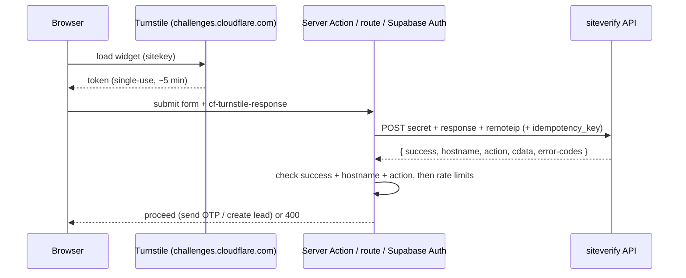

# Cloudflare - Turnstile & Bot Protection for Forms

> [!info] Deep dive of [[Cloudflare]]

> [!abstract] TL;DR
> **Turnstile** is Cloudflare's free, mostly invisible CAPTCHA replacement. The widget issues a token, and **your server must verify it** with `siteverify` (single-use, short-lived) before doing anything expensive.
> - Protect the abuse magnets: **signup, login, OTP/WhatsApp-code sending, contact/lead forms, password reset, AI chat**.
> - Layer it with **rate limits** (edge + per phone/IP in Redis), and on mobile use **App Check / Play Integrity / App Attest** instead.
> - **Supabase Auth** verifies Turnstile natively (`captchaToken`).
>
> Turnstile reduces automated abuse. It doesn't authenticate users or stop paid human farms.

## Concept
| Layer | Tool | Stops | Doesn't stop |
|---|---|---|---|
| Edge bot scoring | Bot Fight Mode (free), Super Bot Fight Mode (Pro+), WAF custom rules | Crude bots, known bad ASNs, scanners | Low-volume targeted abuse |
| Rate limiting | Cloudflare rate limiting rules, Redis limits per phone/IP/user | Floods, brute force, SMS/WhatsApp pumping volume | Distributed slow abuse |
| Challenge | **Turnstile** widget + server verification | Scripted form submissions, credential stuffing scripts | Human CAPTCHA farms, logged-in abuse |
| App attestation | Firebase App Check (Play Integrity / App Attest) | Non-genuine mobile clients | Abuse from genuine but malicious devices |
| Business rules | Per-phone OTP caps, disposable-email blocks, payment verification | Economic abuse | — |

**Turnstile widget modes**:

| Mode | UX | Use |
|---|---|---|
| Managed | Interactive checkbox only when Cloudflare is unsure | Default |
| Non-interactive | Shows a widget, never asks for interaction | Forms where any interaction hurts conversion |
| Invisible | No visible widget | Background protection (still disclose in privacy notice) |

## How It Works


## Practical Usage
**Widget in Next.js** (explicit render, action label per form):
```tsx
'use client';
import Script from 'next/script';
export function TurnstileField({ action }: { action: string }) {
  return (
    <>
      <Script src="https://challenges.cloudflare.com/turnstile/v0/api.js" async defer />
      <div className="cf-turnstile" data-sitekey={process.env.NEXT_PUBLIC_TURNSTILE_SITEKEY} data-action={action}
           data-theme="auto" data-response-field-name="cf-turnstile-response" />
    </>
  );
}
```
**Server-side verification** (Server Action; reject before any expensive step):
```ts
'use server';
export async function verifyTurnstile(token: string | null, expectedAction: string, ip?: string) {
  if (!token) return false;
  const res = await fetch('https://challenges.cloudflare.com/turnstile/v0/siteverify', {
    method: 'POST',
    body: new URLSearchParams({ secret: process.env.TURNSTILE_SECRET!, response: token, ...(ip ? { remoteip: ip } : {}) }),
  });
  const r = (await res.json()) as { success: boolean; hostname?: string; action?: string; 'error-codes'?: string[] };
  return r.success && r.action === expectedAction && r.hostname === 'app.client.my';
}

export async function requestWhatsAppOtp(form: FormData) {
  const ip = (await headers()).get('cf-connecting-ip') ?? undefined;
  if (!(await verifyTurnstile(form.get('cf-turnstile-response') as string, 'otp', ip))) return { ok: false, code: 'captcha_failed' };
  const phone = normalizeMyPhone(form.get('phone') as string);
  if (!(await limit(`otp:phone:${phone}`, 3, 15 * 60_000)).ok) return { ok: false, code: 'rate_limited' };   // per phone
  if (!(await limit(`otp:ip:${ip}`, 10, 15 * 60_000)).ok) return { ok: false, code: 'rate_limited' };        // per IP
  return sendOtp(phone);
}
```
**Supabase Auth with captcha enabled** (dashboard: Auth → Bot and Abuse Protection → Turnstile):
```ts
await supabase.auth.signInWithOtp({ phone, options: { captchaToken } });
await supabase.auth.signUp({ email, password, options: { captchaToken } });
```
**Testing keys** (never in production):
```bash
NEXT_PUBLIC_TURNSTILE_SITEKEY=1x00000000000000000000AA   # always passes
TURNSTILE_SECRET=1x0000000000000000000000000000000AA     # always passes (dev/CI only)
```
**Wrong way**:
```text
❌ Rendering the widget but never calling siteverify   → bots skip the widget and POST directly
❌ Verifying once, then reusing the token / session forever → tokens are single-use; replay = bypass
❌ Turnstile as the only OTP protection               → SMS/WhatsApp pumping by humans or solved tokens still bills you
❌ Secret key in NEXT_PUBLIC_ / Flutter app            → anyone can mint "verified" requests to your verify proxy
```

## Patterns & Anti-patterns
| Pattern | When | Anti-pattern to avoid |
|---|---|---|
| Verify server-side, check `success`, `hostname`, `action` | Every protected form | Client-only checks |
| Turnstile + per-phone/IP limits + daily OTP budget | OTP/WhatsApp/SMS endpoints | Unlimited OTP sends |
| Supabase native captcha for auth endpoints | Supabase Auth | Custom proxies around auth without captcha |
| App Check / Play Integrity for mobile apps | Flutter clients | Embedding Turnstile in WebViews as the main mobile defense |
| Distinct `action` per form, monitor failures in analytics | Multiple forms | One generic widget everywhere |
| Fail closed for OTP/signup, fail open for low-risk forms if siteverify is down | Outage handling | One policy for everything |
| Disclose bot protection in the privacy notice | PDPA compliance | Silent third-party scripts |

## Performance & Trade-offs
- **UX**: managed/invisible modes rarely show challenges for normal users. Some privacy browsers, VPNs and old devices see more friction, so watch conversion on signup forms.
- **Latency**: `siteverify` adds a server-to-server call (~50–200 ms). Do it once per submission, before expensive work.
- **Cost**: Turnstile is free for typical usage. The real cost it saves is OTP spend: WhatsApp authentication templates or SMS sent to bots ([[n8n - WhatsApp Cloud API Workflows & Template Messaging]]).
- **Coverage**: Turnstile needs JavaScript in a browser context. APIs used by mobile apps or partners need other controls (App Check, API keys, mTLS, rate limits).

## Tips & Reminders
> [!tip] In ZP's stack
> - **Lead/contact forms on SME websites**: Turnstile + server verification + a honeypot field. That kills most spam that otherwise floods n8n workflows and WhatsApp notifications.
> - **WhatsApp OTP login**: Turnstile on web, App Check on Flutter, per-phone (3/15 min) and per-IP limits, plus a daily cap per tenant with alerts ([[Redis - Rate Limiting & Distributed Locks]]).
> - **AI chat widgets on public sites**: Turnstile before starting a session, plus token budgets per session, so bots can't run up the LLM bill.

- Keep keys per environment (preview/staging use test keys) ([[Coolify - Preview Deployments, Environments & Secrets]]).
- Log `error-codes` from siteverify. `timeout-or-duplicate` spikes indicate replay attempts or slow forms.
- Combine with Cloudflare WAF rules for known abusive countries/ASNs on OTP endpoints if abuse persists ([[Network Security - Cloudflare WAF & Rate Limiting Rules]]).
- Test accessibility: managed challenges must be keyboard- and screen-reader-usable.

## Version Notes
| Date | Change |
|---|---|
| 2022-09 | Turnstile launched (beta), free CAPTCHA alternative |
| 2023 | Turnstile GA. Free tier for unlimited widgets/requests (with limits on some features) |
| 2023–24 | Pre-clearance (integrate Turnstile with WAF challenges). Supabase Auth adds Turnstile as a captcha provider |

> [!warning] Unverified — check before relying on this
> Current Turnstile free-tier limits, token lifetime details and any 2025–26 API changes weren't re-checked. See https://developers.cloudflare.com/turnstile/.

## Critical Issues & Gotchas
> [!danger] SMS/WhatsApp pumping (OTP fraud)
> Attackers trigger thousands of OTP sends to premium or attacker-controlled numbers, and you pay per message. A CAPTCHA alone doesn't stop determined pumping. Enforce per-phone and per-IP limits, daily budgets per tenant, number-pattern checks (block unexpected country codes), and alerts on OTP volume spikes. Treat Turnstile as one layer.

> [!danger] Unverified or replayed tokens
> Bots never need to render your widget if the server doesn't verify tokens, or accepts the same token repeatedly. Verify every submission server-side, check `action` and `hostname`, and never cache "verified" status beyond the single request (or a short, bound session for multi-step flows).

- **Strict Content Security Policy** must allow `challenges.cloudflare.com` scripts/frames, or the widget silently fails and blocks all submissions.
- **Server-side rendering** with stale tokens: tokens expire (~5 minutes), so long forms need a refresh (`turnstile.reset()`) before submit.
- **Mobile WebView** embedding is brittle (cookies, user agents). Prefer native attestation for apps ([[Flutter - App Security, Obfuscation & Secure Storage]]).
- **Over-blocking**: aggressive WAF/bot rules can block legitimate Malaysian users on shared mobile carrier IPs. Monitor false positives.

## Related
- [[Cloudflare]]
- [[Network Security - Cloudflare WAF & Rate Limiting Rules]] — edge rules that complement Turnstile
- [[Redis - Rate Limiting & Distributed Locks]] — per-phone/IP/user limits
- [[Supabase - Auth Flows, MFA & Custom Claims]] — native captcha on auth endpoints
- [[Next.js - Server Actions, Mutations & Security]] — verifying tokens in actions
- [[Flutter - App Security, Obfuscation & Secure Storage]] — App Check for mobile clients

## References
- https://developers.cloudflare.com/turnstile/
- https://developers.cloudflare.com/turnstile/get-started/server-side-validation/
- https://developers.cloudflare.com/turnstile/troubleshooting/testing/
- https://supabase.com/docs/guides/auth/auth-captcha
- https://developers.cloudflare.com/bots/get-started/bot-fight-mode/
