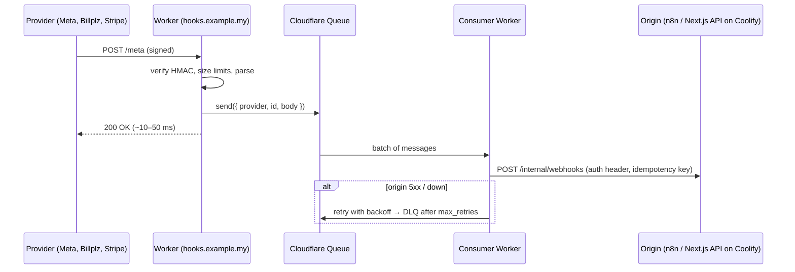

# Cloudflare - Workers for Webhooks & Edge APIs

> [!info] Deep dive of [[Cloudflare]]

> [!abstract] TL;DR
> Use a Worker as a **webhook gateway** in front of your VPS:
> 1. Verify the provider's signature at the edge.
> 2. Enqueue the payload to **Cloudflare Queues**.
> 3. Return 200 in milliseconds.
> 4. A consumer Worker forwards to n8n or your API with retries and a dead-letter queue.
>
> Webhooks then survive Coolify deploys and VPS outages, your origin IP stays hidden, and bad requests never reach n8n. Keep Workers small: CPU-time limits, no long-lived TCP to Postgres (use Hyperdrive or HTTP APIs), and Workers-only APIs are vendor lock-in.

## Concept
| Building block | Use here | Notes |
|---|---|---|
| **Worker** (fetch handler) | Verify, normalize, enqueue, respond | V8 isolates, ms cold starts, global |
| **Queues** | Durable buffer between edge and origin | At-least-once, batching, retries, DLQ |
| **Durable Objects** | Per-key consistency (dedupe, rate limit per phone, ordering per conversation) | Single-threaded per object, strongly consistent storage |
| KV | Config, allowlists, feature flags | **Eventually consistent**: not for dedupe |
| D1 / Hyperdrive | Small SQL / pooled access to your Postgres | Hyperdrive keeps connections warm near your DB |
| `ctx.waitUntil()` | Background work after the response | Bounded by the invocation's limits |
| Secrets | `wrangler secret put META_APP_SECRET` | Never in `wrangler.jsonc` vars |

**Plan limits** (verify on the Workers limits page): Free is about **100k requests/day** with a small CPU budget per request (official docs historically 10 ms; some 2026 summaries say 30 ms). The Paid plan (~USD 5/month) includes millions of requests and much higher, configurable CPU limits.

## How It Works


## Practical Usage
**`wrangler.jsonc`**:
```jsonc
{
  "name": "hooks-gateway",
  "main": "src/index.ts",
  "compatibility_date": "2026-10-01",
  "compatibility_flags": ["nodejs_compat"],
  "routes": [{ "pattern": "hooks.example.my/*", "zone_name": "example.my" }],
  "queues": {
    "producers": [{ "binding": "HOOKS", "queue": "hooks" }],
    "consumers": [{ "queue": "hooks", "max_batch_size": 10, "max_retries": 8, "dead_letter_queue": "hooks-dlq" }]
  },
  "vars": { "ORIGIN_URL": "https://api.internal.example.my/internal/webhooks" }
}
```
**Gateway + consumer** (Meta WhatsApp webhook example):
```ts
interface Env { HOOKS: Queue; META_APP_SECRET: string; META_VERIFY_TOKEN: string; ORIGIN_URL: string; ORIGIN_TOKEN: string }

async function hmacHex(secret: string, body: ArrayBuffer) {
  const key = await crypto.subtle.importKey('raw', new TextEncoder().encode(secret), { name: 'HMAC', hash: 'SHA-256' }, false, ['sign']);
  return [...new Uint8Array(await crypto.subtle.sign('HMAC', key, body))].map((b) => b.toString(16).padStart(2, '0')).join('');
}

export default {
  async fetch(req: Request, env: Env): Promise<Response> {
    const url = new URL(req.url);
    if (req.method === 'GET' && url.pathname === '/meta') {                  // Meta subscription handshake
      const ok = url.searchParams.get('hub.mode') === 'subscribe' && url.searchParams.get('hub.verify_token') === env.META_VERIFY_TOKEN;
      return ok ? new Response(url.searchParams.get('hub.challenge')) : new Response('forbidden', { status: 403 });
    }
    if (req.method !== 'POST' || url.pathname !== '/meta') return new Response('not found', { status: 404 });
    if (Number(req.headers.get('content-length') ?? 0) > 256_000) return new Response('too large', { status: 413 });

    const raw = await req.arrayBuffer();
    const expected = `sha256=${await hmacHex(env.META_APP_SECRET, raw)}`;
    if (req.headers.get('x-hub-signature-256') !== expected) return new Response('bad signature', { status: 401 });

    await env.HOOKS.send({ provider: 'meta', receivedAt: Date.now(), body: new TextDecoder().decode(raw) });
    return new Response('ok');
  },

  async queue(batch: MessageBatch<{ provider: string; body: string }>, env: Env) {
    for (const msg of batch.messages) {
      const res = await fetch(env.ORIGIN_URL, {
        method: 'POST',
        headers: { 'content-type': 'application/json', authorization: `Bearer ${env.ORIGIN_TOKEN}`, 'idempotency-key': msg.id },
        body: JSON.stringify(msg.body),
      });
      if (res.ok) msg.ack(); else msg.retry({ delaySeconds: Math.min(300, 2 ** msg.attempts * 5) });
    }
  },
} satisfies ExportedHandler<Env>;
```
Use a constant-time comparison for the signature in production (compare HMACs via `crypto.subtle.verify`). The origin must still dedupe by `idempotency-key` ([[REST API - Webhooks & Idempotency]]).

**Deploy**:
```bash
npx wrangler queues create hooks && npx wrangler queues create hooks-dlq
npx wrangler secret put META_APP_SECRET && npx wrangler secret put ORIGIN_TOKEN
npx wrangler deploy
npx wrangler tail hooks-gateway          # live logs while testing
```
**Wrong way**:
```ts
// ❌ synchronous forward: if the VPS is redeploying, Meta gets 5xx, retries, then disables the webhook
return fetch(env.ORIGIN_URL, { method: 'POST', body: req.body });
// ❌ KV for dedupe: eventually consistent → duplicates slip through across PoPs
if (await env.KV.get(id)) return new Response('dup');
```

## Patterns & Anti-patterns
| Pattern | When | Anti-pattern to avoid |
|---|---|---|
| Verify + enqueue + 200 at the edge | Every third-party webhook | Heavy processing before responding |
| Queue consumer with backoff + DLQ + alert on DLQ depth | Origin can be down | Silent drops on origin errors |
| Origin endpoint only accepts the Worker (bearer token / mTLS / Tunnel) | Internal webhook ingress | Public origin endpoint duplicating the gateway |
| Durable Object per conversation for ordering/dedupe | Chat-like flows needing order | Assuming queue order = event order |
| Keep business logic in the origin; Worker stays thin | Most SME stacks | Rebuilding the backend in Workers (lock-in, limits) |
| Hyperdrive or HTTP APIs for DB access | Workers needing Postgres | Direct `pg` connections per request |

## Performance & Trade-offs
- **Latency**: edge acknowledgement in tens of ms from Malaysian PoPs. Providers see fast 200s, which reduces their retry storms.
- **Cost**: a webhook gateway for an SME (thousands of events/day) fits the free or USD 5 plan. Queues and Durable Objects add per-operation pricing at scale.
- **CPU limits**: HMAC + JSON parse costs well under 1 ms. Fine on Free. AI calls, PDF parsing and heavy transforms belong in the origin or a paid Worker with higher CPU limits.
- **Workers vs Supabase Edge Functions**: Workers sit in front of everything (any origin, WAF integration, Queues). Supabase Edge Functions sit next to your DB (easy RLS/SQL access) ([[Supabase - Edge Functions, Cron & Queues]]). Use either, not both, for the same webhook.

## Tips & Reminders
> [!tip] In ZP's stack
> - **Gateway**: `hooks.<client>.my` → Worker gateway → Queue → consumer → n8n webhook or Next.js `/internal/webhooks` on Coolify, reachable only with the Worker's token (or via Tunnel).
> - **Benefits**: Coolify redeploys, n8n upgrades and VPS reboots no longer lose Meta or payment webhooks ([[n8n - Security, Credentials & Self-Hosting Hardening]]).
> - **WAF**: keep WAF challenges off this hostname ([[Network Security - Cloudflare WAF & Rate Limiting Rules]]).

- Log provider, event ID, signature result and queue outcome (Workers Logs / `wrangler tail`). Never log full payloads with personal data.
- Re-drive DLQ messages with a small script after fixing the origin, and keep DLQ retention long enough (days).
- Separate Workers (or environments) for staging and production, with different provider apps and secrets.
- Version Worker code in the same monorepo and deploy it with GitHub Actions (`wrangler deploy`) ([[Git - Monorepo Workflows with pnpm & Turborepo]]).

## Version Notes
| Date | Change relevant here |
|---|---|
| 2022–23 | Queues GA, Durable Objects mature, Hyperdrive launched (DB connection pooling at the edge) |
| 2024–25 | `nodejs_compat` broadens Node API support. Workers static assets. Higher configurable CPU limits on paid plans |
| 2026 | Workers as Cloudflare's primary platform (Pages convergence; Astro acquisition) |

> [!warning] Unverified — check before relying on this
> Free-plan CPU limit (10 ms vs 30 ms), paid CPU maximums and Queues plan availability/pricing are reported inconsistently. Check https://developers.cloudflare.com/workers/platform/limits/ and https://developers.cloudflare.com/queues/platform/pricing/.

## Critical Issues & Gotchas
> [!danger] Unverified webhooks reaching n8n
> Without signature checks at the edge (or in the first node), anyone can POST fake "payment succeeded" or fake WhatsApp messages into your automations. Verify HMACs over the **raw body**, and re-query providers for money events.

> [!danger] Queue ≠ exactly-once
> Queues retry on consumer failure, and a message can be delivered twice (e.g. the origin processed it but timed out before the ack). The origin must dedupe by event ID or idempotency key, or customers get duplicate WhatsApp replies and double-credited payments.

- **Body consumed once**: read `req.arrayBuffer()` once and reuse it. Calling `req.json()` after reading the body throws.
- **Secrets in `vars`** are visible in the dashboard and git. Use `wrangler secret`.
- **Vendor coupling**: Durable Objects, KV and Queues bindings are Cloudflare-specific. Keep the gateway thin so moving to another edge or a VPS-hosted gateway is a small rewrite.
- **Cloudflare outages** (2025) take the gateway down too. Providers will retry, so make sure their retry windows (Meta retries for hours) cover a typical outage.

## Related
- [[Cloudflare]]
- [[REST API - Webhooks & Idempotency]] — signature verification, dedupe, retries
- [[Cloudflare - R2 Storage & Presigned Uploads]] — storing webhook media
- [[Network Security - Cloudflare WAF & Rate Limiting Rules]] — zone rules around the gateway
- [[n8n - Security, Credentials & Self-Hosting Hardening]] — protecting the origin automation
- [[Message Queues - Choosing BullMQ, pgmq, RabbitMQ or NATS]] — queue choice behind the gateway

## References
- https://developers.cloudflare.com/workers/
- https://developers.cloudflare.com/workers/platform/limits/
- https://developers.cloudflare.com/queues/
- https://developers.cloudflare.com/durable-objects/
- https://developers.facebook.com/docs/graph-api/webhooks/getting-started
- https://eastondev.com/blog/ja/posts/dev/20260526-cloudflare-free-limits/
