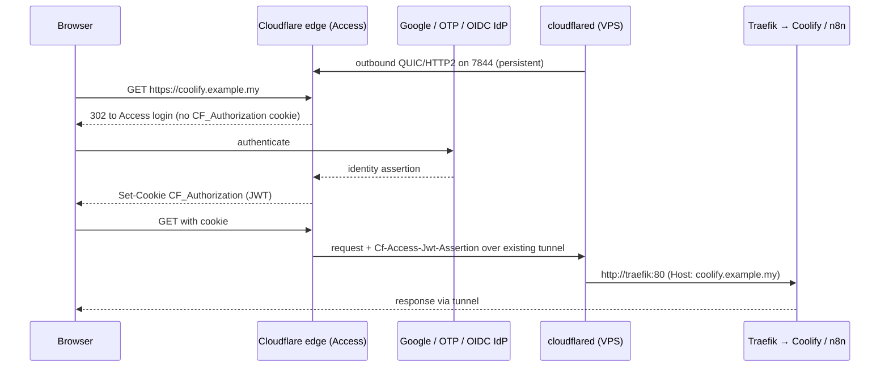

# Cloudflare - Zero Trust Tunnel & Access

> [!info] Deep dive of [[Cloudflare]]

> [!abstract] TL;DR
> - **Tunnel**: `cloudflared` on your server dials **outbound** to Cloudflare's edge, so public hostnames reach your origin with **zero inbound ports open**.
> - **Access**: puts an identity check (SSO/OTP/service token) **at the edge**, before any request touches the origin.
> - **Together**: they hide admin surfaces like Coolify, the n8n editor and DB UIs. Public webhooks and APIs stay on separate, non-Access hostnames.
> - **Remember**: the origin must still **validate the Access JWT**. And Cloudflare becomes a single point of failure for admin access, so keep a break-glass path (Tailscale/SSH).

## Concept

### Building blocks
| Component | What it is | Key facts |
|---|---|---|
| **Tunnel** | Named, persistent object (UUID) in your account | One tunnel can serve many hostnames and private networks |
| **Connector** (`cloudflared`) | Daemon that holds the tunnel open | Opens **4 connections** to ≥2 edge data centres. Run 2+ replicas for HA |
| **Public hostname** (ingress rule) | `app.example.my → http://traefik:80` | Creates a proxied CNAME `<uuid>.cfargotunnel.com` |
| **Private network** | CIDR routed through the tunnel | Reached via the WARP client. Replaces a VPN |
| **Access application** | A hostname/path protected by policies | Self-hosted, SaaS (SAML/OIDC IdP), or private-network app |
| **Policy** | Action (`Allow`, `Block`, `Bypass`, `Service Auth`) plus include/require/exclude rules | Evaluated in order. Rules: emails, groups, IdP, country, device posture, IP |
| **Service token** | Client ID + secret pair for machines | Sent as `CF-Access-Client-Id` / `CF-Access-Client-Secret` headers |
| **Access JWT** | Signed token issued after login | Cookie `CF_Authorization` + header `Cf-Access-Jwt-Assertion` to origin |

### Remote-managed vs locally-managed tunnels
| | Remote-managed (token) | Locally-managed (`config.yml`) |
|---|---|---|
| Config lives in | Dashboard / API / Terraform | Server file + credentials JSON |
| Run with | `cloudflared tunnel run --token <TOKEN>` | `cloudflared tunnel --config config.yml run` |
| Pros | No files on the host, easy in Coolify/Docker | Config in [[Git]], no dashboard drift |
| Cons | Config not in Git unless you use Terraform | Credentials file to protect and back up |
| Pick | **Default for ZP**, with Terraform for client infra | Air-gapped GitOps, complex ingress |

## How It Works

1. `cloudflared` authenticates with the tunnel token and keeps long-lived connections to the edge. It uses **QUIC (UDP 7844)** by default and falls back to **HTTP/2 (TCP 7844)**. The host only needs **outbound** connectivity.
2. DNS for each public hostname is a proxied CNAME to `<tunnel-uuid>.cfargotunnel.com`. Nobody can reach the origin IP through it.
3. Access evaluates policies at the edge. Unauthenticated requests never traverse the tunnel.
4. `cloudflared` matches the request against **ingress rules top-to-bottom** and proxies to the first matching local service. The last rule must be a catch-all.

## Practical Usage

### Run cloudflared next to Traefik (Docker / Coolify)
```yaml
# docker-compose.yml: cloudflared on the same network as Traefik
services:
  cloudflared:
    image: cloudflare/cloudflared:2026.8.1    # pin; don't use :latest in prod
    command: tunnel --no-autoupdate run
    environment:
      TUNNEL_TOKEN: ${CF_TUNNEL_TOKEN}         # from Zero Trust → Networks → Tunnels
      TUNNEL_METRICS: 0.0.0.0:2000
    restart: unless-stopped
    networks: [coolify]
    deploy:
      replicas: 2                              # or run a second connector on another host
networks:
  coolify:
    external: true
```
- Point public hostnames to `http://coolify-proxy:80` (Traefik) and let Traefik route by `Host`. One tunnel then serves every app, and TLS between the edge and Traefik is unnecessary because the tunnel is already encrypted.
- Alternative: point directly at a container (`http://n8n:5678`), which bypasses Traefik middlewares. That's simpler, but you lose rate limits and headers ([[Traefik - Middlewares, TLS & Routing]]).

### Locally-managed ingress (`config.yml`)
```yaml
tunnel: 6ff42ae2-765d-4adf-8112-31c55c1551ef
credentials-file: /etc/cloudflared/6ff42ae2.json
originRequest:
  connectTimeout: 10s
  keepAliveConnections: 100
ingress:
  - hostname: coolify.example.my
    service: http://localhost:8000
  - hostname: n8n-editor.example.my
    service: http://localhost:5678
  - hostname: hooks.example.my              # public webhooks: NO Access app on this hostname
    path: ^/webhook(-test)?/
    service: http://localhost:5678
  - hostname: ssh.example.my
    service: ssh://localhost:22
  - service: http_status:404                # mandatory catch-all
```
```bash
cloudflared tunnel ingress validate --config config.yml
cloudflared tunnel ingress rule https://hooks.example.my/webhook/abc   # which rule matches?
cloudflared tunnel route dns <tunnel> coolify.example.my                # create the CNAME
```

### Access policy design
| Application | Policy | Notes |
|---|---|---|
| `coolify.example.my` | Allow: emails `zp@rarticle.com` + Require: country `MY`, Google IdP | Session 24h. Enable "Instant Auth" |
| `n8n-editor.example.my` | Allow: group `rarticle-admins` | Separate hostname from webhooks |
| `hooks.example.my` | **No Access app** (or `Bypass` on `/webhook/*`) | Protect with HMAC signatures in the workflow |
| `api-internal.example.my` | `Service Auth`: service token `ci-deployer` | For GitHub Actions / cron callers |
| `db.example.my` (Adminer/pgAdmin) | Allow: ZP only + device posture (WARP) | Or private network only, no public hostname |

```bash
# Machine call through Access with a service token
curl https://api-internal.example.my/deploy \
  -H "CF-Access-Client-Id: $CF_ACCESS_CLIENT_ID" \
  -H "CF-Access-Client-Secret: $CF_ACCESS_CLIENT_SECRET"
```

### Validate the Access JWT at the origin (defence in depth)
```ts
// Next.js middleware / Node: reject requests that didn't pass through Access
import { createRemoteJWKSet, jwtVerify } from "jose";

const TEAM = "https://rarticle.cloudflareaccess.com";
const JWKS = createRemoteJWKSet(new URL(`${TEAM}/cdn-cgi/access/certs`));

export async function verifyAccess(req: Request) {
  const token = req.headers.get("cf-access-jwt-assertion");
  if (!token) throw new Error("missing Access JWT");
  const { payload } = await jwtVerify(token, JWKS, {
    issuer: TEAM,
    audience: process.env.CF_ACCESS_AUD,   // the application's AUD tag
  });
  return payload.email as string;
}
```
- Without this check, anyone who reaches the origin some other way bypasses Access completely: a leaked origin IP, another tunnel hostname, or a container port exposed on the host. See [[JWT]] for the validation rules (`aud`, `iss`, `exp`, key rotation).

### SSH and private networks
```bash
# Client side: SSH through an Access-protected hostname
# ~/.ssh/config
Host vps-a
  HostName ssh.example.my
  ProxyCommand cloudflared access ssh --hostname %h
```
- Alternatives: **browser-rendered SSH** in Access (no client install), or **private network routes + WARP** to reach `10.0.0.0/24` like a VPN.
- Use **short-lived SSH certificates** from Access to stop managing `authorized_keys`.

## Patterns & Anti-patterns
| Pattern | When | Anti-pattern to avoid |
|---|---|---|
| Tunnel → Traefik, Traefik routes by Host | Coolify servers with many apps | One tunnel hostname per container with duplicated middleware logic |
| Separate hostnames for humans (Access) and machines (webhooks/API) | n8n, Supabase functions, payment callbacks | Access on the webhook hostname → Stripe/Meta get a login page and retry forever |
| Origin JWT validation + firewall denying inbound 80/443 | Sensitive admin apps | Trusting "it's behind Access" while ports 80/443 are still open to the world |
| 2 connectors per tunnel on different hosts/AZs | Production | Single `cloudflared` container: one restart = outage |
| Service tokens with expiry, one per caller | CI, cron, partner integrations | Shared token across all callers, never rotated |
| Break-glass path (Tailscale or provider console) | Always | Access as the **only** way into servers |

## Performance & Trade-offs
- **Latency**: adds edge routing plus one hop to the origin. That's usually <20 ms extra within Asia, since Cloudflare has a Kuala Lumpur PoP and Hostinger KVM regions are SG/MY. It's fine for dashboards, so measure before putting latency-critical APIs through it.
- **Throughput**: a connector handles typical SME loads easily. For large uploads, the proxied 100 MB request-body limit (Free/Pro) still applies through tunnels. Use direct-to-R2 presigned uploads instead.
- **WebSockets** work through tunnels (n8n editor, Supabase Realtime). Long-lived connections drop when `cloudflared` restarts, so clients must reconnect ([[WebSocket - Scaling & Reliability]]).
- **Cost**: Tunnel is free. Zero Trust is free up to **50 users**, then per-user pricing. For an SME agency, internal users stay well under 50.
- **Limits**: max 1,000 tunnels per account, and ingress rules are evaluated linearly (keep them short and specific).

## Tips & Reminders
> [!tip]
> - Firewall the origin after moving to Tunnel: `ufw deny 80,443` (and keep SSH reachable only via Tailscale). This is what makes Tunnel worth having.
> - Set Access **session duration** per app: shorter for Coolify and DB tools, longer for low-risk dashboards.
> - Use `--no-autoupdate` in containers and bump the pinned image tag deliberately. Watch the cloudflared releases for breaking changes (see below).
> - Expose metrics (`TUNNEL_METRICS`) and alert on `cloudflared_tunnel_ha_connections < 4`.
> > - **In ZP's stack**:
>   - **Tunnel**: one tunnel per VPS. Public hostnames → `coolify-proxy:80`.
>   - **Access apps**: Coolify, the n8n editor, Supabase Studio/pgAdmin and Uptime Kuma, all behind Google SSO restricted to the Rarticle domain.
>   - **No Access**: `hooks.<client>.my` for n8n webhooks and Meta/WhatsApp callbacks, verified by HMAC instead.
>   - **Break-glass**: Tailscale SSH.

## Version Notes
| Version | Change |
|---|---|
| 2021 | "Argo Tunnel" renamed Cloudflare Tunnel, made free. Named tunnels replace legacy |
| 2023–2024 | Remote-managed (token) tunnels become the default in the dashboard |
| 2026.2.0 | **Breaking**: `proxy-dns` feature and its commands/flags removed (use WARP or a real DoH resolver) |
| 2026.4.0 | **Breaking**: default `--edge-ip-version` changed from `4` to `auto`. Set `--edge-ip-version 4` on IPv4-only hosts |
| 2026.5.2 | `tail` uses `/management/logs`, management token command. Go `x/net` bumped for CVE-2026-39821, CVE-2026-33814 |
| 2026.8.x | Latest seen (2026-08). Check releases before pinning |

> [!warning] Unverified — check before relying on this
> Plan limits (50 free seats, 100 MB body limit, 1,000 tunnels) and the exact contents of 2026.7/2026.8 releases weren't verified against current docs. Check the Zero Trust pricing page and the GitHub releases.

## Critical Issues & Gotchas
> [!danger] Access is only as strong as the paths around it
> - Common bypasses:
>   - The origin is still reachable directly (open 80/443, `docker run -p 5678:5678` publishing past UFW).
>   - A second tunnel hostname points at the same service without an Access app.
>   - A `Bypass` policy is broader than intended (e.g. `Everyone` on `/*`).
> - The fix in each case: validate `Cf-Access-Jwt-Assertion` at the origin, close inbound ports, and audit hostname↔app mapping.

> [!danger] Cloudflare outages lock you out
> - **Past outages**:
>   - **2025-06-12**: a storage dependency failure broke Access, WARP and Zero Trust logins for ~2.5 h.
>   - **2025-11-18**: a global outage hit proxied traffic.
> - **Why it matters**: if Access is your only route to Coolify and SSH, you can't deploy or fix anything. Keep Tailscale SSH or the Hostinger VPS console as a documented break-glass path.

> [!danger] Edge security rules can have holes
> In January 2026, researchers disclosed that requests to the ACME challenge path (`/.well-known/acme-challenge/`) could skip WAF custom rules and reach origins. Cloudflare patched it at the edge with no customer action required. Lesson: treat edge controls as one layer. The origin must still authenticate and rate-limit.

> [!warning] Gotchas
> - Ingress order matters. A broad `hostname: "*.example.my"` rule above specific ones swallows them.
> - Path rules are **regex**. `path: /webhook` also matches `/webhooks-admin`. Anchor with `^` and `/`.
> - The tunnel token is a full credential. Anyone with it can run a connector and receive your traffic. Store it in Coolify secrets, never in Git, and rotate it if leaked (`cloudflared tunnel token --cred-file` or dashboard refresh).
> - QUIC (UDP 7844) blocked by a corporate or hosting firewall → slow fallback. Force it with `--protocol http2` if you see flapping.
> - Access cookies are per hostname. Cross-subdomain SPAs calling an Access-protected API need CORS settings in the Access app (or the same hostname).
> - The OTP login method depends on email delivery. Prefer an IdP (Google Workspace/Entra/GitHub) for staff, with OTP as a backup only.

## Related
- [[Cloudflare]]
- [[Cloudflare - DNS, Email Authentication & Domain Ops]] — DNS records and domain ownership around Tunnel hostnames
- [[Traefik]] — tunnel target, routes by Host
- [[Coolify]] — dashboard protected by Access ([[Coolify - Operations, Backups & Hardening]])
- [[n8n]] — editor behind Access, webhooks on a separate hostname
- [[Network Security]] — firewalling the origin, Docker/UFW bypass
- [[OAuth 2.0 & OIDC]] — IdP integration for Access login
- [[JWT]] — validating `Cf-Access-Jwt-Assertion`

## References
- Cloudflare Tunnel docs: https://developers.cloudflare.com/cloudflare-one/connections/connect-networks/
- Tunnel configuration file: https://developers.cloudflare.com/cloudflare-one/connections/connect-networks/configure-tunnels/local-management/configuration-file/
- Access policies: https://developers.cloudflare.com/cloudflare-one/policies/access/
- Validate Access JWTs: https://developers.cloudflare.com/cloudflare-one/identity/authorization-cookie/validating-json/
- Service tokens: https://developers.cloudflare.com/cloudflare-one/identity/service-tokens/
- cloudflared releases: https://github.com/cloudflare/cloudflared/releases
