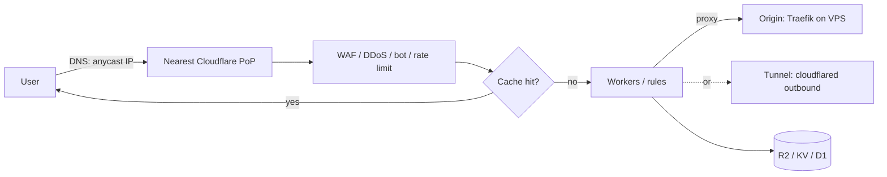

# Cloudflare

> [!abstract] TL;DR
> Cloudflare is a global edge network (330+ cities) that sits **in front of** your origin as authoritative DNS, reverse proxy/CDN, WAF and DDoS shield.
> - **Also a developer platform**: Workers, R2 object storage with **zero egress fees**, D1, KV, Queues, Durable Objects, Workers AI.
> - **Also a Zero Trust suite**: **Tunnel** for publishing services without open ports, and **Access** for SSO in front of internal apps.
> - **For a solo founder on a VPS**: the free/Pro plans plus Tunnel, Access and R2 give enterprise-grade edge security for close to RM 0.
> - **The trade-off is concentration risk**: Cloudflare's own outages (2025-11-18, 2025-12-05) took down large parts of the internet, your sites included.

## Introduction
- **Origin**: founded 2009 (Matthew Prince, Lee Holloway, Michelle Zatlyn). Started as Project Honey Pot spam-tracking → CDN + security. NYSE: NET.
- **Problem**: protecting and accelerating websites without owning a global network: absorbing DDoS, caching near users, terminating TLS, filtering attacks.
- **Where it sits**: DNS + proxy (orange cloud) → origin ([[Traefik]] on a Hostinger VPS via [[Coolify]]), or a Tunnel from `cloudflared` on the server outbound to the edge. Plus storage (R2) and serverless compute (Workers) that can replace parts of a backend.

## Core Concepts

### Product map (what matters for ZP)
| Area | Products | Free tier highlights |
|---|---|---|
| DNS | Authoritative DNS, DNSSEC, CNAME flattening | Free, fast, API-driven |
| Proxy / CDN | Orange-cloud proxy, cache rules, Tiered Cache, Argo | Free CDN, universal SSL |
| Security | WAF (managed + custom rules), DDoS (unmetered), Bot Fight Mode, rate limiting, Turnstile (CAPTCHA alternative) | Free managed ruleset subset, 1 rate-limit rule |
| Zero Trust | **Tunnel** (`cloudflared`), **Access** (SSO policies), Gateway (DNS filtering), WARP | Free up to 50 users |
| Storage | **R2** (S3-compatible, no egress fees), KV, D1 (SQLite), Durable Objects, Queues, Hyperdrive (DB pooling) | R2: 10 GB storage + 1M Class A ops/month free |
| Compute | **Workers** (V8 isolates), Workers static assets (successor to Pages), Workers AI, Containers | 100k requests/day free. Paid plan USD 5/month |
| Email | Email Routing (forwarding), DMARC management | Free |

### Proxy modes and SSL
| SSL/TLS mode | Browser ↔ CF | CF ↔ origin | Use |
|---|---|---|---|
| Off / Flexible | HTTPS | **HTTP (plaintext)** | Never. Also causes redirect loops |
| Full | HTTPS | HTTPS, cert not validated | Temporary only |
| **Full (strict)** | HTTPS | HTTPS with valid cert (Let's Encrypt or **Origin CA**) | **Default choice** |
| Tunnel | HTTPS | Outbound-only encrypted tunnel | No public origin IP at all |

### Tunnel + Access
```bash
# On the VPS: outbound-only connection, no inbound ports needed
cloudflared tunnel login
cloudflared tunnel create vps-1
cloudflared tunnel route dns vps-1 coolify.example.my
cloudflared tunnel run vps-1          # or run as a container / systemd service with a token
```
```yaml
# ~/.cloudflared/config.yml
tunnel: vps-1
credentials-file: /etc/cloudflared/vps-1.json
ingress:
  - hostname: coolify.example.my
    service: http://localhost:8000
  - hostname: n8n-editor.example.my
    service: http://localhost:5678
  - service: http_status:404
```
Then add an **Access application** for `coolify.example.my` and `n8n-editor.example.my` with a policy like "emails ending in @rarticle.com + one-time PIN or Google SSO". The login page is served by Cloudflare before any request reaches the server.

## Architecture / How It Works

- **Anycast**: the same IPs are announced from every PoP, so BGP routes users to the nearest one. DDoS traffic is spread across the whole network.
- **Single binary per server**: every PoP runs every service (the proxy, now the Rust-based FL2/Pingora stack). That's efficient, but it's also why one bad global config push can take everything down at once.
- **Configuration propagates globally in seconds** (Quicksilver). That's great for fixes, and dangerous for mistakes.
- **Workers** run in V8 isolates (no containers): ~0 ms cold start and Web APIs (fetch, Request/Response), with limited Node.js compatibility (`nodejs_compat` flag). CPU time is limited per request.
- **R2** is S3 API–compatible (use any S3 SDK). Data is stored in a region hint location. Public buckets can be served via a custom domain with caching.

## Project Structure
Workers project (Wrangler):
```text
edge-worker/
├── wrangler.jsonc        # name, main, compatibility_date, bindings (R2, KV, D1, Queues, vars)
├── src/index.ts
└── package.json          # wrangler, @cloudflare/workers-types
```
```ts
// src/index.ts: signed upload URL for R2 (no egress fees when users download)
export default {
  async fetch(req: Request, env: Env): Promise<Response> {
    const url = new URL(req.url);
    if (url.pathname.startsWith('/files/')) {
      const obj = await env.BUCKET.get(url.pathname.slice(7));
      if (!obj) return new Response('Not found', { status: 404 });
      return new Response(obj.body, { headers: { 'cache-control': 'public, max-age=86400', etag: obj.httpEtag } });
    }
    return new Response('ok');
  },
} satisfies ExportedHandler<Env>;
```
```bash
npx wrangler dev && npx wrangler deploy
aws s3 cp backup.sql.gz s3://backups/ --endpoint-url https://<account>.r2.cloudflarestorage.com   # R2 via S3 API
```

## Use Cases
| Use case | Why it fits |
|---|---|
| DNS + TLS + CDN for client sites | Free, fast, universal SSL, caching |
| Hide VPS origin and admin panels | Tunnel (no inbound ports) + Access (SSO) |
| DDoS/WAF for launches and public APIs | Unmetered DDoS, managed rules, rate limiting |
| Backups and user uploads | R2: S3-compatible, no egress fees, cheap storage |
| Webhook receivers, redirects, edge auth, A/B | Workers with near-zero cold start |
| Bot protection on forms | Turnstile (privacy-friendly CAPTCHA) |
| Long-running jobs, heavy compute, stateful backends | **Weaker fit**. Keep on VPS/containers ([[Docker]], [[Coolify]]) |

## Pros & Cons
| Pros | Cons |
|---|---|
| Generous free tier: DNS, CDN, DDoS, Tunnel, Access (50 users) | **Single point of failure**: global outages take your sites down too |
| R2 zero egress transforms storage economics | Vendor lock-in: Workers APIs, D1/KV/Durable Objects are proprietary |
| Tunnel removes inbound attack surface | Traffic is TLS-terminated at Cloudflare (it sees plaintext), a privacy/compliance consideration |
| Massive network: absorbs record DDoS (multi-Tbps) | ToS/abuse policies: content-related terminations, aggressive bot challenges can block legit users/APIs |
| API + Terraform for everything | Pricing jumps for Business/Enterprise features (advanced WAF, bot management, SLA) |
| Fast-moving developer platform | Rapid product churn (Pages → Workers assets, naming changes) |

## Alternatives & Peers
| Alternative | Strength vs Cloudflare | Weakness vs Cloudflare | Pick it when… |
|---|---|---|---|
| Bunny.net | Cheap CDN/storage, simple pricing, EU company | Smaller security suite, no Zero Trust | Pure CDN/video delivery on a budget |
| Fastly | Programmable edge (VCL/Compute), instant purge | Expensive, smaller free tier | Media/large enterprises |
| AWS CloudFront + Shield/WAF + S3 | Deep AWS integration | Egress fees, complexity | Already all-in on AWS |
| Tailscale / Headscale | Private mesh access, any protocol | Not for public websites | Admin access only (alternative to Access) |
| Self-hosted (Traefik + CrowdSec + Backblaze B2/MinIO) | No vendor in the path | No DDoS absorption, more ops | Sovereignty requirements, low-risk services |

## Tips & Reminders
> [!tip]
> - **Full (strict)** everywhere. Use a Cloudflare Origin CA cert (15-year) or Let's Encrypt via DNS-01 on [[Traefik]].
> - Lock the origin: firewall 80/443 to Cloudflare IP ranges only, or use Tunnel with no inbound ports. Also check that no DNS record (MX, `direct.`, old A records) leaks the origin IP.
> - Use scoped **API tokens** (Zone:DNS:Edit for one zone) for ACME/automation, never the Global API Key.
> - Cache rules: bypass cache for `/api/*`, authenticated pages and webhook paths. Respect `Set-Cookie`.
> - Under Access, exclude machine endpoints (webhooks, health checks) via separate hostnames or service tokens. Otherwise integrations get a login page.
> - Keep a **break-glass plan**: documented origin access (direct DNS-only record or Tailscale) and DNS export, in case Cloudflare has an outage or your account is locked.
> - **In ZP's stack**: Cloudflare DNS + proxy for client domains → [[Traefik]]/[[Coolify]] on Hostinger KVM. Tunnel + Access for Coolify, the [[n8n]] editor and DB tools. R2 for backups (Postgres dumps, n8n binaries) and user uploads. Workers for lightweight webhook fan-out. n8n webhook hostnames stay outside Access.

## Versions & Breaking Changes
| Change | Date | Key changes | Breaking / migration notes |
|---|---|---|---|
| Workers launch | 2017-09 | V8 isolate serverless | — |
| R2 GA | 2022-09 | S3-compatible storage, no egress | — |
| Tunnel free / Zero Trust free tier | 2021 | `cloudflared` tunnels free | Legacy "Argo Tunnel" naming retired |
| Pages → Workers static assets | 2024–2025 | Workers serve static assets + SSR (Next.js via OpenNext adapter) | New projects should start on Workers. Pages in maintenance focus |
| FL2 (Rust proxy) rollout | 2025 | New core proxy replacing the NGINX/LuaJIT-based FL | Behaviour differences surfaced during 2025 incidents |
| Workers Containers, Workers VPC | 2025–2026 | Containers on the edge platform, private connectivity | Beta/GA status varies. Check docs |

> [!warning] Unverified — check before relying on this
> Product names, free-tier limits and Pages/Workers status change frequently. Check https://developers.cloudflare.com/ and plan pages before committing client architectures.

## Critical Issues & Gotchas
> [!danger] Global outages: you inherit Cloudflare's blast radius
> - **2025-11-18 (~6 h)**: a ClickHouse permissions change made a query return duplicate rows. That doubled the Bot Management feature file (~60 → 200+ features) past a hard limit, and the core proxy crashed worldwide (X, ChatGPT and countless sites returned 5xx).
> - **2025-12-05 (~25 min)**: a WAF configuration change rolled out to mitigate the React Server Components RCE (React2Shell) triggered another widespread outage.
> - **2025-06-12**: a storage dependency failure broke Workers KV, Access, WARP and Zero Trust logins for ~2.5 h.
>
> Mitigation: break-glass DNS/origin access, status-page monitoring, and don't put the *only* admin path to your servers behind Access without an alternative (e.g. Tailscale).

> [!danger] Origin IP leaks bypass all protection
> If attackers find the origin IP (historical DNS, `mail.` records, SSL certificate scans on Censys/Shodan, outbound webhooks revealing the server IP), they hit the VPS directly, skipping WAF and DDoS protection. Firewall to Cloudflare ranges or use Tunnel, and consider a separate egress IP for outbound calls.

> [!warning] Gotchas
> - Flexible SSL + an origin that redirects HTTP→HTTPS = an infinite redirect loop (`ERR_TOO_MANY_REDIRECTS`).
> - Proxied hostnames only support specific ports (80/443/8080/8443…). SSH or DB ports need DNS-only records or Tunnel/Spectrum.
> - Free/Pro plans cap request bodies at 100 MB. Large uploads must go directly to R2 (presigned URLs).
> - Bot Fight Mode / Super Bot Fight Mode can block legitimate API clients and webhooks (Stripe, Meta). Add WAF skip rules for those paths.
> - Caching HTML with `Set-Cookie` or user-specific content can leak data between users. Use cache rules carefully.
> - Worker CPU time limits (10 ms free, configurable on paid plans) and no raw TCP to arbitrary DBs without Hyperdrive/connect APIs.

## Deep Dives
- [[Cloudflare - Zero Trust Tunnel & Access]]
- [[Cloudflare - R2 Storage & Presigned Uploads]] — presigned PUT flow, CORS, checksum gotcha, lifecycle, ops pricing
- [[Cloudflare - Workers for Webhooks & Edge APIs]] — edge webhook gateway: verify, enqueue, ack; Queues consumer with DLQ; Durable Objects; limits and lock-in

## Related
- [[Traefik]] — origin proxy, DNS-01 certificates via the Cloudflare API
- [[Network Security]] — origin hardening, DDoS, zero trust
- [[Coolify]] — VPS platform behind Cloudflare
- [[HTTP & HTTPS]] — TLS, caching headers
- [[Next.js]] — deployment on Workers (OpenNext) or behind the CDN
- [[Astro]] — Cloudflare-owned (2026) content framework, static assets on Workers
- [[n8n]] — webhooks vs editor exposure

## References
- Developer docs: https://developers.cloudflare.com/
- Tunnel: https://developers.cloudflare.com/cloudflare-one/connections/connect-networks/
- Access: https://developers.cloudflare.com/cloudflare-one/policies/access/
- R2 pricing: https://developers.cloudflare.com/r2/pricing/
- 2025-11-18 outage postmortem: https://blog.cloudflare.com/18-november-2025-outage/
- IP ranges: https://www.cloudflare.com/ips/
