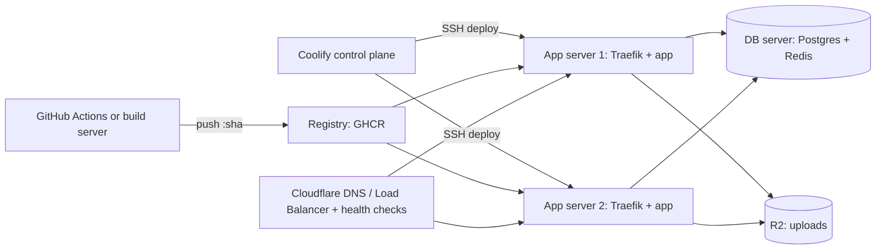

# Coolify - Multi-Server, Build Servers & Scaling

> [!info] Deep dive of [[Coolify]]

> [!abstract] TL;DR
> Scale Coolify in this order: **vertical** (bigger KVM) → **split the database** onto its own server → **build elsewhere** (a dedicated build server or GitHub Actions) → **multi-server deployments behind an external load balancer**.
> - **Multi-server** means one independent instance per server. Coolify does **not** balance traffic, so you need Cloudflare LB, a cloud LB or DNS in front.
> - **Docker Swarm is deprecated** (removal in v5; v5 plans native Compose replicas).
> - Before going multi-instance, make the app stateless: sessions, uploads, cron and WebSockets.

## Concept
| Role | What it is | Rules |
|---|---|---|
| **Control plane** | The Coolify instance (UI, API, SSH keys, secrets) | Small VPS (2 vCPU / 2–4 GB). Ideally runs **no** client workloads. Back it up |
| **Server** | Any SSH-reachable host Coolify manages; runs `coolify-proxy` (Traefik) | Same CPU architecture across servers for one app |
| **Destination** | A Docker network on a server where resources run | Type (standalone/Swarm) comes from how the server was set up |
| **Build server** | Server flagged for builds only | **Can't** be a deployment destination. Don't enable it on servers running apps/DBs. Multiple build servers are picked at random. Needs a registry login for the Coolify SSH user |
| **Multi-server deployment** | One app deployed to a primary + additional servers | Each server runs its own instance. Needs a registry all servers can pull from, plus an external LB |

- **What Coolify doesn't do**: cross-server traffic distribution, cross-server failover, shared volumes, or leader election for scheduled tasks. Those are yours.

## How It Works

1. The image is built once (CI or build server) and pushed to a registry.
2. Coolify SSHes to each target server, pulls the image, starts the new container, waits for health, switches the local Traefik and removes the old container.
3. The external LB health-checks each server's `/api/health` and routes only to healthy origins.

## Practical Usage
**Step 1: vertical first.** A Hostinger KVM 4 → KVM 8 upgrade is minutes of downtime and zero architecture change. Most SME apps never need more.

**Step 2: separate DB server** (private network or Tailscale between servers):
```bash
# on the DB server: Postgres bound to the private interface only
# postgresql.conf
listen_addresses = '10.0.0.5'
# pg_hba.conf: only app servers, scram auth
hostssl app app 10.0.0.0/24 scram-sha-256
```
Point apps at `DATABASE_URL=postgres://app:…@10.0.0.5:5432/app?sslmode=require`. Firewall port 5432 to the app servers' private IPs ([[Network Security]]).

**Step 3: build server or CI builds.**
- In the Coolify UI: Servers → add server → enable **Build Server**. Log the Coolify SSH user into the registry on it: `docker login ghcr.io -u <user> --password-stdin`.
- Or skip build servers entirely: build in GitHub Actions and deploy by image tag ([[CI-CD - Deploy Pipelines for Coolify & Flutter Releases]]).

**Step 4: multi-server + external LB.** Make the app stateless first:

| State | Single server | Multi-server fix |
|---|---|---|
| Sessions | In-memory / local file | Signed JWT cookies, or Redis session store on the DB server |
| Uploads | Local volume | [[Cloudflare - R2 Storage & Presigned Uploads]] |
| Cron / schedulers | `node-cron` in the app | Run on **one** instance only (env flag `RUN_SCHEDULER=true` on server 1), Postgres advisory lock, or pg_cron / queue workers |
| WebSockets / Realtime | Local in-process pub/sub | Redis pub/sub adapter. LB session affinity, or tolerate reconnects ([[WebSocket - Scaling & Reliability]]) |
| Caches | In-process LRU | Accept per-instance caches, or move to Redis; invalidate via pub/sub |

```ts
// scheduler guard: only one instance runs jobs, even if the env flag is misconfigured
const { rows } = await pool.query('select pg_try_advisory_lock(42) as ok');
if (rows[0].ok) startSchedulers();
```
**TLS behind a load balancer**: HTTP-01 challenges can hit the wrong server. Use one of:
- Traefik **DNS-01** with a Cloudflare API token on every server, or
- Cloudflare **Origin CA** certificates (15-year validity, trusted only by Cloudflare) with Full (strict) mode.

**Wrong way**:
```text
❌ Enable "Build Server" on the production app server  → builds starve the apps it serves
❌ Add server 2 to the app and expect traffic to split  → Coolify doesn't load-balance; server 2 gets nothing (or everything via DNS)
❌ New deployments on Docker Swarm destinations          → deprecated, removed in v5
❌ Two instances both running node-cron                  → every WhatsApp reminder sent twice
```

## Patterns & Anti-patterns
| Pattern | When | Anti-pattern to avoid |
|---|---|---|
| Dedicated small control-plane VPS | More than one client or server | Control plane on the busiest client server (and the blast radius of every Coolify CVE) |
| Build in CI, deploy by tag | Next.js/Flutter-web builds > 1 GB RAM | Building on 4 GB production KVMs |
| External LB with active health checks | 2+ app servers | DNS round robin without health checks (dead server keeps getting traffic) |
| DB on its own server with backups + PITR | Growth beyond one box | DB co-located with apps on every server |
| Separate Coolify instance per high-value client | Contractual isolation | One control plane holding every client's root SSH keys |
| Same image tag on all servers, deployed sequentially | Rolling across servers | Different versions live for hours because one server failed silently |

## Performance & Trade-offs
- **Cost ladder** (approximate):

| Setup | Monthly | Gets you |
|---|---|---|
| 1 KVM (app + DB) | ~RM 40–120 | Simplest. One point of failure |
| Control plane + app server + DB server | ~RM 100–250 | Isolation, safer builds, DB tuning |
| + 2nd app server + Cloudflare LB (~USD 5+/mo) | ~RM 200–400 | Server-level redundancy for stateless tiers |
| Managed DB (Supabase/Neon) + app servers | Varies | DB HA and PITR without running Patroni yourself |

- **HA reality**: two app servers + one DB server removes app-tier single points of failure only. The DB is still single. True HA needs replication + failover (Patroni) or a managed Postgres. For most SMEs, good backups + a 30-minute restore runbook beat a half-configured HA cluster.
- **Latency**: keep app and DB servers in the same datacenter. Cross-region DB calls add 20–200 ms per query.
- **Build servers**: a 4–8 vCPU build box cuts Next.js build times roughly in half compared with a shared 2-vCPU app server, but it's another server to patch. CI runners do the same job without the server.

## Tips & Reminders
> [!tip] In ZP's stack
> - **Default for client projects**: one Hostinger KVM per client (app + DB), managed by a separate small Coolify control-plane VPS behind Cloudflare Access, with images built in GitHub Actions.
> - **Going multi-server**: only for clients with an uptime SLA. Then add a 2nd app server, Cloudflare Load Balancing with health checks, DB moved to a dedicated server or Supabase, and uploads in R2.
> - **Put the SLA in the contract** only after the architecture supports it.

- Connect servers over a private network (Hostinger VPC if available, or Tailscale) so DB and Redis ports are never public.
- Label servers by role in Coolify (tags), then deploy by tag with the API's `tag=` parameter, for example to redeploy all `role-app` servers.
- Monitor each server separately (Sentinel, Uptime Kuma or Better Stack per origin, not just the LB hostname). Otherwise one dead origin hides behind the healthy one.
- Test failover: stop server 1's app and confirm the LB drains it within the health-check interval.

## Version Notes
| Version | Change relevant here |
|---|---|
| v4 (multi-server) | Servers, destinations, build servers, multi-server deployments |
| v4 Swarm support | Experimental, now **deprecated**. Existing Swarm deployments keep working on v4 |
| 4.2.0 (2026-07-21) | Expanded API, resource migration between servers, audit logging, permission/API breaking changes |
| v5 (planned) | Swarm removed. Native Docker Compose replicas planned for scaling |

> [!warning] Unverified — check before relying on this
> The v5 timeline and replica design are from Coolify's docs, but not released. Check https://coolify.io/docs/core/infrastructure/scaling/multi-server-deployments before planning around them.

## Critical Issues & Gotchas
> [!danger] Duplicate scheduled work across instances
> Every app instance runs its in-process schedulers. With two servers, reminders, invoices and WhatsApp broadcasts fire twice. Gate schedulers with a Postgres advisory lock or a single designated instance, or move them to queue-driven workers.

> [!danger] The control plane is the crown jewels
> Adding servers adds SSH keys to the Coolify instance. After the Jan 2026 critical CVEs, a compromised control plane means every connected server is compromised. Patch promptly, put the UI behind Cloudflare Access, and split instances by client risk ([[Coolify - Operations, Backups & Hardening]]).

- **Architecture mismatch**: an `arm64` server next to `amd64` servers fails pulls unless you build multi-arch images (`docker buildx --platform linux/amd64,linux/arm64`).
- **Registry auth per server**: each target (and build) server needs registry credentials for the Coolify SSH user, otherwise deploys fail at the pull step with a vague error.
- **Volumes don't replicate**: a resource with a local volume can't be multi-server without moving that data to a shared service (DB, R2).
- **LB health checks must hit the app, not Traefik**: a 404 from Traefik with the app down can look "up" to a TCP check. Use HTTP checks on `/api/health` expecting 200 and a body match.

## Related
- [[Coolify]]
- [[Coolify - Operations, Backups & Hardening]] — patching, backups, control-plane security
- [[CI-CD - Deploy Pipelines for Coolify & Flutter Releases]] — build in CI, deploy by tag
- [[Traefik]] — per-server proxy and DNS-01 certificates
- [[Cloudflare]] — load balancing, Origin CA, Tunnel
- [[System Design - Reliability Patterns]] — health checks, failover, idempotent schedulers

## References
- https://coolify.io/docs/core/infrastructure/scaling/multi-server-deployments
- https://coolify.io/docs/core/infrastructure/servers/build-servers
- https://coolify.io/docs/core/infrastructure/scaling/docker-swarm
- https://coolify.io/docs/knowledge-base/destinations
- https://developers.cloudflare.com/load-balancing/
