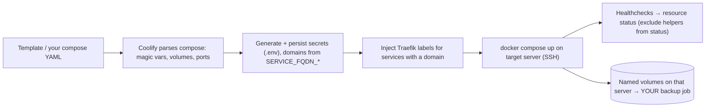

# Coolify - One-Click Services & Compose Deployments

> [!info] Deep dive of [[Coolify]]

> [!abstract] TL;DR
> Coolify runs three kinds of resources:
> - **Applications** from git (Nixpacks/Dockerfile/Compose build packs);
> - **Databases** (managed Postgres/Redis/etc. with scheduled backups);
> - **Services**: one-click templates (n8n, Supabase, Plausible, Uptime Kuma, Chatwoot…) or your own compose ("Docker Compose Empty").
>
> In compose files, **magic variables** generate domains and secrets: `SERVICE_FQDN_<NAME>_<PORT>`, `SERVICE_URL_*`, `SERVICE_PASSWORD_*`, `SERVICE_USER_*`. They persist per service and are editable in the UI.
>
> Templates are a starting point, not a product. **Pin image versions**, add **resource limits and healthchecks**, decide **which ports get public domains**, and **back up volumes yourself**, because only Coolify-managed databases get built-in backups.

## Concept
| Resource type | Source | Backups | Use for |
|---|---|---|---|
| Application | Git repo (Nixpacks, Dockerfile, Compose, static) or Docker image | App is stateless. Data lives elsewhere | Next.js, APIs, workers |
| Database | Coolify-managed Postgres/MySQL/Redis/Mongo/ClickHouse… | ✅ Scheduled dumps to S3/R2 | App databases |
| Service (template) | Coolify's template catalogue (copied compose) | ❌ Volumes not backed up automatically | n8n, Uptime Kuma, Plausible, Chatwoot, Supabase |
| Service (custom compose) | "Docker Compose Empty" YAML you paste | ❌ Same | Anything else, multi-container stacks |

**Magic environment variables** (compose services):

| Variable | Generates | Example |
|---|---|---|
| `SERVICE_NAME_<SVC>` | Service name (auto-created) | Internal references |
| `SERVICE_FQDN_<SVC>` / `SERVICE_FQDN_<SVC>_<PORT>` | Hostname (no scheme), routed to that internal port | `SERVICE_FQDN_N8N_5678` → `n8n-xyz.client.my` |
| `SERVICE_URL_<SVC>` / `_<PORT>` | Same with `https://` | Webhook base URLs |
| `SERVICE_PASSWORD_<ID>` / `SERVICE_PASSWORD_64_<ID>` | Random password (64 chars) | DB passwords shared by app + DB |
| `SERVICE_USER_<ID>` | Random username | DB user |
| `SERVICE_BASE64_<ID>` (and length variants) | Random base64 string | Encryption keys, JWT secrets |
| `${ANY_NAME}` | A UI-editable env var | `${SMTP_PASS}` |

Hyphens/dots in service names become underscores in variable names. Generated values persist across deployments.

## How It Works


## Practical Usage
**Custom compose service** (n8n + Postgres + Redis, queue mode, pinned and limited):
```yaml
services:
  n8n:
    image: n8nio/n8n:2.42.1                          # pin, upgrade deliberately
    environment:
      - SERVICE_FQDN_N8N_5678                        # Coolify domain + Traefik route to 5678
      - N8N_HOST=${SERVICE_FQDN_N8N}
      - WEBHOOK_URL=${SERVICE_URL_N8N}
      - N8N_ENCRYPTION_KEY=${SERVICE_BASE64_64_N8NKEY}   # persisted; also copy to your secrets manager
      - DB_TYPE=postgresdb
      - DB_POSTGRESDB_HOST=postgres
      - DB_POSTGRESDB_USER=${SERVICE_USER_POSTGRES}
      - DB_POSTGRESDB_PASSWORD=${SERVICE_PASSWORD_POSTGRES}
      - EXECUTIONS_MODE=queue
      - QUEUE_BULL_REDIS_HOST=redis
      - GENERIC_TIMEZONE=Asia/Kuala_Lumpur
    depends_on: { postgres: { condition: service_healthy }, redis: { condition: service_healthy } }
    deploy: { resources: { limits: { memory: 1g } } }
    healthcheck: { test: ["CMD-SHELL", "wget -qO- http://127.0.0.1:5678/healthz || exit 1"], interval: 15s }
  n8n-worker:
    image: n8nio/n8n:2.42.1
    command: worker
    environment: [ "N8N_ENCRYPTION_KEY=${SERVICE_BASE64_64_N8NKEY}", "EXECUTIONS_MODE=queue", "QUEUE_BULL_REDIS_HOST=redis",
                   "DB_TYPE=postgresdb", "DB_POSTGRESDB_HOST=postgres",
                   "DB_POSTGRESDB_USER=${SERVICE_USER_POSTGRES}", "DB_POSTGRESDB_PASSWORD=${SERVICE_PASSWORD_POSTGRES}" ]
    deploy: { resources: { limits: { memory: 768m } } }
  postgres:
    image: postgres:17
    environment: [ "POSTGRES_USER=${SERVICE_USER_POSTGRES}", "POSTGRES_PASSWORD=${SERVICE_PASSWORD_POSTGRES}", "POSTGRES_DB=n8n" ]
    volumes: [ "n8n-pg:/var/lib/postgresql/data" ]
    healthcheck: { test: ["CMD-SHELL", "pg_isready -U $${POSTGRES_USER}"], interval: 10s }
  redis:
    image: redis:8
    command: ["redis-server", "--maxmemory", "256mb", "--maxmemory-policy", "noeviction", "--appendonly", "yes"]
    volumes: [ "n8n-redis:/data" ]
    healthcheck: { test: ["CMD", "redis-cli", "ping"], interval: 10s }
volumes: { n8n-pg: {}, n8n-redis: {} }
```
**Volume backup for a service** (scheduled task or host cron; templates don't do this):
```bash
docker exec $(docker ps -qf name=postgres-<uuid>) pg_dump -U "$PGUSER" -Fc n8n > /backups/n8n-$(date +%F).dump
rclone copy /backups r2:client-backups/n8n --max-age 2d && find /backups -mtime +7 -delete
```
**Wrong way**:
```text
❌ Template with image: latest, untouched for a year        → surprise major upgrade on redeploy (n8n 2.0, Envoy switch)
❌ SERVICE_FQDN on the database container                   → Postgres admin port exposed with a public domain
❌ Assuming "Backups" tab covers a one-click service's volumes → only Coolify-managed Databases have scheduled backups
❌ Editing the generated docker-compose on the server by hand → overwritten on next deploy
```

## Patterns & Anti-patterns
| Pattern | When | Anti-pattern to avoid |
|---|---|---|
| Copy template → pin versions → add limits/healthchecks | Every one-click service | Running templates as-is in production |
| Public domains only on UI/API containers | All stacks | Domains on DBs, Redis, internal admin ports |
| Coolify-managed Database resources for app DBs | Postgres/Redis for apps | Embedding the DB in every app's compose without backups |
| Explicit volume backup jobs to R2 + restore tests | Services with state | Trusting the server disk |
| Secrets via magic vars, mirrored in your secrets manager | Encryption keys, DB passwords | Hardcoded secrets in compose YAML |
| Separate servers/projects per client | Agency setups | All client stacks on one server/project |
| Changelog check before bumping template images | Upgrades | Blind "Redeploy" to pull new images |

## Performance & Trade-offs
- **Convenience vs control**: templates save hours but encode someone else's choices (versions, env defaults, exposed ports). Custom compose gives control and costs maintenance.
- **Resource density**: each service brings its own Postgres/Redis in templates. Five services can mean five Postgres instances (~150–300 MB each idle). Consolidate where safe, or size the VPS for it.
- **Upgrades**: Coolify's template updates may change compose structure. Diff before applying to existing services.
- **Multi-server**: services run on the chosen server, and moving them means migrating volumes manually ([[Coolify - Multi-Server, Build Servers & Scaling]]).

## Tips & Reminders
> [!tip] In ZP's stack
> - **Per client server**: n8n (queue mode, custom compose above), Uptime Kuma (or on a separate monitor VPS), the client's Next.js apps as Applications, and app databases as Coolify Databases with R2 backups.
> - **Supabase via template**: check which gateway/version it deploys and keep Studio private ([[Supabase - Self-Hosting with Docker & Coolify]]).
> - **Keep a `services/` folder in the client repo** with the exact compose YAML you pasted into Coolify. It's version-controlled and part of the handover.

- Put `GENERIC_TIMEZONE`/`TZ=Asia/Kuala_Lumpur` on schedulers (n8n, cron containers).
- Add Traefik middlewares (auth, rate limits) to admin UIs via labels, or keep them on Tailscale only ([[Traefik - Middlewares, TLS & Routing]]).
- After first deploy, copy generated secrets (encryption keys!) to your secrets manager, because losing the Coolify DB loses them ([[Coolify - Operations, Backups & Hardening]]).
- Use Coolify's healthcheck status as a signal, but monitor externally too ([[Docker - Logging, Metrics & Resource Limits on a VPS]]).

## Version Notes
| Version | Change relevant here |
|---|---|
| v4 beta (2023–26) | Services (templates + custom compose), magic variables, compose build pack for Applications |
| v4 beta.420.x | `SERVICE_FQDN_*`/`SERVICE_URL_*` usable in compose-based Applications (with breaking-change notes) |
| 4.0.0 stable (2026) | Stable v4 with Jan 2026 CVE fixes ([[Coolify]]) |

> [!warning] Unverified — check before relying on this
> The `exclude_from_hc` key, `SERVICE_BASE64_*` variants and current template behaviour weren't confirmed in the official docs this run. Check https://coolify.io/docs/knowledge-base/docker/compose before relying on them.

## Critical Issues & Gotchas
> [!danger] Exposed internal services through generated domains
> Adding a `SERVICE_FQDN_*` (or a domain in the UI) to the wrong container publishes it through Traefik with TLS: databases, Redis Commander, Supabase Studio, n8n without auth. Review every domain per service, keep admin UIs behind Access/Tailscale or auth middlewares, and scan from outside after deploys.

> [!danger] Lost encryption keys and unbacked volumes
> n8n's `N8N_ENCRYPTION_KEY`, Supabase JWT secrets and similar values generated by magic variables live in Coolify's database. Service volumes live on one server's disk. A failed server or a lost Coolify instance without backups loses credentials and data permanently. Back up volumes to R2, store generated secrets in a secrets manager, and test restores.

- **Variable naming**: port suffixes need the exact format (`SERVICE_FQDN_N8N_5678`), and hyphenated service names become underscores. Typos silently create empty variables.
- **`$` escaping**: shell-style `$VAR` inside compose commands needs `$$`, or Compose interpolates it at deploy time.
- **Template drift**: updating the template catalogue doesn't update existing services, which keep their copied compose. Track upgrades yourself.
- **Healthcheck-less services** show "running" while broken. Add healthchecks, and exclude one-shot/init containers from status.

## Related
- [[Coolify]]
- [[Coolify - Operations, Backups & Hardening]] — backups, `APP_KEY`, hardening
- [[Coolify - Preview Deployments, Environments & Secrets]] — env vars and build vs runtime
- [[Docker - Compose Patterns for Production]] — healthchecks, limits, volumes
- [[Supabase - Self-Hosting with Docker & Coolify]] — the Supabase template in practice
- [[n8n - Queue Mode & Scaling]] — queue-mode settings used above

## References
- https://coolify.io/docs/knowledge-base/docker/compose
- https://coolify.io/docs/services/configuration/environment-variables
- https://coolify.io/docs/services/configuration/docker-compose
- https://coolify.io/docs/knowledge-base/add-a-service
- https://newreleases.io/project/github/coollabsio/coolify/release/v4.0.0-beta.420.4
