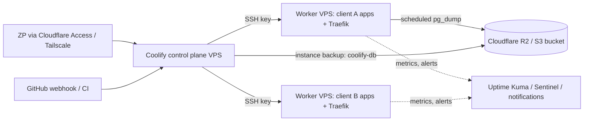

# Coolify - Operations, Backups & Hardening

> [!info] Deep dive of [[Coolify]]

> [!abstract] TL;DR
> Running Coolify for client production means operating a **control plane** that holds SSH root access to every server, plus all app secrets. The baseline:
> - **Isolate** the dashboard: Cloudflare Access or Tailscale, 2FA, no public port 8000.
> - **Separate** the control plane from workload servers once you host clients.
> - **Back up three things**: the Coolify instance (its Postgres + `/data/coolify`), every app database (scheduled dumps to R2/S3), and persistent volumes. **Rehearse restores.**
> - **Patch on a schedule**: Coolify (Jan 2026 critical CVEs), the OS, Docker, and Traefik.
> - **Watch** disk, logs and health checks.

## Concept

### What Coolify runs on the control-plane host
| Container | Role | Data |
|---|---|---|
| `coolify` | Laravel app: UI, API, deployment orchestration over SSH | Config in `/data/coolify/source/.env` (`APP_KEY` encrypts secrets) |
| `coolify-db` | PostgreSQL: projects, servers, env vars (encrypted), deployment history | **Critical**: lose it and you lose all configuration |
| `coolify-redis` | Queues and cache for deployments/jobs | Ephemeral |
| `coolify-realtime` | Soketi WebSocket server for live UI updates (ports 6001/6002) | Ephemeral |
| `coolify-proxy` | [[Traefik]] (or Caddy) on each managed server: routing + TLS | `/data/coolify/proxy` (dynamic configs, `acme.json`) |
| `coolify-sentinel` (optional) | Metrics/health agent per server | — |

### Key paths
| Path | Contains | Back up? |
|---|---|---|
| `/data/coolify/source/.env` | `APP_KEY`, DB credentials | **Yes**, separately and securely (without `APP_KEY`, encrypted env vars can't be decrypted) |
| `/data/coolify/ssh/keys` | Private keys Coolify uses to reach servers | Yes (or be ready to re-provision keys) |
| `/data/coolify/proxy` | Traefik dynamic config, certificates | Optional (certs re-issue). Custom configs: yes, in Git |
| `/data/coolify/applications`, `/data/coolify/services` | Generated compose files | Re-generated on redeploy |
| Docker volumes (`docker volume ls`) | App/database data | **Yes**, via DB dumps or volume backups |

### Topologies
| Topology | Pros | Cons | Fit |
|---|---|---|---|
| All-in-one (Coolify + apps on one VPS) | Cheapest, simplest | A bad deploy/disk-full takes down the control plane. Compromise = everything | Personal projects, early stage |
| **Control plane on a small VPS + apps on worker servers** | Blast-radius separation, maintenance without app downtime | More hosts to patch | **Client production (recommended)** |
| Per-client worker servers | Tenant isolation, per-client billing | More cost/ops | Clients with data sensitivity or SLAs |

## How It Works

- **Deployments**: Coolify connects via SSH, builds (Nixpacks/Dockerfile/compose) on the target or a build server, starts new containers, waits for **health checks**, switches Traefik routing, then removes old containers. Without a health check, rolling updates can't detect a broken release.
- **Scheduled backups**: for databases created in Coolify (PostgreSQL, MySQL, MariaDB, MongoDB), Coolify runs dump commands on a cron and uploads to an **S3-compatible destination** (R2 works) with retention settings. The **instance backup** dumps Coolify's own database the same way.
- **Updates**: Coolify can auto-update itself. In production, prefer controlled manual updates after reading release notes, especially after the 2026 security releases.

## Practical Usage

### Hardening checklist
```bash
# 1. Firewall: only 80/443 public on workers; dashboard not public
ufw default deny incoming
ufw allow 80,443/tcp
ufw allow from 100.64.0.0/10 to any port 22,8000,6001,6002 proto tcp   # Tailscale range only
# (or use Cloudflare Tunnel + Access for the dashboard hostname; see Cloudflare - Zero Trust Tunnel & Access)

# 2. Docker log rotation (prevents disk-full outages)
cat >/etc/docker/daemon.json <<'EOF'
{ "log-driver": "json-file", "log-opts": { "max-size": "10m", "max-file": "3" } }
EOF
systemctl restart docker

# 3. OS patching
apt install -y unattended-upgrades && dpkg-reconfigure -plow unattended-upgrades
```
- In the UI:
  - Enable **2FA** for all users. Use team roles to limit who can see production env vars.
  - Restrict **API tokens** (scopes, expiry), and rotate any token shared with CI.
  - Set **instance backup** and **database backup** schedules to an R2 bucket, with a lifecycle rule and **bucket-level credentials scoped to that bucket only**.
  - Configure **notifications** (Telegram/Discord/email) for failed deployments, backups and server issues.
  - Enable **Docker cleanup** schedules (unused images/build cache) per server.

### Restore drill (quarterly)
```bash
# Restore an app database dump into a scratch container and verify
aws s3 cp s3://rarticle-backups/clientA/pg-2026-10-15.dump . --endpoint-url "$R2_ENDPOINT"
docker run -d --name restore-test -e POSTGRES_PASSWORD=test postgres:17
docker cp pg-2026-10-15.dump restore-test:/tmp/ && docker exec restore-test pg_restore -U postgres -d postgres --create /tmp/pg-2026-10-15.dump
docker exec restore-test psql -U postgres -c "select count(*) from orders;"   # compare with production counts
docker rm -f restore-test
```
For a Coolify control-plane rebuild:
1. Install the same Coolify version on a new host.
2. Stop it, restore `coolify-db` from the instance backup, and restore `/data/coolify/source/.env` (same `APP_KEY`) and the SSH keys.
3. Start it, verify servers reconnect, and redeploy.

### Health checks for zero-downtime deploys
```yaml
# docker-compose in Coolify, or the Health Check section of the app settings
services:
  api:
    healthcheck:
      test: ["CMD", "wget", "-qO-", "http://localhost:3000/healthz"]
      interval: 10s
      timeout: 3s
      retries: 5
      start_period: 20s
```

## Patterns & Anti-patterns
| Pattern | When | Anti-pattern to avoid |
|---|---|---|
| Dashboard behind Access/Tailscale + 2FA | Always | Public `:8000` login page with password-only accounts |
| Separate control-plane VPS from client workloads | Client production | One VPS running Coolify, client apps and client DBs together |
| Scheduled DB dumps to R2 + retention + restore drills | Every database | "Hostinger snapshots are our backup" (same provider, coarse, often weekly) |
| Back up `APP_KEY` + instance DB securely | Control plane | Losing `APP_KEY` → all stored secrets unrecoverable |
| Health checks on every app | Rolling deploys | Deploys that switch traffic to crashing containers |
| Manual, scheduled Coolify upgrades after release notes | Production | Blind auto-updates, or never updating (missing security fixes) |

## Performance & Trade-offs
- **Builds on production servers** consume CPU/RAM and can starve running apps. Use a separate build server or build images in GitHub Actions and deploy by image tag ([[CI-CD]]).
- **Backups** of large databases via `pg_dump` take time and I/O. Schedule them off-peak, and for big datasets consider physical backups (pgBackRest/WAL-G) with PITR outside Coolify.
- **Snapshots vs dumps**: provider snapshots are fast to restore whole servers but aren't application-consistent for databases, and live with the same provider. Use both, with dumps as the source of truth.
- **One Traefik per server**: a misconfigured dynamic config or exhausted Let's Encrypt rate limit affects every app on that server.

## Tips & Reminders
> [!tip]
> - Keep an `OPERATIONS.md` per client: servers, apps, DBs, backup schedule, restore steps, who has access, patch day.
> - Pin app images and database major versions, and upgrade Postgres deliberately (dump/restore or `pg_upgrade`), never by changing the tag blindly.
> - Monitor disk on `/var/lib/docker` and `/data`. Alert at 80%. Full disks corrupt databases.
> - Put Coolify's dynamic Traefik configs and compose files for important services in [[Git]] as documentation and for disaster recovery.
> - **In ZP's stack**:
>   - **Hosts**: control plane on a small Hostinger KVM, client workloads on separate KVMs, dashboard via Cloudflare Access.
>   - **Backups**: nightly to R2 with 30-day retention, plus monthly restore tests.
>   - **Patching**: OS updates on Sundays, Coolify upgrades within 7 days of security releases.
>   - **Contracts**: state backup RPO/RTO in client SOWs.

## Version Notes
| Version | Change |
|---|---|
| v4 beta (2023-11 → 2026) | Multi-server, S3 backups, Traefik/Caddy proxies, compose deployments |
| beta.466 / beta.471 (2026-01) | Fixes for critical CVEs (command injection, terminal WebSocket auth) |
| **4.0.0** (2026) | First stable v4 |
| 4.2.0 (2026-07-21) | Fixes env-var command injection CVE (CVE-2026-84694) |
| 4.3.x (2026-09) | Current line |

> [!warning] Unverified — check before relying on this
> Exact backup/restore UI flows and instance-backup behaviour vary across 4.x releases. Check https://coolify.io/docs and test restores on your version.

## Critical Issues & Gotchas
> [!danger] The control plane is root on every server
> Coolify stores SSH private keys with root/sudo access to all connected servers, plus every app's secrets. A dashboard compromise (weak password, unpatched CVE, leaked API token) is a full infrastructure compromise for all clients. Isolate it (no public exposure), patch fast, use 2FA, scope tokens, and separate client workloads onto different servers so one incident doesn't expose everyone.

> [!danger] Backups that were never restored aren't backups
> Common failure modes: the S3 destination credentials expired, backups ran but were empty (wrong DB name), retention deleted the only good copy, `APP_KEY` wasn't saved so restored secrets are unreadable, or the dumps were written to the same disk that died. Alert on backup failures, verify sizes, and run restore drills.

> [!warning] Gotchas
> - Changing a service's domain/port in the UI regenerates Traefik labels. Custom labels added by hand may be overwritten.
> - Databases created with "public port" enabled are exposed through Docker's iptables rules, bypassing UFW ([[Network Security]]). Keep DBs internal.
> - Deleting a resource in Coolify can delete its volumes. Double-check before removing services with data.
> - Server time zone/NTP drift breaks scheduled backups and TLS. Keep `timedatectl` NTP enabled.
> - Upgrading Coolify while deployments are running can leave stuck jobs. Upgrade during quiet windows.

## Related
- [[Coolify]]
- [[Coolify - Multi-Server, Build Servers & Scaling]] — build servers, DB split, multi-server topology
- [[Docker]] — containers, volumes, log rotation
- [[Traefik]] — the proxy Coolify manages per server
- [[Cloudflare]] — Access/Tunnel in front of the dashboard, R2 for backups
- [[Cloudflare - R2 Storage & Presigned Uploads]] — R2 bucket/token setup, lifecycle expiry for backups
- [[Linux Essentials]] — firewall, SSH, disk management
- [[PostgreSQL]] — dumps, restores, upgrades

## References
- Coolify docs: https://coolify.io/docs
- Coolify backups: https://coolify.io/docs/knowledge-base/backups
- Coolify security advisories: https://github.com/coollabsio/coolify/security/advisories
- Docker logging drivers: https://docs.docker.com/engine/logging/configure/
- PostgreSQL backup & restore: https://www.postgresql.org/docs/current/backup.html
