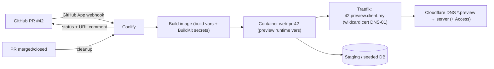

# Coolify - Preview Deployments, Environments & Secrets

> [!info] Deep dive of [[Coolify]]

> [!abstract] TL;DR
> Model each client as a **Project** with **Environments** (production, staging), and enable **PR preview deployments** via the GitHub App, with URLs from a wildcard template such as `{{pr_id}}.preview.client.my`.
> - Give previews their own **preview-scoped variables** pointing at a staging/seed database, never production credentials.
> - Share common values via **team / project / environment shared variables** (`{{environment.DATABASE_URL}}`).
> - Mark build-time vs runtime variables deliberately. `NEXT_PUBLIC_*` is baked into the image.
> - Pass build-time secrets as **BuildKit secrets**, not build args.
> - Keep public-fork PR previews **off**.

## Concept
| Level | Holds | Typical use |
|---|---|---|
| Team | Servers, Git sources, team shared variables | Agency-wide values (Sentry DSN org, SMTP relay) |
| Project | Environments for one client/product, project shared variables | `client-acme` |
| Environment | Resources (apps, DBs, services), environment shared variables | `production`, `staging` |
| Resource | App-specific variables, production vs **preview** groups | `web`, `worker` |

**Variable flags**:

| Flag | Effect | Use for |
|---|---|---|
| Build Variable | Available during the image build (build arg / secret) | `NEXT_PUBLIC_*`, `npm` registry tokens (as secret) |
| Runtime Variable | Injected into the running container | DB URLs, API keys, signing secrets |
| Both (default for new vars) | Build and runtime | Convenient, but leaks runtime secrets into build layers if misused |
| Preview group | Applies only to PR deployments | Staging DB, sandbox payment keys, test WhatsApp number |
| Locked / hidden value | Not shown again in the UI | Long-lived secrets |

**Preview deployments**:

| Aspect | Behaviour / setting |
|---|---|
| Trigger | GitHub App (or webhooks) on PR open/update. Also `GET /api/v1/deploy?uuid=…&pr=42` |
| URL | Preview URL template (e.g. `{{pr_id}}.preview.client.my`). Needs wildcard DNS + TLS |
| Lifecycle | Removed when the PR is closed/merged |
| Public PRs | "Allow public PR deployments" is off by default. Leave it off: a fork could run arbitrary code with your preview secrets |
| Data | Uses the preview variable group. No automatic per-PR database for plain applications |

## How It Works


## Practical Usage
**DNS + TLS for previews** (Cloudflare):
```text
*.preview.client.my   A   203.0.113.10   ; DNS-only, or proxied with an Advanced/Total TLS cert for this level
```
Universal SSL covers only `*.client.my` (one level). Either use `{{pr_id}}-preview.client.my` (first level) or issue a wildcard for `*.preview.client.my` via Traefik DNS-01 ([[Traefik - Middlewares, TLS & Routing]]).

**Shared variables referenced from a resource**:
```bash
# Environment "staging" shared variables
DATABASE_URL=postgres://app:…@staging-db:5432/app
# Resource "web" (preview group)
DATABASE_URL={{environment.DATABASE_URL}}
NEXT_PUBLIC_APP_ENV=preview            # Build Variable ✔ (baked into the bundle)
WHATSAPP_PHONE_ID=<test number id>     # Runtime ✔ — never the client's live number
PAYMENT_MODE=sandbox
```
**Build-time secret via BuildKit** (not a build arg):
```dockerfile
# syntax=docker/dockerfile:1.7
FROM node:22-alpine AS deps
WORKDIR /app
COPY package.json pnpm-lock.yaml ./
RUN --mount=type=secret,id=NPM_TOKEN \
    NPM_TOKEN="$(cat /run/secrets/NPM_TOKEN)" corepack pnpm install --frozen-lockfile
```
**Keep previews private and out of search engines** (Traefik labels on the preview resource):
```yaml
labels:
  - traefik.http.middlewares.preview-noindex.headers.customresponseheaders.X-Robots-Tag=noindex, nofollow
  - traefik.http.middlewares.preview-auth.basicauth.users=${PREVIEW_BASIC_AUTH}
  - traefik.http.routers.web-pr.middlewares=preview-noindex,preview-auth
```
(Or put `*.preview.client.my` behind Cloudflare Access with an email allowlist for the client's testers.)

**Trigger from CI after checks pass** (instead of auto-deploying every push):
```bash
curl -fsS -H "Authorization: Bearer $COOLIFY_DEPLOY_TOKEN" \
  "$COOLIFY_URL/api/v1/deploy?uuid=$WEB_UUID&pr=$PR_NUMBER"
```
**Wrong way**:
```text
❌ Preview group empty → previews inherit production DATABASE_URL and run migrations against prod
❌ STRIPE/Billplz live keys or the client's WhatsApp number in previews → real charges / real customer messages
❌ API secrets marked "Build Variable" → baked into image layers and the JS bundle
❌ "Allow public PR deployments" on a public repo → strangers run code with your secrets on your server
```

## Patterns & Anti-patterns
| Pattern | When | Anti-pattern to avoid |
|---|---|---|
| Project per client, environments `production` + `staging` | Agency setup | All clients in one project |
| Preview group always populated (staging DB, sandbox keys) | Previews enabled | Relying on "not set = safe" |
| Shared environment variables for common values | Many resources | Copy-pasting the same URL into 6 apps |
| Separate build for preview when `NEXT_PUBLIC_*` differs | Next.js | Promoting a preview image to production |
| Preview DB reset/seed job (`pnpm db:seed`) | Data-dependent features | Previews pointed at a copy of production data with PII |
| Access/basic auth + `noindex` on preview domains | Client demos | Public, indexed preview URLs |
| Cap concurrent previews / memory limits on preview containers | Small VPS | 10 open PRs = 10 Next.js servers = OOM |

## Performance & Trade-offs
- **RAM**: each preview is a full container (Next.js ~300–800 MB). On an 8 GB KVM, 3–4 open previews alongside production is the practical limit. Use a separate build/preview server if PRs pile up ([[Coolify - Multi-Server, Build Servers & Scaling]]).
- **Build time**: previews rebuild on every push. Cache layers and use a build server, or trigger from CI only after lint/tests pass.
- **Databases**: shared staging DB is cheap but previews can collide (two PRs migrating differently). Supabase branching or per-PR schemas cost more but isolate. Pick per project.
- **Shared variables** reduce drift, but changing one requires redeploying every resource that references it.

## Tips & Reminders
> [!tip] In ZP's stack
> - **Client workflow**: the PR preview URL goes to the client for acceptance, then merge, then production deploy. This doubles as your **UAT sign-off record** (link the PR in the change log / SOW deliverable list).
> - **Staging Supabase project** (or Supabase branching) behind previews, seeded with fake Malaysian test data (no real IC numbers or phones). That keeps PDPA exposure out of preview environments.
> - **Next.js self-hosted**: set `NEXT_SERVER_ACTIONS_ENCRYPTION_KEY` and `deploymentId` per environment ([[Next.js - Server Actions, Mutations & Security]]).

- Use test WhatsApp Business numbers and payment-gateway sandbox credentials for every non-production environment.
- Document which variables are build-time in the repo (`.env.example` with comments), so a new environment isn't missing a baked value.
- Rotate secrets by updating the shared variable and redeploying. Keep `APP_KEY` safe, since it decrypts all stored values ([[Coolify - Operations, Backups & Hardening]]).
- Prefer deploy-only API tokens in CI ([[CI-CD - Deploy Pipelines for Coolify & Flutter Releases]]).

## Version Notes
| Version | Change relevant here |
|---|---|
| v4 beta (2023–26) | Projects/environments, GitHub App previews, preview URL templates, shared variables |
| 4.0.0 stable (2026) | Stable v4 including Jan 2026 CVE fixes |
| 4.x (2026) | Separate production/preview variable groups, independent build/runtime flags, BuildKit build secrets with build-arg fallback |

> [!warning] Unverified — check before relying on this
> Whether shared variables can override preview-specific values, and the exact behaviour of Compose-based previews (whether databases are duplicated per PR), weren't confirmed. Test on a staging project and check https://coolify.io/docs/applications/deployments/preview-deployments.

## Critical Issues & Gotchas
> [!danger] Previews running against production
> An unconfigured preview group means previews inherit production values. A PR with a destructive migration, a test script sending WhatsApp broadcasts, or a payment flow in live mode then hits real customers and real money. Populate the preview group before enabling previews, and add a startup assertion (`if APP_ENV=preview && DATABASE_URL contains prod-host → exit 1`).

> [!danger] Secrets in build layers and bundles
> Variables marked as build variables become build args unless passed as BuildKit secrets. Build args persist in image history (`docker history`), and `NEXT_PUBLIC_*` values ship to every browser. Only public config goes in build variables. Secrets are runtime-only or BuildKit secrets.

- **Wildcard TLS depth**: `42.preview.client.my` isn't covered by Cloudflare Universal SSL. Certificate errors on previews usually mean this.
- **OAuth callbacks**: Supabase Auth / Google OAuth redirect URLs must allow the preview pattern (`https://*.preview.client.my/**`), or logins fail only on previews.
- **Webhooks from third parties** (Meta, payment gateways) point to production URLs. Previews need their own test app/webhook config, or those flows can't be tested there.
- **Orphaned previews** after a failed cleanup keep consuming RAM. Check the server's container list periodically.

## Related
- [[Coolify]]
- [[CI-CD - Deploy Pipelines for Coolify & Flutter Releases]] — triggering previews and deploys from CI
- [[Coolify - Operations, Backups & Hardening]] — `APP_KEY`, tokens and control-plane security
- [[Traefik - Middlewares, TLS & Routing]] — wildcard certs and preview middlewares
- [[Cloudflare - Zero Trust Tunnel & Access]] — gating preview domains
- [[Docker - Dockerfile & Image Best Practices]] — BuildKit secrets and layer hygiene

## References
- https://coolify.io/docs/applications/deployments/preview-deployments
- https://coolify.io/docs/applications/ci-cd/github/preview-deploy
- https://coolify.io/docs/applications/configuration/environment-variables
- https://coolify.io/docs/knowledge-base/environment-variables
- https://docs.docker.com/build/building/secrets/
