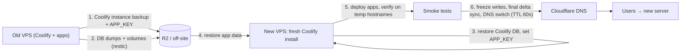

# Coolify - Server Migration & Disaster Recovery

> [!info] Deep dive of [[Coolify]]

> [!abstract] TL;DR
> Two layers to recover:
> 1. **The Coolify control plane**: its Postgres DB (projects, envs, server definitions), **`APP_KEY`** in `/data/coolify/source/.env` (decrypts every stored secret), and SSH keys.
> 2. **The workloads**: app data in **database dumps and volumes**, plus configs. Images are rebuildable from git.
>
> **Planned migration** (bigger VPS, provider move): new server → restore or re-add apps → copy data with dumps/restic → lower DNS TTL → short write freeze → final sync → DNS switch → keep the old server read-only for a few days.
>
> **Disaster recovery**: write the runbook *before* you need it, store `APP_KEY` + backups **off the server**, set RPO/RTO per client, and **rehearse** a full restore onto a scratch VPS each quarter.

## Concept
| Asset | Where | Back up how | Without it… |
|---|---|---|---|
| Coolify DB | `coolify-db` container (Postgres) | Coolify's instance backup to S3/R2, or `pg_dump` | Recreate every project/env by hand |
| `APP_KEY` | `/data/coolify/source/.env` | Password manager + off-site | Restored DB can't decrypt env vars/secrets |
| SSH keys | `/data/coolify/ssh/keys` | Off-site backup | Can't reach managed servers |
| App databases | Postgres/MySQL containers | Coolify scheduled DB backups to S3 + restic | Data loss |
| App volumes (uploads) | `/var/lib/docker/volumes/...` | restic / rsync | Lost user files |
| Proxy config + certs | `/data/coolify/proxy` (`acme.json`, dynamic configs) | restic | Re-issue certs (rate limits), lost custom routes |
| Images | Registry / git | Rebuild | Slower recovery only |
| DNS | Cloudflare | Export zone, document records | Wrong cutover, email breakage |

**Targets per client tier**:

| Tier | RPO (max data loss) | RTO (time to restore) | Means |
|---|---|---|---|
| Basic | 24 h | 1 business day | Nightly dumps + restic, manual restore |
| Standard | 1–4 h | 4 h | Frequent dumps or WAL archiving, scripted restore |
| Premium | Minutes | < 1 h | PITR/managed DB, warm standby server |

## How It Works


## Practical Usage
**Before anything: capture the critical secrets** (old server):
```bash
grep -E '^APP_KEY=' /data/coolify/source/.env          # store in password manager (per-client entry)
tar czf coolify-keys-$(date +%F).tgz /data/coolify/ssh/keys /data/coolify/source/.env
restic backup --tag coolify-control coolify-keys-*.tgz /data/coolify/proxy
```
**Coolify DB dump** (if not using the built-in instance backup):
```bash
docker exec coolify-db pg_dump -U coolify -d coolify -Fc > coolify-$(date +%F).dump
```
**Restore control plane on the new server** (outline, follow current Coolify docs):
```bash
curl -fsSL https://cdn.coollabs.io/coolify/install.sh | bash      # same major version as old instance
docker stop coolify coolify-realtime                             # keep coolify-db running
docker exec -i coolify-db pg_restore -U coolify -d coolify --clean --if-exists < coolify-YYYY-MM-DD.dump
sed -i 's/^APP_KEY=.*/APP_KEY=base64:…old key…/' /data/coolify/source/.env
# restore ssh keys to /data/coolify/ssh/keys, then re-run installer/upgrade to restart services
```
**App data migration** (per database, during a short write freeze):
```bash
# old server
docker exec app-db pg_dump -U app -Fc app > app.dump
# new server (after Coolify created the empty DB resource)
docker exec -i <new-app-db> pg_restore -U app -d app --clean --if-exists < app.dump
# volumes with uploads
rsync -aHAX --info=progress2 old:/var/lib/docker/volumes/<vol>/_data/ /var/lib/docker/volumes/<vol>/_data/
```
**Cutover checklist**:
```text
T-48h  lower DNS TTL to 60 s (Cloudflare proxied records switch instantly anyway)
T-24h  full data copy, deploy apps on new server, test via temporary hostnames / hosts file
T-0    announce maintenance → stop writes (maintenance page or stop app) → final dump/rsync delta
       → restore → smoke test (login, create order, webhook in, WhatsApp out, n8n executions)
       → switch DNS A records / Cloudflare Tunnel → watch logs, error rate, webhook deliveries
T+7d   keep old server stopped but intact → then delete and remove its keys/access
```
**Wrong way**:
```text
❌ Restoring Coolify DB without the old APP_KEY      → env vars/secrets undecryptable; re-enter everything
❌ Copying /var/lib/docker/volumes of a running Postgres → corrupt or inconsistent database
❌ DNS switch before webhook URLs/IP allowlists updated → Meta/Stripe/payment gateway callbacks fail
❌ Deleting the old VPS on cutover day               → no fallback when something was missed
```

## Patterns & Anti-patterns
| Pattern | When | Anti-pattern to avoid |
|---|---|---|
| `APP_KEY` + SSH keys in password manager per instance | Always | Keys only on the server |
| Logical dumps for DBs, rsync/restic for files | Migrations | Raw data-dir copies of live DBs |
| Rehearsal on scratch VPS before the real cutover | Planned migrations | First attempt in production |
| Low TTL / Cloudflare proxy for fast cutover | DNS | 24 h TTLs during migration |
| Inventory of external integrations (webhooks, IP allowlists, OAuth redirects) | Cutover | Discovering them from customer complaints |
| Keep old server intact for a week | Rollback | Immediate teardown |
| Written DR runbook per client with RPO/RTO | Retainers | Improvising during an outage |

## Performance & Trade-offs
- **Restore Coolify DB vs re-create apps**: restoring the DB is faster with many resources but brittle across versions. Re-creating a handful of apps from git and compose files is cleaner and documents the setup.
- **Downtime**: a write freeze of 5–30 minutes is realistic for SME apps with dumps under a few GB. Logical replication can cut it further for large databases ([[PostgreSQL - Logical Replication & Change Data Capture]]).
- **Warm standby** (second VPS with replicated DB) shrinks RTO but doubles cost. Usually only for Premium-tier clients.
- **Provider lock-in**: keeping everything in compose + git + off-site backups makes moving away from Hostinger (or any VPS host) a day's work.

## Tips & Reminders
> [!tip] In ZP's stack
> - **Per-client DR card** in the handover pack: RPO/RTO, backup locations, `APP_KEY` escrow instructions, restore steps, external integrations to update (Meta webhooks, payment gateway callback URLs, Google OAuth redirects).
> - **Cloudflare Tunnel** setups cut over by moving the tunnel connector, with no DNS changes. That's a big simplification for migrations ([[Cloudflare - Zero Trust Tunnel & Access]]).
> - **Quarterly drill**: restore one client to a scratch VPS, time it, and log it. That's the evidence your retainer is worth paying for.

- Match the Coolify version on the new server before restoring its DB, then upgrade.
- Update allow-lists that pin the old server IP (database firewalls, partner APIs, SMTP relays).
- Recheck SSL issuance on the new server. Persisted `acme.json` avoids rate limits ([[Traefik - Custom Domains, ACME DNS-01 & Wildcard Certificates]]).
- Re-run n8n with the **same encryption key** after migration, or its credentials won't decrypt.

## Version Notes
| Version | Change relevant here |
|---|---|
| 4.0.0 (2026) | Stable v4. Instance backup to S3 documented |
| 4.2.0 (2026-07) | Resource migration between servers/environments. Volume backup scheduling |
| 4.4.x–4.6.0 (2026) | Current lines. Preview channel for betas/RCs (stay on stable for production) ([[Coolify]]) |

> [!warning] Unverified — check before relying on this
> The exact Coolify restore procedure (container names, which services to stop, whether the installer must be re-run) and the scope of 4.2's resource migration weren't verified against current docs. Follow https://coolify.io/docs and test on a scratch server first.

## Critical Issues & Gotchas
> [!danger] Losing APP_KEY or the n8n encryption key
> Coolify encrypts environment variables and secrets with `APP_KEY`, and n8n encrypts credentials with `N8N_ENCRYPTION_KEY`. Restoring databases without these keys yields unusable secrets. Every API key, DB password and OAuth token must be re-entered, often with no record of the values. Escrow both keys per client before you ever need them.

> [!danger] Single-provider "backups"
> Hostinger snapshots and backups stored on the same VPS or account disappear with the account (suspension, billing issue, provider incident). A DR plan that never leaves the provider isn't a DR plan. Keep off-site copies (R2/B2) under credentials the server can't delete ([[Linux Essentials - Backups with restic & Off-Site Storage]]).

- **Webhook re-registration**: some platforms (Meta, payment gateways) need callback URL updates or re-verification. Plan them in the cutover window.
- **Email deliverability**: new server IP for SMTP needs SPF updates or relays ([[Cloudflare - DNS, Email Authentication & Domain Ops]]).
- **Cron/scheduled tasks**: confirm they run once, on the new server only. Stop schedulers on the old server.
- **Timezone/locale** differences between old and new hosts can shift scheduled jobs.

## Related
- [[Coolify]]
- [[Coolify - Operations, Backups & Hardening]] — routine backups and hardening
- [[Coolify - Multi-Server, Build Servers & Scaling]] — multiple servers, standby options
- [[Linux Essentials - Backups with restic & Off-Site Storage]] — off-site backup tooling
- [[PostgreSQL - Backups, PITR & Restore Drills]] — database restore procedures
- [[Cloudflare - DNS, Email Authentication & Domain Ops]] — DNS cutover

## References
- https://coolify.io/docs/knowledge-base/how-to/backup-restore-coolify
- https://coolify.io/docs/knowledge-base/server/introduction
- https://coolify.io/docs/databases/backups
- https://github.com/coollabsio/coolify/releases
- https://developers.cloudflare.com/dns/manage-dns-records/reference/ttl/
