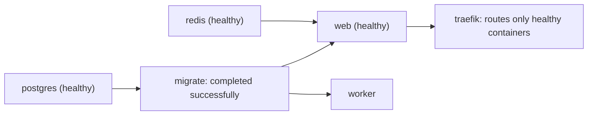

# Docker - Compose Patterns for Production

> [!info] Deep dive of [[Docker]]

> [!abstract] TL;DR
> Compose is a solid **single-host** production runtime if each service declares:
> - its health;
> - its start order (`depends_on: condition: service_healthy`);
> - restart policy and resource limits;
> - log rotation and a hardened runtime;
> - one-off jobs (migrations) as services that must **complete successfully**.
>
> Compose does **not** do rolling updates, multi-host scheduling or secret management at the level of [[Kubernetes]]. Know where that line is.

## Concept
- **One file = one project**. Set a top-level `name:` so the project name doesn't depend on the directory, which matters for volume and network names.
- **Layering**: `compose.yaml` (prod baseline) + `compose.override.yaml` (dev, auto-loaded) or explicit `-f compose.yaml -f compose.prod.yaml`. Use `include:` to pull in shared stacks, and `x-` extension fields with YAML anchors for shared config.
- **Lifecycle building blocks**:

| Key | Purpose | Note |
|---|---|---|
| `healthcheck` | Container reports healthy/unhealthy | Needed for `service_healthy` and `--wait` |
| `depends_on.<svc>.condition` | `service_started` / `service_healthy` / `service_completed_successfully` | Start order only on `up`, not a runtime guarantee |
| `restart` | `unless-stopped` / `always` / `on-failure[:N]` | Use `no` for one-off jobs |
| `deploy.resources.limits` | `cpus`, `memory` (honoured by `docker compose`, no Swarm needed) | OOM-kills the container at the limit |
| `profiles` | Opt-in services (`--profile tools`) | Backups, admin UIs, debug containers |
| `secrets` | File mounted at `/run/secrets/<name>` | Not encrypted at rest; better than env vars |
| `stop_grace_period` | Time between SIGTERM and SIGKILL (default 10 s) | Raise for workers draining jobs |

## How It Works

On `docker compose up -d --wait`, Compose creates networks and volumes, then starts services in dependency order. It blocks each dependant until its conditions are met, and exits non-zero if any service fails health within the timeout. That makes `--wait` the deploy gate for CI scripts.

## Practical Usage
**Production `compose.yaml`** (Next.js web + worker + Postgres + Redis + migrations):
```yaml
name: shop

x-app: &app
  image: ghcr.io/acme/shop@sha256:4f1c…            # pin by digest (or immutable tag)
  env_file: .env.production
  restart: unless-stopped
  init: true                                       # PID 1 reaps zombies, forwards signals
  read_only: true
  tmpfs: [/tmp]
  user: "10001:10001"
  cap_drop: [ALL]
  security_opt: ["no-new-privileges:true"]
  logging: { driver: json-file, options: { max-size: "10m", max-file: "5" } }
  networks: [internal]

services:
  db:
    image: postgres:18-alpine
    restart: unless-stopped
    environment:
      POSTGRES_PASSWORD_FILE: /run/secrets/pg_password
    secrets: [pg_password]
    volumes: [pgdata:/var/lib/postgresql]
    healthcheck:
      test: ["CMD-SHELL", "pg_isready -U postgres"]
      interval: 5s
      timeout: 3s
      retries: 10
      start_period: 20s
    deploy: { resources: { limits: { memory: 1g } } }
    networks: [internal]

  redis:
    image: redis:8-alpine
    command: ["redis-server", "--appendonly", "yes", "--maxmemory-policy", "noeviction"]
    healthcheck: { test: ["CMD", "redis-cli", "ping"], interval: 5s, retries: 10 }
    volumes: [redisdata:/data]
    networks: [internal]

  migrate:
    <<: *app
    command: ["node", "scripts/migrate.mjs"]
    restart: "no"
    depends_on: { db: { condition: service_healthy } }

  web:
    <<: *app
    command: ["node", "server.js"]
    depends_on:
      migrate: { condition: service_completed_successfully }
      redis:   { condition: service_healthy }
    healthcheck:
      test: ["CMD", "node", "-e", "fetch('http://localhost:3000/api/health').then(r=>process.exit(r.ok?0:1)).catch(()=>process.exit(1))"]
      interval: 10s
      start_period: 30s
    deploy: { resources: { limits: { cpus: "1.5", memory: 768m } } }
    networks: [internal, proxy]
    labels:
      - traefik.enable=true
      - traefik.http.routers.shop.rule=Host(`shop.example.com`)
      - traefik.http.services.shop.loadbalancer.server.port=3000

  worker:
    <<: *app
    command: ["node", "worker.js"]
    stop_grace_period: 60s                         # let BullMQ/pgmq jobs finish
    depends_on: { migrate: { condition: service_completed_successfully } }

  backup:
    image: postgres:18-alpine
    profiles: [tools]
    entrypoint: ["sh", "-c", "PGPASSWORD=$$(cat /run/secrets/pg_password) pg_dump -h db -U postgres -Fc app > /backups/app-$$(date +%F).dump"]
    secrets: [pg_password]
    volumes: ["./backups:/backups"]
    networks: [internal]

networks:
  internal: { internal: true }                     # no outbound internet, no host exposure
  proxy: { external: true }                        # shared with Traefik / Coolify

volumes: { pgdata: {}, redisdata: {} }
secrets: { pg_password: { file: ./secrets/pg_password.txt } }
```
> [!warning] `internal: true` blocks outbound internet
> Services that call external APIs (Meta, Stripe, LLM APIs) also need a non-internal network, such as `proxy` or a dedicated `egress` network. Here `web` has `proxy`; give `worker` an egress network if it sends WhatsApp messages.

**Deploy script**:
```bash
set -euo pipefail
docker compose pull
docker compose up -d --wait --wait-timeout 120 --remove-orphans
docker image prune -f --filter "until=168h"
docker compose --profile tools run --rm backup     # ad-hoc, or from cron
```
**Wrong way**:
```yaml
services:
  web:
    image: acme/web:latest          # ❌ mutable tag: a reboot or pull silently deploys a new version
    ports: ["3000:3000"]            # ❌ bypasses UFW; Traefik should be the only public entry
    depends_on: [db]                # ❌ waits for "started", not "ready" → crash on first boot
    environment:
      DB_PASSWORD: pa$$word         # ❌ visible in docker inspect; `$` interpolation surprises
    container_name: web             # ❌ blocks --scale and collides across projects
```

## Patterns & Anti-patterns
| Pattern | When | Anti-pattern to avoid |
|---|---|---|
| Migrations as a `service_completed_successfully` dependency | Every app with a schema | Migrating in the web container's entrypoint (races with replicas, slow boots) |
| `--wait` as a deploy gate | CI/CD scripts | `up -d` and hoping; failures found by users |
| `x-` anchors for shared hardening | 3+ app services | Copy-pasted, drifting security options |
| `profiles: [tools]` for backup/admin/psql | Occasional ops tasks | pgAdmin running 24/7 on a public port |
| Log rotation on every service | Always (default json-file has **no** rotation) | 40 GB `*-json.log` filling the VPS disk |
| `secrets:` or `*_FILE` env vars | Passwords, API keys | Secrets in `environment:` (show in `docker inspect`, crash dumps) |
| Top-level `name:` | Every project | Volume names that change when the folder is renamed, creating an empty DB |

## Performance & Trade-offs
- **No rolling updates**: `up -d` recreates changed containers, which gives a few seconds of 502s. Options:
  - accept it, for internal tools;
  - run `web` with 2 replicas and recreate them one at a time (`docker rollout` plugin), with Traefik routing only to healthy ones;
  - let [[Coolify]] do it (it supports rolling updates for single-container apps with health checks).
- **Resource limits**: without `memory` limits, one leaking service can trigger the host OOM-killer on Postgres. Set limits so the total stays below ~80% of RAM on a Hostinger KVM.
- **Healthcheck cost**: every check `exec`s a process. With 5 s intervals across 15 services that's ~3 forks/s. Fine on most VPSs, but use 10–30 s intervals with `start_period` for heavy images.
- **When to outgrow Compose**: multi-node HA, autoscaling, or more than ~20 services per host with frequent deploys mean [[Kubernetes]] (k3s) or Swarm. For one to three VPSs, Compose + Coolify is simpler.

## Tips & Reminders
> [!tip] In ZP's stack
> [[Coolify]] deploys "Docker Compose" resources by injecting Traefik labels and its own network. Keep your compose file portable:
> - no hard-coded `container_name`;
> - no `ports:` for HTTP services;
> - env through Coolify's UI.
>
> For n8n queue mode, the same patterns apply: `main` + `worker`s + Redis + Postgres, workers with `stop_grace_period: 120s` (see [[n8n - Queue Mode & Scaling]]).

- Run `docker compose config` to render the final merged and interpolated file. Diff it in CI before deploying.
- `$` in values must be `$$`, otherwise Compose interpolates it. Prefer secret files for generated passwords.
- `env_file` sets container env; `.env` in the project directory only feeds **interpolation** of `${VAR}` in the YAML. They are different mechanisms.
- Use `docker compose up -d --no-deps web` to redeploy one service without touching its dependencies.
- Add a `HEALTHCHECK`-friendly `/api/health` that checks DB connectivity but not third-party APIs. Otherwise a Meta outage marks your app unhealthy.

## Version Notes
| Version | Change relevant here |
|---|---|
| v2.1+ | `up --wait` |
| v2.20 (2023) | `include:` top-level element |
| v2.22 (2023) | `develop.watch` GA (dev sync/rebuild) |
| v2.24 | `!reset` / `!override` merge tags for override files |
| v2.30 (2024) | Lifecycle hooks `post_start` / `pre_stop` |
| v2.40 | Line shipped on GitHub hosted runners from 2026-02 (with Engine 29.1) |
| v5.x (2026) | New major line. v5.3 native init containers; v5.6 (2026-10) partial `jobs` support (manual trigger only) |

> [!warning] Unverified — check before relying on this
> The v5.x feature list and dates come from a release aggregator (releases.sh), and the v2.2x/2.30 version attributions are from memory. Check https://github.com/docker/compose/releases before relying on a specific key.

## Critical Issues & Gotchas
> [!danger] `depends_on` without `condition` doesn't wait for readiness
> The short form only orders container *start*. Postgres takes seconds to accept connections, so the app crashes, restarts and eventually works, which hides real boot failures. Always use `condition: service_healthy` with a real healthcheck.

> [!danger] Default logging fills the disk
> The `json-file` driver keeps logs forever unless `max-size`/`max-file` are set. A chatty worker on a 50 GB VPS disk can stop Postgres (no space to write WAL). Set rotation per service, or globally in `/etc/docker/daemon.json` (`"log-opts": {"max-size": "10m", "max-file": "5"}`).

- **Project or volume renames orphan data**: changing the folder name or `name:` creates new, empty volumes (`newname_pgdata`). The old data is still there under the old name, and the app starts on an empty DB. Pin `name:` or use explicit `volumes: pgdata: { name: shop_pgdata }`.
- **`restart: always` crash loops** hide failing deploys. Alert on container restarts (`docker events`, or Uptime Kuma checking `/api/health`).
- **Published ports bypass UFW**: see [[Docker - Networking & Volumes]]. Bind admin ports to `127.0.0.1:` if you must publish them.
- **`docker compose down -v`** deletes named volumes, including the database. Never put it in deploy scripts.

## Related
- [[Docker]]
- [[Docker - Networking & Volumes]] — internal networks, volumes, firewall bypass
- [[Docker - Dockerfile & Image Best Practices]] — the images these services run
- [[Coolify]] — Compose deployments with managed Traefik
- [[Traefik]] — label-based routing to healthy containers
- [[n8n - Queue Mode & Scaling]] — a multi-service Compose stack in ZP's stack

## References
- https://docs.docker.com/reference/compose-file/
- https://docs.docker.com/compose/how-tos/startup-order/
- https://docs.docker.com/compose/how-tos/use-secrets/
- https://github.com/docker/compose/releases
- https://releases.sh/docker/docker-compose-releases.md
- https://github.blog/changelog/2026-01-30-docker-and-docker-compose-version-upgrades-on-hosted-runners
