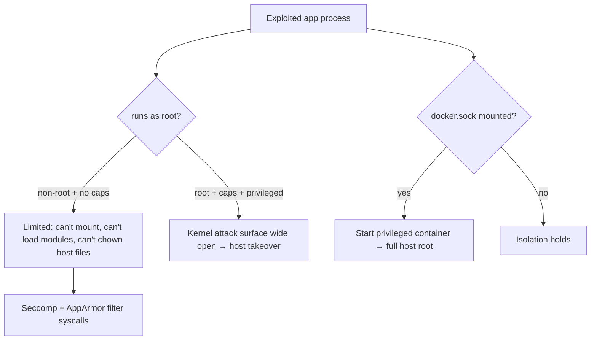

# Docker - Container Hardening, Rootless & Seccomp

> [!info] Deep dive of [[Docker]]

> [!abstract] TL;DR
> Containers share the host kernel. A compromised app container plus weak isolation leads to host compromise and every client on that VPS. Baseline for every service:
> - **Run as non-root**: `USER` in the image or `user:` in compose.
> - **Restrict the container**: `cap_drop: [ALL]` (add back only what's needed), `security_opt: [no-new-privileges:true]`, keep the **default seccomp** profile (never `unconfined`), and **no `privileged: true`**.
> - **Lock down the filesystem**: **read-only root filesystem** with `tmpfs` for scratch dirs.
> - **Cap resources**: memory/PID/CPU limits.
> - **Treat `/var/run/docker.sock` as root access**: only Coolify/Traefik should touch it, read-only where possible, ideally through a **socket proxy**.
>
> **Rootless Docker/user namespaces** add a strong layer (container root ≠ host root), but complicate Coolify-style setups, so apply them selectively.

## Concept
| Control | Compose key | Effect | Breakage risk |
|---|---|---|---|
| Non-root user | `user: "1000:1000"` / Dockerfile `USER` | Exploit runs unprivileged | Volume permissions, ports < 1024 |
| Drop capabilities | `cap_drop: [ALL]`, `cap_add: [NET_BIND_SERVICE]` | Removes kernel privileges | Apps needing chown/setuid at start |
| No new privileges | `security_opt: ["no-new-privileges:true"]` | Blocks setuid escalation | Rare (sudo inside containers) |
| Seccomp default | (implicit) | Blocks ~40+ dangerous syscalls | Only exotic workloads |
| AppArmor/SELinux | `security_opt: ["apparmor=docker-default"]` | MAC confinement | Distro-specific |
| Read-only rootfs | `read_only: true` + `tmpfs` | Prevents dropping binaries/web shells | Apps writing to cache dirs |
| Resource limits | `mem_limit`, `pids_limit`, `cpus` | Limits DoS and fork bombs | Need sizing |
| No privileged/host namespaces | avoid `privileged`, `network_mode: host`, `pid: host` | Keeps isolation | Some monitoring agents need exceptions |
| Docker socket access | Avoid mounting. Proxy if needed | Socket = root on host | Coolify/Traefik need it (managed carefully) |
| Rootless / userns-remap | Daemon config | Container root maps to unprivileged host UID | Coolify compatibility, networking, volumes |

## How It Works


## Practical Usage
**Hardened service in compose**:
```yaml
services:
  api:
    image: ghcr.io/rarticle/api@sha256:…          # pinned digest
    user: "10001:10001"
    read_only: true
    tmpfs: ["/tmp:size=64m", "/app/.next/cache:size=256m"]
    cap_drop: [ALL]
    security_opt: ["no-new-privileges:true"]
    mem_limit: 768m
    pids_limit: 256
    networks: [internal]                          # no published ports; Traefik routes via network
    environment:
      NODE_ENV: production
networks:
  internal: { driver: bridge }
```
**Dockerfile with non-root user**:
```dockerfile
FROM node:22-bookworm-slim
RUN groupadd -g 10001 app && useradd -u 10001 -g app -s /usr/sbin/nologin -M app
WORKDIR /app
COPY --chown=app:app . .
USER app
EXPOSE 3000
CMD ["node", "server.js"]
```
**Socket proxy instead of raw socket** (for tools needing read-only Docker API, e.g. monitoring, Traefik):
```yaml
socket-proxy:
  image: tecnativa/docker-socket-proxy:latest      # pin a version
  environment: { CONTAINERS: 1, NETWORKS: 1, SERVICES: 0, TASKS: 0, POST: 0 }   # read-only, limited endpoints
  volumes: ["/var/run/docker.sock:/var/run/docker.sock:ro"]
  networks: [socket]
traefik:
  command: ["--providers.docker.endpoint=tcp://socket-proxy:2375"]
  networks: [socket, public]
```
**Daemon defaults** (`/etc/docker/daemon.json`):
```json
{
  "no-new-privileges": true,
  "live-restore": true,
  "userland-proxy": false,
  "log-driver": "json-file",
  "log-opts": { "max-size": "10m", "max-file": "3" }
}
```
**Audit what's running**:
```bash
docker ps -q | xargs docker inspect --format \
 '{{.Name}} user={{.Config.User}} priv={{.HostConfig.Privileged}} ro={{.HostConfig.ReadonlyRootfs}} caps={{.HostConfig.CapAdd}} sec={{.HostConfig.SecurityOpt}}'
docker run --rm --net host --pid host --cap-add audit_control -v /var/lib:/var/lib:ro -v /var/run/docker.sock:/var/run/docker.sock:ro \
  -v /etc:/etc:ro docker/docker-bench-security          # CIS benchmark checks (review output, don't blindly apply)
```
**Wrong way**:
```text
❌ privileged: true "to make it work"            → container root ≈ host root
❌ -v /var/run/docker.sock in an app container   → any RCE = full host takeover
❌ security_opt: seccomp=unconfined              → removes syscall filtering
❌ Running every service as root by default      → each bug is one step from host compromise
```

## Patterns & Anti-patterns
| Pattern | When | Anti-pattern to avoid |
|---|---|---|
| Non-root + `cap_drop: ALL` as template default | All app containers | Root by default |
| Read-only rootfs + explicit `tmpfs` | Stateless services | Writable everything |
| Only infra (Coolify, Traefik) touches the socket, preferably via proxy | Single-VPS stacks | Socket mounted into apps/monitoring randomly |
| Internal networks, no published ports except proxy | Compose stacks | `ports:` for databases |
| Pinned image digests + scanning | Supply chain | `latest` tags in prod ([[Docker - Image Scanning, SBOMs & Signing]]) |
| Resource limits per container | Shared VPS | One container can OOM the host |
| Separate VPS per high-risk client/workload | Isolation needs | All clients on one host with shared socket access |

## Performance & Trade-offs
- **Hardening overhead** is negligible at runtime. Seccomp and capability checks cost microseconds.
- **Read-only rootfs** requires knowing every write path (Next.js cache, Python `__pycache__`, temp uploads). Test thoroughly.
- **Rootless Docker** gives stronger isolation, but ports < 1024 need extra config, networking performance is lower (slirp/pasta), and orchestrators like Coolify may not support it. User-namespace remapping is a middle ground, with volume ownership caveats.
- **gVisor/Kata** sandboxing offers much stronger isolation for untrusted code (e.g. code execution features), at a performance cost.

## Tips & Reminders
> [!tip] In ZP's stack
> - **Coolify** itself mounts the Docker socket and manages servers via SSH as root. Protect Coolify like the crown jewels (MFA, Cloudflare Access, updates), because compromising it compromises every client server ([[Coolify - Operations, Backups & Hardening]]).
> - **n8n Code nodes and task runners** execute user-defined code. Keep runners as non-root, without the Docker socket, and with builtins restricted.
> - **Template**: bake the hardened compose snippet into your client project template, so every new deployment starts secure.

- Verify running containers' users after updates. Some images reset to root.
- Never store secrets in images. Pass them via env/secrets at runtime.
- Keep the host kernel and Docker Engine patched (container escapes are usually kernel bugs) ([[Linux Essentials - VPS Hardening Runbook]]).
- Use `docker scout`/Trivy (pinned, verified) for image CVEs alongside runtime hardening.

## Version Notes
| Version | Change relevant here |
|---|---|
| 1.10 (2016) | Default seccomp profile, user namespaces (`userns-remap`) |
| 19.03 / 20.10 | Rootless mode (experimental → GA) |
| Engine 28 (2025) | Firewall/iptables hardening of published ports |
| Engine 29.x (2025–26) | containerd image store default. Current patch 29.9.1 includes security fixes ([[Docker]]) |

> [!warning] Unverified — check before relying on this
> Coolify's compatibility with rootless Docker/userns-remap and the current socket-proxy image recommendations weren't verified this run. Test on a staging VPS before changing daemon-level settings on client servers.

## Critical Issues & Gotchas
> [!danger] The Docker socket is root on the host
> Any container with `/var/run/docker.sock` mounted (even `:ro` on the socket file, since the API is still writable) can start a privileged container mounting `/` and own the host. Exposing the Docker API over TCP without TLS is equally fatal. Limit socket access to trusted infrastructure, use a filtering socket proxy, and never expose 2375/2376 publicly.

> [!danger] Container escapes via kernel and runtime CVEs
> runc/containerd and Linux kernel vulnerabilities periodically allow escapes from root containers. Running non-root with dropped capabilities and seccomp turns many of these from critical into non-exploitable. Patch Docker Engine, runc and the kernel promptly, and reboot hosts after kernel updates.

- **Volume permissions**: switching to non-root breaks existing volumes owned by root. `chown` once, or use init containers.
- **`network_mode: host`** bypasses Docker network isolation and Docker's firewall rules for that container.
- **`--pid host` or `--ipc host`** leaks host process info and shared memory.
- **Default bridge network** lets all containers talk. Use per-stack networks.

## Related
- [[Docker]]
- [[Docker - Image Scanning, SBOMs & Signing]] — supply-chain side of container security
- [[Docker - Dockerfile & Image Best Practices]] — non-root, minimal images
- [[Linux Essentials - VPS Hardening Runbook]] — host-level hardening
- [[Docker - Networking & Volumes]] — internal networks and volume permissions
- [[Coolify - Operations, Backups & Hardening]] — protecting the control plane

## References
- https://docs.docker.com/engine/security/
- https://docs.docker.com/engine/security/rootless/
- https://docs.docker.com/engine/security/seccomp/
- https://www.cisecurity.org/benchmark/docker
- https://github.com/Tecnativa/docker-socket-proxy
