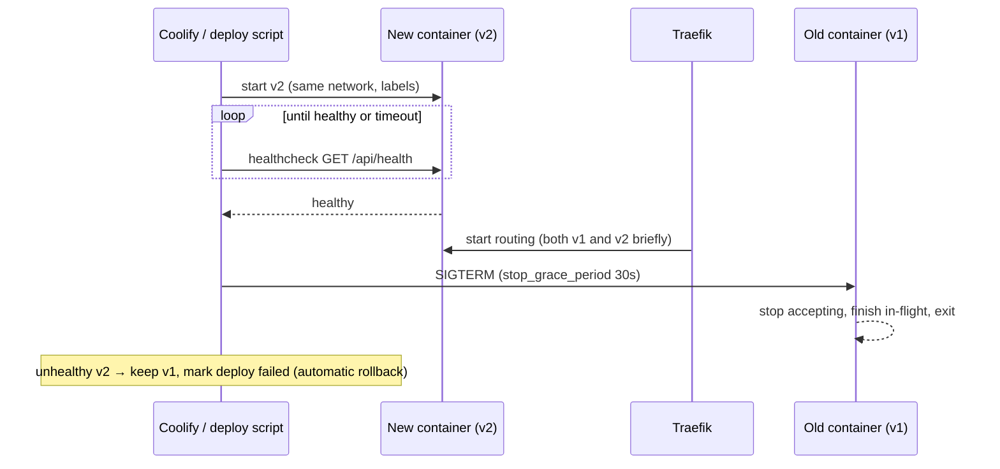

# Docker - Healthchecks, Restart Policies & Zero-Downtime Deploys

> [!info] Deep dive of [[Docker]]

> [!abstract] TL;DR
> - **Healthchecks** tell Docker (and Coolify/Traefik) whether a container can serve. Probe a cheap **readiness** endpoint (`/api/health` checks the process plus critical deps lightly), with `start_period` for boot time.
> - **Restart policies**: `unless-stopped` (or `always`) for services, `on-failure` for jobs. Restarts don't fix crash loops, so alert on restart counts.
> - **Zero-downtime** on a single VPS means starting the new container, waiting until healthy, shifting traffic (Traefik), then stopping the old one **gracefully** (SIGTERM, `stop_grace_period`). Coolify does this for apps with healthchecks. With plain Compose, use `docker rollout` or blue/green.
> - **Migrations** must be backward-compatible (expand → deploy → contract), or zero-downtime is impossible regardless of tooling.

## Concept
| Concept | Setting | Guidance |
|---|---|---|
| Healthcheck | `HEALTHCHECK` / compose `healthcheck` | Fast (< 1 s), local, no heavy DB queries |
| Start grace | `start_period` | ≥ app boot time (Next.js 5–20 s, JVM 30–60 s) |
| Interval/retries | `interval: 10s, retries: 3` | Unhealthy after ~30 s of failures |
| Restart policy | `restart: unless-stopped` | Services. `on-failure:5` for one-shot jobs |
| Dependency order | `depends_on: { db: { condition: service_healthy } }` | Startup only. Not a runtime guarantee |
| Graceful stop | `stop_signal`, `stop_grace_period: 30s` | Finish in-flight requests/jobs |
| Rolling deploy | Coolify rolling update, `docker rollout`, blue/green | Needs healthcheck + no fixed host ports |

**Liveness vs readiness** (Docker has one healthcheck, so choose deliberately):

| Probe style | Checks | Risk |
|---|---|---|
| Liveness-ish (`/healthz`: process responds) | Event loop alive | Routes traffic before warm-up/DB ready |
| Readiness-ish (`/readyz`: + DB ping, migrations done) | Can serve real requests | DB blip marks all replicas unhealthy (restart storms if orchestrator restarts on unhealthy) |
| **Recommended** | Process + cheap dependency check with short timeout, tolerant of brief blips | Balanced |

## How It Works


## Practical Usage
**Health endpoint** (Next.js route handler):
```ts
// app/api/health/route.ts
export const dynamic = "force-dynamic";
export async function GET() {
  try {
    await Promise.race([db.execute("select 1"), new Promise((_, r) => setTimeout(() => r(new Error("db timeout")), 800))]);
    return Response.json({ ok: true, version: process.env.APP_VERSION });
  } catch {
    return Response.json({ ok: false }, { status: 503 });
  }
}
```
**Dockerfile healthcheck** (no curl in slim images? use Node):
```dockerfile
HEALTHCHECK --interval=10s --timeout=3s --start-period=20s --retries=3 \
  CMD node -e "fetch('http://127.0.0.1:3000/api/health').then(r=>process.exit(r.ok?0:1)).catch(()=>process.exit(1))"
```
**Compose: health-gated startup, restart and graceful stop**:
```yaml
services:
  db:
    image: postgres:17
    restart: unless-stopped
    healthcheck:
      test: ["CMD-SHELL", "pg_isready -U app -d app"]
      interval: 5s
      timeout: 3s
      retries: 10
  app:
    image: ghcr.io/rarticle/app:${TAG}
    restart: unless-stopped
    depends_on:
      db: { condition: service_healthy }
    stop_grace_period: 30s
    environment: { APP_VERSION: "${TAG}" }
    labels:
      - traefik.http.services.app.loadbalancer.server.port=3000
      - traefik.http.services.app.loadbalancer.healthcheck.path=/api/health
      - traefik.http.services.app.loadbalancer.healthcheck.interval=10s
```
```bash
docker compose up -d --wait          # returns when services are running/healthy (or fails)
```
**Graceful shutdown in Node**:
```ts
const server = app.listen(3000);
process.on("SIGTERM", () => {
  server.close(() => process.exit(0));          // stop accepting, finish in-flight
  setTimeout(() => process.exit(1), 25_000).unref();
});
```
**Zero-downtime with plain Compose** (`docker rollout` plugin):
```bash
# requires: no container_name, no host port mapping for the service, Traefik routing by labels
docker rollout -f docker-compose.yml app      # scales app to 2, waits healthy, removes old
```
**Expand/contract migrations** (compatible with old and new code running together):
```text
Deploy 1: add new column (nullable) + write both columns   → old code still works
Backfill: copy data in batches
Deploy 2: read from new column
Deploy 3: drop old column (after all old containers gone)
```
**Wrong way**:
```text
❌ healthcheck: curl http://localhost/ on an image without curl   → always unhealthy (or always skipped)
❌ ports: "3000:3000" on the app service                          → second replica can't start → downtime deploys
❌ Destructive migration in the same deploy as code change         → old container errors during switchover
❌ restart: always on a crash-looping app with no alerting         → silent flapping for days
```

## Patterns & Anti-patterns
| Pattern | When | Anti-pattern to avoid |
|---|---|---|
| Cheap health endpoint with dependency timeout | Web apps | Healthcheck that runs heavy queries |
| `start_period` ≥ boot time | Slow-starting apps | Marked unhealthy during boot → rollback loops |
| Traefik routing by labels, no host ports | Rolling deploys | Fixed host ports per service |
| SIGTERM handling + grace period | All services | Hard kills dropping requests/jobs |
| Expand → migrate → contract | Schema changes | Rename/drop columns in one deploy |
| Alert on restart count/unhealthy status | Ops | Assuming `restart: always` = reliability |
| Deploy version in health output | Debugging | Guessing which version is live |

## Performance & Trade-offs
- **Two replicas briefly** need RAM headroom for both versions during deploys. Small VPSs (2–4 GB) with Next.js + Postgres + n8n can OOM mid-deploy, so set memory limits and check headroom ([[Docker - Logging, Metrics & Resource Limits on a VPS]]).
- **Healthcheck frequency**: 5–10 s intervals are negligible for HTTP checks. DB-touching checks multiply across containers, so keep them trivial.
- **Blue/green** (two full stacks) gives instant rollback but doubles resources. Rolling (one service at a time) is the VPS-friendly default.
- **Stateful services** (Postgres, Redis) can't be zero-downtime this way. Accept short maintenance windows or use managed/HA setups.

## Tips & Reminders
> [!tip] In ZP's stack
> - **Coolify**: enable the healthcheck in the app settings (path `/api/health`, port 3000), and avoid custom container names and host port mappings. Coolify then does rolling updates and keeps the old container if the new one never becomes healthy ([[Next.js - Self-Hosting, Standalone Builds & ISR on Coolify]]).
> - **Workers** (BullMQ, n8n workers): no HTTP health needed for routing, but handle SIGTERM (`worker.close()`) so jobs aren't lost on deploy.
> - **Uptime Kuma** on `/api/health` from outside, so external monitoring sees what users see.

- `docker inspect --format '{{json .State.Health}}' app | jq` shows recent probe results.
- `docker events --filter event=health_status` for live health changes.
- Include `APP_VERSION`/git SHA in health output and logs.
- Run migrations as a separate one-shot step before the rolling switch, not in container entrypoints of every replica.

## Version Notes
| Version | Change relevant here |
|---|---|
| Engine 1.12 (2016) | `HEALTHCHECK` instruction |
| Compose spec | `depends_on` conditions (`service_healthy`, `service_completed_successfully`) |
| Compose v2.17+ | `up --wait`. `start_interval` for faster checks during start period (Engine 25+) |
| Engine 29.x (current 29.9.1) | No changes to health semantics. Patch for security fixes ([[Docker]]) |
| Coolify 4.x | Rolling updates for apps with healthchecks |

> [!warning] Unverified — check before relying on this
> Coolify's exact preconditions for rolling updates (container names, port mappings, compose vs Dockerfile apps) and the current `docker rollout` plugin status weren't verified this run. Check Coolify docs ("Rolling updates") and https://github.com/wowu/docker-rollout.

## Critical Issues & Gotchas
> [!danger] Healthchecks that cause outages
> A healthcheck that depends on Postgres, Redis and a third-party API turns any brief dependency blip into "all containers unhealthy". Traefik stops routing (healthcheck-aware load balancer) and some orchestrators restart everything at once. Keep checks local and cheap, use short timeouts and retries, and monitor deep dependencies separately.

> [!danger] Non-backward-compatible migrations break "zero-downtime"
> During a rolling deploy, old and new versions run simultaneously against the same database. Dropping/renaming a column, or adding a NOT NULL without default, makes the old version throw 500s for the overlap window, or the new one if migrations run late. Use expand/contract and deploy-order discipline ([[PostgreSQL - Locking, Deadlocks & Concurrency Control]]).

- **`depends_on` only orders startup**: if the DB restarts later, the app must reconnect with retries.
- **Docker doesn't restart unhealthy containers** by itself (Swarm/K8s do). Plain Docker only marks them unhealthy, so use autoheal tools or monitoring.
- **Next.js standalone** listens on `HOSTNAME=0.0.0.0` only if set. Healthchecks from inside the container to `127.0.0.1` need it bound correctly.
- **Long-lived connections** (WebSocket/SSE) need a drain strategy. Clients must reconnect after deploys.

## Related
- [[Docker]]
- [[Docker - Compose Patterns for Production]] — compose structure and networks
- [[Next.js - Self-Hosting, Standalone Builds & ISR on Coolify]] — health endpoint and standalone server
- [[Coolify - Preview Deployments, Environments & Secrets]] — deploy settings
- [[Traefik - Middlewares, TLS & Routing]] — routing and load balancer healthchecks
- [[System Design - Reliability Patterns]] — retries, timeouts, graceful degradation

## References
- https://docs.docker.com/reference/dockerfile/#healthcheck
- https://docs.docker.com/reference/compose-file/services/#healthcheck
- https://docs.docker.com/reference/compose-file/services/#depends_on
- https://coolify.io/docs/knowledge-base/rolling-updates
- https://github.com/wowu/docker-rollout
