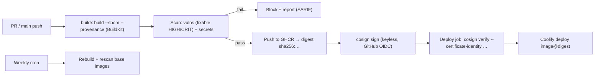

# Docker - Image Scanning, SBOMs & Signing

> [!info] Deep dive of [[Docker]]

> [!abstract] TL;DR
> - **Build** images in CI with **SBOM + provenance attestations** (BuildKit `--sbom --provenance`).
> - **Scan** for vulnerabilities and secrets (Trivy/Grype/Docker Scout). Gate on **fixable HIGH/CRITICAL**, and document accepted risks with expiry (VEX/ignore files).
> - **Sign** with **cosign keyless** (GitHub OIDC), and deploy **by digest** only after `cosign verify` passes.
> - Rebuild weekly to pick up base-image patches.
> - **The scanner is supply chain too**: in March 2026 attackers hijacked Trivy's release and almost all `trivy-action` tags to steal CI secrets. Pin actions to commit SHAs, verify tool checksums, and keep secrets out of scan jobs.

## Concept
| Artifact / tool | What it is | Use |
|---|---|---|
| **SBOM** (SPDX / CycloneDX) | Inventory of packages in the image | Know what's affected when the next CVE drops |
| **Provenance** (SLSA) | Who built what, from which commit, with which builder | Prove the image came from your CI |
| **Vulnerability scan** | SBOM matched against CVE databases | Gate builds, schedule rebuilds |
| **Secret scan** | Keys/tokens found in layers | Block pushes with leaked credentials |
| **Signature** (cosign/Sigstore) | Cryptographic link: image digest ↔ signer identity | Deploy-time verification |
| **VEX** | "This CVE doesn't affect us because…" statements | Suppress false positives with justification |
| **Digest** (`@sha256:…`) | Immutable image reference | Tags move, digests don't |

**Scanners compared**:

| Tool | Strengths | Notes |
|---|---|---|
| Trivy | Images, filesystems, IaC, secrets, SBOMs | Most popular. 2026 compromise means pin and verify versions |
| Grype (+ Syft for SBOMs) | Fast, SBOM-first workflow | Pair Syft (SBOM) + Grype (scan) |
| Docker Scout | Integrated in Docker CLI/Hub, base-image recommendations | Some features need a Docker subscription |
| GitHub Dependabot / code scanning | Repo-level deps, SARIF upload | Complements image scanning |

## How It Works


## Practical Usage
**Build with attestations** (GitHub Actions; actions pinned by full commit SHA):
```yaml
permissions: { contents: read, packages: write, id-token: write }    # id-token for keyless signing
steps:
  - uses: actions/checkout@<full-commit-sha>                          # v4.x — pin SHAs, not tags
  - uses: docker/setup-buildx-action@<full-commit-sha>
  - uses: docker/login-action@<full-commit-sha>
    with: { registry: ghcr.io, username: "${{ github.actor }}", password: "${{ secrets.GITHUB_TOKEN }}" }
  - id: build
    uses: docker/build-push-action@<full-commit-sha>
    with:
      push: true
      tags: ghcr.io/rarticle/web:${{ github.sha }}
      sbom: true
      provenance: mode=max
```
**Scan without trusting a mutable action** (pinned binary + checksum, no secrets in this job):
```bash
TRIVY_VERSION=0.69.3                                   # a known-good version per the advisory; re-check before upgrading
curl -fsSLO "https://github.com/aquasecurity/trivy/releases/download/v${TRIVY_VERSION}/trivy_${TRIVY_VERSION}_Linux-64bit.tar.gz"
echo "<expected-sha256>  trivy_${TRIVY_VERSION}_Linux-64bit.tar.gz" | sha256sum -c -
tar xzf trivy_*.tar.gz trivy
./trivy image --scanners vuln,secret --severity HIGH,CRITICAL --ignore-unfixed --exit-code 1 \
  --format sarif --output trivy.sarif "ghcr.io/rarticle/web@${DIGEST}"
```
**Sign and verify** (cosign keyless via Sigstore + GitHub OIDC):
```bash
cosign sign --yes "ghcr.io/rarticle/web@${DIGEST}"

cosign verify "ghcr.io/rarticle/web@${DIGEST}" \
  --certificate-identity-regexp '^https://github.com/rarticle/web/\.github/workflows/release\.yml@refs/heads/main$' \
  --certificate-oidc-issuer https://token.actions.githubusercontent.com
```
**Inspect SBOM and provenance**:
```bash
docker buildx imagetools inspect "ghcr.io/rarticle/web@${DIGEST}" --format '{{ json .SBOM }}' | jq '.SPDX.packages | length'
grype "ghcr.io/rarticle/web@${DIGEST}" --only-fixed --fail-on high
```
**Accepted risk with expiry** (`.trivyignore.yaml`):
```yaml
vulnerabilities:
  - id: CVE-2026-12345
    paths: ["usr/lib/libfoo.so"]
    statement: "Not reachable: library unused by app; base image fix pending"
    expired_at: 2026-12-31
```
**Wrong way**:
```text
❌ uses: aquasecurity/trivy-action@master (or @0.34.0)   → mutable ref; March 2026 tags pointed at credential stealers
❌ Scan job with access to deploy tokens and cloud keys  → a compromised scanner exfiltrates them
❌ Deploying :latest                                      → unknown, unsigned, unscanned image in prod
❌ Ignoring all CVEs "because there are too many"        → real exploitable ones hide in the noise
```

## Patterns & Anti-patterns
| Pattern | When | Anti-pattern to avoid |
|---|---|---|
| Actions pinned to full commit SHAs, updated by Renovate | All workflows | `@v4`, `@master` tags |
| Least-privilege scan job (no deploy secrets, read-only token) | CI | One job with every secret |
| Gate on fixable HIGH/CRITICAL, report the rest | Build pipelines | Failing on every LOW (alert fatigue) or never failing |
| Deploy by digest after signature verification | Production | Tag-based deploys |
| Weekly rebuild + rescan of base images | Long-lived services | Images built once and run for a year |
| Minimal base images (distroless/alpine/slim) | Runtime images | Full OS images with compilers |
| SBOM stored with each release | Incident response | "Are we affected?" guesswork |

## Performance & Trade-offs
- **Scan time**: Trivy/Grype take seconds to a minute per image (DB download dominates). Cache the vulnerability DB in CI, or run a scheduled DB update.
- **Noise**: OS packages produce many CVEs without fixes. `--ignore-unfixed` plus VEX keeps gates actionable. Revisit ignores on expiry.
- **Keyless signing** depends on Sigstore's public infrastructure (Fulcio/Rekor) at sign and verify time. Key-based signing avoids that dependency but makes you manage keys.
- **Verification without an admission controller**: Coolify won't verify signatures itself, so verify in the CI deploy job before calling Coolify's deploy API, and deploy only pre-built images ([[CI-CD - Deploy Pipelines for Coolify & Flutter Releases]]).

## Tips & Reminders
> [!tip] In ZP's stack
> - **Pipeline per app**: buildx with SBOM/provenance → GHCR → Trivy (pinned, checksum-verified) → cosign keyless → `cosign verify` in the deploy job → Coolify deploys `image@digest`.
> - **Weekly scheduled rebuild** of Next.js/n8n custom images to pick up `node:22-alpine` patches. Renovate bumps base images and pinned action SHAs.
> - **Client reporting**: attach the release SBOM and scan summary to monthly maintenance reports. It's tangible proof of security work for retainers.

- Scan third-party images you run (n8n, Chatwoot, Metabase) too, and subscribe to their security advisories.
- Use `--scanners secret` on images and `gitleaks` on repos. Secrets in layers persist even if deleted later ([[Docker - Dockerfile & Image Best Practices]]).
- Keep `id-token: write` only on jobs that sign. Other jobs get `contents: read` ([[CI-CD - GitHub Actions Security Hardening]]).
- After any CI tool compromise, rotate every secret the affected workflows could read ([[CI-CD - Secrets Management with SOPS & Infisical]]).

## Version Notes
| Date / version | Change |
|---|---|
| BuildKit / buildx 0.11+ (2023) | `--sbom` and `--provenance` attestations attached to images |
| Sigstore cosign 2.x | Keyless signing default with OIDC identities |
| 2026-02-28 | Earlier compromise of Trivy repository automation (reported "hackerbot-claw") |
| 2026-03-19 | **Trivy supply chain attack** (CVE-2026-33634): malicious v0.69.4, `trivy-action` tags (≤ 0.34.2) and `setup-trivy` tags rewritten to steal CI secrets. Safe: trivy v0.69.2/0.69.3, trivy-action 0.35.0 (per advisories) |
| 2026-08 | Vendor advisories updated (additional unrotated secret found) |

> [!warning] Unverified — check before relying on this
> Exact affected/safe version lists differ slightly between advisories (tag counts, `setup-trivy` versions). Current Trivy releases and cosign v3 changes weren't checked. Re-read the official advisory (GHSA/CVE-2026-33634) before choosing versions.

## Critical Issues & Gotchas
> [!danger] Security tooling as the attack vector (Trivy, March 2026)
> Attackers used leftover credentials from an earlier breach to publish a malicious Trivy release and repoint nearly all `trivy-action`/`setup-trivy` tags to credential-stealing code. Every pipeline using those tags leaked whatever secrets the job could access. Lessons:
> - pin actions by SHA;
> - verify binaries;
> - isolate scan jobs from secrets;
> - rotate everything on exposure;
> - treat "the security scanner" with the same suspicion as any dependency.

> [!danger] Unsigned, tag-based deployments
> If production pulls `:latest` or a mutable tag, a registry compromise, a leaked push token or a mistaken push changes what runs without any code review. Deploy immutable digests that you've verified were signed by your release workflow identity.

- **Scanner DB staleness** in air-gapped/cached setups misses new CVEs. Update the DB at least daily.
- **False confidence**: a clean scan only covers known CVEs in detected packages. Vendored binaries and app-level logic bugs aren't covered.
- **SBOM accuracy**: multi-stage builds must attest the final image, not the builder stage. Verify that SBOM package counts look plausible.
- **GHCR visibility**: public packages expose your images (and anything accidentally baked in). Keep client images private.

## Related
- [[Docker]]
- [[Docker - Dockerfile & Image Best Practices]] — minimal images, secret mounts, BuildKit
- [[CI-CD - GitHub Actions Security Hardening]] — SHA pinning, permissions, OIDC
- [[Node.js - Supply Chain Security & Dependency Hygiene]] — dependency-level supply chain
- [[CI-CD - Secrets Management with SOPS & Infisical]] — rotation after CI compromises
- [[Coolify - Operations, Backups & Hardening]] — deploying verified images

## References
- https://infra.apache.org/blog/trivy_security_incident.html
- https://www.wiz.io/blog/trivy-compromised-teampcp-supply-chain-attack
- https://trust.barracuda.com/security/information/trivy-supply-chain-compromise
- https://docs.docker.com/build/metadata/attestations/
- https://docs.sigstore.dev/cosign/signing/signing_with_containers/
