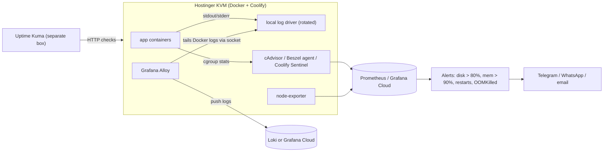

# Docker - Logging, Metrics & Resource Limits on a VPS

> [!info] Deep dive of [[Docker]]

> [!abstract] TL;DR
> On a single 4–16 GB VPS, three settings prevent most container outages: the **`local` log driver with rotation** set globally, **memory limits on every container** (total ≤ ~80% of RAM, with runtimes told their limit), and **alerts** on disk, memory, restarts and OOM kills.
> - Start small: Uptime Kuma (uptime) plus Beszel/Netdata or Coolify metrics (host and containers).
> - Add Prometheus + cAdvisor + Loki + **Grafana Alloy** only when you need queries and retention. **Promtail is EOL (2026-03-02)**.
> - Or ship logs and metrics to Grafana Cloud's free tier to keep RAM on the box for apps.

## Concept
| Log driver | Stored | Rotation | `docker logs` works | Pick it when… |
|---|---|---|---|---|
| `json-file` (default) | Plain JSON per container | **None by default** | ✅ | Legacy default. Always add `max-size`/`max-file` |
| **`local`** | Compressed, efficient format | Default 20 MB × 5, compressed | ✅ | Default choice on a VPS |
| `journald` | systemd journal | journald limits (`SystemMaxUse`) | ✅ | You already centralize via journald |
| `syslog` / `gelf` / `fluentd` / Loki plugin | Remote | Remote side | ❌ (dual logging cache only) | Avoid on small boxes: delivery failures can block or drop logs |

**Resource controls (cgroup v2)**:

| Compose key | cgroup effect | Use |
|---|---|---|
| `deploy.resources.limits.memory` | `memory.max`: hard cap, OOM-kill inside the container | Every service |
| `deploy.resources.reservations.memory` | `memory.low`: soft protection under pressure | Postgres, Redis |
| `memswap_limit` = memory limit | No swap for the container | Latency-sensitive services |
| `deploy.resources.limits.cpus` | CFS quota (e.g. `1.5` cores) | Build-heavy or batch services |
| `cpu_shares` | Relative weight under contention | Prioritize web over workers |
| `pids_limit` | Max processes/threads | Fork bombs, runaway workers |
| `oom_score_adj` | Kernel OOM victim preference (host-level OOM) | Make workers die before Postgres |

## How It Works


## Practical Usage
**Global defaults** (`/etc/docker/daemon.json`, restart Docker; applies to new containers):
```json
{
  "log-driver": "local",
  "log-opts": { "max-size": "20m", "max-file": "5" },
  "live-restore": true
}
```
**Per-service limits sized to the runtime** (Compose):
```yaml
services:
  web:
    image: ghcr.io/acme/shop:${SHA}
    environment:
      NODE_OPTIONS: "--max-old-space-size=576"      # ≈ 75% of the container limit
    deploy: { resources: { limits: { cpus: "1.5", memory: 768m } } }
    pids_limit: 512
  worker:
    image: ghcr.io/acme/shop-worker:${SHA}
    deploy: { resources: { limits: { cpus: "1.0", memory: 512m } } }
    oom_score_adj: 500                               # sacrificed first under host pressure
  postgres:
    image: postgres:18
    command: ["postgres", "-c", "shared_buffers=512MB", "-c", "effective_cache_size=1536MB", "-c", "work_mem=8MB"]
    deploy: { resources: { limits: { memory: 2g }, reservations: { memory: 1g } } }
    oom_score_adj: -500
    shm_size: 256m
```
**Find and confirm OOM kills / hogs**:
```bash
docker stats --no-stream --format "table {{.Name}}\t{{.MemUsage}}\t{{.CPUPerc}}\t{{.PIDs}}"
docker inspect -f '{{.Name}} oom={{.State.OOMKilled}} restarts={{.RestartCount}}' $(docker ps -aq)
docker events --filter event=oom --since 24h
journalctl -k --since "1 day ago" | grep -i -E "oom|killed process"
docker system df -v | head -40        # images, build cache, volumes eating disk
```
**Logs to Loki with Grafana Alloy** (replaces Promtail; `config.alloy`):
```hcl
discovery.docker "containers" {
  host = "unix:///var/run/docker.sock"
}

discovery.relabel "containers" {
  targets = []
  rule {
    source_labels = ["__meta_docker_container_name"]
    regex         = "/(.*)"
    target_label  = "container"
  }
}

loki.source.docker "all" {
  host          = "unix:///var/run/docker.sock"
  targets       = discovery.docker.containers.targets
  relabel_rules = discovery.relabel.containers.rules
  forward_to    = [loki.write.default.receiver]
}

loki.write "default" {
  endpoint {
    url = "http://loki:3100/loki/api/v1/push"     // or Grafana Cloud URL + basic_auth
  }
}
```
Migrating an existing Promtail config: `alloy convert --source-format=promtail --output=config.alloy promtail.yaml`.

**Cleanup job** (weekly; Coolify also has threshold-based cleanup):
```bash
docker image prune -af --filter "until=168h"
docker builder prune -af --filter "until=168h"
```
**Wrong way**:
```yaml
services:
  api:
    image: api:latest            # ❌ no memory limit: a leak OOM-kills Postgres via the host OOM killer
    logging: { driver: json-file }   # ❌ no rotation: 30 GB log file, disk full, Postgres stops writing WAL
```

## Patterns & Anti-patterns
| Pattern | When | Anti-pattern to avoid |
|---|---|---|
| `local` driver + rotation in `daemon.json` | Every host | Per-service rotation that new services forget |
| Limits on all services, sum ≤ ~80% RAM | Single VPS | Unlimited containers "because it's one box" |
| Runtime told its limit (Node heap, JVM `-XX:MaxRAMPercentage`, Postgres buffers) | Node, Java, Postgres | Heap sized from host RAM → OOM at the cgroup limit |
| Structured JSON logs with request ID, no PII | Apps | Multi-line text logs with phone numbers and tokens |
| External uptime monitoring | Always | Monitoring that lives on the box it monitors |
| Lightweight metrics first (Beszel, Netdata, Coolify) | 1–3 servers | Full Prometheus/Grafana/Loki stack on a 4 GB VPS |
| Alert on symptoms (disk, OOM, restarts, 5xx) | Solo ops | Dashboards nobody watches |

## Performance & Trade-offs
- **Observability RAM budget**:
  - Uptime Kuma: ~100 MB.
  - Beszel agent: ~10–30 MB.
  - Netdata: ~150–300 MB.
  - Prometheus + Grafana + Loki + Alloy + cAdvisor: ~1–1.5 GB.
  
  On an 8 GB KVM, the full stack can cost a client app's worth of memory, so consider Grafana Cloud's free tier or a separate small monitoring VPS.
- **cAdvisor** CPU overhead can reach 2–5% on hosts with many containers. Raise the housekeeping interval (`--housekeeping_interval=30s`) and drop unused metrics.
- **Log volume**: chatty debug logs at 100 lines/s ≈ 1 GB/day. Set `LOG_LEVEL=info` in production, and sample access logs at Traefik ([[Traefik - Observability & Troubleshooting]]).
- **CPU limits** throttle via CFS quota, so latency spikes appear as throttling, not 100% CPU. Watch `container_cpu_cfs_throttled_periods_total` if you set tight `cpus`.
- **Swap**: a little host swap (1–2 GB) prevents abrupt host OOM, but containers swapping heavily become slow instead of failing. Prefer limits that fail fast.

## Tips & Reminders
> [!tip] In ZP's stack
> - **Baseline per client VPS**:
>   - `daemon.json` with the `local` driver;
>   - limits on every Coolify resource;
>   - Uptime Kuma on a separate tiny VPS or Cloudflare Worker cron checking `/api/health`;
>   - Coolify server metrics or Beszel for CPU/RAM/disk;
>   - alerts to Telegram.
> - **Central logs** for multiple clients: Alloy on each VPS → one Loki (or Grafana Cloud) with a `client` label. Keep client data segregated per contract.
> - **Sizing for an 8 GB KVM**: Postgres 2 GB, Redis 512 MB (`maxmemory` set), n8n main 1 GB, 2 workers × 768 MB, Next.js 768 MB, Traefik + Coolify ~1 GB, leaving headroom.

- Postgres in containers needs `shm_size` (default 64 MB breaks parallel queries) and a memory limit above `shared_buffers` + `work_mem` × connections.
- Redis with a container memory limit must also set `maxmemory` below it, or Redis is OOM-killed instead of evicting/erroring.
- After an OOM, check what grew: `docker stats` history in Beszel/Grafana, then heap snapshots for Node ([[Node.js - Performance & Diagnostics]]).
- Don't log secrets, OTPs or IC numbers. Log retention is PDPA retention too.

## Version Notes
| Version / date | Change |
|---|---|
| Docker 18.09+ | `local` log driver |
| Docker 20.10 | cgroup v2 support. Dual logging (`docker logs` with remote drivers) |
| Compose v2 | `deploy.resources` honoured without Swarm |
| 2026-03-02 | Promtail EOL. Grafana Alloy is the supported collector (`alloy convert` for configs) |
| Docker Engine 29 (2025–26) | cgroup v2 assumed on modern distros. nftables backend experimental ([[Docker]]) |

> [!warning] Unverified — check before relying on this
> RAM figures for monitoring tools are typical community numbers, not vendor specs. Grafana Cloud free-tier limits and the Loki Helm chart move (2026-03-16, third-party blog) weren't verified. Check https://grafana.com/pricing/ and https://grafana.com/docs/alloy/latest/.

## Critical Issues & Gotchas
> [!danger] Disk full takes the whole server down
> Logs, images, build cache and Postgres WAL share one disk on a VPS. At 100%, Postgres stops (possibly needing manual recovery), Docker can't start containers, and Coolify can't deploy. Rotate logs, prune weekly, alert at 80%, and keep 15–20% free.

> [!danger] Mounting the Docker socket into monitoring agents
> Alloy, cAdvisor, Beszel and Portainer-like tools often mount `/var/run/docker.sock`, which is root-equivalent on the host. Mount it read-only where supported, use a socket proxy (`tecnativa/docker-socket-proxy`) with only `CONTAINERS=1`, keep these UIs off the internet (Cloudflare Access/Tailscale), and patch them ([[Coolify - Operations, Backups & Hardening]]).

- **Restart loops hide OOMs**: `restart: unless-stopped` makes a container that's OOM-killed every 10 minutes look "up". Alert on `RestartCount` growth.
- **`docker logs` on huge files** is slow and memory-hungry. Use `--since 10m --tail 200`.
- **Changing `daemon.json` log settings** doesn't affect existing containers. Recreate them (redeploy in Coolify).
- **Node 20+ cgroup awareness** helps, but explicit `--max-old-space-size` is still the reliable way to keep the heap below the limit.

## Related
- [[Docker]]
- [[Docker - Compose Patterns for Production]] — healthchecks, restart policies, service limits
- [[Linux Essentials - systemd, Logs & Troubleshooting]] — journald, disk and OOM triage on the host
- [[Traefik - Observability & Troubleshooting]] — access logs and metrics at the proxy
- [[Coolify - Operations, Backups & Hardening]] — Coolify metrics, cleanup and alerts
- [[Node.js - Performance & Diagnostics]] — heap sizing and leak hunting

## References
- https://docs.docker.com/engine/logging/drivers/local/
- https://docs.docker.com/engine/containers/resource_constraints/
- https://grafana.com/docs/loki/latest/send-data/promtail/
- https://grafana.com/docs/alloy/latest/reference/components/loki/loki.source.docker/
- https://github.com/google/cadvisor
- https://community.grafana.com/t/promtail-is-now-end-of-life-eol-how-to-migrate-to-grafana-alloy-for-existing-loki-server-deployments/162087/4
