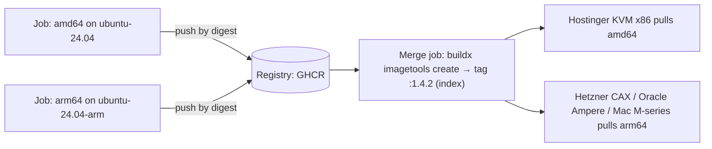

# Docker - Multi-Architecture Builds for ARM & x86

> [!info] Deep dive of [[Docker]]

> [!abstract] TL;DR
> One tag, many architectures: a **manifest list / OCI image index** points to per-platform images (`linux/amd64`, `linux/arm64`), and the daemon pulls the matching one.
> - Build with **Buildx** (`docker buildx build --platform linux/amd64,linux/arm64 --push`).
> - Prefer **native runners per platform** (e.g. GitHub `ubuntu-24.04` + `ubuntu-24.04-arm`) merged into one manifest, over **QEMU emulation**, which is often 5–30× slower for compile-heavy builds.
> - Use **cross-compilation** (`BUILDPLATFORM`/`TARGETARCH`) where the toolchain supports it (Go, Rust, Dart AOT via native runners, Node without native addons).
>
> Why it matters: Apple Silicon laptops (arm64) building images for x86 VPSs (Hostinger KVM) is the classic `exec format error`.

## Concept
| Term | Meaning |
|---|---|
| Platform | `os/arch[/variant]`: `linux/amd64`, `linux/arm64`, `linux/arm/v7` |
| Manifest list / OCI index | One tag → list of per-platform image manifests |
| Buildx / BuildKit | Builder supporting multi-platform, cache export, attestations |
| `docker-container` driver | Buildx builder that can produce multi-platform output (the classic `docker` driver can't without the containerd image store) |
| QEMU / binfmt | Kernel emulation to run foreign-arch build steps |
| Build args | `BUILDPLATFORM` (where it runs), `TARGETPLATFORM`/`TARGETOS`/`TARGETARCH` (what it targets) |

**Strategy comparison**:

| Strategy | Speed | Complexity | Pick it when… |
|---|---|---|---|
| QEMU emulation, single job | Slow (native code compile very slow) | Lowest | Small images, interpreted apps, rare builds |
| Cross-compile in Dockerfile | Fast | Medium (toolchain support) | Go/Rust/static binaries |
| Native runner per arch + manifest merge | Fast | Medium (matrix + merge job) | Node native addons, Python wheels, frequent builds |
| Single arch only | Fastest | None | All servers are x86 and devs build on x86/CI |

## How It Works


## Practical Usage
**Local multi-arch build and push**:
```bash
docker buildx create --name multi --driver docker-container --use
docker buildx build --platform linux/amd64,linux/arm64 \
  -t ghcr.io/rarticle/api:1.4.2 --push .
docker buildx imagetools inspect ghcr.io/rarticle/api:1.4.2     # verify both platforms exist
```
**Cross-compile pattern** (Go: build on the runner's native arch, emit target binary):
```dockerfile
# syntax=docker/dockerfile:1
FROM --platform=$BUILDPLATFORM golang:1.25 AS build
ARG TARGETOS TARGETARCH
WORKDIR /src
COPY . .
RUN CGO_ENABLED=0 GOOS=$TARGETOS GOARCH=$TARGETARCH go build -ldflags="-s -w" -o /out/app ./cmd/app

FROM gcr.io/distroless/static-debian12
COPY --from=build /out/app /app
ENTRYPOINT ["/app"]
```
**Node app with native deps**: the build stage must run on the target arch (native runner or QEMU), since `npm ci` compiles/downloads arch-specific binaries (`sharp`, `bcrypt`, Prisma engines).
```dockerfile
FROM node:22-bookworm-slim AS deps        # no --platform=$BUILDPLATFORM here: install for the target arch
WORKDIR /app
COPY package*.json ./
RUN npm ci --omit=dev
```
**GitHub Actions: native runners + manifest merge** (condensed):
```yaml
jobs:
  build:
    strategy:
      matrix:
        include:
          - { platform: linux/amd64, runner: ubuntu-24.04 }
          - { platform: linux/arm64, runner: ubuntu-24.04-arm }
    runs-on: ${{ matrix.runner }}
    steps:
      - uses: actions/checkout@v4
      - uses: docker/setup-buildx-action@v3
      - uses: docker/login-action@v3
        with: { registry: ghcr.io, username: ${{ github.actor }}, password: ${{ secrets.GITHUB_TOKEN }} }
      - id: build
        uses: docker/build-push-action@v6
        with:
          platforms: ${{ matrix.platform }}
          outputs: type=image,name=ghcr.io/${{ github.repository }},push-by-digest=true,name-canonical=true,push=true
          cache-from: type=gha,scope=${{ matrix.platform }}
          cache-to: type=gha,mode=max,scope=${{ matrix.platform }}
      # upload steps.build.outputs.digest as an artifact
  merge:
    needs: build
    runs-on: ubuntu-24.04
    steps:
      # download digests, then:
      - run: docker buildx imagetools create -t ghcr.io/${{ github.repository }}:${{ github.sha }} ghcr.io/${{ github.repository }}@sha256:<amd64> ghcr.io/${{ github.repository }}@sha256:<arm64>
```
**Mac (arm64) dev deploying to x86 VPS, single arch**:
```bash
docker buildx build --platform linux/amd64 -t registry.example.my/app:1.4.2 --push .
```
**Wrong way**:
```text
❌ docker build on M-series Mac → push → x86 VPS        → "exec format error" at container start
❌ FROM --platform=$BUILDPLATFORM for a Node stage with native addons → arm64 image contains x86 binaries
❌ QEMU arm64 build of a large Next.js/Rust app on every PR → 40+ min CI
❌ Retagging by pulling one arch and pushing              → silently drops the other platform from the index
```

## Patterns & Anti-patterns
| Pattern | When | Anti-pattern to avoid |
|---|---|---|
| Build only the platforms you deploy to | Most SME projects (x86 only) | Multi-arch "just in case" doubling CI time |
| Native runners + merge by digest | arm64 servers in the fleet | QEMU for compile-heavy builds |
| `--platform=$BUILDPLATFORM` only in cross-compiling stages | Go/Rust/static assets | Applying it to stages that install native deps |
| Per-platform cache scopes | GHA cache | One shared scope evicting each other |
| `imagetools create` / `crane` for retagging | Promote staging → prod | `docker pull && docker tag && docker push` |
| Verify with `imagetools inspect` in CI | Every release | Assuming both arches published |
| Pin base images by digest of the index | Reproducibility | Per-arch digests pinned in a multi-arch Dockerfile |

## Performance & Trade-offs
- **QEMU**: fine for `COPY` + interpreted apps. `npm ci` with native compilation, `cargo build` or `next build` under emulation can take 5–30× longer, and occasionally hits emulator bugs (segfaults in JIT-heavy steps).
- **ARM servers** (Hetzner CAX, Oracle Ampere, AWS Graviton) are often ~20–40% cheaper per vCPU than x86. That's the main reason to go multi-arch. Hostinger KVM plans are x86, so arm64 images only matter if you add ARM hosts or devs on Apple Silicon run prod images locally.
- **Registry storage** roughly doubles per tag. Clean up untagged digests in GHCR.
- **Attestations**: Buildx adds provenance/SBOM manifests to the index. Some older registries/tools show them as `unknown/unknown` platforms. Harmless, but confusing ([[Docker - Image Scanning, SBOMs & Signing]]).

## Tips & Reminders
> [!tip] In ZP's stack
> - **Default: build `linux/amd64` only** for client apps on Hostinger KVM + Coolify, and set `--platform linux/amd64` explicitly when building on an M-series Mac.
> - **Coolify builds on the server itself** (native x86) when deploying from Git, so arch issues show up mainly with prebuilt images pushed from a laptop ([[Coolify]], [[CI-CD - Deploy Pipelines for Coolify & Flutter Releases]]).
> - **Go multi-arch** only for public images (open-source tools, n8n custom node images used by others) or if you move to ARM VPSs for cost.

- `docker inspect --format '{{.Architecture}}' image` checks what you actually pulled.
- `uname -m` on the server: `x86_64` → amd64, `aarch64` → arm64.
- Third-party images: check `docker buildx imagetools inspect` before relying on arm64. Many niche images are amd64-only.
- Pin actions by SHA in release workflows ([[CI-CD - GitHub Actions Security Hardening]]).

## Version Notes
| Date / version | Change relevant here |
|---|---|
| 2020 | Buildx + BuildKit multi-platform builds |
| 2023 (Docker Desktop 4.x) | containerd image store enables local multi-platform images |
| 2025-01 / GA 2025-08 | GitHub-hosted Linux arm64 runners (`ubuntu-24.04-arm`, `ubuntu-22.04-arm`) free for public repos |
| build-push-action v6 | Build summaries, attestations by default |
| Engine 29.x (2025-11+) | Current at writing; containerd image store the default for new installs ([[Docker]]) |

> [!warning] Unverified — check before relying on this
> Whether standard `ubuntu-24.04-arm` runners are available for **private** repositories on your plan (some sources say larger/paid ARM runners are required), the containerd-store default in Engine 29, and the exact action major versions weren't confirmed against GitHub/Docker docs this run.

## Critical Issues & Gotchas
> [!danger] `exec format error` in production
> An image built on Apple Silicon without `--platform linux/amd64` contains only arm64 binaries. It pushes fine, then every container restart on the x86 VPS fails, often noticed only during a rollout. Set the platform explicitly in build scripts, and add an `imagetools inspect` check in CI.

> [!danger] Retag operations dropping architectures
> `docker pull`, `tag`, `push` copies only the local platform's image, so the "promoted" prod tag silently loses arm64 (or amd64). Use `docker buildx imagetools create -t new:tag old:tag` or `crane copy` to copy the whole index.

- **Mixed-arch binaries**: `--platform=$BUILDPLATFORM` on a stage that runs `npm ci`/`pip install` puts build-host binaries into the target image, which crashes at runtime on the other arch.
- **QEMU not registered**: on self-hosted runners, run `docker run --privileged --rm tonistiigi/binfmt --install all` (or `docker/setup-qemu-action`), or foreign-arch steps fail.
- **Arch-specific downloads** in Dockerfiles (`curl …-linux-amd64.tar.gz`) must use `$TARGETARCH`.
- **GHA cache limits** (10 GB per repo): two arches with `mode=max` evict fast. Use registry cache for large builds.

## Related
- [[Docker]]
- [[Docker - Dockerfile & Image Best Practices]] — multi-stage builds and base images
- [[CI-CD - Deploy Pipelines for Coolify & Flutter Releases]] — where builds run
- [[Docker - Image Scanning, SBOMs & Signing]] — attestations attached to the index
- [[CI-CD - GitHub Actions Security Hardening]] — pinned actions, token scopes
- [[Coolify]] — server-side builds on the target arch

## References
- https://docs.docker.com/build/building/multi-platform/
- https://docs.docker.com/build/ci/github-actions/multi-platform/
- https://depot.dev/blog/multi-platform-docker-images-in-github-actions
- https://sredevopsorg.github.io/multi-arch-docker-github-workflow
- https://oneuptime.com/blog/post/2026-01-06-docker-multi-architecture-images/view
