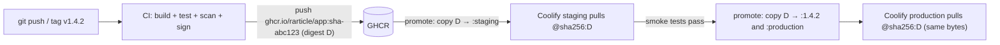

# Docker - Private Registries & Image Promotion

> [!info] Deep dive of [[Docker]]

> [!abstract] TL;DR
> Build once, promote the **same image digest** through environments (staging → production) instead of rebuilding per environment.
> - **Registry choice**:
>   - **GHCR** is the default for GitHub-based projects: integrated auth, cheap/free for small usage, org-level permissions.
>   - **Self-hosted Harbor/Zot** only when you need on-prem, replication, or strict control.
>   - Docker Hub for public images, with **authenticated pulls** to avoid rate limits.
> - **Promotion**: CI builds `app:sha-abc123` → tests → **retag by digest** (`crane copy`/`imagetools create`) to `app:staging` / `app:1.4.2` → deploy servers pull **by digest**.
> - **Hygiene**: immutable release tags, retention policies for old SHAs, pull credentials scoped read-only per server, and scanning + signing in the pipeline ([[Docker - Image Scanning, SBOMs & Signing]]).

## Concept
| Registry | Strengths | Weaknesses | Pick it when… |
|---|---|---|---|
| GHCR (ghcr.io) | GitHub Actions `GITHUB_TOKEN`, org/repo permissions, OCI artifacts | Tied to GitHub, storage/egress billing for private beyond free | Code on GitHub (ZP default) |
| Docker Hub | Public discovery, official images | Pull rate limits, private repo limits per plan | Publishing public images |
| Harbor (self-hosted) | RBAC, replication, scanning, quotas, retention | Ops burden (DB, Redis, storage) | On-prem, many teams, compliance |
| Zot / distribution (self-hosted) | Lightweight OCI registry | Fewer enterprise features | Simple private mirror/cache |
| Cloud registries (ECR/GAR/ACR) | Native to cloud platforms | Cloud lock-in, IAM complexity | Workloads already in that cloud |

**Tag strategy**:

| Tag | Mutable? | Use |
|---|---|---|
| `sha-<gitsha>` | No | Every CI build, traceable to a commit |
| `1.4.2` | No (enforce) | Releases |
| `staging`, `production` | Yes (pointer) | Convenience. Deploy by digest anyway |
| `latest` | Yes | Avoid for deployments |

## How It Works


## Practical Usage
**CI build and push to GHCR** (GitHub Actions):
```yaml
permissions: { contents: read, packages: write, id-token: write }
steps:
  - uses: actions/checkout@<sha>
  - uses: docker/login-action@<sha>
    with: { registry: ghcr.io, username: ${{ github.actor }}, password: ${{ secrets.GITHUB_TOKEN }} }
  - id: build
    uses: docker/build-push-action@<sha>
    with:
      push: true
      tags: ghcr.io/rarticle/app:sha-${{ github.sha }}
      provenance: true
      sbom: true
  - run: echo "digest=${{ steps.build.outputs.digest }}" >> "$GITHUB_OUTPUT"
```
**Promote by digest** (no rebuild, preserves multi-arch index and attestations):
```bash
crane copy ghcr.io/rarticle/app@sha256:<D> ghcr.io/rarticle/app:staging
crane copy ghcr.io/rarticle/app@sha256:<D> ghcr.io/rarticle/app:1.4.2
# or: docker buildx imagetools create -t ghcr.io/rarticle/app:1.4.2 ghcr.io/rarticle/app@sha256:<D>
```
**Deploy by digest** (compose / Coolify image field):
```yaml
services:
  app:
    image: ghcr.io/rarticle/app@sha256:<D>     # exact bytes tested in staging
```
**Read-only pull credentials on servers**:
```bash
# fine-grained PAT or GitHub App token with read:packages only, per server/client
echo "$GHCR_READ_TOKEN" | docker login ghcr.io -u rarticle-deploy --password-stdin
```
**Authenticated Docker Hub pulls** (avoid anonymous rate limits on shared VPS IPs):
```bash
echo "$DOCKERHUB_TOKEN" | docker login -u rarticledeploy --password-stdin   # read-only access token
```
**Pull-through cache** (self-hosted distribution as Docker Hub mirror):
```yaml
# /etc/distribution/config.yml (registry:3)
proxy:
  remoteurl: https://registry-1.docker.io
  username: rarticledeploy
  password: ${DOCKERHUB_TOKEN}
```
```json
{ "registry-mirrors": ["https://mirror.internal.rarticle.my"] }
```
**Retention** (GHCR: delete untagged/old `sha-*` versions on a schedule, e.g. `actions/delete-package-versions` keeping the last N).

**Wrong way**:
```text
❌ Rebuilding the image for production from the same commit → different bytes than what was tested
❌ Deploying :latest                                       → unknown version running, no rollback target
❌ Personal GitHub PAT with write:packages on client servers → server compromise = registry compromise
❌ Anonymous Docker Hub pulls on busy CI/VPS                 → rate-limit failures mid-deploy
```

## Patterns & Anti-patterns
| Pattern | When | Anti-pattern to avoid |
|---|---|---|
| Build once, promote digest | All environments | Per-environment builds |
| Immutable release tags (`1.4.2`) | Releases | Overwriting version tags |
| Read-only deploy tokens per server | Pull access | Shared admin credentials |
| Retention policy for CI tags | Storage costs | Infinite `sha-*` accumulation |
| Scan + sign before promotion | Supply chain | Promoting unscanned images |
| Client-owned registry (or org per client) | Handover | Client images in your personal namespace |
| Pull-through cache for base images | Many servers/CI | Every server hammering Docker Hub |

## Performance & Trade-offs
- **GHCR vs self-hosted**: GHCR costs nothing to operate. Harbor gives full control but needs Postgres, Redis, storage and upgrades. For a solo agency, GHCR (plus a small pull-through cache if needed) wins.
- **Pull speed**: registries far from Malaysian VPSs slow deploys. Caching base images locally or in Singapore helps. Layer reuse matters more than registry location for app images ([[Docker - Dockerfile & Image Best Practices]]).
- **Digest pinning** makes deploys reproducible but requires tooling to update digests (CI output → Coolify API/compose). Tags are convenient but mutable.
- **Storage costs**: multi-arch images double storage. Prune aggressively ([[Docker - Multi-Architecture Builds for ARM & x86]]).

## Tips & Reminders
> [!tip] In ZP's stack
> - **Coolify**: either build on the server from Git (simple, no registry), or build in GitHub Actions → push to GHCR → Coolify deploys the image via webhook/API. The latter gives build-once-promote and offloads CPU from small VPSs ([[CI-CD - Deploy Pipelines for Coolify & Flutter Releases]]).
> - **Per-client namespaces**: `ghcr.io/<client-org>/app` under the client's GitHub org, with you as a member. That keeps handover clean.
> - **Registry credentials in Coolify**: add read-only tokens per server, and rotate when staff/contractors change ([[Coolify - Preview Deployments, Environments & Secrets]]).

- Record the deployed digest in your release notes/changelog for rollback.
- Rollback = redeploy the previous digest (keep at least the last 5 release digests).
- Pin base images by digest in Dockerfiles for reproducible builds.
- Set GHCR package visibility explicitly. Packages default to private when linked to private repos.

## Version Notes
| Date | Change relevant here |
|---|---|
| 2020 | GHCR launched (OCI artifacts, GitHub permissions) |
| 2020-11 | Docker Hub pull rate limits introduced |
| 2025 | Docker Hub changed pull limits/pricing (stricter anonymous limits announced) |
| 2025 | CNCF distribution 3.0 (registry:3) |
| 2025–26 | Attestations (SBOM/provenance) widely attached to images by build-push-action |

> [!warning] Unverified — check before relying on this
> Current Docker Hub pull limits per tier, GHCR storage/egress pricing for private packages, and Harbor/distribution versions weren't verified this run. Check the Docker Hub usage docs and GitHub Packages billing.

## Critical Issues & Gotchas
> [!danger] Registry credentials with write access on servers
> A production VPS holding a token with `write:packages` (or a full PAT) means a server compromise lets attackers push backdoored images that every other server or client then pulls. Use read-only, per-server tokens, push only from CI with short-lived `GITHUB_TOKEN`/OIDC, and sign images so deployers can verify provenance ([[CI-CD - GitHub Actions Security Hardening]]).

> [!danger] Mutable tags cause "works on staging, broken in prod"
> If `:production` or `:1.4.2` is overwritten, servers pulling at different times run different code, and rollbacks restore the wrong image. Deploy by digest, enforce immutable version tags, and keep a record of digests per release.

- **Rate limits during incidents**: emergency redeploys fail if Docker Hub throttles your IP. Authenticate and cache base images.
- **Deleting images still in use** breaks scaling and rollbacks. Retention rules must keep currently deployed digests.
- **Private package visibility** mistakes can make client images public. Audit org package settings.
- **Multi-arch promotion with `docker pull/tag/push`** drops other architectures. Use `crane copy`/`imagetools` ([[Docker - Multi-Architecture Builds for ARM & x86]]).

## Related
- [[Docker]]
- [[Docker - Image Scanning, SBOMs & Signing]] — scan and sign before promotion
- [[Docker - Multi-Architecture Builds for ARM & x86]] — multi-arch indexes and copying
- [[CI-CD - Deploy Pipelines for Coolify & Flutter Releases]] — pipelines that push and deploy
- [[CI-CD - GitHub Actions Security Hardening]] — token scopes and pinned actions
- [[Coolify - Preview Deployments, Environments & Secrets]] — registry credentials in Coolify

## References
- https://docs.github.com/en/packages/working-with-a-github-packages-registry/working-with-the-container-registry
- https://docs.docker.com/docker-hub/usage/
- https://github.com/google/go-containerregistry/blob/main/cmd/crane/doc/crane_copy.md
- https://goharbor.io/docs/
- https://distribution.github.io/distribution/recipes/mirror/
