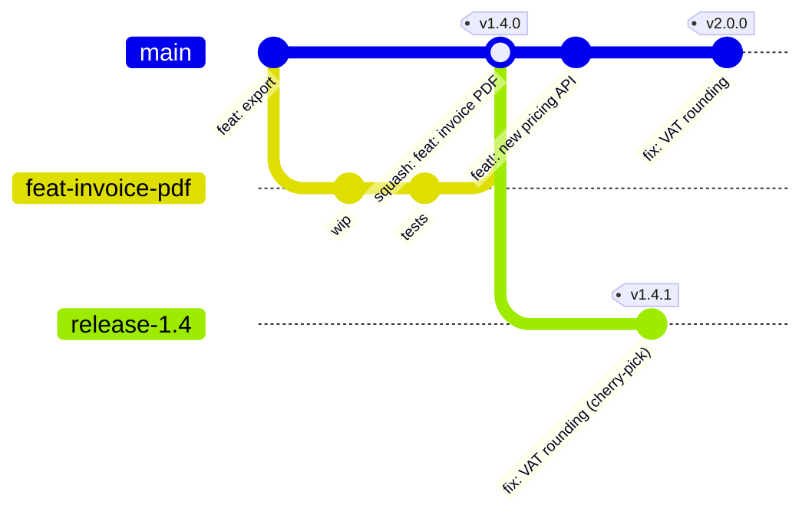

# Git - Branching, Releases & Recovery

> [!info] Deep dive of [[Git]]

> [!abstract] TL;DR
> - **Branching for a solo founder or small team**: trunk-based. Protect `main`, use short-lived branches with PRs and **squash merge**, and always deploy from `main`.
> - **Releases**: `vX.Y.Z` tags driven by **Conventional Commits** and automated with release-please or changesets. Build the image once per commit SHA and deploy by tag.
> - **Hotfixes**: cherry-pick into a `release/x.y` branch only when you must patch an older version.
> - **Recovery**: almost anything is recoverable with **`git reflog`** within ~90 days locally. Pushed mistakes get `git revert`, never a force-push on shared branches.
> - **Secrets in history**: **rotate first**, then rewrite history.

## Concept

### Branching strategies
| Strategy | Shape | Pick it when… | Cost |
|---|---|---|---|
| **Trunk-based** (+ short-lived branches) | `main` always deployable. Branches live hours–2 days | Continuous deploy web apps/APIs (ZP default) | Needs CI + feature flags for unfinished work |
| GitHub flow | Same as trunk-based, branch → PR → merge → deploy | Small teams on GitHub | Same as trunk-based |
| Release branches | `main` + `release/1.4` for patching shipped versions | Mobile apps (store review lag), on-prem client installs, SDKs | Backporting effort |
| GitFlow (`develop`, `release/*`, `hotfix/*`) | Long-lived parallel branches | Rarely justified today. Boxed software with scheduled releases | Merge pain, slow feedback, drift |

### Merge methods on PRs
| Method | History | Pick it when… |
|---|---|---|
| **Squash merge** | One commit per PR on `main` | Default: clean history, easy revert of a whole feature |
| Rebase merge | PR commits replayed linearly | Well-crafted atomic commits worth keeping |
| Merge commit | Preserves branch topology | Long-running branches, release-branch merges |

### Versioning
- **SemVer** `MAJOR.MINOR.PATCH`: breaking, then feature, then fix. Apps can use SemVer or CalVer (`2026.10.1`). Pick one and automate it.
- **Conventional Commits** (`feat:`, `fix:`, `feat!:` / `BREAKING CHANGE:`) let tools compute the next version and the changelog.

## How It Works

- **Reflog** records every movement of `HEAD` and branch tips locally (default expiry 90 days for reachable entries, 30 days for unreachable). "Lost" commits stay in the object store until garbage collection.
- **Tags**: annotated tags (`git tag -a`) store tagger, date and message, and can be signed. Lightweight tags are just pointers. Release tooling should use annotated, ideally signed, tags.

## Practical Usage

### Branch protection baseline (GitHub rulesets)
- Protect `main`:
  - require a PR, ≥1 approval for team repos (self-review checklist for solo), passing status checks and linear history
  - block force-push and deletion
  - require signed commits on client repos where feasible
- Add **CODEOWNERS** for `.github/`, `supabase/migrations/` and infra files ([[CI-CD - GitHub Actions Security Hardening]]).

### Signed commits with SSH keys
```bash
git config --global gpg.format ssh
git config --global user.signingkey ~/.ssh/id_ed25519.pub
git config --global commit.gpgsign true
git config --global tag.gpgSign true
# Add the same public key on GitHub as a "Signing key"
```

### Automated releases (release-please)
```yaml
# .github/workflows/release.yml
on: { push: { branches: [main] } }
permissions: { contents: write, pull-requests: write }
jobs:
  release:
    runs-on: ubuntu-24.04
    steps:
      - uses: googleapis/release-please-action@<sha>   # opens/updates a "Release PR" with version bump + CHANGELOG
        with: { release-type: node }
```
- Merging the Release PR creates tag `v1.5.0` and a GitHub Release. The deploy workflow promotes the already-built image for that commit SHA ([[CI-CD]]).

### Hotfix on an older release
```bash
git switch -c release/1.4 v1.4.0           # once, when you first need to patch 1.4
git cherry-pick -x <fix-sha-from-main>     # -x records the origin commit in the message
git tag -a v1.4.1 -m "fix: VAT rounding" && git push origin release/1.4 v1.4.1
```
- Always land the fix on `main` first, then backport. Otherwise the next release regresses.

### Recovery cookbook
| Situation | Command |
|---|---|
| Undo last commit, keep changes staged | `git reset --soft HEAD~1` |
| Discard local changes to a file | `git restore path/to/file` |
| Recover after bad `reset --hard` / rebase | `git reflog` → `git switch -c rescue <sha>` (or `git reset --hard <sha>`) |
| Deleted a branch | `git reflog` (or `git fsck --lost-found`) → `git branch <name> <sha>` |
| Lost a dropped stash | `git fsck --no-reflog \| grep "dangling commit"` → `git stash apply <sha>` |
| Undo a pushed commit on shared branch | `git revert <sha>` (new commit, history intact) |
| Undo a pushed merge commit | `git revert -m 1 <merge-sha>` (re-merging later needs reverting the revert) |
| Committed to `main` instead of a branch (not pushed) | `git switch -c feat/x && git switch main && git reset --hard origin/main` |
| Rewrote your own pushed feature branch | `git push --force-with-lease` (refuses if someone else pushed) |
| Find the commit that broke something | `git bisect start; git bisect bad; git bisect good v1.3.0; git bisect run npm test` |
| Repeated identical conflicts during long rebases | `git config --global rerere.enabled true` |

### Removing a leaked secret
```bash
# 1. ROTATE the secret at the provider first (assume it's already scraped; bots scan GitHub in minutes)
# 2. Rewrite history
pipx run git-filter-repo --replace-text <(echo 'sk_live_51H...==>REDACTED')    # or --path .env --invert-paths
git push --force --all && git push --force --tags
# 3. Ask collaborators to re-clone; GitHub may still serve old commits via PR refs/forks → contact support for cached views
```

## Patterns & Anti-patterns
| Pattern | When | Anti-pattern to avoid |
|---|---|---|
| Short-lived branches + feature flags | Continuous delivery | Month-long feature branches with painful merges |
| Squash merge + Conventional Commit PR titles | GitHub repos | 40 "wip"/"fix typo" commits on `main` |
| Build once per SHA, promote by tag | Docker/Coolify deploys | Rebuilding from a tag at deploy time (non-reproducible) |
| `git revert` on shared branches | Undoing pushed work | `reset --hard` + force-push on `main` |
| `--force-with-lease` on own branches | After rebasing | Plain `--force` (silently overwrites teammates' pushes) |
| Release branches only when you support old versions | Mobile/SDK/on-prem | GitFlow ceremony for a single web app |
| `.gitignore` + pre-commit secret scanning (gitleaks) + push protection | Always | Relying on "I'll be careful" |

## Performance & Trade-offs
- **Squash merge** loses intermediate commits (bisect granularity inside a PR). Keep PRs small so one squash is one logical change.
- **Linear history** makes logs and bisect easier, but requires rebasing branches before merge. Automate it with "Update branch" or a merge queue on busy repos.
- **Release branches** add backport work per fix. Keep at most 1–2 supported versions, and say so in client contracts.
- **Large repos/binaries**: use Git LFS for design assets, and partial clone (`--filter=blob:none`) for big monorepos. Don't commit build outputs or `.env` files.

## Tips & Reminders
> [!tip]
> - **Aliases** worth having: `git config --global alias.lg "log --oneline --graph --decorate -20"`, plus `pull.rebase=true`, `push.autoSetupRemote=true` and `fetch.prune=true`.
> - **Tag what's deployed**: the deploy pipeline should record `v1.5.0 = <sha> = image digest` in release notes. That gives you instant rollback targets.
> - **Client handover**: transfer repo ownership, or add the client as org owner. Document branch rules, release process and secret locations in `HANDOVER.md`.
> - **In ZP's stack**:
>   - **Flow**: trunk-based on GitHub with squash merges, release-please for versioning, GHCR images tagged by SHA and version, and Coolify deploying `main` to staging automatically and tags to production.
>   - **Flutter apps**: add `release/x.y` branches only when a store build needs a hotfix while `main` has moved on.

## Version Notes
| Version | Change |
|---|---|
| 2.23 (2019) | `git switch` / `git restore` split from `checkout` |
| 2.34 (2021) | SSH commit/tag signing (`gpg.format ssh`) |
| 2.38 (2022) | `git rebase --update-refs` for stacked branches |
| 2.45 (2024) | reftable ref backend available |
| 2.52 (2025-11) | Announces 3.0 defaults (`main` as initial branch) |
| 2.55 (2026-06) | Current 2.x line, more breaking-change preparation |
| **3.0** | Unreleased, no official date. `main` default, SHA-256 default for new repos, reftable default, removal of deprecated options ([[Git]]) |

> [!warning] Unverified — check before relying on this
> Third-party articles claim Rust becomes a required build dependency in Git 3.0, and some overstate SHA-256 as already default. Check `git-scm.com/docs/BreakingChanges` for the authoritative list.

## Critical Issues & Gotchas
> [!danger] Force-pushing shared history
> `git push --force` on `main` or a shared branch silently discards teammates' commits and breaks every clone, CI cache and open PR based on it. Recovery requires someone's reflog. Block force-push via rulesets, use `--force-with-lease` only on your own branches, and fix shared mistakes with `revert`.

> [!danger] Secrets live forever in history (and forks)
> Deleting a committed `.env` in a new commit doesn't remove it. It's in every clone, fork, CI cache and GitHub's PR refs. Automated scanners harvest leaked keys within minutes. **Rotate immediately**, then rewrite with `git filter-repo`, and enable secret scanning + push protection to prevent recurrence.

> [!warning] Gotchas
> - `git reset --hard` discards **uncommitted** work irrecoverably. The reflog only covers committed states. Commit or `stash` first.
> - Reverting a merge then merging the branch again doesn't bring the changes back. Revert the revert first.
> - Rebasing a branch others pulled forces them to reset. Coordinate, or merge instead.
> - Tags are not pushed by default (`git push --follow-tags` or `--tags`), and moving a tag after release breaks reproducibility. Never re-tag a published version.
> - SHA-256 repos (Git 3.0 default) can't push to SHA-1 remotes. Check hosting support before switching.

## Related
- [[Git]]
- [[Git - Monorepo Workflows with pnpm & Turborepo]] — repo structure and affected-only CI for multi-app products
- [[CI-CD]] — build once, promote by tag
- [[CI-CD - GitHub Actions Security Hardening]] — protected branches, CODEOWNERS, release workflows
- [[Coolify]] — deploying branches/tags
- [[Docker]] — image tags and digests per release
- [[Network Security]] — secret handling and rotation

## References
- Git BreakingChanges (3.0 plan): https://git-scm.com/docs/BreakingChanges
- Pro Git book (reset, reflog, rewriting history): https://git-scm.com/book/en/v2
- Trunk-based development: https://trunkbaseddevelopment.com/
- Conventional Commits: https://www.conventionalcommits.org/
- release-please: https://github.com/googleapis/release-please
- git-filter-repo: https://github.com/newren/git-filter-repo
