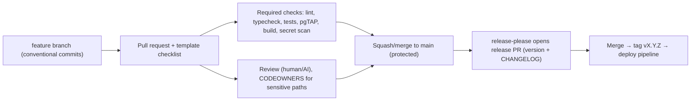

# Git - Code Review, PR Templates & Conventional Commits

> [!info] Deep dive of [[Git]]

> [!abstract] TL;DR
> Even as a solo developer or a tiny team, a **lightweight review process** prevents the most expensive mistakes (leaked secrets, missing RLS, destructive migrations) and produces a usable history for clients.
> - **Pull requests for every change to `main`** with a **PR template** checklist (tests, migrations, security, screenshots).
> - **Branch protection/rulesets**: required CI checks, no force-push, linear history if preferred.
> - **Conventional Commits** (`feat:`, `fix:`, `chore:`…) enable **automated changelogs and versioning** (release-please/semantic-release). Client-facing release notes come for free.
> - **Review focus by risk**: security/data (RLS, auth, migrations, payments) > correctness > maintainability > style. Let linters/formatters handle style.
> - **AI-assisted review** is a useful second pass, not a substitute for testing and judgment.

## Concept
| Element | Purpose | Tooling |
|---|---|---|
| PR template | Consistent checklist and context | `.github/pull_request_template.md` |
| Branch protection / rulesets | Enforce CI + review before merge | GitHub rulesets |
| CODEOWNERS | Route reviews for sensitive paths | `.github/CODEOWNERS` |
| Conventional Commits | Machine-readable history | commitlint + Husky/lefthook |
| Automated releases | Version bumps + changelog | release-please, semantic-release, changesets (monorepo) |
| Required checks | Tests, typecheck, lint, migrations, security scans | GitHub Actions |
| Review comments | Knowledge sharing, catching defects | Conventional Comments (`nit:`, `blocking:`) |

**Commit types**:

| Type | Version bump | Example |
|---|---|---|
| `feat:` | minor | `feat(booking): add outlet selection` |
| `fix:` | patch | `fix(auth): refresh token on resume` |
| `feat!:` / `BREAKING CHANGE:` | major | `feat(api)!: rename /v1/leads fields` |
| `chore:`, `docs:`, `refactor:`, `test:`, `ci:` | none | `ci: pin actions by sha` |

## How It Works


## Practical Usage
**PR template** (`.github/pull_request_template.md`):
```markdown
## What & why
<!-- Short summary, link to ticket/client request -->

## Changes
- 

## Risk checklist
- [ ] DB migrations are backward-compatible (expand → contract) and reviewed for DROP/locks
- [ ] RLS/authorization covered (new tables have policies + pgTAP tests)
- [ ] No secrets/keys in code or client bundles
- [ ] Payments/webhooks idempotent; error paths fail closed
- [ ] Feature flag / kill switch for risky changes

## Testing
- [ ] Unit/integration tests added or updated
- [ ] Manually tested on: web / Android / iOS
- Screenshots / recordings:

## Deployment notes
<!-- env vars, data backfill, manual steps, rollback plan -->
```
**commitlint + hook**:
```bash
npm i -D @commitlint/cli @commitlint/config-conventional lefthook
echo "export default { extends: ['@commitlint/config-conventional'] };" > commitlint.config.mjs
```
```yaml
# lefthook.yml
commit-msg:
  commands:
    commitlint:
      run: npx commitlint --edit {1}
pre-commit:
  commands:
    lint:
      run: npx eslint --cache {staged_files}
      glob: "*.{ts,tsx}"
```
**CODEOWNERS for sensitive paths**:
```text
/supabase/migrations/   @rarticle/db-reviewers
/app/api/webhooks/      @rarticle/security
/.github/workflows/     @rarticle/maintainers
```
**release-please** (GitHub Actions):
```yaml
on: { push: { branches: [main] } }
permissions: { contents: write, pull-requests: write }
jobs:
  release:
    runs-on: ubuntu-latest
    steps:
      - uses: googleapis/release-please-action@<sha>
        with: { release-type: node }
```
**Review comment conventions**:
```text
blocking: this policy allows any authenticated user to read all tenants' orders
suggestion: extract the phone normalization into lib/phone.ts (used in 3 places)
nit: prefer const here
question: what happens if the webhook arrives twice?
```
**Wrong way**:
```text
❌ Pushing directly to main on client projects          → no CI gate, no record of why changes happened
❌ 2,000-line PRs mixing refactor + feature + migration  → reviews become rubber stamps
❌ Commit messages "fix", "update", "wip"               → useless history and changelogs
❌ Debating formatting in reviews                        → wasted time; automate with Prettier/ESLint
```

## Patterns & Anti-patterns
| Pattern | When | Anti-pattern to avoid |
|---|---|---|
| Small PRs (< ~400 lines changed) | Always | Mega PRs |
| Risk-based checklist in template | Client work | Generic "LGTM" |
| Required CI checks before merge | Protected branches | Optional CI |
| Self-review: read your own diff after a break | Solo dev | Merging immediately |
| AI review as extra pass on security/edge cases | Solo/small teams | Treating AI approval as sign-off |
| Automated changelog from commits | Client release notes | Hand-written notes forgotten |
| Squash merge with conventional title | Clean history | Noisy merge commits (team preference) |

## Performance & Trade-offs
- **Review overhead** for a solo founder: a checklist + CI + self-review with fresh eyes catches most issues at low cost. Require a second reviewer only for high-risk paths or client teams.
- **Squash vs merge commits**: squash keeps history readable and works well with conventional PR titles. Merge commits preserve detailed history (useful for large features).
- **Automated releases** need commit discipline. Enforce via commitlint, or derive from PR titles with squash merges.
- **Monorepos**: use changesets or release-please manifest mode for per-package versions ([[Git - Monorepo Workflows with pnpm & Turborepo]]).

## Tips & Reminders
> [!tip] In ZP's stack
> - **Client repos in the client's GitHub org** with branch protection on `main`: clean handover and an audit trail of changes for disputes ("when did this change?").
> - **Supabase migrations and RLS** are the highest-risk diffs. Always require pgTAP passing and a second look at policies ([[Supabase - Database Testing with pgTAP & Policy Tests]]).
> - **Changelog as client deliverable**: release-please output, lightly edited, becomes the monthly retainer update.

- Pin GitHub Actions by SHA and restrict workflow permissions ([[CI-CD - GitHub Actions Security Hardening]]).
- Use draft PRs for work in progress, and request review only when CI is green.
- Link PRs to issues/tickets for traceability.
- Archive the PR template in your project starter so every repo has it from day one.

## Version Notes
| Date | Change relevant here |
|---|---|
| 2019 | Conventional Commits 1.0.0 |
| 2023–24 | GitHub repository rulesets (successor/complement to branch protection) |
| 2024 | release-please-action v4 (googleapis) |
| 2025–26 | AI code review tools integrated into PR workflows |

> [!warning] Unverified — check before relying on this
> Current commitlint/release-please major versions and GitHub ruleset feature availability on free plans for private repos weren't verified this run.

## Critical Issues & Gotchas
> [!danger] Unreviewed migrations and policy changes
> A single unreviewed migration can drop a column with production data, lock a hot table during business hours, or open an RLS policy to all tenants. These are irreversible or breach-level mistakes. Require CI (pgTAP, migration lint) and an explicit migration checklist item, and never apply schema changes outside the PR flow ([[PostgreSQL - Locking, Deadlocks & Concurrency Control]]).

> [!danger] Secrets committed to history
> `.env` files, service-role keys or API tokens committed even once remain in Git history and forks. Bots scan public repos within minutes. Enable secret scanning/push protection, use pre-commit secret checks (gitleaks), rotate any leaked secret immediately, and treat history rewriting as damage control, not a fix.

- **Force-pushes to shared branches** destroy colleagues' work. Block via rulesets.
- **Stale branches** with outdated migrations cause conflicts. Rebase/merge main frequently.
- **Bot PRs** (Renovate/Dependabot) still need review for major versions.
- **Conventional commit scope creep**: keep the type list small and consistent across repos.

## Related
- [[Git]]
- [[Git - Branching, Releases & Recovery]] — branching models and recovery
- [[Git - Monorepo Workflows with pnpm & Turborepo]] — multi-package releases
- [[CI-CD - GitHub Actions Security Hardening]] — secure required checks
- [[CI-CD - Deploy Pipelines for Coolify & Flutter Releases]] — tags to deployments
- [[Testing Strategy]] — what CI should run

## References
- https://www.conventionalcommits.org/en/v1.0.0/
- https://commitlint.js.org/
- https://github.com/googleapis/release-please-action
- https://docs.github.com/en/repositories/configuring-branches-and-merges-in-your-repository/managing-rulesets/about-rulesets
- https://conventionalcomments.org/
