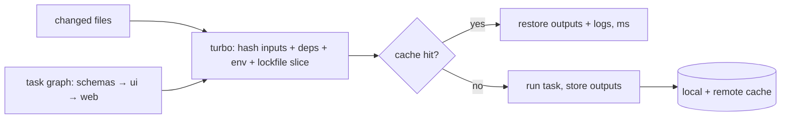

# Git - Monorepo Workflows with pnpm & Turborepo

> [!info] Deep dive of [[Git]]

> [!abstract] TL;DR
> One repo per **product** (web + workers + shared packages + mobile), not per client or per package.
> - **pnpm workspaces** handle linking and strict dependencies, with **catalogs** keeping versions aligned.
> - **Turborepo** builds a task graph with content-hashed caching, so only affected packages rebuild, locally and in CI.
> - **`turbo prune --docker`** creates minimal per-app Docker contexts.
>
> The two failure modes are undeclared env vars poisoning the cache, and packages importing each other's internals.

## Concept
**Layout**:
```text
repo/
├── apps/
│   ├── web/            # Next.js (Coolify)
│   ├── worker/         # Node queue worker (Coolify)
│   └── mobile/         # Flutter (pub workspace / melos; outside pnpm)
├── packages/
│   ├── schemas/        # Zod schemas, shared types (ESM-only)
│   ├── ui/             # shadcn-based components
│   ├── tokens/         # design tokens → CSS + Dart
│   └── config/         # tsconfig, eslint, prettier presets
├── pnpm-workspace.yaml
├── turbo.json
└── package.json        # root scripts only, no app code
```
| Concern | Tool | Key idea |
|---|---|---|
| Install + link | pnpm workspaces | `workspace:*` protocol. Strict `node_modules` (no phantom deps) |
| Version alignment | pnpm **catalogs** | One version of `react`, `zod`, `next` for every package |
| Task orchestration + cache | Turborepo | `dependsOn`, `inputs`, `outputs`, `env` define the hash |
| Affected-only CI | `turbo run … --affected` / `--filter=...[origin/main]` | Skip unchanged packages |
| Releases of publishable packages | Changesets (optional) | Internal-only packages usually don't need versions |

## How It Works

- A task's hash covers its package's files (or the declared `inputs`), its dependencies' hashes, the relevant lockfile entries, declared `env` vars and global dependencies. **Anything not in the hash can produce a stale cache hit.**
- `^build` means "build my workspace dependencies first". Turborepo parallelizes everything else.

## Practical Usage
**`pnpm-workspace.yaml`** with a catalog:
```yaml
packages:
  - apps/*
  - packages/*
catalog:
  react: ^19.3.0
  next: ^16.3.0
  zod: ^4.6.0
  typescript: ^7.0.0
```
```json
// packages/schemas/package.json (excerpt)
{ "name": "@acme/schemas", "dependencies": { "zod": "catalog:" } }
// apps/web/package.json (excerpt)
{ "dependencies": { "@acme/schemas": "workspace:*", "@acme/ui": "workspace:*", "next": "catalog:", "react": "catalog:" } }
```
**`turbo.json`**:
```json
{
  "$schema": "https://turborepo.com/schema.json",
  "globalDependencies": [".env.example"],
  "tasks": {
    "build": {
      "dependsOn": ["^build"],
      "inputs": ["$TURBO_DEFAULT$", "!**/*.test.ts", "!**/*.md"],
      "outputs": ["dist/**", ".next/**", "!.next/cache/**"],
      "env": ["NEXT_PUBLIC_*", "APP_ENV"]
    },
    "typecheck": { "dependsOn": ["^build"] },
    "lint": {},
    "test": { "dependsOn": ["^build"], "outputs": ["coverage/**"] },
    "dev": { "cache": false, "persistent": true }
  }
}
```
**Daily commands**:
```bash
pnpm add zod --filter @acme/schemas            # dependency for one package
pnpm turbo run dev --filter=web...             # web + everything it depends on
pnpm turbo run build test --affected           # only packages changed vs the base branch
pnpm turbo run build --dry=json | jq '.tasks[] | {taskId, hash, cache: .cache.status}'   # why did it (not) cache?
```
**Docker for one app** (minimal context, cached install layer):
```dockerfile
FROM node:24-alpine AS prune
RUN corepack enable
WORKDIR /repo
COPY . .
RUN pnpm dlx turbo prune web --docker          # out/json (manifests) + out/full (sources)

FROM node:24-alpine AS build
RUN corepack enable
WORKDIR /app
COPY --from=prune /repo/out/json/ .
RUN --mount=type=cache,target=/root/.local/share/pnpm/store pnpm install --frozen-lockfile
COPY --from=prune /repo/out/full/ .
RUN pnpm turbo run build --filter=web

FROM node:24-alpine
WORKDIR /app
COPY --from=build /app/apps/web/.next/standalone ./
COPY --from=build /app/apps/web/.next/static ./apps/web/.next/static
CMD ["node", "apps/web/server.js"]
```
**CI** (affected-only + remote cache):
```yaml
- uses: actions/checkout@v4
  with: { fetch-depth: 0 }                     # history needed for --affected
- uses: pnpm/action-setup@v4
- run: pnpm install --frozen-lockfile
- run: pnpm turbo run lint typecheck test build --affected
  env:
    TURBO_API: ${{ vars.TURBO_API }}           # self-hosted remote cache on Coolify, or Vercel
    TURBO_TOKEN: ${{ secrets.TURBO_TOKEN }}
    TURBO_TEAM: acme
    TURBO_REMOTE_CACHE_SIGNATURE_KEY: ${{ secrets.TURBO_SIGNATURE_KEY }}
```
**Wrong way**:
```ts
import { thing } from '../../packages/ui/src/internal/thing';   // ❌ reaching into another package's internals
```
```json
{ "tasks": { "build": { "outputs": [] } } }   // ❌ no outputs → cache hit restores nothing → broken deploys
```

## Patterns & Anti-patterns
| Pattern | When | Anti-pattern to avoid |
|---|---|---|
| Internal packages consumed via `exports` entry points | Shared code | Relative imports across package boundaries |
| Catalog versions for shared deps | 2+ apps on React/Next/Zod | Three React versions in one lockfile |
| Declare every build-affecting env var in `env` | Next.js `NEXT_PUBLIC_*`, `APP_ENV` | Staging values baked into a cached prod build |
| `turbo prune --docker` per deployable app | Coolify/Docker builds | Copying the whole repo into every image |
| Signed remote cache, CI-only write token | Teams/CI | Developers' laptops writing to the shared cache unsigned |
| Path-filtered workflows for mobile (`apps/mobile/**`) | Flutter in the same repo | Every web change triggering an iOS build |

## Performance & Trade-offs
- **Cache payoff**: lint/typecheck/test/build on unchanged packages restore in milliseconds. Typical CI drops from ~10 min to 1–3 min for small changes once the remote cache is warm.
- **Remote cache options**: Vercel (zero setup, data leaves your infra) vs a **self-hosted** open-source cache server on Coolify backed by R2/S3 (control, a small ops cost).
- **Monorepo vs polyrepo**: a monorepo gives atomic cross-package changes and one CI. It costs larger clones and needs boundary discipline. Per-client projects with no shared code are fine as separate repos.
- **Flutter in the monorepo**: keep Dart tooling native (pub workspaces / melos). Wrap `flutter test` in a `package.json` script only if you want Turborepo caching. Generated token/API client packages bridge the two worlds.

## Tips & Reminders
> [!tip] In ZP's stack
> - **One monorepo per SaaS product**: `apps/web` (Next.js), `apps/worker` (BullMQ/pgmq), `apps/mobile` (Flutter), plus `packages/schemas`, `ui`, `tokens` and `config`.
> - **Deploys**: each Coolify app builds from its own pruned Dockerfile, or better, CI builds images by SHA ([[CI-CD - Deploy Pipelines for Coolify & Flutter Releases]]).
> - **Client-specific forks**: avoid them. Use per-tenant config and feature flags inside the product.

- Enable Turborepo's strict env mode and inspect `--dry=json` when a deploy shows stale config.
- `pnpm why <pkg>` / `pnpm ls -r --depth 0` explain duplicate versions. `pnpm dedupe` fixes drift.
- Resolve `pnpm-lock.yaml` merge conflicts by re-running `pnpm install` on the merged `package.json` files, never by hand.
- Add `CODEOWNERS` per package once more than one person commits, even if one of them is your own future self.

## Version Notes
| Version | Released | Key changes | Breaking / migration notes |
|---|---|---|---|
| Turborepo 2.0 | 2024-06-04 | `tasks` key (was `pipeline`), strict env mode default, new TUI | Run `npx @turbo/codemod migrate` |
| Turborepo 2.x (2025–26) | — | `--affected`, `turbo prune` improvements, composable config, devtools, Yarn 4 catalogs (2.7) | 1.x end-of-life **2026-06-04** |
| Turborepo 2.11.7 | 2026-10-02 | Latest seen (aggregator) | — |
| pnpm 9.5+ / 10 | 2024–25 | Catalogs (`catalog:` protocol). pnpm 10 blocks dependency lifecycle scripts by default (`onlyBuiltDependencies`) | Allow-list postinstall-needing packages (`sharp`, `esbuild`, Prisma) |
| pnpm 11–12 (2026) | 2026 | Multi-document lockfiles, auto-dedupe on install, Rust port (12) reported | Check Turborepo compatibility before upgrading pnpm |

> [!warning] Unverified — check before relying on this
> Turborepo and pnpm 2026 version details come from release aggregators (releases.sh, Releasebot), and pnpm catalog introduction details are from memory. See https://github.com/vercel/turborepo/releases and https://pnpm.io/blog.

## Critical Issues & Gotchas
> [!danger] Cache poisoning via undeclared inputs
> If `NEXT_PUBLIC_API_URL` (or a generated file outside `inputs`) affects the build but isn't in the hash, Turborepo happily restores a build made with **another environment's values**. Production then calls the staging API. Declare env vars, keep strict mode on, and use separate cache namespaces or keys per environment when in doubt.

> [!danger] Remote cache as a supply-chain vector
> Anyone with write access to the remote cache can plant artifacts that CI restores and deploys. Use `TURBO_REMOTE_CACHE_SIGNATURE_KEY` (signed artifacts), give write tokens only to CI on `main`, and make PR runs read-only.

- **pnpm 10 lifecycle-script blocking**: native deps (`sharp`, `esbuild`, `@prisma/engines`) silently skip their postinstall and fail at runtime. Add them to `onlyBuiltDependencies`.
- **Next.js and internal TS packages**: either build them to `dist`, or list them in `transpilePackages`. Mixing both leads to duplicate React or "module not found" in production builds.
- **`--affected` needs git history**: shallow clones (`fetch-depth: 1`) make every package "affected" or none. Fetch enough history, or set the base explicitly.
- **Docker context bloat**: without a `.dockerignore` (`node_modules`, `.next`, `.turbo`, `apps/mobile/build`), the build context can be gigabytes.

## Related
- [[Git]]
- [[Git - Branching, Releases & Recovery]] — trunk-based flow, tags, recovery
- [[CI-CD - Deploy Pipelines for Coolify & Flutter Releases]] — affected builds into deploys
- [[JavaScript - Modules, ESM-CJS Interop & Bundling]] — `exports` maps for internal packages
- [[Next.js]] — `transpilePackages`, standalone output
- [[Tailwind CSS - Design Token Pipeline for Web & Flutter]] — a shared `tokens` package

## References
- https://turborepo.com/docs
- https://turborepo.com/docs/guides/tools/docker
- https://pnpm.io/workspaces
- https://pnpm.io/catalogs
- https://releases.sh/vercel/turborepo-releases.md
