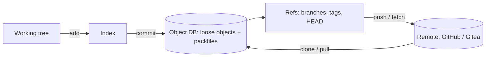

# Git

> [!abstract] TL;DR
> Git is the distributed version control system behind virtually all software, with GitHub/GitLab/Gitea/Forgejo as hosting and collaboration layers.
> - **Mental model**: a **content-addressed DAG of commits**, each pointing to an immutable tree snapshot. Branches and tags are just movable/fixed pointers.
> - **The skills that matter**: small commits, a clear branching strategy (trunk-based + short-lived branches), safe history rewriting (`rebase` locally, never on shared branches), and **keeping secrets out of history**.
> - **Git 3.0** (no release date yet, estimated around late 2026) switches defaults: `main` instead of `master`, **SHA-256** for new repos, and the reftable ref backend.

## Introduction
- **Origin**: Linus Torvalds (2005), after BitKeeper's free license for Linux was revoked. Maintained by Junio Hamano and community. GPLv2.
- **Problem**: fast, distributed, integrity-checked version control for huge projects with thousands of contributors and offline work.
- **Where it sits**: the source of truth for code, infra-as-code, docs (this vault!) and config. It triggers [[CI-CD]] pipelines and deployments ([[Coolify]] deploys on push), GitOps (Argo CD/Flux for [[Kubernetes]]), and code review via pull requests.

## Core Concepts

### Object model
| Object | Contains | Identified by |
|---|---|---|
| **blob** | File content | Hash of content |
| **tree** | Directory listing → blobs/trees + modes | Hash |
| **commit** | Tree + parent(s) + author/committer + message (+ signature) | Hash |
| **tag** (annotated) | Points to an object + tagger + message (+ signature) | Hash |
| **ref** | Name → commit (`refs/heads/main`, `refs/tags/v1.2.0`, `HEAD`) | Name |

Three areas: **working tree** → `git add` → **index (staging)** → `git commit` → **repository**.

### Everyday commands (modern forms)
```bash
git switch -c feat/order-export          # create + switch (instead of checkout -b)
git restore --staged file.ts              # unstage (instead of reset HEAD)
git add -p                                # stage hunks interactively
git commit -m "feat(orders): export CSV"  # Conventional Commits style
git fetch origin && git rebase origin/main   # update a private feature branch
git push -u origin feat/order-export
git log --oneline --graph --decorate -20
git diff main...HEAD                      # what this branch changes vs merge-base
git stash push -m "wip" && git stash pop
git worktree add ../hotfix main           # second checkout without cloning
git bisect start HEAD v1.4.0 && git bisect run npm test   # find the breaking commit
git reflog                                # recover "lost" commits after reset/rebase
```

### Merge vs rebase
| | Merge | Rebase |
|---|---|---|
| History | Preserves true history, adds merge commits | Linear history, rewrites commits (new hashes) |
| Safety | Safe on shared branches | **Never rebase commits others have pulled** |
| Conflicts | Resolved once | May resolve per replayed commit (`rerere` helps) |
| Typical use | Merging PRs into `main` (or squash-merge) | Updating your local feature branch, cleaning up before PR |

**Force pushing**: use `git push --force-with-lease` (fails if the remote moved), never plain `--force`, and only on your own branches.

## Architecture / How It Works

- **Content addressing**: an object's ID is the hash of its content. A commit hash covers its tree and parents, so history is tamper-evident (a Merkle DAG, like [[Blockchain Fundamentals]]).
- **SHA-1 → SHA-256**: Git hardened SHA-1 with collision detection after SHAttered (2017). SHA-256 repos exist (`git init --object-format=sha256`) and become the default in Git 3.0, but SHA-1 and SHA-256 repos **can't push/fetch to each other**, and hosting support (GitHub) lags.
- **Packfiles** delta-compress objects, and `git gc`/`git maintenance` repack. Partial clone (`--filter=blob:none`), shallow clone (`--depth=1`) and sparse-checkout keep large repos fast.
- **Refs storage**: loose files + `packed-refs`, or the **reftable** backend (2.45+, planned default in 3.0) for repos with many refs.
- **Transport**: smart HTTP or SSH. Protocol v2 is the default.

## Project Structure
```text
repo/
├── .git/                     # object DB, refs, config, hooks (never commit or copy into images)
├── .gitignore                # node_modules, .env, build output, *.pem
├── .gitattributes            # line endings (* text=auto eol=lf), LFS, diff drivers
├── .github/
│   ├── workflows/ci.yml      # CI-CD
│   ├── CODEOWNERS
│   └── pull_request_template.md
└── .pre-commit-config.yaml   # or husky + lint-staged: lint, format, secret scan before commit
```
```ini
# ~/.gitconfig essentials
[init]   defaultBranch = main
[pull]   rebase = true
[fetch]  prune = true
[rerere] enabled = true
[push]   autoSetupRemote = true
[commit] gpgsign = true
[gpg]    format = ssh
[user]   signingkey = ~/.ssh/id_ed25519.pub
```

## Use Cases
| Use case | Why it fits |
|---|---|
| Source control for every project | Distributed, fast, universal tooling |
| Infra/config as code (Compose files, Coolify, K8s manifests) | Audit trail, review, rollback |
| GitOps deployments | Git is the desired state, controllers reconcile |
| Docs/knowledge bases (Obsidian vault) | Plain-text history, sync across devices |
| Client handover and contract evidence | Commit history documents who delivered what and when |
| Large binary assets (videos, 3D models, datasets) | **Weaker fit**. Use Git LFS, R2/S3, or DVC |

## Pros & Cons
| Pros | Cons |
|---|---|
| Distributed: full history offline, cheap branching | Steep, inconsistent CLI. Easy to confuse beginners |
| Integrity via content hashing | Rewriting shared history causes chaos |
| Ubiquitous hosting, CI and tooling | Secrets committed once live forever in clones/forks |
| Fast for code-sized repos | Poor native handling of large binaries / monorepo scale without tuning |
| Flexible workflows | Merge conflicts in generated/lock files |

## Alternatives & Peers
| Alternative | Strength vs Git | Weakness vs Git | Pick it when… |
|---|---|---|---|
| Jujutsu (`jj`) | Git-compatible backend, easier undo/rebase model, no staging area | Newer, smaller tooling | Power users wanting saner history editing |
| Mercurial | Simpler CLI, scales (Meta's Sapling fork) | Small ecosystem now | Legacy or specific monorepo tooling |
| Perforce / Plastic (Unity VCS) | Large binaries, file locking | Proprietary, centralized | Game studios with huge assets |
| SVN | Centralized simplicity, path-level ACLs | Weak branching | Legacy enterprise repos |

## Tips & Reminders
> [!tip]
> - **Trunk-based** with short-lived branches + PRs + squash merge keeps `main` deployable. Protect `main` (required reviews/checks, no force push).
> - Use Conventional Commits (`feat:`, `fix:`, `chore:`) to automate changelogs/versioning (release-please, semantic-release).
> - Sign commits with SSH keys and enable "vigilant mode" on GitHub. Use separate SSH keys or deploy keys per server with read-only access.
> - Add secret scanning: GitHub push protection, plus `gitleaks` in a pre-commit hook and CI.
> - Commit lockfiles. Resolve lockfile conflicts by regenerating (`npm install` / `pnpm install`), not by hand.
> - **In ZP's stack**: one GitHub org for Rarticle, with client repos either in their org (preferred, so ownership is clear at handover) or yours with documented transfer terms. [[Coolify]] deploys on push to `main` via GitHub App/webhook, GitHub Actions runs [[CI-CD]] checks, and n8n workflows/Obsidian notes are exported to Git for history.

## Versions & Breaking Changes
| Version | Released | Key changes | Breaking / migration notes |
|---|---|---|---|
| 2.0 | 2014-05 | `push.default=simple` | Changed push behaviour |
| 2.23 | 2019-08 | `git switch` / `git restore` | `checkout` still works |
| 2.28 | 2020-07 | `init.defaultBranch` config | — |
| 2.29 | 2020-10 | Experimental SHA-256 repos | — |
| 2.45 | 2024-04 | **reftable** ref backend | `git refs migrate` (2.46) |
| 2.52 | 2025-11 | Announces 3.0 defaults (`main` initial branch) | Warnings for legacy behaviours |
| 2.53–2.55 | 2026 | Ongoing improvements, breaking-change prep | Check `BreakingChanges` doc |
| **3.0** | Planned (no date, est. late 2026) | Default branch `main`, **SHA-256** default for new repos, reftable default, removal of deprecated commands/options | SHA-256 repos can't interoperate with SHA-1 remotes. Hosting support required |

> [!warning] Unverified — check before relying on this
> Latest 2.x patch release and Git 3.0 timing/defaults weren't confirmed beyond the official BreakingChanges document. Check https://git-scm.com/docs/BreakingChanges and https://github.com/git/git/tree/master/Documentation/RelNotes.

## Critical Issues & Gotchas
> [!danger] Secrets in history are permanent
> A committed `.env`, private key or API token stays in every clone, fork and CI cache even after deletion in a later commit. Bots scrape public GitHub for keys **within minutes**. **Rotate the secret first**, then purge history (`git filter-repo`) if needed, and treat it as compromised regardless.

> [!danger] Clone-time RCE and file-write CVEs
> - **CVE-2024-32002** (2024-05, critical): crafted repos with submodules + symlinks could execute hooks during `git clone --recursive` on case-insensitive filesystems.
> - **CVE-2025-48384** (2025-07): carriage-return handling in config enabled arbitrary file writes and code execution on clone. Added to the CISA KEV catalog after exploitation.
>
> Keep Git updated on dev machines and CI runners, and avoid recursive clones of untrusted repos.

> [!warning] Gotchas
> - `git reset --hard` / `git clean -fdx` destroy uncommitted work (only `reflog` saves committed states).
> - `.git` directories exposed on web servers (`/.git/config`) leak full source. Block in [[Nginx]]/[[Traefik]] and never deploy `.git`.
> - Line-ending churn between Windows and Linux. Set `.gitattributes` (`* text=auto eol=lf`).
> - Case-only renames on macOS/Windows (case-insensitive FS) confuse Git. Use `git mv`.
> - Submodules pin commits and are easy to get out of sync. Prefer packages/monorepo tooling.
> - Large files bloat the repo forever. Use LFS from the start or keep assets in object storage.

## Deep Dives
N/A — no deep dives planned yet. Candidates: branching & release workflows, history rewriting and recovery.

## Related
- [[CI-CD]] — pipelines triggered by Git events
- [[Coolify]] — git-push deployments
- [[Linux Essentials]] — SSH keys, permissions, shell
- [[Docker]] — never ship `.git` in images (`.dockerignore`)
- [[Network Security]] — secret leaks, signed commits
- [[Blockchain Fundamentals]] — same Merkle-DAG idea

## References
- Pro Git book: https://git-scm.com/book/en/v2
- Git documentation: https://git-scm.com/docs
- BreakingChanges (Git 3.0): https://git-scm.com/docs/BreakingChanges
- Git 3.0 main default (thoughtbot): https://thoughtbot.com/blog/git-3-0-will-use-main-as-the-default-branch
- SHA-256 in Git: https://devtoollab.com/blog/git-sha256
- git-filter-repo: https://github.com/newren/git-filter-repo
