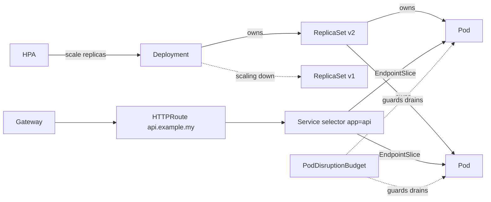

# Kubernetes - Core Objects

> [!info] Deep dive of [[Kubernetes]]

> [!abstract] TL;DR
> Kubernetes is a set of **declarative objects** (`apiVersion`, `kind`, `metadata`, `spec`, `status`) reconciled by controllers. For almost every app you need:
> - **Pod** (inside a **Deployment** or **StatefulSet**)
> - **Service**
> - **HTTPRoute** (Gateway API)
> - **ConfigMap/Secret**
> - **PVC**
> - **HPA** + **PodDisruptionBudget**
> - **NetworkPolicy**
> - **ServiceAccount + RBAC**
>
> Get **probes, resource requests/limits and labels** right. Most production incidents trace back to one of those three.

## Concept

### Object anatomy
```yaml
apiVersion: apps/v1          # API group/version
kind: Deployment
metadata:
  name: api
  namespace: shop
  labels: { app.kubernetes.io/name: api, app.kubernetes.io/part-of: shop }   # selectable
  annotations: { owner: "zp@rarticle" }                                       # non-identifying metadata
spec: {}                     # desired state (you write)
status: {}                   # observed state (controllers write)
```
- **Labels + selectors** connect everything: Deployments select Pods, Services select Pods, NetworkPolicies select Pods/namespaces. A selector typo means nothing gets connected, and no error is raised.
- **Owner references** cascade deletion (Deployment → ReplicaSet → Pods). **Finalizers** block deletion until cleanup runs (stuck namespaces are usually stuck finalizers).

### Workload objects
| Object | Manages | Key fields / behaviour |
|---|---|---|
| **Pod** | 1+ containers sharing network/IPC/volumes | `containers`, `initContainers` (incl. native **sidecars**: `restartPolicy: Always`, GA 1.33), probes, resources, `securityContext` |
| **Deployment** | Stateless replicas via ReplicaSets | `replicas`, `strategy.rollingUpdate.{maxSurge,maxUnavailable}`, `revisionHistoryLimit`. Rollback with `kubectl rollout undo` |
| **StatefulSet** | Stable names (`db-0`), ordered rollout, per-pod PVCs (`volumeClaimTemplates`) | Needs a headless Service. `podManagementPolicy` |
| **DaemonSet** | One pod per (selected) node | Log/metrics agents, CNI, storage drivers |
| **Job / CronJob** | Run to completion / on schedule | `backoffLimit`, `activeDeadlineSeconds`, `concurrencyPolicy: Forbid`, `ttlSecondsAfterFinished`, `timeZone` |

### Networking and config objects
| Object | Purpose |
|---|---|
| **Service** `ClusterIP` | Stable virtual IP + DNS `api.shop.svc.cluster.local` |
| Service `headless` (`clusterIP: None`) | DNS returns pod IPs (StatefulSets, client-side LB for gRPC) |
| Service `NodePort` / `LoadBalancer` | Expose on node ports / cloud LB |
| **EndpointSlice** | Backing pod IPs for Services (replaces deprecated `Endpoints`) |
| **Gateway / HTTPRoute** (Gateway API) | L7 routing (hosts, paths, headers, weights, TLS). Successor to Ingress |
| **ConfigMap / Secret** | Config and credentials as env vars or mounted files. Secrets are base64, so enable encryption at rest |
| **PersistentVolumeClaim / StorageClass** | Durable storage requests, dynamic provisioning, `ReadWriteOnce` vs `ReadWriteMany` |

### Policy, scaling and access
| Object | Purpose |
|---|---|
| **HorizontalPodAutoscaler** | Scale replicas on CPU/memory/custom metrics (needs metrics-server/Prometheus adapter) |
| **PodDisruptionBudget** | Min available pods during voluntary disruptions (node drains, upgrades) |
| **NetworkPolicy** | Pod-level firewall (requires a CNI that enforces it: Cilium, Calico) |
| **ServiceAccount + Role/ClusterRole + (Cluster)RoleBinding** | Identity and RBAC for pods and humans |
| **ResourceQuota / LimitRange** | Per-namespace caps and default requests/limits |
| **PriorityClass** | Which pods are preempted first under pressure |

## How It Works

- **Rollout**: changing the pod template creates a new ReplicaSet. New pods must pass **readiness** before old ones are removed (per `maxSurge`/`maxUnavailable`).
- **Probes**:
  - `startupProbe` delays the others for slow starters.
  - `readinessProbe` gates traffic (removes the pod from EndpointSlices when failing).
  - `livenessProbe` restarts the container when it's hung.
- **QoS classes** come from requests/limits:
  - `Guaranteed`: requests = limits.
  - `Burstable`.
  - `BestEffort`: none set. Evicted first under node memory pressure.
- **Termination**: pod marked Terminating → removed from endpoints (asynchronously!) → `preStop` hook → `SIGTERM` → `terminationGracePeriodSeconds` → `SIGKILL`.
- **In-place pod resize** (GA 1.35): change CPU/memory requests/limits without recreating the pod (`resizePolicy`).

## Practical Usage

### Production-grade Deployment
```yaml
apiVersion: apps/v1
kind: Deployment
metadata: { name: api, namespace: shop }
spec:
  replicas: 3
  revisionHistoryLimit: 5
  strategy: { rollingUpdate: { maxSurge: 1, maxUnavailable: 0 } }
  selector: { matchLabels: { app.kubernetes.io/name: api } }
  template:
    metadata: { labels: { app.kubernetes.io/name: api } }
    spec:
      serviceAccountName: api
      automountServiceAccountToken: false
      topologySpreadConstraints:
        - { maxSkew: 1, topologyKey: kubernetes.io/hostname, whenUnsatisfiable: ScheduleAnyway,
            labelSelector: { matchLabels: { app.kubernetes.io/name: api } } }
      terminationGracePeriodSeconds: 40
      containers:
        - name: api
          image: ghcr.io/rarticle/api:9f3c2ab           # immutable SHA tag
          ports: [{ name: http, containerPort: 3000 }]
          envFrom: [{ configMapRef: { name: api-config } }, { secretRef: { name: api-secrets } }]
          resources: { requests: { cpu: 200m, memory: 256Mi }, limits: { memory: 512Mi } }
          startupProbe:   { httpGet: { path: /healthz, port: http }, failureThreshold: 30, periodSeconds: 2 }
          readinessProbe: { httpGet: { path: /readyz, port: http }, periodSeconds: 5 }
          livenessProbe:  { httpGet: { path: /livez, port: http }, periodSeconds: 10, failureThreshold: 3 }
          lifecycle: { preStop: { sleep: { seconds: 5 } } }   # let endpoint removal propagate before SIGTERM
          securityContext: { runAsNonRoot: true, readOnlyRootFilesystem: true, allowPrivilegeEscalation: false,
                             capabilities: { drop: ["ALL"] } }
---
apiVersion: policy/v1
kind: PodDisruptionBudget
metadata: { name: api, namespace: shop }
spec: { minAvailable: 2, selector: { matchLabels: { app.kubernetes.io/name: api } } }
---
apiVersion: autoscaling/v2
kind: HorizontalPodAutoscaler
metadata: { name: api, namespace: shop }
spec:
  scaleTargetRef: { apiVersion: apps/v1, kind: Deployment, name: api }
  minReplicas: 3
  maxReplicas: 10
  metrics: [{ type: Resource, resource: { name: cpu, target: { type: Utilization, averageUtilization: 70 } } }]
```

### Default-deny NetworkPolicy + allow from gateway
```yaml
apiVersion: networking.k8s.io/v1
kind: NetworkPolicy
metadata: { name: default-deny, namespace: shop }
spec: { podSelector: {}, policyTypes: [Ingress, Egress] }
---
apiVersion: networking.k8s.io/v1
kind: NetworkPolicy
metadata: { name: api-allow, namespace: shop }
spec:
  podSelector: { matchLabels: { app.kubernetes.io/name: api } }
  ingress: [{ from: [{ namespaceSelector: { matchLabels: { kubernetes.io/metadata.name: infra } } }], ports: [{ port: 3000 }] }]
  egress:
    - to: [{ podSelector: { matchLabels: { app.kubernetes.io/name: postgres } } }]
      ports: [{ port: 5432 }]
    - to: [{ namespaceSelector: {}, podSelector: { matchLabels: { k8s-app: kube-dns } } }]   # DNS
      ports: [{ port: 53, protocol: UDP }]
```

## Patterns & Anti-patterns
| Pattern | When | Anti-pattern to avoid |
|---|---|---|
| Requests on every container, memory limits | All workloads | No requests (BestEffort pods evicted first, nodes overcommitted) |
| Separate readiness (dependencies) and liveness (process health) | All HTTP services | Liveness checking the DB → cascading restarts during DB blips |
| PDB + ≥2 replicas + topology spread | Customer-facing services | Single replica "because it's small" |
| `maxUnavailable: 0` + preStop delay | Zero-downtime rollouts | Dropped requests during deploys |
| Immutable image tags + GitOps | All environments | `:latest` with `imagePullPolicy: IfNotPresent` |
| Recommended labels (`app.kubernetes.io/*`) | Everything | Ad-hoc labels per team, breaking selectors |

## Performance & Trade-offs
- CPU **limits** cause CFS throttling and latency spikes. Many teams set CPU requests only, plus memory limits.
- HPA reacts in tens of seconds to minutes. Set `minReplicas` for baseline traffic, and use KEDA for queue-length-based scaling (BullMQ/Kafka lag).
- StatefulSets + PVCs tie pods to zones/nodes (ReadWriteOnce). Failover is slower than for stateless pods. Managed databases are often simpler.
- Each NetworkPolicy and Service adds rules to kube-proxy/eBPF datapaths. At large scale, prefer eBPF CNIs (Cilium).

## Tips & Reminders
> [!tip]
> - `kubectl explain deployment.spec.strategy --recursive` documents any field offline.
> - `kubectl diff -k overlays/prod` before applying. `kubectl rollout status` in CI deploy steps.
> - Use `kubectl debug` ephemeral containers instead of baking shells into production images.
> - Validate manifests in CI with `kubeconform` and policies (Kyverno/OPA Gatekeeper: require probes, requests, non-root).
> - **In ZP's stack**: these objects map onto what [[Coolify]] does for you on one VPS (health checks = probes, rolling deploys = Deployment strategy, env = ConfigMap/Secret). Adopt k3s only when multi-node HA justifies it, and start with exactly this set of objects.

## Version Notes
| Version | Change |
|---|---|
| 1.21–1.25 | PodSecurityPolicy deprecated → removed (1.25). Pod Security Admission. `batch/v1` CronJob GA (1.21) |
| 1.27 | `timeZone` for CronJobs GA |
| 1.28–1.29 | Native sidecar containers (beta) |
| 1.29–1.33 | `preStop` sleep action (alpha 1.29 → beta → GA). Verify for your cluster version |
| **1.33** | **Sidecar containers GA**. `Endpoints` API deprecated in favour of EndpointSlices |
| **1.35** | **In-place pod resize GA**. cgroup v1 removed |
| Gateway API v1.x | GA routing APIs (HTTPRoute, GRPCRoute). The replacement for Ingress after ingress-nginx retirement (2026-03) |

## Critical Issues & Gotchas
> [!danger] Misconfigured probes cause outages
> Aggressive liveness probes (short timeouts, checking dependencies) restart healthy pods under load or during DB slowness. Every pod then restarts in a loop, and a partial slowdown becomes a full outage. Keep liveness cheap and dependency-free, use startup probes for slow boots, and tune `timeoutSeconds`/`failureThreshold`.

> [!danger] Over-privileged ServiceAccounts and Secrets
> Default ServiceAccount tokens auto-mounted into every pod, plus broad RBAC (`cluster-admin` bindings for CI or apps), turn any RCE into cluster takeover (read all Secrets, create privileged pods). Disable token automount, grant minimal Roles per namespace, use short-lived projected tokens, and audit RoleBindings.

> [!warning] Gotchas
> - Endpoint removal and SIGTERM happen in parallel, so without a preStop delay or graceful shutdown some requests hit terminating pods (502s).
> - Changing a Deployment's `selector` is immutable. You must recreate the Deployment.
> - `kubectl apply` on a Secret with `stringData` vs `data` (base64) mixups produces wrong values silently.
> - CronJobs default `concurrencyPolicy: Allow`, so slow jobs overlap. Set `Forbid` for backups and migrations.
> - Deleting a namespace deletes PVCs (and possibly volumes, per `reclaimPolicy: Delete`).

## Related
- [[Kubernetes]]
- [[Kubernetes - k3s vs Coolify for Small Teams]] — k3s vs Coolify decision for small teams
- [[Docker]] — container images and runtime basics
- [[Traefik]] — Gateway API / ingress controller option
- [[CI-CD]] — GitOps deployment of these manifests
- [[Network Security]] — NetworkPolicy, RBAC, least privilege
- [[Linux Essentials]] — cgroups, signals, OOM behaviour underneath

## References
- Kubernetes concepts (workloads, services): https://kubernetes.io/docs/concepts/
- Gateway API: https://gateway-api.sigs.k8s.io/
- Configure liveness, readiness and startup probes: https://kubernetes.io/docs/tasks/configure-pod-container/configure-liveness-readiness-startup-probes/
- Sidecar containers: https://kubernetes.io/docs/concepts/workloads/pods/sidecar-containers/
- Recommended labels: https://kubernetes.io/docs/concepts/overview/working-with-objects/common-labels/
- Pod Security Standards: https://kubernetes.io/docs/concepts/security/pod-security-standards/
