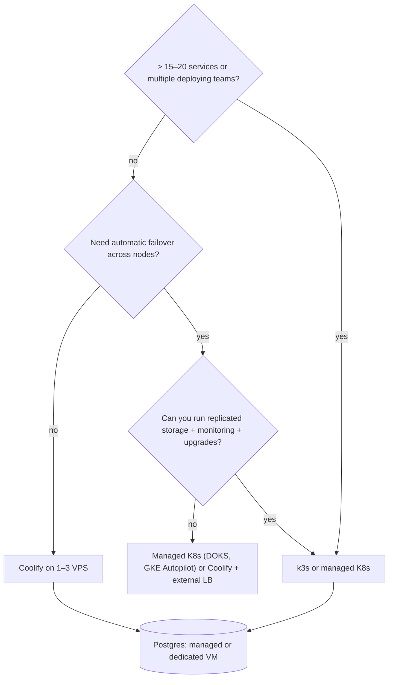

# Kubernetes - k3s vs Coolify for Small Teams

> [!info] Deep dive of [[Kubernetes]]

> [!abstract] TL;DR
> For a solo founder or small team running SME apps on 1–3 VPSs, **Coolify (Compose + Traefik) is the default**: git-push deploys, previews, backups and a UI, with almost no platform work.
> **k3s** gives the real Kubernetes API in one binary. You also inherit Kubernetes' operational surface: ingress, certs, storage, secrets, GitOps, monitoring, upgrades.
> **Switch when**:
> - you need multi-node self-healing or autoscaling;
> - you run more than ~15–20 services with frequent deploys;
> - several people deploy independently;
> - a client contract requires Kubernetes.
>
> Either way, keep **Postgres outside** the platform (managed, or a dedicated VM with PITR).

## Concept
| Dimension | Coolify (on Docker) | k3s |
|---|---|---|
| Unit of deploy | Compose service / Dockerfile / image | Deployment + Service + Ingress (Helm/Kustomize) |
| Control plane | Coolify app (Laravel + Postgres + Redis) | k3s server (API server, scheduler, controller; SQLite or embedded etcd) |
| Footprint | ~1–2 GB for Coolify + proxy | ~0.5–1 GB server + add-ons (monitoring stacks add GBs) |
| Multi-node | Per-server deploys, external LB, no rescheduling | Scheduler reschedules pods on node failure (with shared/replicated storage) |
| HA control plane | No (single Coolify instance) | 3 servers with embedded etcd |
| Storage | Docker volumes on one host | `local-path` (node-bound) by default. Longhorn/OpenEBS for replication |
| Certs / ingress | Built-in Traefik + ACME | Bundled Traefik. cert-manager commonly added |
| Secrets | Env in Coolify UI/DB | K8s Secrets (base64) + SOPS/Sealed Secrets/External Secrets |
| Deploy workflow | UI, webhooks, API | GitOps (Argo CD/Flux) or `kubectl`/Helm from CI |
| Learning curve / ops time | Low | Medium–high, ongoing |

**Middle-ground options**:

| Tool | Pick it when… |
|---|---|
| Docker Compose + scripts | 1 server, a handful of services, you want zero platform |
| Coolify | 1–5 servers, many small apps, UI + previews + backups |
| Kamal (37signals) | Code-first deploys of a few apps to plain servers, no control plane |
| Nomad | Mixed workloads (containers + binaries), simpler than K8s, HashiCorp licensing considerations |
| k3s / managed K8s | Need the K8s API, ecosystem, multi-node scheduling |

## How It Works


## Practical Usage
**Same app on both** (Next.js web on port 3000).

*Coolify / Compose*:
```yaml
services:
  web:
    image: ghcr.io/acme/shop:${SHA}
    environment: [DATABASE_URL]
    healthcheck: { test: ["CMD", "wget", "-qO-", "http://localhost:3000/api/health"], interval: 10s }
    deploy: { resources: { limits: { memory: 768m } } }
# Coolify adds the Traefik labels, domain and TLS
```
*k3s*:
```yaml
apiVersion: apps/v1
kind: Deployment
metadata: { name: web }
spec:
  replicas: 2
  selector: { matchLabels: { app: web } }
  template:
    metadata: { labels: { app: web } }
    spec:
      containers:
        - name: web
          image: ghcr.io/acme/shop:4f1c2ab
          envFrom: [{ secretRef: { name: web-env } }]
          ports: [{ containerPort: 3000 }]
          readinessProbe: { httpGet: { path: /api/health, port: 3000 }, periodSeconds: 10 }
          resources: { requests: { cpu: 100m, memory: 256Mi }, limits: { memory: 768Mi } }
---
apiVersion: v1
kind: Service
metadata: { name: web }
spec: { selector: { app: web }, ports: [{ port: 80, targetPort: 3000 }] }
---
apiVersion: networking.k8s.io/v1
kind: Ingress
metadata: { name: web, annotations: { cert-manager.io/cluster-issuer: letsencrypt } }
spec:
  rules: [{ host: shop.example.my, http: { paths: [{ path: /, pathType: Prefix, backend: { service: { name: web, port: { number: 80 } } } }] } }]
  tls: [{ hosts: [shop.example.my], secretName: web-tls }]
```
Plus what Coolify gave you implicitly, which on k3s you install and maintain yourself: cert-manager, a secrets workflow (SOPS/Sealed Secrets), Argo CD/Flux, a backup tool (Velero + etcd snapshots), monitoring, log shipping, and an upgrade path (system-upgrade-controller).

**k3s install with HA datastore and off-site snapshots** (3 servers):
```bash
curl -sfL https://get.k3s.io | INSTALL_K3S_CHANNEL=stable sh -s - server --cluster-init \
  --etcd-s3 --etcd-s3-endpoint=<account>.r2.cloudflarestorage.com --etcd-s3-bucket=k3s-snapshots \
  --etcd-snapshot-schedule-cron="0 */6 * * *" --secrets-encryption
# join the other servers with --server https://<first>:6443 and the node token
```
**Wrong way**:
```text
❌ Single k3s node with SQLite, local-path volumes and Postgres inside the cluster → all the complexity, none of the HA
❌ Exposing 6443 (Kubernetes API) to the internet                                → firewall it / Tailscale only
❌ Moving to K8s to "be scalable" for 3 SME client apps                         → months of platform work, no customer value
```

## Patterns & Anti-patterns
| Pattern | When | Anti-pattern to avoid |
|---|---|---|
| Coolify until concrete triggers appear | Solo founder, SME clients | Adopting K8s preemptively |
| Postgres outside the cluster (managed or VM + pgBackRest) | Both platforms | Stateful DBs on `local-path` volumes |
| OCI images built in CI, deployed by SHA | Both (eases future migration) | Platform-specific build steps that lock you in |
| GitOps repo for manifests | k3s | `kubectl apply` from laptops |
| Managed Kubernetes if you need K8s but not K8s ops | Client mandates K8s | Self-hosting HA control planes solo |
| Resource requests/limits on everything | k3s | BestEffort pods evicted unpredictably |

## Performance & Trade-offs
- **Ops time is the real cost**: Coolify needs roughly 1–2 h/month (updates, backups checks). A self-run k3s cluster with monitoring, GitOps and storage realistically needs several hours a month plus incident learning time, which is time not spent on revenue.
- **Resource overhead**: the k3s server is light, but production add-ons (Prometheus/Grafana stack, Longhorn, Argo CD) can consume 2–4 GB. On 4–8 GB Hostinger KVMs that's a large share.
- **Resilience**: k3s on 3+ nodes with replicated storage survives node loss automatically. Coolify needs an external LB and manual intervention for a dead server ([[Coolify - Multi-Server, Build Servers & Scaling]]).
- **Portability**: Kubernetes manifests run anywhere (GKE, EKS, DOKS, bare metal). Coolify configs are Coolify-specific, but the images and Compose files transfer.

## Tips & Reminders
> [!tip] In ZP's stack
> - **Stay on Coolify** for SME client apps and your SaaS until one of the triggers appears.
> - **Prepare the exit** without switching: CI-built images by SHA, health endpoints, env-based config and external Postgres. A later move to k3s or managed K8s then mostly means writing manifests.
> - **If a client requires Kubernetes**, quote managed K8s (DigitalOcean/GKE) plus a maintenance retainer, not a self-hosted cluster you operate unpaid.

- Learn k3s on a throwaway VPS first (ingress, cert-manager, a rollout, a node failure, a restore) before committing a client to it.
- Keep the Kubernetes API private (firewall/Tailscale). Use `kubectl` via a bastion or CI only.
- Pin k3s versions and upgrade one minor at a time. Kubernetes supports skew policies, not skipping minors.
- Document the platform decision (ADR) per client: why Coolify vs K8s, triggers to revisit, and costs.

## Version Notes
| Version / date | Change relevant here |
|---|---|
| k3s (2019→) | CNCF sandbox lightweight distro (SUSE/Rancher). Bundles Traefik, CoreDNS, local-path, metrics-server |
| k3s 1.34.x (2026-08) | Latest line seen at re-check (v1.34.11+k3s1, 2026-08-27). Tracks upstream minors with a lag |
| Kubernetes 1.36 (2026) | Upstream current (see [[Kubernetes]]) |
| Coolify 4.x | Multi-server, build servers. Swarm deprecated (removal in v5) |

> [!warning] Unverified — check before relying on this
> Whether k3s already ships 1.35/1.36 lines, and official minimum RAM figures, weren't confirmed this run. Check https://docs.k3s.io/release-notes and https://docs.k3s.io/installation/requirements.

## Critical Issues & Gotchas
> [!danger] HA theatre
> A k3s cluster with a single server (SQLite), node-bound volumes and the database in-cluster has a single point of failure everywhere, plus more moving parts than Coolify. If you adopt Kubernetes for resilience, do it fully: 3 control-plane nodes, replicated or external storage, external DB, tested restores.

> [!danger] Exposed Kubernetes API and dashboards
> Port 6443 or an unauthenticated dashboard on the internet is an immediate full-cluster compromise risk. Firewall the API, use short-lived credentials, and keep dashboards behind Cloudflare Access/Tailscale ([[Cloudflare - Zero Trust Tunnel & Access]]).

- **`local-path` volumes pin pods to nodes**: a node failure means the pod can't reschedule with its data. Don't run stateful services that way.
- **Secrets are only base64** in etcd by default. Enable secrets encryption (`--secrets-encryption`) and restrict RBAC.
- **Helm chart supply chain**: third-party charts pull many images and CRDs. Pin chart and image versions, and review values.
- **Upgrades**: unmanaged clusters drift behind security patches. Schedule upgrades, or use managed K8s.

## Related
- [[Kubernetes]]
- [[Kubernetes - Core Objects]] — Deployments, Services, Ingress, probes
- [[Coolify]] — the default platform in ZP's stack
- [[Coolify - Multi-Server, Build Servers & Scaling]] — scaling without Kubernetes
- [[Docker - Compose Patterns for Production]] — the Compose baseline
- [[PostgreSQL - Backups, PITR & Restore Drills]] — keeping the database outside the platform

## References
- https://docs.k3s.io/
- https://docs.k3s.io/datastore/ha-embedded
- https://documentation.suse.com/cloudnative/k3s/latest/en/release-notes/v1.34.X.html
- https://coolify.io/docs/
- https://kamal-deploy.org/
