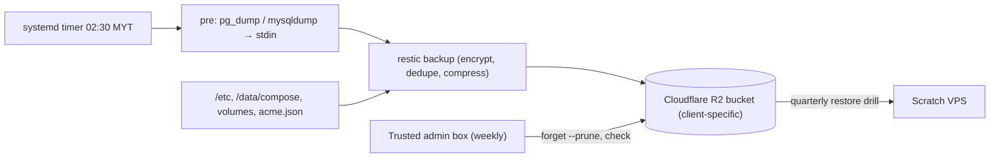

# Linux Essentials - Backups with restic & Off-Site Storage

> [!info] Deep dive of [[Linux Essentials]]

> [!abstract] TL;DR
> **restic** is a single Go binary for **encrypted, deduplicated, compressed** snapshots to S3-compatible storage (Cloudflare R2, Backblaze B2, Wasabi), SFTP, or rest-server.
> - **What to back up on a VPS**: database **dumps** (not live data dirs), Docker volumes with app files, `/etc` and compose/`.env` files, and Traefik's `acme.json`.
> - **The loop**: `backup` (systemd timer) → `forget --prune` (retention) → `check --read-data-subset` (integrity) → **quarterly restore drill**.
> - **Ransomware/compromise resistance**: credentials on the server shouldn't be able to delete history. Use append-only rest-server or bucket-level object lock/lifecycle protections, with pruning done from a separate trusted machine.
> - **Hostinger snapshots ≠ backups**: same provider, same account, same blast radius.

## Concept
| Concept | Meaning | Note |
|---|---|---|
| Repository | Encrypted store of packs + index | One per server or per client. Password = only key |
| Snapshot | Point-in-time file tree | Tagged (`--tag db`, `--tag files`) |
| Deduplication | Content-defined chunking | Daily snapshots cost only changed chunks |
| Compression | Repo v2 (`auto` default) | zstd. Great for SQL dumps |
| `forget` / `prune` | Retention policy / delete unreferenced data | Prune is the heavy, destructive step |
| `check` | Verify structure (and optionally data) | `--read-data-subset=5%` rotates coverage |
| Lock | Repo locks during operations | Stale locks after crashes: `restic unlock` |

**Tool landscape**:

| Tool | Pick it when… |
|---|---|
| restic CLI + systemd timers | Default. Scriptable, minimal deps |
| Backrest (web UI on restic) | You want UI, schedules and restore browsing per server |
| resticprofile / autorestic | Many profiles/repos defined in config files |
| BorgBackup + BorgBase | SSH-only targets, mature append-only mode |
| Coolify S3 backups | Coolify-managed DB backups only ([[Coolify - Operations, Backups & Hardening]]) |

## How It Works


## Practical Usage
**Repository on R2** (env file `/etc/restic/acme.env`, `chmod 600`):
```bash
export RESTIC_REPOSITORY="s3:https://<account_id>.r2.cloudflarestorage.com/acme-backups"
export RESTIC_PASSWORD_FILE=/etc/restic/acme.pass       # random 32+ chars, escrowed in password manager
export AWS_ACCESS_KEY_ID=…                              # R2 token scoped to this bucket only
export AWS_SECRET_ACCESS_KEY=…
export RESTIC_COMPRESSION=auto
```
```bash
source /etc/restic/acme.env
restic init
```
**Backup script** (`/usr/local/bin/backup-acme.sh`):
```bash
#!/usr/bin/env bash
set -euo pipefail
source /etc/restic/acme.env

# 1) database: stream a consistent dump straight into restic (no temp file on a full disk)
restic backup --tag db --stdin-filename n8n.dump \
  --stdin-from-command -- docker exec n8n-postgres pg_dump -U n8n -Fc n8n

# 2) files: configs, compose, volumes with uploads, certificates
restic backup --tag files --exclude-caches \
  --exclude '/var/lib/docker/volumes/*postgres*' \
  /etc /data/coolify/applications /var/lib/docker/volumes /data/coolify/proxy/acme.json

# 3) heartbeat to monitoring (alert if missing)
curl -fsS -m 10 "https://uptime.rarticle.my/api/push/acme-backup?status=up" >/dev/null
```
**systemd service + timer**:
```ini
# /etc/systemd/system/backup-acme.service
[Unit]
Description=restic backup (acme)
[Service]
Type=oneshot
ExecStart=/usr/local/bin/backup-acme.sh
Nice=10
IOSchedulingClass=idle

# /etc/systemd/system/backup-acme.timer
[Timer]
OnCalendar=*-*-* 18:30:00 UTC        # 02:30 MYT
RandomizedDelaySec=15m
Persistent=true
[Install]
WantedBy=timers.target
```
```bash
systemctl daemon-reload && systemctl enable --now backup-acme.timer
systemctl list-timers | grep backup
```
**Retention and integrity** (run from a trusted machine with delete rights, weekly):
```bash
restic forget --tag db --keep-daily 14 --keep-weekly 8 --keep-monthly 12 --prune
restic forget --tag files --keep-daily 7 --keep-weekly 4 --keep-monthly 6 --prune
restic check --read-data-subset=5%
```
**Restore drill**:
```bash
restic snapshots --tag db --latest 3
restic dump latest --tag db n8n.dump > /tmp/n8n.dump
docker exec -i scratch-postgres pg_restore -U n8n -d n8n --clean --if-exists < /tmp/n8n.dump
restic restore latest --tag files --target /restore --include /etc/traefik
```
**Wrong way**:
```text
❌ restic backup /var/lib/docker/volumes/pgdata (live)  → inconsistent DB files; restore may not start
❌ Password only in /etc/restic on the same server       → server lost = backups unreadable forever
❌ Server credentials can delete/prune the bucket        → attacker or bad script wipes all history
❌ Never running restore                                 → discovering broken backups during an outage
```

## Patterns & Anti-patterns
| Pattern | When | Anti-pattern to avoid |
|---|---|---|
| Logical dumps for databases, files for the rest | Every server | Copying live data directories |
| One repo/bucket per client, client-owned account where possible | Client servers | All clients in one repo/key |
| Server can write, admin box prunes | Ransomware resistance | Full-delete keys on every server |
| Heartbeat monitoring of backup jobs | Always | Assuming cron runs |
| Rotating `check --read-data-subset` | Weekly | Never verifying data |
| Quarterly restore drill with notes | Retainers | "Backups exist" as the only evidence |
| Different provider/region than the VPS | 3-2-1 | Provider snapshots as the only copy |

## Performance & Trade-offs
- **First backup** uploads everything. Later ones upload only changed chunks. Daily SQL dumps compress well, but dumps with timestamps/ordering changes dedupe less than raw files.
- **Prune** rewrites packs and needs RAM and time on large repos. Schedule weekly, off-peak, and not from a tiny VPS.
- **R2 pricing**: no egress fees (restores are cheap), with storage and operation costs. restic's many small requests are fine at SME scale.
- **`--stdin-from-command`** fails the backup if the dump command fails (non-zero exit). That's better than `pg_dump | restic --stdin`, which can store a truncated dump.

## Tips & Reminders
> [!tip] In ZP's stack
> - **Per client VPS**: back up n8n Postgres dump, Supabase/self-hosted DB dumps, Coolify `/data/coolify` (app configs, `.env`), uploads volumes and `acme.json`. Push a heartbeat to Uptime Kuma.
> - **Escrow**: store each repo password and R2 keys in your password manager *and* in the client handover pack. Losing the password means losing the backups.
> - **Retainer evidence**: log each restore drill (date, snapshot, time to restore, issues). It shows due diligence if a client's data is ever lost.

- Exclude caches (`node_modules`, build output, Docker image layers). Back up compose files, not images.
- Use `--tag` and `--host` consistently so `forget` policies apply to the right snapshots.
- `restic unlock` only after confirming no other restic process is running.
- Document the RPO (24 h with daily dumps) and RTO in the SLA. Use WAL archiving/PITR for tighter RPO ([[PostgreSQL - Backups, PITR & Restore Drills]]).

## Version Notes
| Version | Change relevant here |
|---|---|
| 0.14 (2022) | Compression, repository format v2 |
| 0.17 (2024) | `--stdin-from-command` for streaming dumps safely |
| 0.18 (2025-03) | Various performance and UX improvements |
| 0.19.0 (2026-06-09) | Feature release (faster index loading among changes) |
| 0.19.1 (2026-07-05) | Bugfixes (`mount` latest symlink, `snapshots --latest` behaviour, `stats --json`) |

> [!warning] Unverified — check before relying on this
> A Fedora advisory referenced CVE-2026-39828 alongside restic 0.19.x packaging. Its impact wasn't verified. Also confirm whether a release newer than 0.19.1 exists at https://github.com/restic/restic/releases.

## Critical Issues & Gotchas
> [!danger] Compromised server deletes its own backups
> If the VPS holds credentials that can delete objects in the bucket, ransomware or an attacker with root runs `restic forget --prune` (or deletes the bucket), and history is gone. Give servers write-only paths: rest-server `--append-only`, or bucket object lock/retention rules where the provider supports them. Run prune from a separate, hardened machine.

> [!danger] Unreadable backups: lost password or corrupt repo
> restic encryption has no recovery: losing `RESTIC_PASSWORD` makes the repo useless. Interrupted prunes, full disks or provider issues can corrupt packs, unnoticed until restore day. Escrow passwords off-server, run `restic check` regularly, and do real restores.

- **Disk-full during dumps**: stream with `--stdin-from-command` instead of writing temp dumps on a nearly full disk.
- **Clock skew** breaks S3 signatures. Keep `systemd-timesyncd`/chrony running.
- **Hostinger snapshot only**: provider account suspension or region outage takes VPS and snapshots together.
- **PDPA**: backups contain personal data. Encrypt (restic does), restrict access, and apply retention, since deleted customer data persists in old snapshots until they expire.

## Related
- [[Linux Essentials]]
- [[PostgreSQL - Backups, PITR & Restore Drills]] — database-level backups and PITR
- [[Coolify - Operations, Backups & Hardening]] — Coolify's built-in S3 DB backups
- [[Cloudflare - R2 Storage & Presigned Uploads]] — R2 tokens and buckets
- [[Linux Essentials - systemd, Logs & Troubleshooting]] — timers and journal
- [[Docker - Networking & Volumes]] — where volume data lives

## References
- https://restic.readthedocs.io/en/stable/
- https://restic.net/blog/2026-07-05/restic-0.19.1-released/
- https://restic.net/blog/2026-06-09/restic-0.19.0-released/
- https://github.com/restic/rest-server
- https://github.com/garethgeorge/backrest
