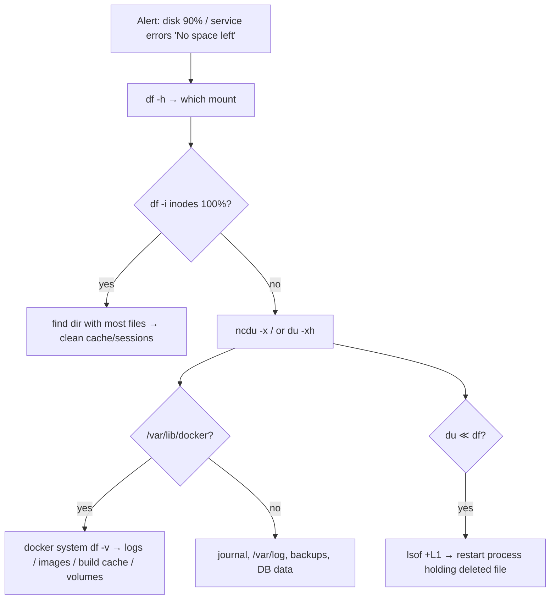

# Linux Essentials - Disk, Inodes & Log Rotation Troubleshooting

> [!info] Deep dive of [[Linux Essentials]]

> [!abstract] TL;DR
> "No space left on device" takes down Postgres, Redis persistence, Docker builds and n8n on small VPSs. Triage:
> 1. **`df -h`**: which filesystem is full.
> 2. **`df -i`**: inodes exhausted (millions of tiny files)?
> 3. **`du`/`ncdu`**: what's big.
> 4. **`lsof +L1`**: deleted-but-open files still holding space.
> 5. **`docker system df`**: images, build cache, container logs, volumes.
>
> **Usual culprits**: Docker container logs without limits, build cache and dangling images, Postgres WAL retained by a stuck replication slot, n8n binary data/executions, journald, backups written locally, and core dumps.
>
> **Prevent it**: Docker log limits (`max-size`/`max-file`), journald `SystemMaxUse`, logrotate for app logs, scheduled pruning, alerts at 80%/90%, and data on a separate volume where possible.

## Concept
| Symptom | Check | Likely cause |
|---|---|---|
| `df -h` shows 100% | `du -xh --max-depth=1 / \| sort -h` | Logs, Docker data, DB, backups |
| `df -h` OK but writes fail | `df -i` | Inode exhaustion (cache/session files, node_modules, mail queue) |
| `du` total ≪ `df` used | `lsof +L1` | Deleted files still open (rotated logs held by process) |
| `/var/lib/docker` huge | `docker system df -v` | Images, build cache, container logs, volumes |
| Postgres disk growth | `pg_replication_slots`, `pg_wal` size | Inactive slot, archiving failing, bloat |
| `/var/log/journal` large | `journalctl --disk-usage` | No journald size cap |
| Root FS full, data elsewhere | `findmnt` | Container writes going to rootfs instead of volume |

## How It Works


## Practical Usage
**Triage commands**:
```bash
df -hT                                            # usage by filesystem
df -i                                             # inode usage
sudo du -xh --max-depth=1 / 2>/dev/null | sort -h | tail -15
sudo ncdu -x /                                    # interactive (apt install ncdu)
sudo lsof +L1 | sort -k7 -n | tail                # deleted but open files (size column)
docker system df -v                               # Docker space by type
sudo find / -xdev -type f -size +500M -exec ls -lh {} \; 2>/dev/null
```
**Find inode hogs**:
```bash
sudo find / -xdev -type f | cut -d/ -f2-4 | sort | uniq -c | sort -n | tail -10
```
**Docker cleanup** (review before running on production hosts):
```bash
docker image prune -a --filter "until=168h"       # unused images older than 7 days
docker builder prune --filter "until=72h"         # build cache
docker container prune                            # stopped containers
# ⚠ never 'docker volume prune' blindly: it deletes unattached volumes (possibly databases)
truncate -s 0 $(docker inspect --format='{{.LogPath}}' <container>)   # emergency: empty a huge log
```
**Cap Docker logs globally** (`/etc/docker/daemon.json`, applies to new containers):
```json
{ "log-driver": "local", "log-opts": { "max-size": "20m", "max-file": "5" } }
```
**Cap journald** (`/etc/systemd/journald.conf.d/size.conf`):
```ini
[Journal]
SystemMaxUse=500M
MaxRetentionSec=30day
```
```bash
sudo systemctl restart systemd-journald && journalctl --vacuum-size=500M
```
**logrotate for app logs written to files**:
```conf
# /etc/logrotate.d/myapp
/var/log/myapp/*.log {
  daily
  rotate 14
  compress
  delaycompress
  missingok
  notifempty
  copytruncate          # for apps that don't reopen files on signal
}
```
**Postgres WAL check**:
```sql
select slot_name, active, pg_size_pretty(pg_wal_lsn_diff(pg_current_wal_lsn(), restart_lsn)) as retained
from pg_replication_slots;
```
**Alert at 80% / 90%** (simple cron or monitoring):
```bash
use=$(df --output=pcent / | tail -1 | tr -dc '0-9'); [ "$use" -ge 85 ] && \
  curl -fsS -m 10 "https://api.telegram.org/bot$TG/sendMessage" -d chat_id=$CHAT -d text="⚠️ $(hostname) disk ${use}%"
```
**Wrong way**:
```text
❌ rm on a 20 GB log still written by the app      → space not freed (file held open); use truncate or restart
❌ docker system prune -a --volumes on prod        → deletes database volumes not attached at that moment
❌ Deleting files inside /var/lib/postgresql/data  → corrupt database
❌ Backups written to the same disk                 → fills disk and dies with the server
```

## Patterns & Anti-patterns
| Pattern | When | Anti-pattern to avoid |
|---|---|---|
| Global Docker log limits in daemon.json | Every Docker host | Default unlimited json-file logs |
| Separate block volume for DB/data | Growing data | Everything on a 40 GB root disk |
| Scheduled image/build-cache pruning | CI/build hosts, Coolify | Manual cleanup during outages |
| Alerts at 80/90% + growth trend | Always | Finding out from "No space left" errors |
| `max_slot_wal_keep_size` for Postgres | Replication/CDC | Unbounded WAL retention |
| n8n execution pruning + filesystem/S3 binary mode | n8n hosts | Binary data in DB, no pruning |
| Off-box backups only | Backups | Local `/backups` growing forever |

## Performance & Trade-offs
- **`local` log driver** compresses and rotates automatically and is more efficient than `json-file`, but external log tools that read raw files may need adjusting.
- **Aggressive pruning** speeds up recovery from full disks but forces image re-pulls (slower deploys, Docker Hub rate limits). Keep recent images.
- **Inode-heavy workloads** (caches with millions of files) may need a filesystem with more inodes, or storing data in objects/DB instead.
- **Disk at 100%** can corrupt write-in-progress files (Redis AOF, SQLite). Keep 10–15% headroom.

## Tips & Reminders
> [!tip] In ZP's stack
> - **Coolify servers**: Coolify has cleanup settings (Docker cleanup thresholds/schedules). Enable them, and still set daemon log limits ([[Coolify - Operations, Backups & Hardening]]).
> - **Hostinger KVM plans** have fixed disk. Track growth monthly (DB, uploads, n8n), and upgrade or move uploads to R2/Supabase Storage before 80%.
> - **n8n**: `EXECUTIONS_DATA_PRUNE=true`, max age 7–14 days, and binary data in filesystem/S3 mode ([[n8n - Binary Data, Files & Data Tables]]).

- Check `/var/lib/docker/overlay2` growth after many deploys. Old images accumulate.
- Watch `/tmp` on hosts where apps write large temp files (PDF generation, uploads).
- Core dumps: `ulimit -c 0` or limit via systemd-coredump config.
- After freeing space, verify services recovered (Postgres may need a restart if it hit ENOSPC on WAL).

## Version Notes
| Version / date | Change relevant here |
|---|---|
| Docker 1.13+ | `docker system df/prune`. `local` log driver (18.09+) |
| systemd-journald | `SystemMaxUse`, `MaxRetentionSec` (long-standing) |
| PostgreSQL 13 | `max_slot_wal_keep_size` caps WAL retained by slots |
| Ubuntu 24.04 LTS | Current base for most VPS images ([[Linux Essentials]]) |
| Docker Engine 29.x | containerd image store default, so `docker system df` reporting differs slightly ([[Docker]]) |

> [!warning] Unverified — check before relying on this
> Coolify's current Docker cleanup settings names and defaults weren't verified this run. Check your Coolify server settings.

## Critical Issues & Gotchas
> [!danger] Full disk corrupts or stops databases
> Postgres refuses writes (or crashes) when WAL can't be written. Redis fails AOF/RDB saves and may stop accepting writes, and SQLite-backed tools can corrupt. A disk-full incident on a shared VPS takes down every client app at once. Monitor disk with alerts, cap logs, keep headroom, and put databases on their own volume ([[PostgreSQL - Logical Replication & Change Data Capture]]).

> [!danger] Destructive "cleanup" commands
> Under pressure, `docker system prune -a --volumes`, `rm -rf` in data directories, or deleting "old" Postgres WAL files by hand cause irreversible data loss. Free space safely: truncate logs, prune images/build cache, vacuum journals, drop abandoned replication slots, and only then consider anything else.

- **Deleted-but-open files** keep consuming space until the process restarts. Check `lsof +L1`.
- **Overlay filesystem writes**: containers writing to paths not mounted as volumes fill `/var/lib/docker`.
- **Snap packages** keep old revisions (`snap set system refresh.retain=2`).
- **Mail queues** (postfix on hosts sending cron mail) can create millions of small files, exhausting inodes.

## Related
- [[Linux Essentials]]
- [[Linux Essentials - Performance Troubleshooting with top, vmstat & iostat]] — CPU/memory/IO triage
- [[Linux Essentials - systemd, Logs & Troubleshooting]] — journald and service logs
- [[Docker - Logging, Metrics & Resource Limits on a VPS]] — log drivers and metrics
- [[PostgreSQL - Logical Replication & Change Data Capture]] — slots retaining WAL
- [[Linux Essentials - Backups with restic & Off-Site Storage]] — off-box backups
- [[n8n - Binary Data, Files & Data Tables]] — n8n disk usage

## References
- https://docs.docker.com/engine/logging/drivers/local/
- https://docs.docker.com/reference/cli/docker/system/prune/
- https://www.freedesktop.org/software/systemd/man/latest/journald.conf.html
- https://manpages.ubuntu.com/manpages/noble/man8/logrotate.8.html
- https://www.postgresql.org/docs/current/runtime-config-replication.html
