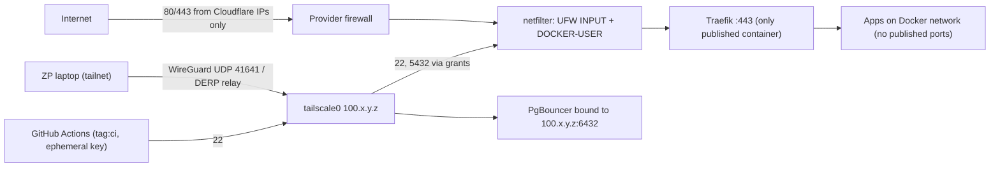

# Linux Essentials - Networking, Firewalls & Tailscale

> [!info] Deep dive of [[Linux Essentials]]

> [!abstract] TL;DR
> On a Docker VPS, three layers decide reachability:
> - the **provider firewall** (Hostinger panel);
> - the **host netfilter rules** (UFW/nftables, where **Docker's own rules run before UFW**);
> - the **bind address** of each service.
>
> The reliable pattern:
> - publish only Traefik on 80/443 (ideally from **Cloudflare IP ranges only**, or no inbound at all via Tunnel);
> - bind everything else to `127.0.0.1`, the Docker network or the **Tailscale IP**;
> - reach admin/DB ports over Tailscale with tag-based **grants**.
>
> Verify from the outside (`nmap`), not with `ufw status`.

## Concept
| Layer | Tool | What it decides | Gotcha |
|---|---|---|---|
| Provider edge | Hostinger/VPS firewall | Packets reaching the VM | Often forgotten when rules change, and it does nothing for traffic inside the provider network |
| Netfilter (kernel) | nftables (iptables-nft on Ubuntu), UFW frontend | Per-packet accept/drop | Docker inserts NAT/FORWARD rules that bypass UFW's INPUT rules |
| Socket bind | `0.0.0.0` vs `127.0.0.1` vs `100.x` (tailnet) | Which interfaces listen at all | `ports: ["5432:5432"]` binds all interfaces, IPv4 and IPv6 |
| Overlay | Tailscale (WireGuard) | Private mesh between your devices/servers | Access is controlled by the tailnet policy, not UFW |
| Edge proxy | Cloudflare proxy/Tunnel | Public HTTP entry | Origin IP must not be reachable directly, or the WAF is bypassed |

**Why Docker bypasses UFW**: published ports are DNAT'ed in `PREROUTING` and forwarded through Docker's `FORWARD` chains, so they never hit UFW's `INPUT` rules. Filtering for container traffic belongs in the **`DOCKER-USER`** chain, or you avoid publishing.

**Tailscale building blocks**:

| Feature | Use |
|---|---|
| Tags (`tag:server`, `tag:db`, `tag:ci`) | Identity for machines, owned by admins |
| Grants (recommended) / ACLs (legacy, still supported) | Who can reach what, on which ports |
| Tailscale SSH | SSH authenticated by tailnet identity (optional, with check mode) |
| `tailscale serve` | Expose a local port (e.g. Grafana) only to the tailnet, with HTTPS |
| Subnet router / exit node | Reach non-Tailscale networks, or route egress |
| Auth keys (tagged, ephemeral, pre-approved) | Unattended servers, CI runners |
| Headscale | Self-hosted control server (open source) |

## How It Works


## Practical Usage
**Bind instead of publish** (Compose):
```yaml
services:
  postgres:
    ports: ["127.0.0.1:5432:5432"]          # host-local only (SSH tunnel / local tools)
  pgbouncer:
    ports: ["100.101.102.103:6432:6432"]    # only the Tailscale IP of this server
  grafana:
    expose: ["3000"]                        # no host port at all; reach via `tailscale serve` or Traefik + Access
```
**Filter Docker-published traffic in `DOCKER-USER`** (persist via `/etc/ufw/after.rules` or a systemd unit):
```bash
# drop new external connections to published ports except 80/443 (established traffic unaffected)
# order matters: DOCKER-USER ends with a default RETURN, so insert (-I) — the last insert ends up on top
iptables -I DOCKER-USER -i eth0 -m conntrack --ctstate NEW -j DROP
iptables -I DOCKER-USER -i eth0 -p tcp -m conntrack --ctorigdstport 443 --ctstate NEW -j RETURN
iptables -I DOCKER-USER -i eth0 -p tcp -m conntrack --ctorigdstport 80  --ctstate NEW -j RETURN
iptables -L DOCKER-USER -n -v --line-numbers
```
**Allow 80/443 only from Cloudflare** (nftables set refreshed by cron):
```bash
#!/usr/bin/env bash
set -euo pipefail
v4=$(curl -fsS https://www.cloudflare.com/ips-v4 | paste -sd, -)
v6=$(curl -fsS https://www.cloudflare.com/ips-v6 | paste -sd, -)
nft -f - <<EOF
table inet cfedge {
  set cf4 { type ipv4_addr; flags interval; elements = { $v4 } }
  set cf6 { type ipv6_addr; flags interval; elements = { $v6 } }
  chain input {
    type filter hook input priority -10; policy accept;
    tcp dport { 80, 443 } ip saddr != @cf4 drop
    tcp dport { 80, 443 } ip6 saddr != @cf6 drop
  }
}
EOF
```
(For Docker-published 80/443, apply the same set in `DOCKER-USER`, or skip inbound entirely with a Cloudflare Tunnel.)

**Tailnet policy with grants**:
```json
{
  "tagOwners": { "tag:server": ["autogroup:admin"], "tag:db": ["autogroup:admin"], "tag:ci": ["autogroup:admin"] },
  "grants": [
    { "src": ["autogroup:admin"], "dst": ["tag:server", "tag:db"], "ip": ["22", "443", "6432"] },
    { "src": ["tag:ci"],          "dst": ["tag:server"],           "ip": ["22"] },
    { "src": ["tag:server"],      "dst": ["tag:db"],               "ip": ["6432"] }
  ]
}
```
```bash
tailscale up --auth-key="$TS_AUTHKEY" --advertise-tags=tag:server   # tagged key: no key expiry tied to a person
tailscale serve --bg --https=443 http://127.0.0.1:3000               # Grafana for the tailnet only
```
**Troubleshooting kit**:
```bash
ss -tulpn                                   # what listens where (0.0.0.0 vs 127.0.0.1 vs 100.x)
ip -br addr && ip route                     # interfaces and routes (docker0, br-*, tailscale0)
nft list ruleset | less                     # the real rules (UFW + Docker + yours)
conntrack -L -p tcp --dport 443 | head      # live connections (conntrack-tools)
tcpdump -ni any port 5432                   # is traffic arriving at all?
curl -sv --resolve app.client.my:443:203.0.113.10 https://app.client.my/health   # bypass DNS/CDN
nmap -Pn -p- 203.0.113.10                   # from OUTSIDE the server: the only truth
tailscale status && tailscale ping server1 && tailscale netcheck
```
**Wrong way**:
```text
❌ ufw deny 5432 + ports: ["5432:5432"]       → still public; Docker NAT skips UFW
❌ Origin open on 443 to the world            → attackers bypass Cloudflare WAF via the IP
❌ Personal Tailscale login on servers         → node key expires/leaves with the person; use tagged auth keys
❌ "Allow all" default ACL kept on a shared tailnet → every client device can reach every server
```

## Patterns & Anti-patterns
| Pattern | When | Anti-pattern to avoid |
|---|---|---|
| Publish only the reverse proxy | Docker hosts | Publishing DB/Redis/admin ports |
| Bind admin services to `127.0.0.1` or the tailnet IP | Postgres, PgBouncer, dashboards | Relying on firewall rules alone |
| Cloudflare-only 80/443, or Tunnel | Proxied sites | Open origin plus "security through obscure IP" |
| Tagged servers + grants least privilege | Tailnet with clients/CI | Default allow-all policy |
| Ephemeral, tagged auth keys for CI runners | Deploy pipelines | Long-lived SSH keys in CI exposed to the internet |
| External scan after every infra change | Always | Trusting `ufw status` |
| IPv6 handled explicitly | Dual-stack VPS | Rules for IPv4 only, services open on IPv6 |

## Performance & Trade-offs
- **Tailscale direct vs relay**: direct WireGuard (UDP 41641) adds ~1 ms overhead. Behind strict NAT it falls back to DERP relays (Singapore for MY) with added latency, so check `tailscale netcheck`.
- **MTU**: WireGuard lowers effective MTU (1280 on Tailscale). Large Postgres responses over misconfigured paths can stall. Check for PMTU issues if bulk transfers hang.
- **nftables sets** scale to thousands of CIDRs with O(1)-ish lookups, which is far better than one rule per Cloudflare range.
- **conntrack table**: high-connection servers (WebSockets, SSE) can hit `nf_conntrack_max` and drop packets. Monitor `nf_conntrack_count` and raise the limit if needed.
- **Tailscale SaaS vs Headscale**: SaaS is less ops but means a third-party control plane. Headscale is self-hosted and one more critical service to run, so for a solo founder SaaS is usually the right call.

## Tips & Reminders
> [!tip] In ZP's stack
> - **Per client VPS**:
>   - Hostinger firewall allows 80/443 (Cloudflare ranges) + UDP 41641.
>   - Only Traefik is published.
>   - SSH and DB/pooler ports are on `tailscale0` only.
>   - Coolify reaches servers over Tailscale IPs ([[Coolify - Operations, Backups & Hardening]]).
> - **Client access**: share a specific node or use `tailscale serve` instead of adding clients to your whole tailnet. For staff dashboards, Cloudflare Access works better ([[Cloudflare - Zero Trust Tunnel & Access]]).
> - **Break-glass**: keep the provider's web console login (with 2FA) documented in case Tailscale or SSH config locks you out.

- Disable key expiry only on tagged server nodes. Keep it on for laptops and phones.
- After Docker or UFW upgrades, re-run `nft list ruleset` and an external `nmap`. Rule ordering changes have reopened ports before.
- Use `ss -tnp state established '( dport = :5432 )'` to see who is connected to Postgres right now.
- Record every published port and its reason in the server's `OPERATIONS.md` ([[Linux Essentials - VPS Hardening Runbook]]).

## Version Notes
| Version / date | Change relevant here |
|---|---|
| Ubuntu 20.04+ | iptables uses the nftables backend (iptables-nft). UFW writes through it |
| Docker 17.06+ | `DOCKER-USER` chain for user rules evaluated before Docker's |
| Tailscale (2025-05-29) | Grants GA. ACLs continue to work indefinitely, but new features land in grants only |
| Docker Engine 29 (2025–26) | Native nftables firewall backend (experimental) ([[Docker]]) |

> [!warning] Unverified — check before relying on this
> How Docker 29's experimental nftables backend interacts with UFW and `DOCKER-USER`, and the current Tailscale client version, weren't verified. Test on a staging VPS before switching backends.

## Critical Issues & Gotchas
> [!danger] Published container ports are public regardless of UFW
> The most common SME breach path on Docker VPSs is an exposed Postgres/Redis/Mongo with weak credentials, found by scanners within hours, then dumped or ransomed. UFW shows "deny" while Docker forwards the port. Don't publish, bind to localhost/tailnet, filter in `DOCKER-USER`, and scan externally after every deploy.

> [!danger] Locking yourself out
> Enabling a default-deny firewall before allowing your SSH path, a bad nftables reload, or tailnet policy mistakes can cut access to production. Apply firewall changes with a timed rollback (`at now + 5 minutes <<< 'ufw disable'`, or `nft` with a backup ruleset restore), and keep provider console access ready.

- **IPv6 surprises**: Docker can publish on `::` and UFW IPv6 may be disabled (`IPV6=no` in `/etc/default/ufw`). Test the v6 address too.
- **Cloudflare range changes**: refresh the IP sets on a schedule. Stale sets block legitimate edge traffic (a site outage that looks like a Cloudflare issue).
- **DNS inside containers** uses Docker's embedded resolver (127.0.0.11). Host `/etc/hosts` and MagicDNS names don't automatically resolve inside containers.
- **Tailscale and Docker subnets** can overlap with client networks (172.16/12). Pick explicit Docker address pools to avoid routing conflicts.

## Related
- [[Linux Essentials]]
- [[Linux Essentials - VPS Hardening Runbook]] — first-boot hardening checklist
- [[Docker - Networking & Volumes]] — bridge networks, published ports, internal networks
- [[Cloudflare - Zero Trust Tunnel & Access]] — no-inbound alternative for web and admin
- [[Network Security]] — layered network defenses
- [[PostgreSQL - Connection Pooling with Supavisor & PgBouncer]] — keeping DB/pooler ports private

## References
- https://docs.docker.com/engine/network/packet-filtering-firewalls/
- https://wiki.nftables.org/wiki-nftables/index.php/Main_Page
- https://tailscale.com/kb/1467/grants-vs-acls
- https://tailscale.com/docs/reference/syntax/grants.md
- https://www.cloudflare.com/ips/
