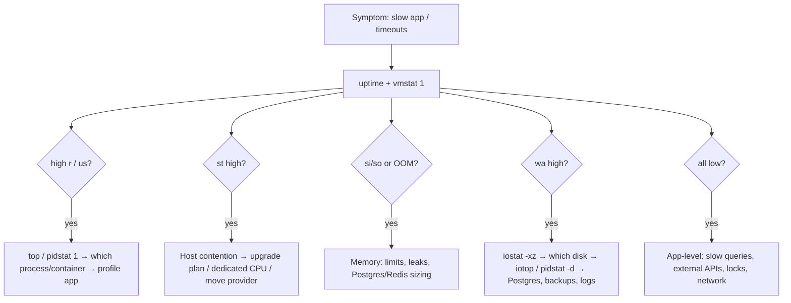

# Linux Essentials - Performance Troubleshooting with top, vmstat & iostat

> [!info] Deep dive of [[Linux Essentials]]

> [!abstract] TL;DR
> When "the server is slow", use the **USE method**: for each resource (CPU, memory, disk, network), check **Utilization, Saturation, Errors**. In 60 seconds:
> 1. `uptime` (load) → `top`/`htop` (who's using CPU/RAM)
> 2. `vmstat 1` (run queue `r`, swap `si/so`, iowait `wa`, **steal `st`**)
> 3. `iostat -xz 1` (disk `%util`, `await`)
> 4. `free -m` + `dmesg -T | tail` (OOM kills)
> 5. `docker stats` (which container)
> 6. `cat /proc/pressure/*` (PSI)
>
> **Common VPS culprits**: noisy-neighbour **CPU steal**, **swapping** from no memory limits, **disk iowait** from Postgres/backups/logs, a single runaway container (n8n workflow, Puppeteer PDF job), and connection storms.
> Fix the bottleneck you measured, not the one you suspect.

## Concept
| Resource | Utilization | Saturation | Errors |
|---|---|---|---|
| CPU | `top` %us/%sy, `mpstat -P ALL 1` | `vmstat` `r` > cores, load avg, `/proc/pressure/cpu` | — |
| CPU (virtualized) | — | **`st` (steal)** > 5–10% = host contention | — |
| Memory | `free -m` used/available | `si/so` swap activity, `/proc/pressure/memory` | `dmesg` OOM killer |
| Disk | `iostat -x` `%util` | `aqu-sz`, `await` ms, `wa` in vmstat, `/proc/pressure/io` | `dmesg` I/O errors |
| Network | `sar -n DEV 1`, `iftop` | `ss -s` (sockets), drops in `ip -s link` | retransmits (`nstat`) |

**Reading key numbers**:

| Metric | Healthy (small VPS) | Problem when |
|---|---|---|
| Load average | ≤ number of vCPUs | Sustained > 1.5× vCPUs |
| `wa` (iowait) | < 5% | > 20% sustained |
| `st` (steal) | ~0% | > 10%: neighbours stealing CPU |
| Swap `si/so` | 0 | Any sustained non-zero |
| Disk `await` (SSD/NVMe) | < 5 ms | > 20–50 ms |
| `available` memory | > 15% of RAM | < 5%, OOM kills |

## How It Works


## Practical Usage
**60-second checklist**:
```bash
uptime                                  # load averages 1/5/15
vmstat 1 5                              # r b swpd free si so bi bo us sy id wa st
mpstat -P ALL 1 3                       # per-CPU (sysstat)
pidstat 1 5                             # per-process CPU
pidstat -d 1 5                          # per-process disk I/O
iostat -xz 1 3                          # per-device utilization/latency
free -m                                 # memory + available
dmesg -T | grep -iE 'oom|killed process|i/o error' | tail
cat /proc/pressure/cpu /proc/pressure/memory /proc/pressure/io   # PSI stall percentages
docker stats --no-stream --format 'table {{.Name}}\t{{.CPUPerc}}\t{{.MemUsage}}\t{{.BlockIO}}'
ss -s                                   # socket summary (connection storms)
```
**Install tools** (Ubuntu):
```bash
sudo apt install -y sysstat htop iotop
sudo sed -i 's/ENABLED="false"/ENABLED="true"/' /etc/default/sysstat && sudo systemctl enable --now sysstat   # sar history
sar -u -f /var/log/sysstat/sa$(date -d yesterday +%d)      # yesterday's CPU, find when slowness started
```
**Map a hot PID to a container**:
```bash
pid=12345; cat /proc/$pid/cgroup | grep -o 'docker-[0-9a-f]\{12\}' | head -1
docker ps --format '{{.ID}} {{.Names}}' | grep <first-12-chars>
```
**Typical fixes by finding**:
```text
CPU (us) high, one container      → profile app (Node --cpu-prof), cap with cpus:, move job to worker
CPU steal high                    → noisy neighbour: bigger plan / dedicated vCPU / different provider
Swap + OOM kills                  → set mem_limit per container, Postgres shared_buffers/work_mem sane, Redis maxmemory
iowait high, Postgres             → slow queries/missing indexes, checkpoints, autovacuum; move backups off-peak
iowait high, backups/logs         → schedule restic off-peak with ionice, cap logs
Many TIME_WAIT/ESTAB sockets      → connection pooling (Supavisor/PgBouncer), keep-alive, fix leaks
```
**Wrong way**:
```text
❌ Upgrading the VPS without measuring                   → same problem at higher cost (often a bad query)
❌ Reading load average without vCPU count                → load 4 on 8 vCPUs is fine; on 2 vCPUs it's not
❌ Killing processes blindly in production                → Postgres crash recovery, lost jobs
❌ Ignoring st (steal) on budget VPS plans                → chasing app bugs that are host contention
```

## Patterns & Anti-patterns
| Pattern | When | Anti-pattern to avoid |
|---|---|---|
| USE method checklist | Every incident | Guessing |
| sysstat/sar history enabled | All servers | No data on "when did it start" |
| Container CPU/memory limits | Shared VPS | One container starving all |
| Heavy jobs (PDF, AI, imports) in workers with limits | Mixed workloads | Doing them in the web process |
| Off-peak schedules with `nice`/`ionice` | Backups, reports | Backups at peak hours |
| Prometheus node_exporter + alerts | Ongoing | SSH-only firefighting ([[Docker - Logging, Metrics & Resource Limits on a VPS]]) |
| Measure → change one thing → re-measure | Tuning | Many simultaneous tweaks |

## Performance & Trade-offs
- **Monitoring overhead**: sysstat/node_exporter cost almost nothing. `perf`/profilers have overhead, so use them briefly.
- **Swap**: a small swap file prevents abrupt OOM kills, but heavy swapping destroys latency. Prefer memory limits and right-sizing.
- **Vertical scaling** (bigger VPS) is often the cheapest fix for SME workloads once you've confirmed the resource is genuinely saturated, not misused.
- **Dedicated vCPU plans** cost more but remove steal variability. Consider them for latency-sensitive clients (POS, WhatsApp bots at peak).

## Tips & Reminders
> [!tip] In ZP's stack
> - **Typical Coolify VPS stack** (Next.js + Postgres/Supabase-self-hosted + n8n + Redis): set memory limits per container, give Postgres predictable memory, and run n8n workers with concurrency caps. Most "slow server" tickets are one runaway workflow or query ([[Redis - Observability, Slow Log & Latency Troubleshooting]]).
> - **Hostinger KVM plans** share hosts. Track `st` over time in Grafana, and use it as evidence when requesting migration or upgrading.
> - **First query check**: `pg_stat_statements` top total time before touching infrastructure ([[PostgreSQL - Query Planning & EXPLAIN]]).

- Keep a runbook snippet with the 60-second checklist in each client's ops docs.
- Correlate with app metrics (p95 latency, queue depth) to confirm cause and effect.
- `dmesg` OOM entries name the killed process. Check after unexplained restarts.
- Use PSI (`/proc/pressure`) for early warning: it measures time tasks stall on CPU/memory/IO.

## Version Notes
| Version | Change relevant here |
|---|---|
| Linux 4.20 | PSI (`/proc/pressure`) |
| sysstat 12.x | `iostat -x` columns renamed (`aqu-sz`, `r_await`, `w_await`) |
| Ubuntu 24.04 LTS | cgroup v2 by default (container resource accounting) |
| Docker Engine 29.x | `docker stats` with cgroup v2 metrics ([[Docker]]) |

> [!warning] Unverified — check before relying on this
> Hostinger KVM plan specifics (dedicated vs shared vCPU, steal behaviour) weren't verified this run. Measure on your own servers.

## Critical Issues & Gotchas
> [!danger] OOM killer takes out the database
> When memory runs out without container limits, the kernel OOM killer picks the largest process: often Postgres or Redis. That causes crash recovery, failed transactions, and downtime for every app on the VPS. Set per-container memory limits, size Postgres/Redis memory explicitly, keep a small swap buffer, and alert on OOM events.

> [!danger] Misdiagnosing host contention as an application bug
> On shared VPS plans, high CPU steal makes everything slow intermittently, regardless of code quality. Teams waste days optimizing queries or blaming n8n. Check `st` first, record it over time, and move latency-critical clients to dedicated vCPU plans.

- **Load average includes uninterruptible I/O waits** (`D` state), so high load with low CPU often means disk problems.
- **`free` "used" includes cache**. Look at `available`, not `free`.
- **Container CPU % in `docker stats`** is relative to one core (200% = 2 cores).
- **Short spikes** are invisible in 1-minute averages. Use 1-second sampling during incidents.

## Related
- [[Linux Essentials]]
- [[Linux Essentials - Disk, Inodes & Log Rotation Troubleshooting]] — disk space incidents
- [[Linux Essentials - systemd, Logs & Troubleshooting]] — service logs and journals
- [[Docker - Logging, Metrics & Resource Limits on a VPS]] — limits and metrics stack
- [[Redis - Observability, Slow Log & Latency Troubleshooting]] — Redis-specific latency
- [[Node.js - Performance & Diagnostics]] — profiling Node processes

## References
- https://www.brendangregg.com/usemethod.html
- https://www.brendangregg.com/Articles/Netflix_Linux_Perf_Analysis_60s.pdf
- https://man7.org/linux/man-pages/man8/vmstat.8.html
- https://docs.kernel.org/accounting/psi.html
- https://github.com/sysstat/sysstat
