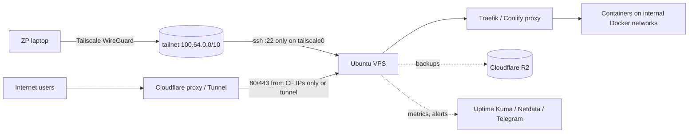

# Linux Essentials - VPS Hardening Runbook

> [!info] Deep dive of [[Linux Essentials]]

> [!abstract] TL;DR
> This is a repeatable ~45-minute runbook for a fresh Ubuntu LTS VPS (Hostinger KVM) before it hosts client workloads.
> - **SSH**: lock down the provider account, then key-only SSH as a non-root user, reachable **only via Tailscale** (or a Cloudflare Tunnel).
> - **Firewall**: default-deny, plus **close the Docker-bypasses-UFW hole**.
> - **Patching**: automatic security updates with a reboot window.
> - **Monitoring**: log retention, monitoring and alerts.
> - **Verification**: run `lynis` and `ss -tulpn` from the outside. Write it down per server in `OPERATIONS.md`.

## Concept

### Layers and what each stops
| Layer | Control | Stops |
|---|---|---|
| Provider account | 2FA, API tokens scoped, snapshots, provider firewall | Console takeover, ransom by deleting VPS |
| Network edge | Provider firewall + UFW/nftables default-deny, Tailscale for admin, Cloudflare proxy/Tunnel for web | Internet-wide SSH brute force, scanner exploits, origin DDoS |
| SSH | Keys only, no root password, `AllowUsers`, modern ciphers (defaults), MaxAuthTries | Credential stuffing, weak-password compromise |
| OS patching | unattended-upgrades, needrestart, Livepatch | Known CVEs (OpenSSH, kernel, glibc) |
| Services | Only needed listeners; DBs bound to localhost/Docker network | Exposed Postgres/Redis/Mongo (ransom bots scan within minutes) |
| Containers | No `--privileged`, no Docker socket mounts, log rotation, non-root images | Container escape, disk-full outage |
| Detection | journald retention, auth log alerts, CrowdSec/fail2ban, uptime + disk alerts | Silent compromise, slow outages |
| Recovery | Off-provider backups + tested restores, rebuild script | Ransomware, provider incident |

## How It Works

- The public interface exposes **only 80/443**, ideally restricted to Cloudflare IP ranges, or nothing at all with a Tunnel.
- SSH, the Coolify UI, DB admin and monitoring are reachable only on the tailnet or behind Cloudflare Access.

## Practical Usage

### 0. Provider (before first login)
- Enable **2FA** on the Hostinger account, remove unused API tokens, choose Ubuntu LTS minimal and enable weekly snapshots.
- Provider firewall: allow 80/443 from anywhere, 22 temporarily from your IP only, and optionally **UDP 41641** for Tailscale direct connections.

### 1. Base system
```bash
apt update && apt full-upgrade -y && apt autoremove -y
timedatectl set-timezone Asia/Kuching && timedatectl set-ntp true
hostnamectl set-hostname vps-a.rarticle.internal

adduser --disabled-password --gecos "" zp && usermod -aG sudo zp
install -d -m 700 -o zp -g zp /home/zp/.ssh
cp /root/.ssh/authorized_keys /home/zp/.ssh/ && chown zp:zp /home/zp/.ssh/authorized_keys && chmod 600 /home/zp/.ssh/authorized_keys

# Swap for ≤ 4 GB RAM hosts (prevents OOM-kills during docker builds)
fallocate -l 4G /swapfile && chmod 600 /swapfile && mkswap /swapfile && swapon /swapfile
echo '/swapfile none swap sw 0 0' >> /etc/fstab && sysctl -w vm.swappiness=10
```

### 2. SSH hardening (drop-in file, keep a second session open while testing)
```bash
cat >/etc/ssh/sshd_config.d/10-hardening.conf <<'EOF'
PermitRootLogin prohibit-password      # Coolify needs root-by-key; set "no" if you use a non-root Coolify user
PasswordAuthentication no
KbdInteractiveAuthentication no
PubkeyAuthentication yes
AuthenticationMethods publickey
MaxAuthTries 3
LoginGraceTime 20
X11Forwarding no
AllowAgentForwarding no
ClientAliveInterval 300
ClientAliveCountMax 2
AllowUsers zp root@100.64.0.0/10 root@<coolify-control-plane-ip>
EOF
sshd -t && systemctl reload ssh      # Ubuntu 24.04 uses ssh.socket; port changes need: systemctl daemon-reload && systemctl restart ssh.socket
```
- Test the login from a **new** terminal before closing the old one. Use Ed25519 keys, ideally FIDO-backed (`ssh-keygen -t ed25519-sk`).

### 3. Tailscale for admin access
```bash
curl -fsSL https://tailscale.com/install.sh | sh     # or the apt repo; review scripts before piping to sh
tailscale up --ssh=false --advertise-tags=tag:server
```
- Afterwards, restrict 22 to `tailscale0` (step 4) and remove the provider-firewall rule for port 22.

### 4. Firewall: UFW + the Docker hole
```bash
ufw default deny incoming && ufw default allow outgoing
ufw allow in on tailscale0 to any port 22 proto tcp
ufw allow 80,443/tcp                 # or restrict to Cloudflare ranges / omit entirely with a Tunnel
ufw enable && ufw status verbose
```
- **Docker bypasses UFW**: `-p 5432:5432` inserts iptables rules ahead of UFW, so the port is public even though `ufw status` says deny.
  - Bind to localhost (`127.0.0.1:5432:5432`), or don't publish at all and use internal Docker networks ([[Docker - Networking & Volumes]]).
  - Or add rules to the `DOCKER-USER` chain (`/etc/ufw/after.rules`, or the `ufw-docker` helper).
```bash
# Verify from OUTSIDE (another machine), not from the server itself
nmap -Pn -p- --min-rate 2000 <public-ip>
```

### 5. Automatic security updates + reboots
```bash
apt install -y unattended-upgrades needrestart
dpkg-reconfigure -plow unattended-upgrades
cat >/etc/apt/apt.conf.d/52rarticle <<'EOF'
Unattended-Upgrade::Automatic-Reboot "true";
Unattended-Upgrade::Automatic-Reboot-Time "03:30";
Unattended-Upgrade::Remove-Unused-Kernel-Packages "true";
EOF
pro attach <token> && pro enable livepatch     # Ubuntu Pro: free for personal use on a few machines; kernel fixes without reboot
```

### 6. Brute-force and log retention
```bash
apt install -y fail2ban    # or CrowdSec (community blocklists + Traefik bouncer)
cat >/etc/fail2ban/jail.d/sshd.local <<'EOF'
[sshd]
enabled = true
backend = systemd
maxretry = 5
bantime = 1h
EOF
systemctl enable --now fail2ban

mkdir -p /etc/systemd/journald.conf.d
printf '[Journal]\nSystemMaxUse=1G\nMaxRetentionSec=90day\n' >/etc/systemd/journald.conf.d/retention.conf
systemctl restart systemd-journald
```

### 7. Kernel/network sysctls
```bash
cat >/etc/sysctl.d/90-hardening.conf <<'EOF'
net.ipv4.conf.all.rp_filter = 1
net.ipv4.conf.all.accept_redirects = 0
net.ipv6.conf.all.accept_redirects = 0
net.ipv4.conf.all.send_redirects = 0
net.ipv4.tcp_syncookies = 1
kernel.kptr_restrict = 2
kernel.dmesg_restrict = 1
fs.protected_hardlinks = 1
fs.protected_symlinks = 1
EOF
sysctl --system
```
- Don't set `net.ipv4.ip_forward = 0`, because Docker needs forwarding.

### 8. Docker daemon baseline
```json
{ "log-driver": "json-file", "log-opts": { "max-size": "10m", "max-file": "3" },
  "live-restore": true, "no-new-privileges": true }
```
- Never expose the Docker API on TCP (`-H tcp://0.0.0.0:2375` is root-RCE for the internet).
- Never mount `/var/run/docker.sock` into third-party containers unless they need it (Traefik/Coolify do; use a socket proxy where possible).

### 9. Verify and document
```bash
ss -tulpn                       # every listener must be expected
lynis audit system --quick      # review warnings, not the score
last -a | head; journalctl -u ssh --since "24 hours ago" | grep -c "Failed"
```
- Record in `OPERATIONS.md`: IPs, tailnet name, open ports, backup schedule, patch window, who has access, and the restore steps.

## Patterns & Anti-patterns
| Pattern | When | Anti-pattern to avoid |
|---|---|---|
| SSH only on the tailnet; public 22 closed | Always | Moving SSH to port 2222 and calling it hardened |
| Keys + `AuthenticationMethods publickey` | Always | Passwords "temporarily" enabled for a client's developer |
| Internal Docker networks; publish only via Traefik | Containers | `ports: ["5432:5432"]` because "UFW blocks it anyway" |
| Unattended security updates + auto reboot window + Livepatch | Single-VPS setups | Manual patching "when there's time" (= never) |
| Separate VPS per sensitive client | Client data with PDPA obligations | All clients on one host with shared root access |
| Rebuild script / documented runbook | Every server | Snowflake servers configured by memory |
| Off-provider backups (R2) + restore drills | Always | Provider snapshots as the only backup |

## Performance & Trade-offs
- **Tailscale vs Cloudflare Access for SSH**:
  - **Tailscale**: simple, any protocol, works during Cloudflare outages.
  - **Access**: browser SSH plus audit logs, but adds a dependency.
  - **Pick**: use one as primary and the other, or the provider console, as break-glass ([[Cloudflare - Zero Trust Tunnel & Access]]).
- **Auto-reboot** causes ~1 min of downtime at 03:30. That's acceptable for SME apps, but announce the window in SLAs. With Livepatch, reboots become rarer.
- **CrowdSec vs fail2ban**: CrowdSec shares crowd blocklists and can bounce at Traefik for HTTP attacks, but is heavier. fail2ban is enough for SSH-only protection once SSH is on the tailnet.
- **Strict CIS-level hardening** (AppArmor profiles, auditd rules, read-only mounts) adds maintenance. For a solo founder, the steps above give most of the risk reduction.

## Tips & Reminders
> [!tip]
> - **Keep a console path**: test Hostinger's VNC/serial console works **before** you lock down SSH.
> - **Remove `curl | sh` installers**, or download, read and pin them. Prefer apt repos with signed keys.
> - **Review weekly** (10 min): `apt list --upgradable`, failed logins, disk (`df -h`, `docker system df`), backup success, cert expiry.
> - **Offboarding**: rotate SSH keys and Coolify/API tokens when a freelancer or client developer leaves. Remove their keys from `authorized_keys` on every host.
> - **In ZP's stack**: every new Hostinger KVM gets steps 0–9, then [[Coolify]] (control plane on its own small VPS). Web traffic only via Cloudflare → [[Traefik]]. Nightly dumps to R2, Telegram alerts from Uptime Kuma.

## Version Notes
| Item | Note |
|---|---|
| Ubuntu 22.10+ / 24.04 | `ssh.socket` activation: port/ListenAddress changes need socket reload. Drop-ins in `sshd_config.d/` |
| Ubuntu 24.04 → 26.04 LTS | Upgrade on a cloned VPS first, after the .1 point release |
| OpenSSH 9.8 (2024-07) | Fixed regreSSHion (CVE-2024-6387, unauthenticated RCE on glibc). `PerSourcePenalties` added |
| OpenSSH 10.x (2025–2026) | DSA removed, post-quantum KEX default (mlkem768x25519). 2026 fixes for certificate-auth bypass (CVE-2026-35414, < 10.3) and auth-delay/DoS issues (< 10.4) |

> [!warning] Unverified — check before relying on this
> The 2026 OpenSSH CVE details come from secondary vulnerability databases. Check your distro's security notices (`ubuntu.com/security/notices`) for patched package versions. Distros backport fixes without changing the major version.

## Critical Issues & Gotchas
> [!danger] Exposed databases get wiped or ransomed within hours
> Bots continuously scan for open Redis (6379), Postgres (5432), MongoDB (27017) and Elasticsearch (9200). Unauthenticated or weak-password instances get dumped and replaced with ransom notes, or turned into crypto miners (Redis `CONFIG SET dir` tricks). The common cause on Docker hosts is a published port bypassing UFW. Verify with an external `nmap` after every deploy.

> [!danger] Locking yourself out
> A typo in `AllowUsers`, a UFW rule enabled before allowing your SSH path, or a Tailscale outage can lock you out. Always:
> keep an existing session open, run `sshd -t`, enable UFW only after adding the allow rule, test console access first, and document the break-glass procedure.

> [!warning] Gotchas
> - `PermitRootLogin no` breaks Coolify setups that connect as root. Configure Coolify's non-root user first, or restrict root-by-key to the control-plane IP.
> - `unattended-upgrades` only installs from `-security` by default. Docker CE and Tailscale come from third-party repos and need explicit origins, or manual updates.
> - IPv6: UFW handles it if `IPV6=yes`, but provider firewalls and Docker IPv6 publishing may differ. Scan IPv6 too.
> - Time drift breaks TOTP, TLS, backups and log correlation. Check that `timedatectl` shows `System clock synchronized: yes`.
> - fail2ban on Docker-published services must use the `DOCKER-USER` chain, or bans don't apply.

## Related
- [[Linux Essentials]]
- [[Linux Essentials - systemd, Logs & Troubleshooting]] — unit sandboxing, timers, incident triage
- [[Network Security]] — firewalls, exposure, SSH threat model
- [[Docker - Networking & Volumes]] — internal networks, port publishing
- [[Coolify - Operations, Backups & Hardening]] — control-plane hardening and backups
- [[Cloudflare - Zero Trust Tunnel & Access]] — closing inbound ports, Access for admin UIs
- [[Traefik]] — the only public entry point

## References
- Ubuntu security notices: https://ubuntu.com/security/notices
- OpenSSH release notes: https://www.openssh.com/releasenotes.html
- Docker and UFW / packet filtering: https://docs.docker.com/engine/network/packet-filtering-firewalls/
- Tailscale on Linux: https://tailscale.com/kb/1031/install-linux
- CIS Ubuntu Linux benchmark: https://www.cisecurity.org/benchmark/ubuntu_linux
- Lynis: https://cisofy.com/lynis/
